# T-RECAP

**Threshold-based Reduction and Encoding for Configurable Analysis Pipelines**

**A shared FPGA signal-processing architecture for finite audio, captured acceleration and recorded RF experiments.**

[](https://github.com/DatDinhh/T_RECAP/actions/workflows/phase2-source.yml)

[Whole-project architecture atlas](phase2/docs/architecture/system/README.md) | [Atlas PDF](phase2/docs/architecture/system/TRECAP_System_Architecture_Atlas.pdf) | [Three applications](#three-concrete-applications) | [Editable algorithm spec](phase2/docs/algorithm/README.md) | [Verification](#design-verification) | [Terms](#terms-and-abbreviations)

T-RECAP is an undergraduate senior design project that explores how an FPGA can transform a signal into a smaller spectral representation for a compatible downstream consumer. Its common processing path is **windowing, FFT, adjustable power threshold, IFFT and weighted overlap-add**. It returns two distinct outputs: a reconstructed signal called **Y**, and spectral power records called **TSP1**.

The architecture has input preparation, a shared spectral-processing engine, output encoders and host applications. Audio and acceleration use the real-sample input contract. Recorded RF uses the I/Q frontend to produce the same signed real-sample contract. These input paths, the common arithmetic and the host interfaces form one T-RECAP system design.

## Objective

**Reduce the spectral data a host receives and the work a compatible spectral consumer performs, while measuring the information lost at each threshold.** The project studies this tradeoff through audio preprocessing, motion analysis and RF monitoring. The reconstructed Y output supplies FLAC encoding, step-event detection and RF recovery. TSP1 supplies spectral inspection and compatible sparse consumers. Each application measures its own output quality and benefit.

There are two comparisons. Comparing the original signal with the thresholded result measures information loss. Comparing dense and sparse storage of the same thresholded values isolates the effect of representation on packet size and host processing time. A benefit in the second comparison does not establish that every application tolerates the loss in the first.

## Current implementation

| Input class | Preparation and FPGA entry | Application status |
|---|---|---|
| Audio file | Laptop prepares signed 12-bit samples. The TSH2 application feeds them into the shared core | Published source, physical capture evidence and audio visualization examples |
| Captured acceleration | A bounded sensor capture or an existing dataset is mapped to one real-valued axis and replayed through TSH2 | Published five-threshold FPGA captures and scored walking-event results from recorded XYZ data. Local sensor-capture helpers remain outside the public source package |
| Recorded RF | A CU8 file supplies unsigned I/Q byte pairs. The TRF1 application performs centering, interpolation and real-IF conversion in FPGA hardware | Published RF adapter, host source, fresh RTL regression and separately recorded physical results |

**One architecture is realized through two build configurations.** TSH2 instantiates the real-sample input path for audio and captured acceleration. TRF1 instantiates the I/Q frontend for recorded RF. Each has its own fitted image and host register contract. Profile selection happens when building and loading the image. The qualified workflows process finite records.

## Whole-project architecture

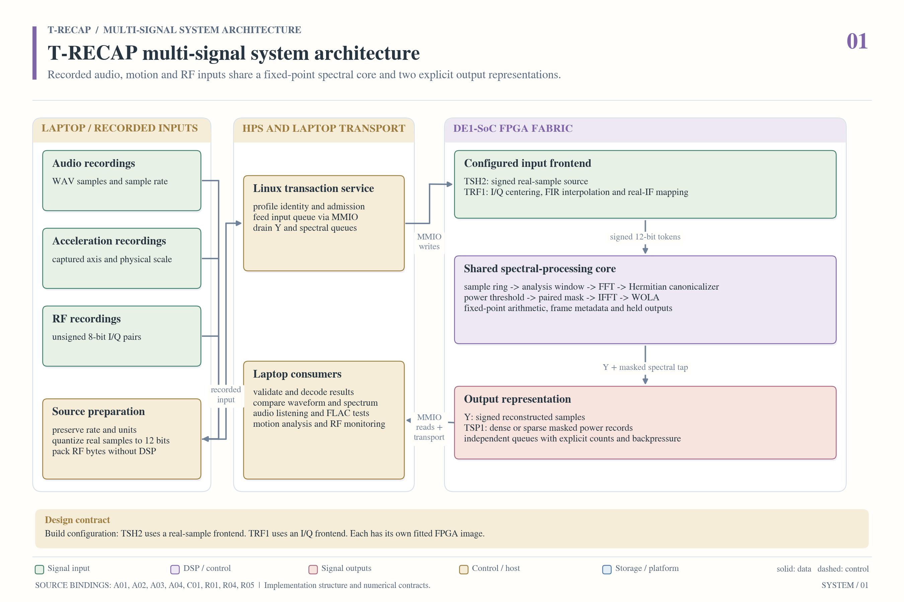

The laptop prepares the input and preserves its units and sample-rate metadata. HPS Linux handles transport, memory-mapped control and input/output FIFOs. Inside the FPGA, the selected application presents a signed 12-bit real stream to the common processor. The host receives Y and TSP1 independently, then visualizes or analyzes the output appropriate to its application.

The [complete atlas](phase2/docs/architecture/system/README.md) has 20 coordinated views, from system responsibilities to module internals, with academic pastel blocks and written descriptions. The [LaTeX PDF](phase2/docs/architecture/system/TRECAP_System_Architecture_Atlas.pdf) collects the views for presentation and review. PNG and editable SVG versions are included.

| View | Question it answers |
|---|---|
| [1. Whole system](phase2/docs/architecture/system/01-system-overview.png) | Where do the input files, laptop, HPS, FPGA and returned results fit together? |
| [2. Input profiles](phase2/docs/architecture/system/02-input-profiles.png) | How do audio, captured acceleration and RF reach the same real-sample boundary? |
| [3. Shared DSP](phase2/docs/architecture/system/03-shared-dsp.png) | What happens inside the FFT, threshold and reconstruction path? |
| [4. RF input adapter](phase2/docs/architecture/system/04-rf-input-adapter.png) | How do the I/Q histories, FIR MAC, mixer and quantizer produce real core samples? |
| [5. Outputs and consumers](phase2/docs/architecture/system/05-outputs-and-consumers.png) | How do waveform reconstruction and sparse spectral analysis serve different tasks? |
| [6. Host and transactions](phase2/docs/architecture/system/06-host-and-transactions.png) | How do files and commands move through HPS to FPGA registers and FIFOs? |
| [7. Control and backpressure](phase2/docs/architecture/system/07-control-and-backpressure.png) | How are configuration, stalls, completion and recovery handled? |
| [8. Platform and verification](phase2/docs/architecture/system/08-platform-and-verification.png) | Which clocks, resets and evidence boundaries apply to each part? |

<details>
<summary>2. Input profiles</summary>

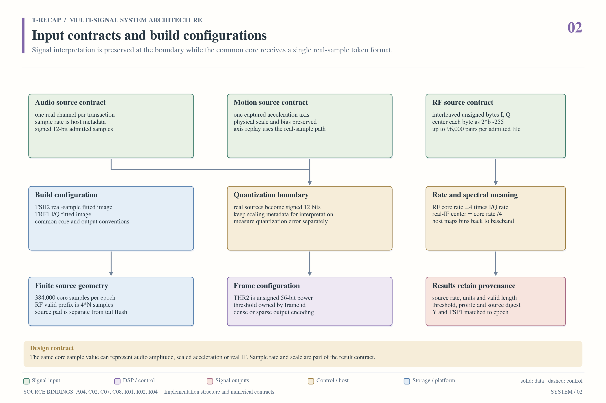

Audio preparation produces signed 12-bit real samples. The accelerometer workflow captures a bounded record, selects an axis on the host and reuses that same FPGA input. The RF input frontend converts CU8 I/Q pairs into the real-sample interface of the shared core. Sample rate and physical units remain application metadata. Padding a short record does not extend its measured observation interval.

</details>

<details>
<summary>3. Shared DSP</summary>

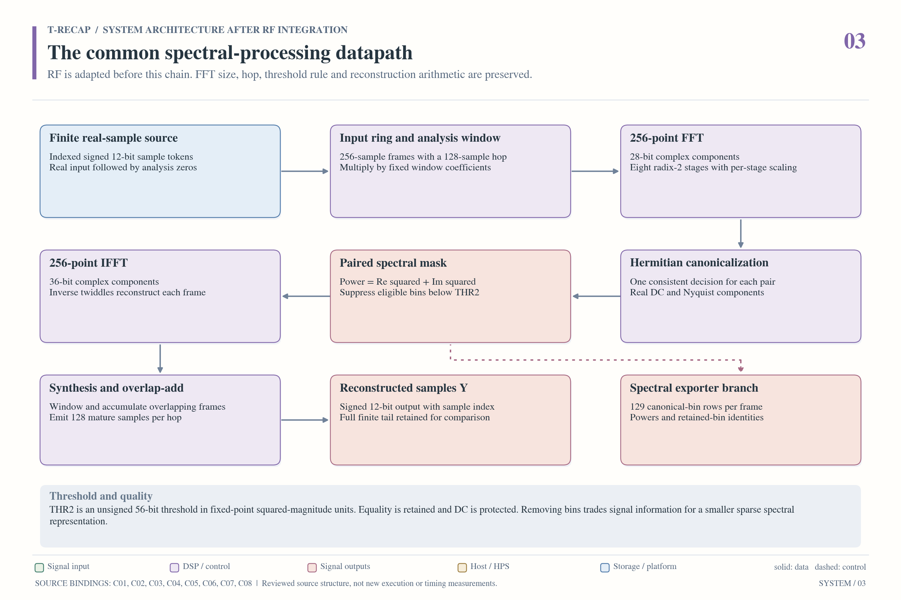

Overlapping 256-sample frames are windowed and transformed with a 128-sample hop. The threshold compares squared FFT magnitude with THR2. Eligible bins below the threshold are removed, equality is retained and DC is protected. The masked complex spectrum supplies the IFFT and weighted overlap-add reconstruction. The spectral exporter separately records canonical-bin power. Raising the threshold changes retained information, but does not shorten the FFT/IFFT schedule.

</details>

<details>
<summary>4. RF input adapter</summary>

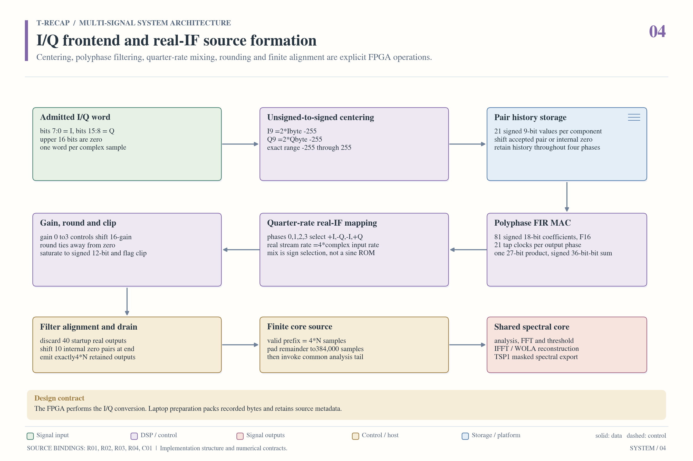

The I/Q frontend centers each unsigned byte with 2*b - 255. An 81-tap FIR interpolates the signal by four. A quarter-rate mixer maps the complex result into a real intermediate-frequency stream using successive +I, -Q, -I and +Q phases. A shared multiply-accumulate datapath applies the fixed coefficients. Gain, defined rounding and signed 12-bit saturation complete the conversion. The finite wrapper aligns the FIR result and pads the valid 4*N samples to the common transaction length.

</details>

<details>
<summary>5. Outputs and consumers</summary>

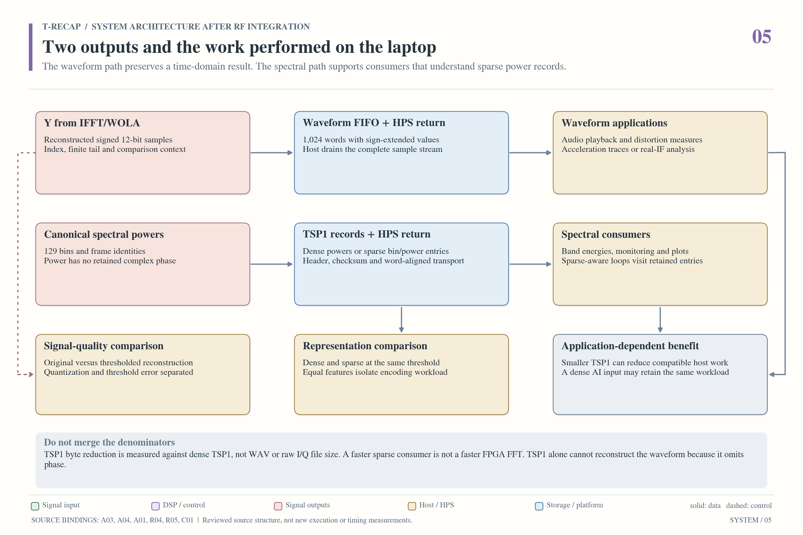

Y contains the reconstructed time-domain signal. For audio it can be played after the appropriate host conversion. For acceleration it represents the processed axis. For RF it is real IF and needs host recovery or demodulation before an application can interpret it. TSP1 contains power and bin metadata without phase. A sparse-aware consumer can skip omitted bins for band-energy features or spectral activity monitoring. TSP1 alone cannot reconstruct Y or the original I/Q signal.

</details>

<details>
<summary>6. Host and transactions</summary>

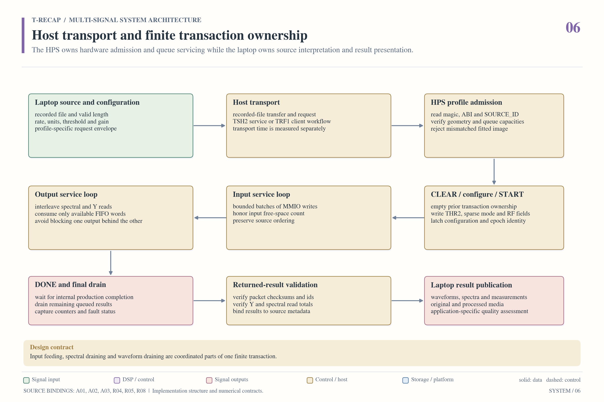

Both profiles use HPS Linux as the bridge between the laptop and FPGA registers. The audio finite TCP service receives prepared samples and interleaves input writes with output reads. The RF workflow uploads a bounded archive, runs a local HPS client and returns a results archive. These are distinct host protocols. The HPS feeds raw I/Q to TRF1, so the RF conversion is performed in the FPGA. The laptop validates and interprets the returned data.

</details>

<details>
<summary>7. Control and backpressure</summary>

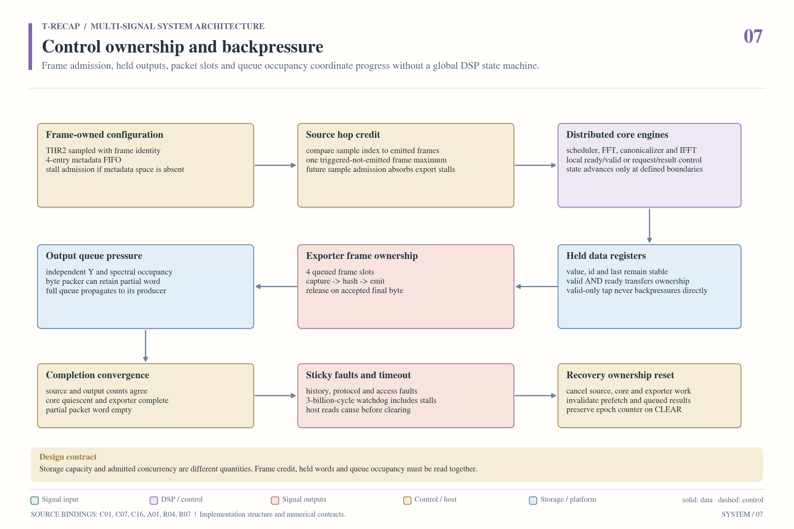

The host admits the expected hardware identity and configures a run while idle. Ready/valid handshakes and spectral-record credit allow input or output progress to pause without replacing pending data. Registered FIFO reads require explicit pending and held-data state. Completion includes finite-stream padding and reconstruction tail handling. The host continues draining queued outputs after production ends. Reset, clear and watchdog recovery have defined effects on the enclosing transaction.

</details>

<details>
<summary>8. Platform and verification</summary>

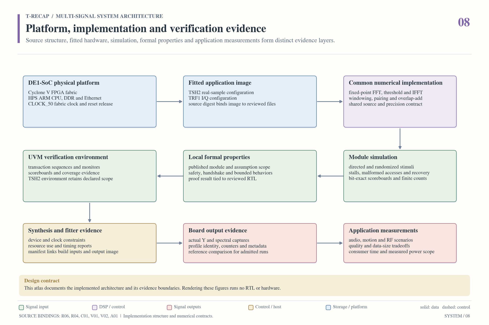

The board combines the Cyclone V FPGA fabric with the ARM HPS and its generated platform interfaces. The qualified finite-file builds use a nominal 50 MHz fabric clock. Source identities distinguish the two fitted applications. TSH2 has its own simulation, physical, UVM and local formal evidence. The RF frontend has independent arithmetic checks, five self-checking RTL suites and source-bound board captures. Verification evidence is mapped to the module and build configuration it covers. The TSH2 formal and UVM scope does not include the RF frontend.

</details>

### Module-level hardware views

Views 9 through 20 open the blocks above and show their arithmetic, memories, scheduling and control. Each figure is available individually and in the same [complete atlas](phase2/docs/architecture/system/README.md).

| Detailed view | What to trace inside the hardware |
|---|---|
| [9. Frame and analysis window](phase2/docs/architecture/system/09-frame-window-hardware.png) | Accepted samples, ring addresses, window coefficients and frame ownership |
| [10. Transform memories](phase2/docs/architecture/system/10-transform-memory-engines.png) | Separate FFT/IFFT work RAM, address generation and twiddle access |
| [11. Canonicalization and masking](phase2/docs/architecture/system/11-canonical-mask-hardware.png) | Pair reads, widened arithmetic, threshold comparison and reconstructed conjugate pairs |
| [12. Butterfly arithmetic](phase2/docs/architecture/system/12-butterfly-arithmetic.png) | Complex multiply, add/subtract, rounding, scaling and register stages |
| [13. WOLA storage](phase2/docs/architecture/system/13-wola-storage.png) | Synthesis multiply, Z memory, overlap ring and mature-sample output |
| [14. Spectral packet hardware](phase2/docs/architecture/system/14-spectral-packet-hardware.png) | Entry memory, dense/sparse encoding, checksum and byte/word serialization |
| [15. RF MAC datapath](phase2/docs/architecture/system/15-rf-mac-datapath.png) | I/Q history selection, coefficient address, shared multiply and accumulation |
| [16. RF controller](phase2/docs/architecture/system/16-rf-controller.png) | Tap and phase progression, startup crop, flush and output acceptance |
| [17. MMIO register interface](phase2/docs/architecture/system/17-mmio-register-interface.png) | Address decoding, configuration, commands, counters and FIFO ports |
| [18. FIFO and handshake](phase2/docs/architecture/system/18-fifo-and-handshake.png) | Registered read latency, pending state, held output and flow control |
| [19. Finite epoch lifecycle](phase2/docs/architecture/system/19-finite-epoch-lifecycle.png) | Input admission, analysis zeros, WOLA tail, production completion and host drain |
| [20. Clock, reset and observability](phase2/docs/architecture/system/20-clock-reset-observability.png) | Fabric clock, reset release, clear behavior and visible status |

<details>
<summary>Open the shared numerical engine, views 9 through 13</summary>

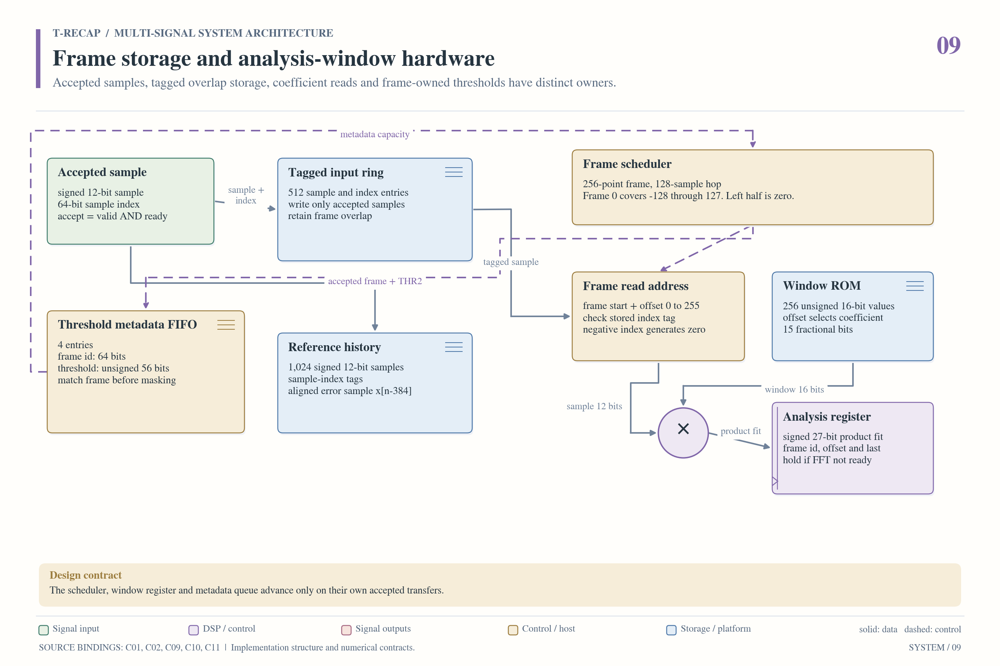

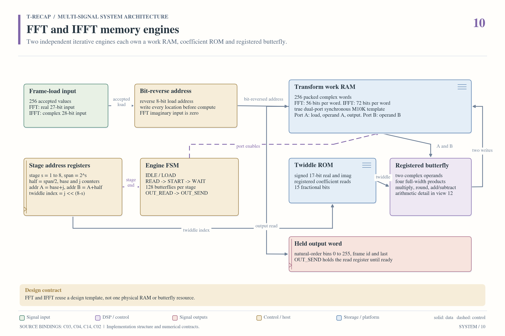

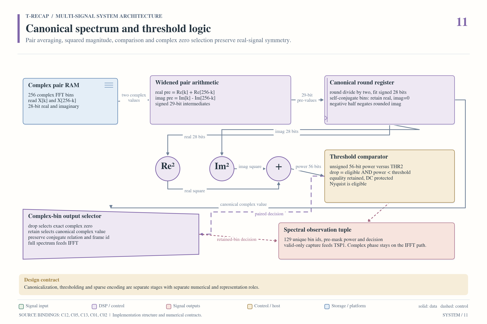

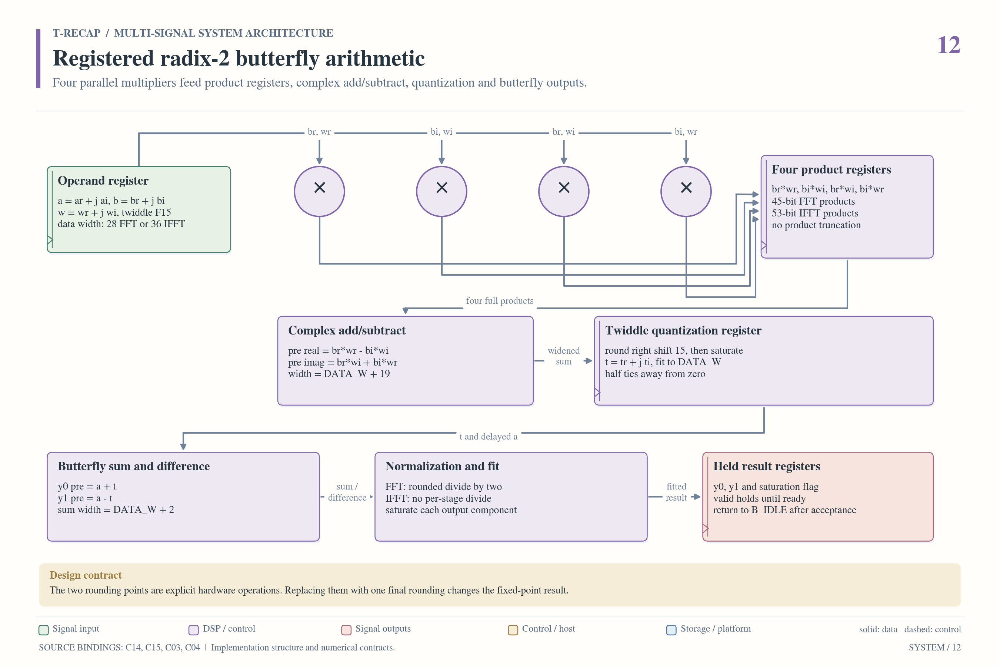

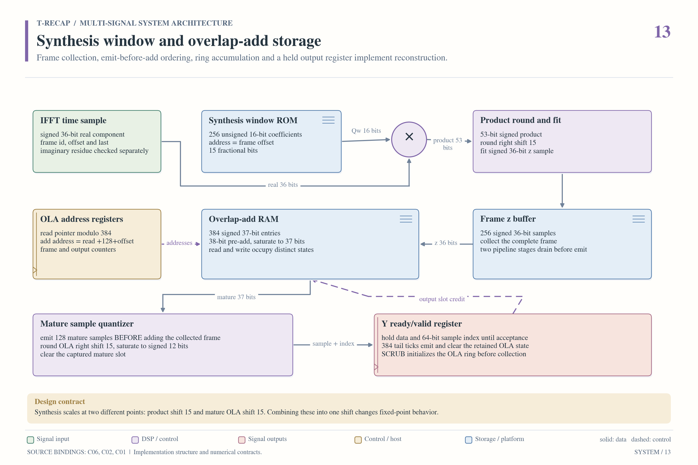

</details>

<details>
<summary>Open spectral packet generation, view 14</summary>

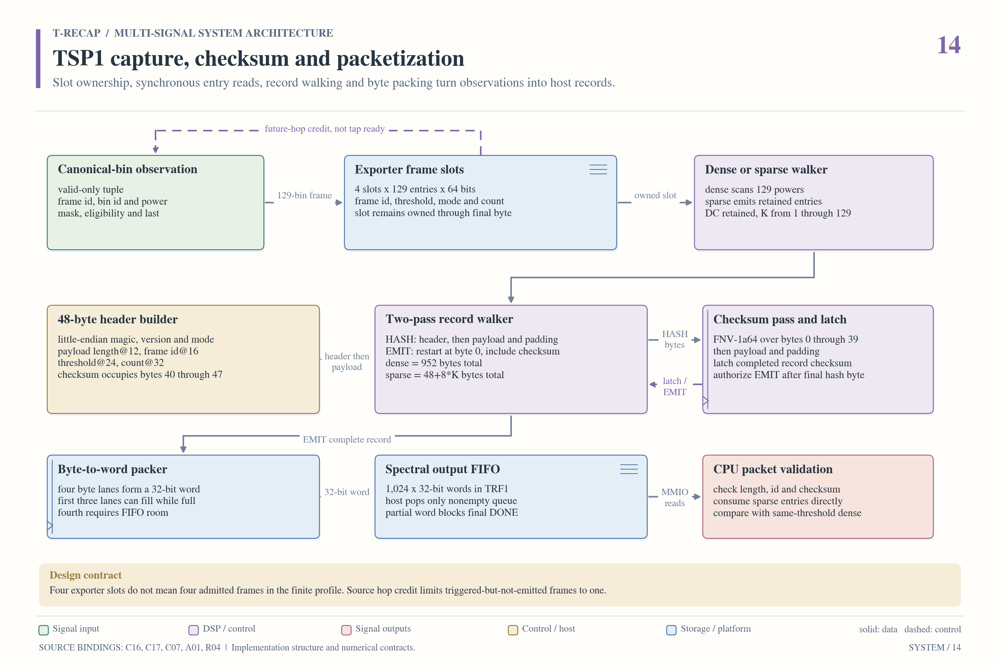

</details>

<details>
<summary>Open the RF input frontend, views 15 and 16</summary>

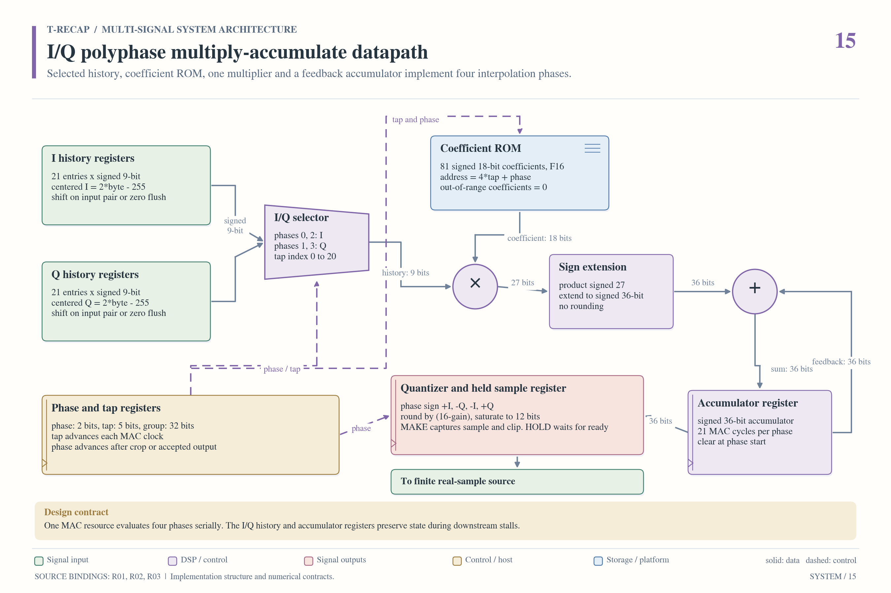

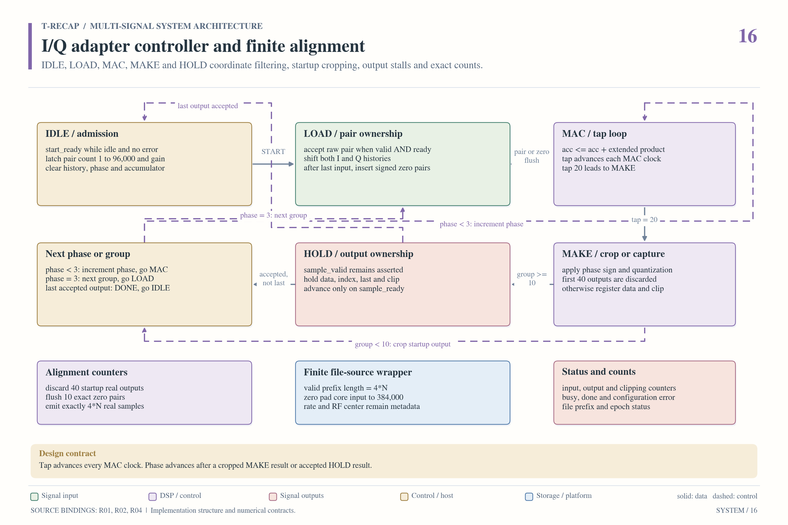

</details>

<details>
<summary>Open interfaces, flow control and lifecycle, views 17 through 20</summary>

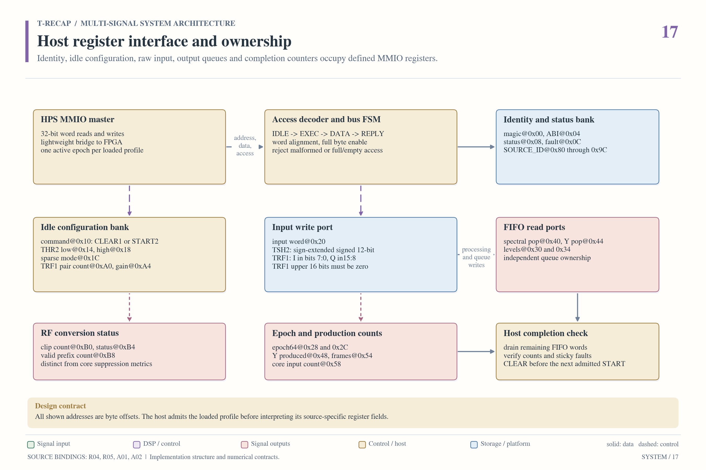

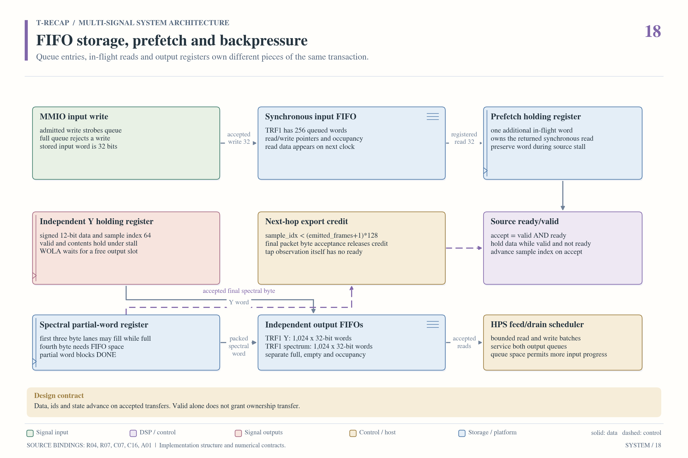

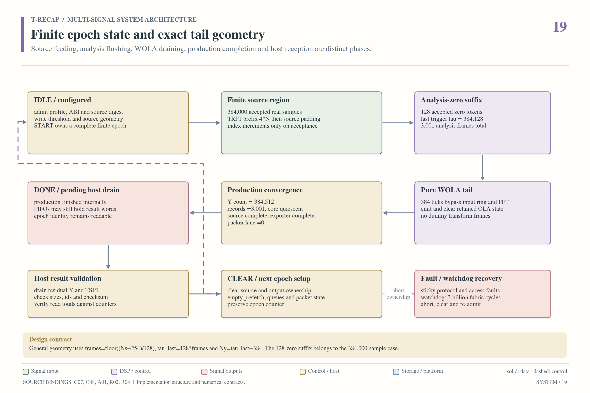

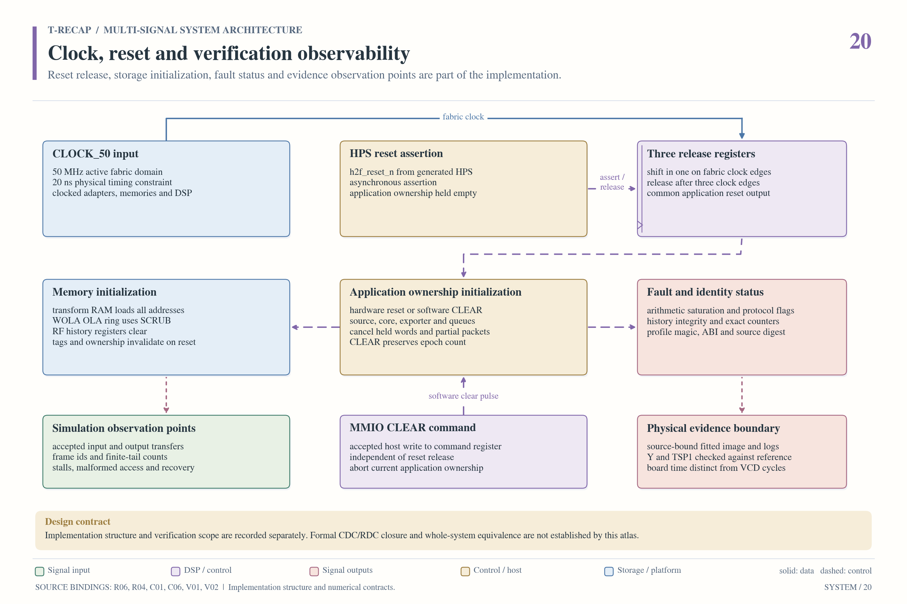

</details>

The profile-specific [TSH2 atlas](phase2/docs/architecture/tsh2/README.md) and [RF detail atlas](phase2/docs/architecture/rf_iq/README.md) remain supporting profile references. The [original DDR-ring and UDP atlas](phase2/docs/architecture/diagrams/README.md) documents a different historical deployment scope.

| Shared numerical property | Value |
|---|---|
| Core input | Signed 12-bit real samples |
| FFT and hop | 256 samples and 128 samples |
| Shared-core coefficient fractional bits | 15 |
| Canonical spectrum | 129 bins with unsigned 56-bit squared magnitudes |
| Full finite transaction | 384,000 input samples, 3,001 spectral frames and 384,512 full-tail Y samples |
| Reconstruction alignment | 384 samples. Its duration depends on the input representation's sample rate |
| Dense TSP1 record | 952 bytes per frame |
| Sparse TSP1 record | 48 + 8*K bytes per frame for K retained bins |

For audio at 48 kHz, 384,000 samples represent eight seconds. For the recorded RF example, 250 ksample/s complex input becomes a 1 Msample/s real-IF representation after interpolation. These rates describe the signal, not measured FPGA execution throughput.

### From architecture blocks to RTL

The figures describe concrete memories, arithmetic units and state machines. This map connects the main responsibilities to their implementation.

| Hardware responsibility | Internal structure | Source |
|---|---|---|
| Framing and shared-core coordination | Input ring, 256-sample frames, 128-sample hop and frame-owned configuration | [Core integration](phase2/rtl/core/trecap_core_top.sv) |
| Forward transform | Separate work RAM, address generation, twiddle ROM and registered radix-2 butterfly with 28-bit stored complex components | [FFT engine](phase2/rtl/fft/trecap_fft256.sv) |
| Canonical spectrum | Widened pair arithmetic, rounded 28-bit components and consistent conjugation | [Hermitian canonicalizer](phase2/rtl/core/trecap_hermitian_canonicalizer.sv) |
| Spectral selection | 56-bit squared-power comparison and pair-consistent spectrum assembly. DC is protected and equality is retained | [Magnitude and decisions](phase2/rtl/core/trecap_mag2_mask.sv), [Spectrum mask builder](phase2/rtl/core/trecap_spectrum_mask_builder.sv) |
| Inverse transform | Its own work RAM and inverse-twiddle butterfly with 36-bit stored complex components | [IFFT engine](phase2/rtl/fft/trecap_ifft256.sv) |
| Reconstruction | Synthesis window, 36-bit Z storage, 37-bit overlap accumulation, mature-sample output and finite-tail drain | [WOLA engine](phase2/rtl/core/trecap_synthesis_wola.sv) |
| RF input representation | Two I/Q histories, coefficient ROM, shared multiplier, 36-bit accumulator, phase/sign selection and 12-bit quantization | [I/Q frontend](phase2/profiles/trf1/adapter/rtl/trecap_rf_iq_adapter.sv) |
| Spectral output | Frame capture, entry memory, checksum pass and dense/sparse byte serialization | [TSP1 exporter](phase2/verification/tsh2/rtl/trecap_spectral_exporter.sv) |
| Host-facing flow control | Register decoder, input FIFO prefetch, byte-to-word packing, independent Y and spectral output FIFOs, epoch counters and status | [Real-sample wrapper](phase2/profiles/tsh2/work/trecap_stream8_v01/rtl/trecap_stream_adapter.sv), [I/Q wrapper](phase2/profiles/trf1/board/rtl/trecap_rf_board_adapter.sv) |

Ready/valid transfers determine when each module advances. State is distributed across the frame scheduler, transform engines, reconstruction stage, input frontend and output encoders. The detailed atlas traces both the data wires and these control dependencies.

## Three concrete applications

The project demonstrates one processing architecture through three application studies. Each has a practical scenario, a downstream consumer, original input files and measured threshold tradeoffs. The [application collection](phase2/docs/applications/README.md) provides the full methods and downloadable results.

| Application | Downstream consumer | Measured benefit and tradeoff |
| --- | --- | --- |
| [Audio preprocessing before FLAC](phase2/docs/applications/audio/README.md) | Laptop FLAC encoder consumes reconstructed Y | Across four clips, threshold 10^8 reduces FLAC bytes by 4.11% and 10^10 by 15.97% relative to the same quantized threshold-0 baseline. Higher thresholds remove audible detail. Encoding time does not improve consistently |
| [Accelerometer step-event analysis](phase2/docs/applications/accelerometer/README.md) | Laptop step detector consumes reconstructed XYZ | With added synthetic noise, 10^10 reduces extra detections from 989 to 360 but increases missed events from 232 to 279. Original recordings get worse at that threshold, and no nonzero threshold passed the frozen calibration gate |
| [RF background suppression](phase2/docs/applications/rf/README.md) | Laptop inspects TSP1 and recovers messages from reconstructed Y | At 10^10, two recorded fixtures lose about 44% of quiet-window power while retaining their messages. At 10^11, one loses its message. A separate generated noisy case gains about 5.40 dB SNR on hardware at 10^9 |

### 1. Audio: compare recording detail and FLAC archive size

The demo scenario is a narration or music recording that a user wants to inspect, preprocess and archive. The physical study uses **Speech A, Speech B, piano and jazz**, with 12 DE1-SoC captures across thresholds 0, 10^8 and 10^10. The laptop encodes the returned waveform as FLAC, decodes it and compares size, encoding time and signal error.

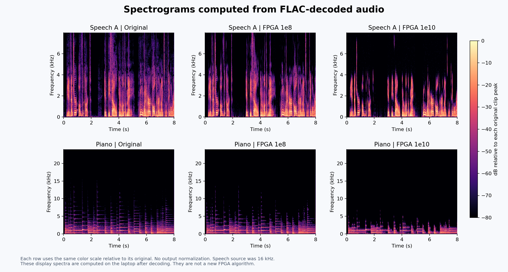

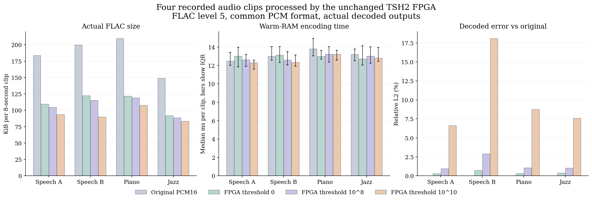

The extra 4.11% and 15.97% size reductions isolate thresholding from the shared 12-bit input preparation. FLAC preserves its encoder input exactly, while the FPGA preprocessing has already changed that waveform. The separate software denoising pilot has both improved and degraded cases, so suppressing weak components is not equivalent to identifying unwanted noise.

[Original and processed files](phase2/docs/applications/audio/README.md#see-the-spectrum-and-hear-the-result) | [Offline listening page](phase2/docs/applications/audio/listen.html) | [Sources and credits](phase2/docs/applications/audio/CREDITS.md)

### 2. Accelerometer: reduce false walking events while tracking missed events

The scenario is an activity logger, or a step-event component that could feed an indoor navigation system when GPS is unavailable. The study evaluates recorded hip acceleration against independent video annotations. Each axis passes through the FPGA, then a frozen laptop detector processes the reconstructed XYZ samples. Heading and position estimation are outside this step-event experiment.

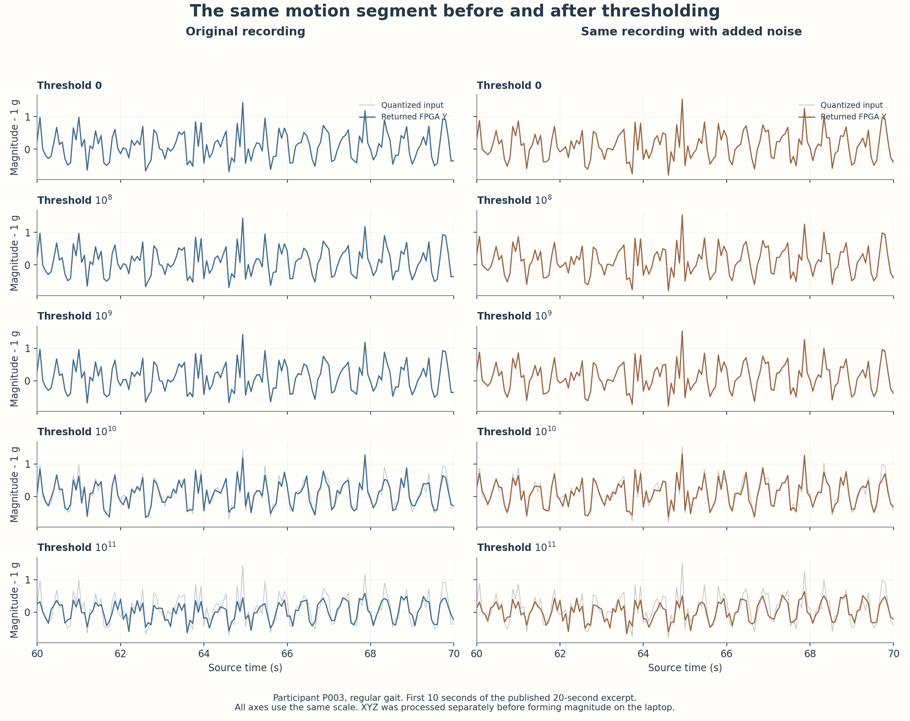

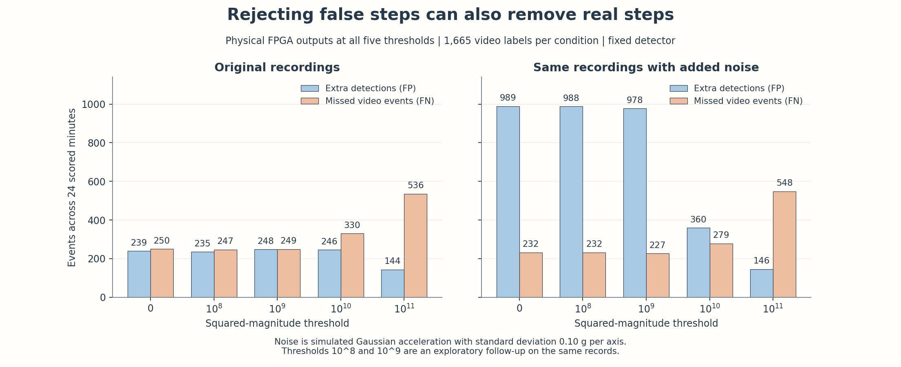

At 10^10, the synthetic-noise condition has fewer extra detections but loses more true events. The original recordings also become less accurate at that setting. This demonstrates a measurable tradeoff, with threshold zero retained by the frozen calibration gate.

[Input and returned XYZ excerpts](phase2/docs/applications/accelerometer/README.md#inspect-the-actual-signals) | [Detector evaluation and source dataset](phase2/docs/applications/accelerometer/README.md#method-and-source)

### 3. RF: suppress background while checking message preservation

The scenario is inspecting recorded sensor bursts surrounded by weak background energy. The FPGA converts raw I/Q and applies the shared spectral processing chain. The laptop visualizes the returned TSP1 spectrum and checks messages using the separate reconstructed waveform. The application includes two recorded sensor fixtures and a controlled generated burst with added white noise.

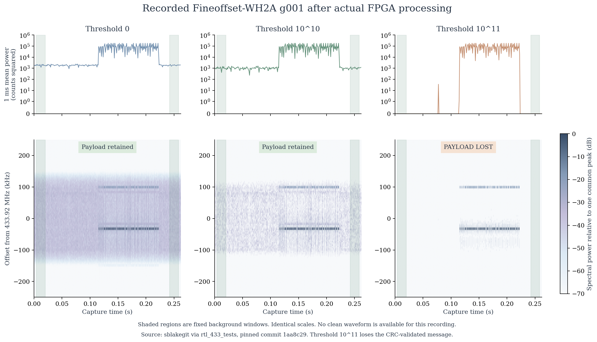

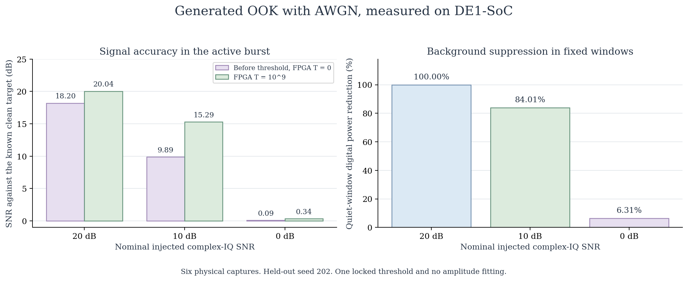

Moderate thresholds can suppress background while retaining these messages. A cleaner-looking spectrum at 10^11 nevertheless loses the g001 message. The RF audio demo maps the signal envelope to an audible tone so viewers can hear the comparison. It is a visualization of RF activity rather than sound transmitted by the sensor.

[Recorded sources and physical results](phase2/docs/applications/rf/README.md) | [Offline RF visual and listening demo](phase2/docs/applications/rf/index.html)

## Editable algorithm specification

The [algorithm folder](phase2/docs/algorithm/README.md) provides an editable Markdown transcription of the full 106-page integrated PDF, with source-page coverage and its original historical scope. A separate [current-profile and RF supplement](phase2/docs/algorithm/current_profiles_and_rf.md) documents CU8 centering, fourfold interpolation, real-IF mixing, gain, rounding, finite alignment, backpressure and the TRF1 host contract.

The original PDF remains available for comparison. Historical DDR-ring and UDP requirements are distinguished from the current finite-file profiles instead of being silently rewritten as the same deployment.

## Design verification

The verification work connects a defined contract, an independently checked numerical model, RTL simulation, and physical board output. It also tests whether the checkers reject incorrect results.

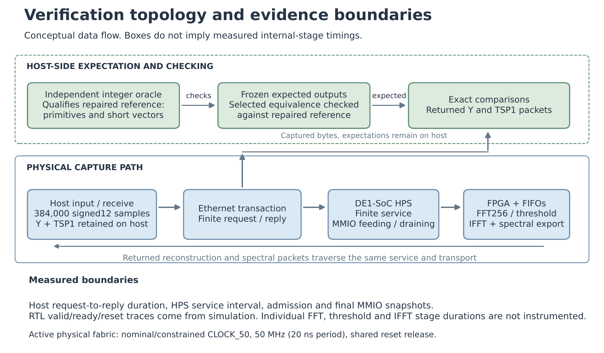

| Verification layer | Executed evidence |
|---|---|
| Reference arithmetic | 729,156 independent arithmetic comparisons, 11 C++ tests and 248 finite-input corner checks |
| Directed RTL campaign | 14 fresh suites covering arithmetic boundaries, threshold semantics, finite geometry, malformed controls, stalls, and reset/recovery |
| Full-length RTL, included in the 14 suites | Two 384,000-input runs, checking 769,024 waveform outputs, 774,258 canonical-bin observations, and 6,002 frames in total |
| Public seeded regression | Three seeds across four threshold/packet-mode cases: 12 epochs, 18,432 exact waveform samples, 13,932 canonical rows, and 94,440 packet bytes |
| Checker qualification | Intentional corrupt/missing results, unknown-value and completion controls, bounded timeouts, plus a real RTL run with mutated expected output that must fail |
| Physical DE1-SoC campaign | 58 epochs across 29 configurations and 13 inputs, with exact output/packet comparison and zero final fault/drop flags |
| Traceability | Source and fixture hashes, requirement dispositions, observed event coverage, JSON/JUnit receipts, native VCD traces, and published data provenance |

**A real defect was found and repaired:** the software reference's signed round-shift helper mishandled shifts 63 and 64. The failing boundary cases were reproduced before the fix, then checked independently after it. This repair concerns the reference arithmetic. It is not presented as a new FPGA speed optimization.

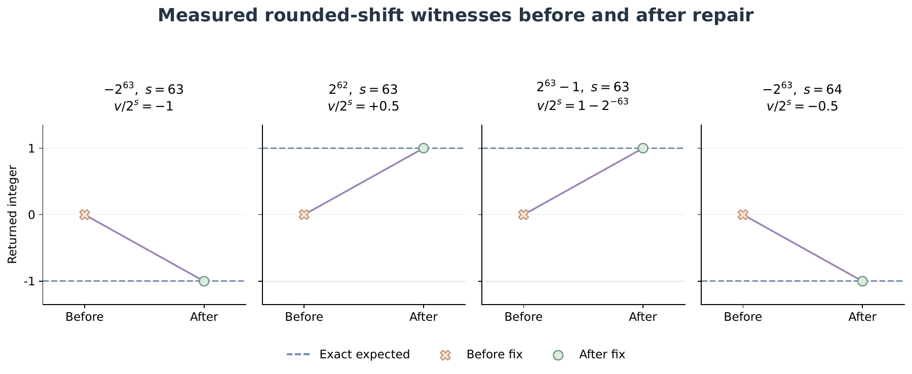

**Flow control and recovery are verified explicitly.** The traces below come from RTL simulation. They show held data during output stalls, completed transfers, and reset/recovery behavior. They are evidence excerpts, not schematic illustrations or complete full-run waveforms.

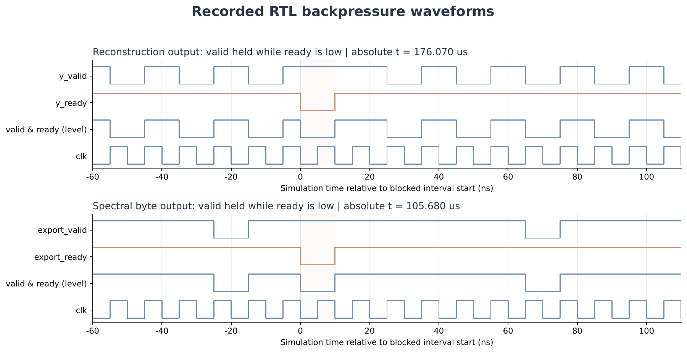

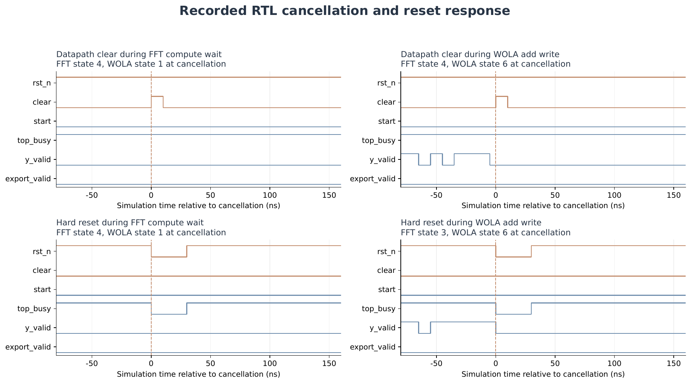

Open the native [startup](phase2/docs/results/verification_20261017/waveforms/startup.vcd), [reset/recovery](phase2/docs/results/verification_20261017/waveforms/reset_recovery.vcd), and [final-output-stall](phase2/docs/results/verification_20261017/waveforms/final_y_stall.vcd) traces in a waveform viewer. The [16-page academic report](phase2/docs/verification/portfolio/TRECAP_DV_Portfolio.pdf) includes eight figures, eleven tables, methodology, failures, source binding, and sign-off limits. Its [LaTeX source and build guide](phase2/docs/verification/portfolio/README.md) are committed with the report.

The original campaign disposition is **pass for the registered finite-file profile under the tested conditions**. That historical environment uses SystemVerilog procedural assertions and scoreboards. The separate supplement below adds genuine UVM execution and local formal proofs. Neither campaign establishes formal CDC/RDC, code-coverage closure or industrial certification. The broader original specification still has **30 partial and 16 excluded requirements**, which are requirement dispositions rather than a test pass rate. [Read the complete verification scope](phase2/verification/README.md).

### UVM and formal supplement

The October 17 supplement adds a reusable **Accellera UVM 1.2** environment and actual **SBY/Yosys formal proofs** against unchanged TSH2 RTL. It preserves the historical campaign and its board results.

| New evidence | Executed scope |
|---|---|
| Genuine UVM simulation | Three seeds, four complete cases each: **12 completed epochs**, including three reset recoveries. Three interrupted prefixes are counted separately |
| Exact UVM scoreboards | 18,432 waveform outputs, 13,932 canonical-bin records and 94,440 packet bytes. Independent replay checks reconcile the captured observations |
| UVM failure qualification | A mutated expected waveform value produces the intended fatal mismatch. One simulator startup crash is preserved with an explicit bounded recovery record |
| Local formal proofs | **16 safety/equivalence jobs**: FIFO order at reduced depths, deployed output-FIFO control, 11 round/saturate instances and threshold-mask control/relations |
| Formal covers | **14 bounded-cover jobs** reach 73 selected predicates. Cover witnesses establish reachability, not universal correctness |
| Formal negative controls | Three deliberately false assertions produce the intended counterexamples. They are expected failures, not additional proofs |

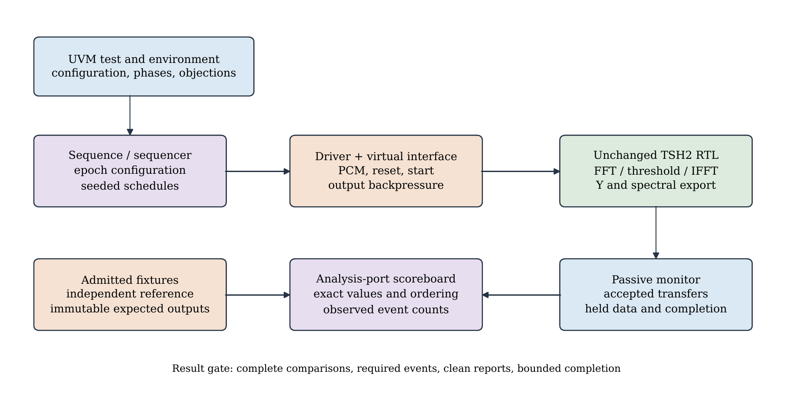

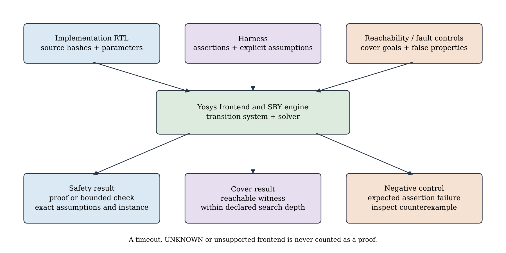

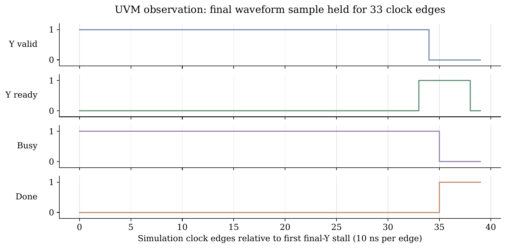

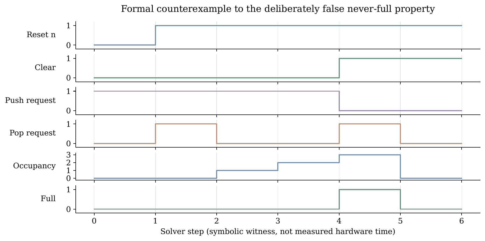

Read the [academic LaTeX supplement](phase2/docs/verification/uvm_formal/README.md), [UVM runner and evidence](phase2/verification/uvm/README.md), and [formal properties, assumptions and witnesses](phase2/verification/formal/README.md). UVM uses deterministic seeded schedules and observed counters with the installed Starter simulator. Solver-constrained randomization, covergroups and code-coverage closure are not claimed. Formal scope is local and instance-specific: it does not prove the complete FFT/IFFT pipeline, production-depth FIFO data order or the separate PCM FIFO.

### RF frontend and system verification

The published RF regression checks the I/Q frontend and its connection to the shared core. It compares every accepted adapter sample, source sample, reconstructed output and packet byte against the corresponding reference path.

| Check | Fresh executed result |
|---|---|
| Standalone adapter | Three seeds, 120 transactions and 33,240 exact sample comparisons |
| Maximum input | 96,000 I/Q pairs and 384,000 exact real outputs |
| Finite wrapper | Four completed transactions, two aborts and 264 sample checks |
| Core and MMIO integration | 32 epochs, 5,634,999 checks, 81,920 Y samples and 411,712 TSP1 bytes |
| Admission and recovery | 4,260 checks, including pending-prefetch reset and held-prefetch clear |
| Independent reference | 42 synthetic fixtures and 405,304 checked samples |
| Native host client | 28 register-mock checks, 11 file cases and four numeric cases under the undefined-behavior sanitizer |

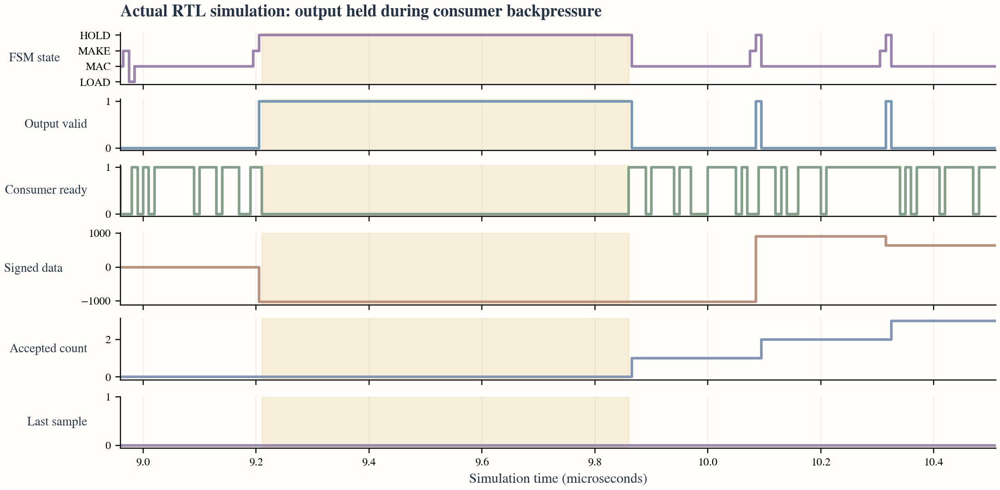

The negative control deliberately corrupts an expected value and must produce a mismatch. Evidence checkers bind the published source, test vectors, logs and native VCD traces. The [10-page LaTeX supplement](phase2/docs/verification/rf_iq/rf_verification_supplement.pdf) documents requirements, results and limits. These are fresh simulation and offline host checks. Historical physical RF captures are reported separately. The RF adapter is outside the documented TSH2 UVM and formal scope.

## Terms and abbreviations

Start here if you are new to the project. **TSH2 identifies the FPGA implementation and its host interface, THR2 is a threshold setting, and TSP1 is an output format.** They refer to different things.

In one sentence: the shared FPGA processor applies **THR2** to FFT-bin power, exports retained spectral powers in **TSP1** packets, and separately produces the reconstructed signal **Y**.

### Project names and output labels

| Term | Meaning in this repository |
|---|---|
| **T-RECAP** | Threshold-based Reduction and Encoding for Configurable Analysis Pipelines. |
| **TSH2** | T-RECAP Signal-processing Hardware, version 2. The finite-record build configuration for real-valued audio and acceleration samples. HPS software uses its interface to configure processing, transfer samples and results, and inspect status and faults. |
| **TSH1** | T-RECAP Signal-processing Hardware, version 1. The earlier Phase 2 implementation used for the historical 1,024-sample resident-compute comparison. Its timing results must not be read as current TSH2 measurements. |
| **THR2** | The threshold applied to squared FFT magnitude: `Re(X)^2 + Im(X)^2`. It is expressed in the implementation's fixed-point power units, not percent, decibels or sound-pressure level. Values below it are suppressed. Equality is retained, and DC is protected. |
| **TSP1** | The project's version-1 spectral packet format. It carries frame metadata and power values, with retained-bin indices in sparse mode. It omits phase, so these packets alone cannot reconstruct the audio. |
| **Y** | The reconstructed time-domain signal from the IFFT/WOLA path. It represents audio, an acceleration axis or real IF according to the selected application. This sample stream is separate from TSP1 spectral packets. |

### RF frontend terms

| Term | Meaning in the RF application |
|---|---|
| **TRF1** | Identifier of the recorded-I/Q build configuration and its register interface. Magic `0x54524631` distinguishes it from the real-sample TSH2 interface. |
| **I/Q** | In-phase and quadrature components. Together they describe a complex baseband signal. I is not amplitude alone and Q is not phase alone. |
| **CU8** | Complex unsigned 8-bit storage, with one unsigned I byte followed by one unsigned Q byte per sample time. Raw files need separate sample-rate and center-frequency metadata. |
| **FIR / polyphase** | Finite impulse response filtering / a decomposition that selects the coefficients needed for each interpolation phase. The adapter uses 81 fixed taps and one shared multiplier. |
| **Real IF** | A real intermediate-frequency waveform representing the converted I/Q signal. It is not automatically demodulated audio. |
| **Interpolation by four** | Four output samples per input I/Q pair with the same signal duration. This is a sample representation change, not a fourfold processing-speed claim. |

### How software uses TSH2

TSH1 and TSH2 are both Phase 2 implementations. The number identifies an implementation/interface version, not a project phase. TSH2 names the real-sample hardware implementation and its interface. TRF1 names the separately fitted RF application interface. The signal-processing operations are FFT, thresholding and IFFT/WOLA.

Software on the board's ARM HPS uses **memory-mapped registers and FIFO data ports** to:

- Configure the threshold and output mode while idle, then issue START or CLEAR commands.
- Write input PCM samples and read the separate reconstructed waveform and spectral outputs.
- Read progress counters, FIFO availability, completion status and fault flags.

These addresses expose hardware functions. A write to the PCM port queues a sample. A valid read from an output port removes the next word from that FIFO. The laptop communicates with the HPS over TCP, and the HPS performs these accesses to the FPGA.

For the exact interfaces, see the [TSH2 contract](phase2/profiles/tsh2/work/trecap_stream8_v01/CONTRACT.md) and [output architecture](phase2/docs/architecture/tsh2/README.md).

### Audio and signal processing

| Term | Meaning and why it matters here |
|---|---|
| **DSP** | Digital signal processing: numerical operations on sampled signals. A hardware *DSP block* is a dedicated arithmetic resource inside the FPGA. |
| **PCM / WAV** | Pulse-code modulation represents audio as numeric samples. WAV is a file container that can store those samples. WAV-file size and spectral-packet size are different measurements. |
| **FFT / IFFT** | Fast Fourier transform and inverse fast Fourier transform. The FFT maps a time-domain frame to frequency coefficients. The IFFT maps coefficients back to time-domain samples. |
| **WOLA** | Weighted overlap-add. Windowed, overlapping frames are combined to form the reconstructed waveform. |
| **Frame / hop** | A frame is one window of samples processed together. The hop is how far the next frame advances. Current settings use 256 samples per FFT frame and a 128-sample hop. |
| **Fixed-point arithmetic** | Integer arithmetic with an agreed binary scale. Rounding, saturation and scaling are part of the implementation and must match the numerical reference. |
| **Bin / canonical bins** | A bin is one discrete FFT frequency index. A real 256-point FFT has 129 unique bins including DC and Nyquist. These are the canonical bins used by the exporter. |
| **Magnitude / power / phase** | Magnitude is the size of a complex FFT coefficient. Power here is its squared magnitude. Phase describes its angle. TSP1 retains power, while waveform reconstruction requires the appropriate complex coefficients. |
| **DC / Nyquist** | DC is the zero-frequency component. Nyquist is half the sample rate. The threshold protects DC. The Nyquist bin can be suppressed. |
| **Dense / sparse / sparsification** | Dense spectra store every canonical bin, including zeros. Sparse spectra store retained bins with their indices. Sparsification suppresses selected coefficients and permits this compact representation. Dense and sparse data at the same threshold represent the same retained powers. |
| **Spectrogram / band energy** | A spectrogram shows spectral strength over time and frequency. Band energy groups and sums powers over selected bins. The 16-band consumer uses 16 disjoint bin groups. |
| **Spectral centroid / dominant frequency** | The centroid summarizes where spectral weight is concentrated. Dominant frequency identifies the strongest spectral component. Both are monitoring features computed downstream. |
| **NRMSE** | Normalized root-mean-square error. Here it is the waveform error-vector norm divided by the reference waveform's norm, reported as a percentage. It measures numerical waveform difference, not recognition accuracy or perceived audio quality. |
| **Consumer / features / AI** | A consumer is downstream software using the output. Features are summaries such as band energies. AI means artificial intelligence. YAMNet is the pretrained audio-event model explored here. The measured 16-band consumer is separate from AI inference. |

### Hardware, transport and timing

| Term | Meaning and why it matters here |
|---|---|
| **FPGA / SoC / DE1-SoC** | Field-programmable gate array / system on a chip. DE1-SoC is the development board used here. Its Cyclone V device contains FPGA fabric and an ARM processor subsystem. |
| **CPU / HPS / host** | CPU means central processing unit. HPS means hard processor system, the ARM side of the board running Linux. In the workload plots, the host CPU is the laptop's Intel CPU. The board CPU and laptop CPU are distinct measurement targets. |
| **MMIO** | Memory-mapped input/output. Software reads or writes hardware registers through addresses, allowing the HPS to configure, feed and drain the FPGA. |
| **FIFO / BRAM / M10K** | First-in, first-out queue / block RAM. FIFOs buffer ordered data. BRAM is on-chip memory. M10K names a Cyclone V embedded memory-block resource. |
| **RAM / DDR** | Random-access memory / double data rate. Current HPS Linux buffers reside in external DDR memory. The historical FPGA-reserved DDR telemetry ring is a separate architecture. FPGA input/output FIFOs use on-chip storage. |
| **Ready/valid / backpressure / credit** | A ready/valid transfer occurs when both signals are asserted. Backpressure pauses acceptance until the receiver has space. Spectral-record credit reserves capacity before producing another frame's records. |
| **TCP/IP / UDP / Ethernet** | Transmission Control Protocol / Internet Protocol and User Datagram Protocol are network protocols. Ethernet provides the network link. The current finite-file path uses TCP. UDP appears in the historical architecture. |
| **Epoch / tail / drain** | An epoch is one accepted processing run. The tail completes the final overlapping frames after input ends. Draining reads pending outputs. FPGA DONE alone does not mean the laptop has received every output. This use of epoch is unrelated to AI training. |
| **Latency / throughput / elapsed cycles** | Latency is delay to a defined output. Throughput is the amount processed per unit time. Elapsed cycles count clock ticks between defined events. The current TSH2 counter includes stalls caused by host feed/drain, so it is not a pure arithmetic-only timing measurement. |
| **ADC / LINE-IN** | Analog-to-digital converter / analog line-level input. These concern physical audio capture. The qualified implementation uses finite audio files. Live input through the board's audio jack is outside the verified scope. |

### Design verification and evidence

| Term | Meaning and why it matters here |
|---|---|
| **RTL / DUT** | Register-transfer level / design under test. RTL describes the hardware. DUT identifies the module or subsystem being checked. |
| **UVM** | Universal Verification Methodology. A SystemVerilog framework that organizes stimulus, drivers, monitors and scoreboards into reusable simulation components. Using UVM alone does not establish verification completeness. |
| **Sequence / driver / monitor / scoreboard** | A sequence supplies test transactions, which a driver applies to the DUT. A monitor observes actual interface activity, and a scoreboard compares those observations with expected results. |
| **Reference model / bit-exact** | The reference model computes expected numerical results. Bit-exact means the checked integer values match exactly, including the required rounding and saturation behavior. |
| **Seed / regression / coverage** | A seed makes a stimulus schedule reproducible. A regression runs a collection of tests. Coverage records what was exercised. The current observed counters are not a claim of complete code or functional coverage. |
| **Formal verification / assertion / assumption** | Formal tools analyze a mathematical model of the RTL. An assertion states what must hold. An assumption limits permitted inputs or behavior. A passing proof applies only to its stated model, properties and assumptions. |
| **SBY / Yosys** | Tools used by this project's formal flow. SBY, also known as SymbiYosys, coordinates formal jobs. Yosys processes the RTL into the model used by the proof flow. These names do not imply that the entire design was proved. |
| **Proof / cover / counterexample** | A proof establishes a property within its stated scope. A cover witness shows that a selected event is reachable. A counterexample is a trace that violates an assertion. A cover witness is not a universal correctness proof. |
| **Negative control** | An intentionally incorrect expected value or property used to check that the verification flow detects a fault. Its expected failure is evidence about the checker, not automatically a DUT defect. |
| **VCD / waveform** | Value Change Dump, a file format containing signal changes over simulation or formal-trace time. A waveform viewer displays those changes for inspection. |
| **CDC / RDC** | Clock-domain crossing / reset-domain crossing. These refer to checks on signals crossing clock or reset boundaries. They require their own analysis. Local functional proofs do not establish CDC/RDC signoff. |
| **Provenance** | The recorded source version, tool configuration, inputs and run artifacts that connect a reported result to the work that produced it. |

## Reproduce the checks

Clone the repository, then check the public package using Python 3.12:

```sh
git clone https://github.com/DatDinhh/T_RECAP.git
cd T_RECAP
python phase2/verification/tsh2/run.py --check-package
```

This command validates the package and qualifies its scoreboards using constructed traces. It does not simulate RTL. With an installed ModelSim-compatible simulator, run:

```sh
python phase2/verification/tsh2/run.py --suite regression --sim-bin /path/to/modelsim/bin --out tsh2_regression_01
```

Build and test the C++20 reference model with CMake 3.24 or later:

```sh
cd phase2
cmake --preset verify
cmake --build --preset verify --parallel 2
ctest --preset verify
```

The [portable regression guide](phase2/verification/tsh2/README.md) documents simulator setup, output files, and fresh output-directory requirements. GitHub Actions runs reference functional tests, RTL frontend elaboration, hygiene checks, package/checker qualification, and public evidence integrity checks on Linux and Windows. Licensed RTL simulation and physical hardware runs are recorded separately. The [formal workflow](https://github.com/DatDinhh/T_RECAP/actions/workflows/formal.yml) separately downloads a hash-pinned tool suite and executes all 33 formal proof, cover and expected-failure jobs. UVM is not executed by the ordinary host package checks.

The [TSH2 application archive](phase2/profiles/tsh2/README.md) includes the board adapter, service, consumers, monitor, and local visualizer source. It also documents external coefficients, native libraries, fitted-image dependencies, and runtime admission requirements. It is not a one-command board deployment. The separate [Spectral Studio repository](https://github.com/DatDinhh/trecap-spectral-studio) is a recorded demonstration. Visiting it does not remotely operate this board.

From the repository root, check the complete recorded RF package and its committed evidence:

```sh
python phase2/verification/rf_iq/run.py --check-package
python phase2/verification/rf_iq/check_evidence.py
python phase2/docs/architecture/system/build_atlas.py --check
```

The [RF reproduction guide](phase2/verification/rf_iq/README.md) explains reference dependencies and simulator execution. The [unified atlas guide](phase2/docs/architecture/system/README.md) explains diagram generation, LaTeX compilation and source bindings. Rendering documentation does not run the FPGA.

## Repository map

| Path | Purpose |
|---|---|
| [`phase2/docs/architecture/system`](phase2/docs/architecture/system/README.md) | Unified system architecture, 20 detailed pastel views, source bindings and LaTeX PDF |
| [`phase2/profiles/trf1`](phase2/profiles/trf1/README.md) | Recorded RF adapter, complete application wrapper, host source and frozen simulation closure |
| [`phase2/verification/rf_iq`](phase2/verification/rf_iq/README.md) | Portable RF reference, RTL, finite-wrapper and actual-core register verification |
| [`phase2/docs/architecture/rf_iq`](phase2/docs/architecture/rf_iq/README.md) | Eight source-bound RF architecture views in PNG and SVG |
| [`phase2/docs/verification/rf_iq`](phase2/docs/verification/rf_iq/README.md) | RF academic report, waveforms and historical hardware evidence |
| [`phase2/rtl`](phase2/rtl) | Fixed-point datapath and broader source/transport RTL |
| [`phase2/profiles/tsh2`](phase2/profiles/tsh2/README.md) | Archived current finite-file adapter, service, consumers, monitor, and visualizer |
| [`phase2/sw/reference_model`](phase2/sw/reference_model/README.md) | C++ arithmetic reference and artifact tools |
| [`phase2/verification/tsh2`](phase2/verification/tsh2/README.md) | Portable synthetic RTL regression and scoreboards |
| [`phase2/verification/uvm`](phase2/verification/uvm/README.md) | Genuine UVM components, observed traces, exact scoreboards and reproducible runner |
| [`phase2/verification/formal`](phase2/verification/formal/README.md) | Local proof harnesses, assumptions, solver receipts and counterexamples |
| [`phase2/docs/verification/uvm_formal`](phase2/docs/verification/uvm_formal/README.md) | Academic supplement, LaTeX, diagrams and actual trace plots |
| [`phase2/verification/campaign_sources`](phase2/verification/campaign_sources/README.md) | Accepted boundary/recovery bench source archive |
| [`phase2/docs/algorithm`](phase2/docs/algorithm/README.md) | Full editable historical algorithm specification and current RF supplement |
| [`phase2/docs/applications`](phase2/docs/applications/README.md) | Three measured application studies with plots, source links and before/after files |
| [`phase2/docs/verification/portfolio`](phase2/docs/verification/portfolio/README.md) | Academic PDF, editable LaTeX, and report figures |
| [`phase2/docs/results/verification_20261017`](phase2/docs/results/verification_20261017/README.md) | Physical/RTL evidence ledger, coverage, source binding, and VCDs |
| [`phase2/docs/project_overview`](phase2/docs/project_overview/README.md) | README figures, tables, audit, provenance, and reproduction notes |
| [`phase2/docs`](phase2/docs/README.md) | Specifications, architecture, build guides, and historical results |
| [`phase1_demo`](phase1_demo) | Historical first-semester demonstration |

The earlier [architecture atlas](phase2/docs/architecture/diagrams/README.md), [board-power study](phase2/docs/results/board_power_20260925/README.md), and [ARM HPS benchmark](phase2/docs/results/hps_cpu_benchmark_20260925/README.md) remain available with their original scope. The HPS benchmark compares the CPU on the board, not the laptop CPU.

## Supporting benchmark archive

The [historical waveform and consumer benchmarks](phase2/docs/project_overview/historical_benchmarks.md) retain the earlier signal-fidelity, packet-size, host-timing and initial RF qualification results. They characterize particular fixtures and consumers. The three application studies above provide the project's application scenarios and evaluations.

Benchmark figures, raw trial tables and numerical provenance remain available in the [benchmark evidence guide](phase2/docs/project_overview/README.md). Their data sources, error references and timing boundaries are kept separate from the application studies.

## About

T-RECAP is a senior capstone engineering project investigating the connection between fixed-point FPGA signal processing, sparse spectral data, and measurable downstream work. Its portfolio spans RTL design, numerical debugging, hardware/software integration, application evaluation, and reproducible design verification.

Project-authored code is distributed under the [MIT license](LICENSE). Third-party toolchains and audio datasets retain their own terms. Source attribution is recorded in the [application studies](phase2/docs/applications/README.md), [historical benchmark archive](phase2/docs/project_overview/historical_benchmarks.md) and [campaign data provenance](phase2/docs/results/verification_20261017/data_provenance/dataset_terms.json). Raw third-party recordings are not bundled with the verification package.
