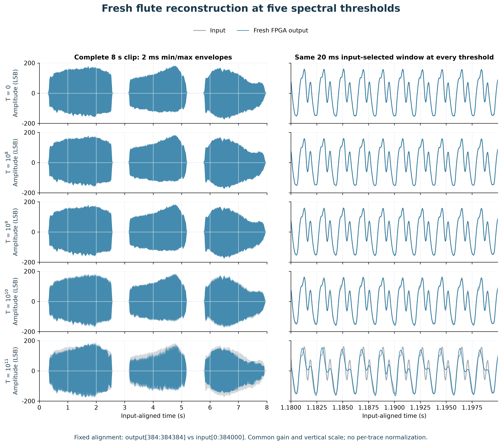
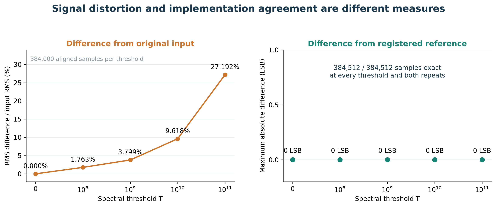
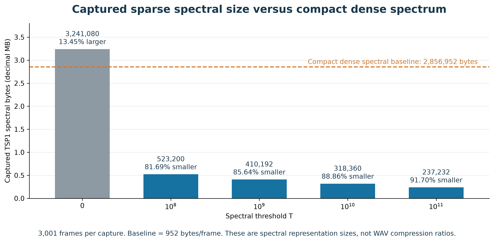
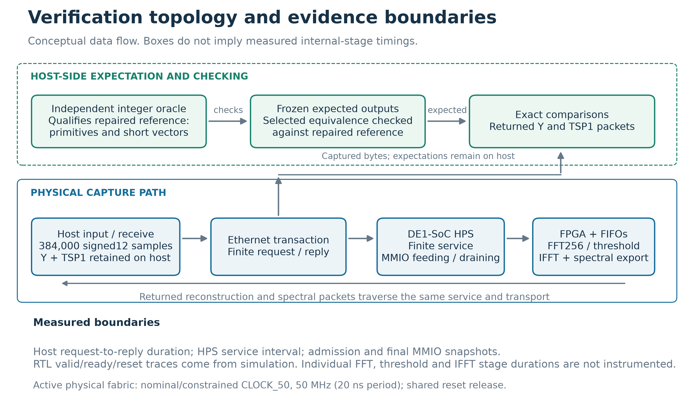
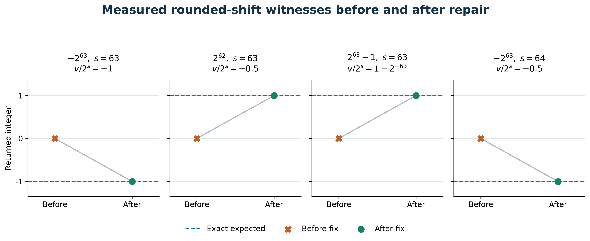
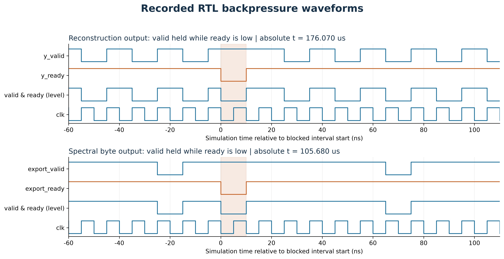
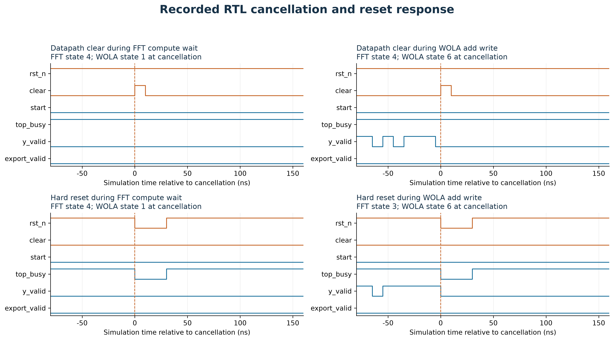

# T-RECAP

**Threshold-based Reduction and Encoding for Controlled Audio Processing**

**FPGA spectral sparsification, audio reconstruction, and measured host workload reduction on DE1-SoC.**

[](https://github.com/DatDinhh/T_RECAP/actions/workflows/phase2-source.yml)

[UVM and formal report](phase2/docs/verification/uvm_formal/TRECAP_UVM_Formal_Report.pdf) | [Original verification report](phase2/docs/verification/portfolio/TRECAP_DV_Portfolio.pdf) | [Runnable RTL verification](phase2/verification/tsh2/README.md) | [Results and provenance](phase2/docs/project_overview/README.md) | [Recorded web demo](https://github.com/DatDinhh/trecap-spectral-studio)

T-RECAP is a senior capstone project built around a fixed-point **FFT → tunable threshold → IFFT/WOLA** pipeline. The FPGA produces both a reconstructed audio waveform and a sparse representation of its spectrum. A laptop can inspect the audio, visualize spectral changes, and compute monitoring features from the retained spectral bins.

**New to the terminology?** See [Terms and abbreviations](#terms-and-abbreviations), including the difference between TSH2, THR2 and TSP1.

## Objective

**Reduce the spectral data a host must receive and process, while measuring the signal information lost at each threshold.** The practical application is a spectral-activity monitor: track dominant frequency, spectral centroid, band energy, and changes in activity from compact spectral records. The reconstruction path lets us hear and measure what the threshold removed.

This asks a specific engineering question: can a consumer that understands sparse spectra do less work while retaining the information its task needs? We compare dense and sparse representations at the **same threshold**, check their feature outputs for equality, and separately compare thresholded results with the original signal.

The current verified implementation processes finite audio files on a real DE1-SoC. Live microphone input and continuous real-time transport have not been qualified. The [project naming note](phase2/docs/project_identity.md) records the current full name and its relationship to historical documents. Electrical energy savings have not been established.

## What the project demonstrates

| Capability | Evidence |
|---|---|
| Process complete audio files through physical FPGA hardware | 58 checked runs across 13 inputs, including two repeats of every configuration |
| Preserve the intended fixed-point algorithm | All 22,301,696 returned waveform samples and 107,200,224 spectral packet bytes matched their threshold-specific reference |
| Trade spectral data volume for waveform fidelity | On the eight-second flute excerpt, threshold `10^8` reduced spectral packet bytes by **81.69%**, with **1.76% waveform NRMSE** |
| Reduce work in a compatible laptop consumer | At `10^8`, strict packet validation plus 16-band features used **77.21% less elapsed time** in paired warm-RAM replay of actual FPGA output |
| Check application-specific quality | A separate spectral monitor retained its registered quality gates on four held-out natural recordings at `10^7` |
| Provide reviewable design verification | Independent arithmetic checks, directed and seeded RTL tests, scoreboards, negative controls, observed coverage, native waveforms, physical receipts, and an academic LaTeX report |

These are different measurement boundaries. A smaller spectral packet is not a smaller WAV file, a faster sparse consumer is not a faster FPGA FFT, and exact reference agreement does not mean the threshold preserved the original audio.

## Current architecture


The [current TSH2 architecture atlas](phase2/docs/architecture/tsh2/README.md) expands this overview into eight source-bound views. Each plate describes the finite-file TCP/MMIO implementation and names its verification boundary.

| View | What it explains | Vector |
|---|---|---|
| [1. System overview](phase2/docs/architecture/tsh2/01-system.png) | Laptop, HPS and FPGA responsibilities in the finite-file path | [SVG](phase2/docs/architecture/tsh2/01-system.svg) |
| [2. DSP and finite frames](phase2/docs/architecture/tsh2/02-dsp-finite-frames.png) | Windowing, FFT, threshold, IFFT/WOLA and finite-stream geometry | [SVG](phase2/docs/architecture/tsh2/02-dsp-finite-frames.svg) |
| [3. Transform engines and memory](phase2/docs/architecture/tsh2/03-transform-memory.png) | Iterative transform engines and their local storage | [SVG](phase2/docs/architecture/tsh2/03-transform-memory.svg) |
| [4. Finite epoch and feed/drain](phase2/docs/architecture/tsh2/04-finite-epoch-feed-drain.png) | Start, input feeding, output draining and full-tail completion | [SVG](phase2/docs/architecture/tsh2/04-finite-epoch-feed-drain.svg) |
| [5. TSP1 and waveform outputs](phase2/docs/architecture/tsh2/05-tsp1-y-outputs.png) | Separate sparse spectral powers and reconstructed samples | [SVG](phase2/docs/architecture/tsh2/05-tsp1-y-outputs.svg) |
| [6. TCP, HPS and MMIO](phase2/docs/architecture/tsh2/06-tcp-hps-mmio.png) | Finite host transaction, Linux RAM and adapter FIFO access | [SVG](phase2/docs/architecture/tsh2/06-tcp-hps-mmio.svg) |
| [7. Configuration and backpressure](phase2/docs/architecture/tsh2/07-configuration-backpressure.png) | Idle configuration, ready/valid flow control and spectral credit | [SVG](phase2/docs/architecture/tsh2/07-configuration-backpressure.svg) |
| [8. Clock, reset and verification boundaries](phase2/docs/architecture/tsh2/08-clock-reset-verification.png) | Clock/reset ownership, checked behavior and remaining scope | [SVG](phase2/docs/architecture/tsh2/08-clock-reset-verification.svg) |

<details>
<summary>Expand the seven detailed architecture views</summary>

### 2. DSP and finite frames

Windowing, FFT, threshold, IFFT/WOLA and finite-stream geometry.


### 3. Transform engines and memory

Iterative transform engines and their local storage.


### 4. Finite epoch and feed/drain

Start, input feeding, output draining and full-tail completion.


### 5. TSP1 and waveform outputs

Separate sparse spectral powers and reconstructed samples.


### 6. TCP, HPS and MMIO

Finite host transaction, Linux RAM and adapter FIFO access.


### 7. Configuration and backpressure

Idle configuration, ready/valid flow control and spectral credit.


### 8. Clock, reset and verification boundaries

Clock/reset ownership, checked behavior and remaining scope.


</details>

1. **Laptop:** prepare signed 12-bit PCM samples and choose `THR2` for the run.
2. **ARM HPS on the board:** receive the complete file over TCP into Linux RAM, then interleave MMIO input writes with waveform and spectral FIFO reads.
3. **FPGA:** window overlapping frames, calculate the FFT, canonicalize the real-signal spectrum, suppress eligible bins below the power threshold, and reconstruct the waveform using IFFT and weighted overlap-add.
4. **FPGA spectral exporter:** emit retained powers and bin indices as sparse TSP1 records. The HPS returns these records and the separate reconstructed waveform to the laptop.
5. **Laptop consumer:** validate records, compute features or monitor activity, and display the results. Reference checking evaluates implementation correctness and signal distortion separately.

The **waveform output contains reconstructed samples**. The **TSP1 output contains squared magnitudes without phase**, so it cannot reconstruct audio by itself. The finite TCP service returns sparse records. The lower-level adapter also supports dense records for verification.

The current implementation is called **TSH2**, an internal name for the finite-file FPGA application profile and its host register interface. It uses ready/valid waveform flow control and spectral-record credit to preserve state while the host feeds and drains data. Its elapsed FPGA counter includes host-induced stalls. The [historical architecture atlas](phase2/docs/architecture/diagrams/README.md) preserves the broader DDR-ring/UDP source snapshot dated 2026-09-14. Its interfaces and acceptance scope are separate from current TSH2 verification.

| Architecture scope | Current TSH2 atlas | Historical atlas, 2026-09-14 |
|---|---|---|
| Input | Complete PCM file through HPS-fed MMIO FIFO | BRAM replay, LINE-IN, ADC and diagnostic source architecture |
| Transport | TCP to HPS Linux RAM, then interleaved MMIO feed/drain | Reserved-DDR ring and HPS UDP forwarding |
| Outputs | Separate reconstructed Y samples and TSP1 spectral powers | WAVE, spectrum, metrics and status telemetry records |
| Qualification | Registered finite-file RTL and physical-capture checks | Historical design snapshot with its own bring-up and acceptance scope |


| Parameter | Current verified profile |
|---|---|
| Platform | Terasic DE1-SoC, Cyclone V, 50 MHz fabric clock |
| Input | Signed 12-bit PCM, represented in sign-extended 32-bit transport words |
| FFT / hop | 256 samples / 128 samples |
| Fixed-point fractional precision | 15 bits |
| Spectral representation | 129 canonical bins, unsigned 56-bit squared magnitudes |
| Eight-second run | 384,000 input samples at nominal 48 kHz, 3,001 frames and 384,512 full-tail output samples |
| Reconstruction delay | 384 samples, equivalent to 8 ms at 48 kHz. This is not network latency |
| Packet size | 952 bytes/frame in dense mode and `48 + 8K` bytes/frame in sparse mode for `K` retained bins |
| Fitted profile resources | 6,521 ALMs, 47 M10K blocks and 35 DSP blocks, as recorded in the historical fit and timing evidence tied to the source |

`THR2` is a power threshold on `Re(X)^2 + Im(X)^2`, not a percentage or a calibrated sound level. An eligible bin is suppressed when its power is **strictly less** than the threshold. Equality is retained, DC is protected, and Nyquist is eligible. Thresholds are configured while idle and remain fixed throughout a run. Increasing the threshold does not shorten the baseline FFT/IFFT schedule.

## What happens to an audio file?

The following plots use the actual reconstructed waveform captured from the board. They show an eight-second flute excerpt credited to the University of Iowa Musical Instrument Samples collection. Output is aligned by the known 384-sample delay before comparison. The full output tail is still checked during verification.


The spectrograms use one shared scale. Threshold zero reproduces this prepared input exactly after alignment. Increasing the threshold removes weak spectral components. At high thresholds the audible waveform changes substantially. This is selective suppression, not a general-purpose denoising guarantee.



| `THR2` | Waveform NRMSE vs input | Sparse spectral bytes | Reduction vs dense spectral format |
|---:|---:|---:|---:|
| `0` | 0.00% | 3,241,080 | **13.45% larger** |
| `10^8` | 1.76% | 523,200 | 81.69% smaller |
| `10^9` | 3.80% | 410,192 | 85.64% smaller |
| `10^10` | 9.62% | 318,360 | 88.86% smaller |
| `10^11` | 27.19% | 237,232 | 91.70% smaller |

The dense baseline is **2,856,952 bytes** for the same 3,001 spectral frames. Sparse encoding adds an index to every retained bin, so it loses at threshold zero when all bins remain. These counts include TSP1 headers and padding but exclude the separately returned waveform and TCP/IP framing. They do not measure WAV compression or total network traffic reduction.



NRMSE is `100 × ||aligned_output - input||₂ / ||input||₂`. It measures total waveform error, not perceived quality. Every thresholded FPGA output matched its corresponding numerical reference exactly, even when it differed considerably from the input. A low aggregate error can also hide large relative losses in weak frequency bands.



The physical campaign also processed natural environmental recordings and synthetic signals. The [case ledger](phase2/docs/results/verification_20261017/hardware/cases.csv) identifies all 58 runs. The [application results](phase2/docs/project_overview/README.md) explain the monitor quality gates and recording provenance. No new hardware execution was performed to redraw these overview figures.

## What work is reduced on the laptop?

A dense consumer visits every spectral bin, including bins that the FPGA has already zeroed. A sparse consumer iterates over retained `(bin index, power)` entries. It can validate fewer bytes and skip arithmetic for omitted bins while producing the same thresholded features.


This experiment replays actual captured sparse FPGA packets from RAM on an **Intel Core i7-8750H**, with 3,001 frames per eight-second flute clip and 30 matched dense/sparse trials. The host re-encodes the same thresholded values into dense control packets. Those controls are not additional FPGA captures. Both paths produce identical integer 16-band features.

| Threshold | Feature computation: paired elapsed-time reduction | Packet validation + features: paired elapsed-time reduction |
|---:|---:|---:|
| `0` | 185.8% more time | 20.8% more time |
| `10^8` | 58.2% less time | 77.2% less time |
| `10^9` | 65.5% less time | 77.7% less time |
| `10^10` | 74.4% less time | 83.3% less time |
| `10^11` | 78.6% less time | 85.6% less time |

Percentages are medians of `100 × (dense_time - sparse_time) / dense_time` across 30 matched pairs. These are elapsed times for the measured consumer stages, with input already resident in RAM. FPGA execution, Ethernet, disk access, and AI inference are excluded. At `10^8`, the median paired saving for validation plus features is **3.84 ms per eight-second clip**. That is a small absolute saving for one stream. It establishes a benefit for this consumer, not a whole-laptop utilization reduction or an end-to-end system speedup. Raw trial extracts and calculation rules are linked in the [results guide](phase2/docs/project_overview/README.md).

The application adds a **causal spectral-activity monitor** with grouped band energy, peak frequency, centroid, and activity-change events. At `10^7`, all four held-out natural recordings passed its registered quality gates in the physical capture audit. A separate software-reference replay benchmark measured a dense/sparse receiver time ratio of **1.311x**, the median of four per-recording median paired ratios, with 30 pairs per recording. That receiver result has its own timing boundary and is not a fresh physical-board timing measurement.


### Findings that limit the claim

- In an earlier resident-compute comparison of six 1,024-sample jobs, the TSH1 FPGA implementation took **4.23 to 6.25 times** the i7-8750H laptop's median time. This is a historical compute-only result, not a new TSH2 timing measurement. Sparse host processing is a different benefit.
- The FFT/IFFT schedule still runs at every threshold. Fewer retained bins do not imply fewer FPGA transform cycles.
- Thresholding a waveform did not establish fewer YAMNet inference calls or an AI inference speedup. This repository's demonstrated consumer is spectral monitoring.
- Electrical energy savings, live microphone acceptance, production reliability, and recognition accuracy remain unproven.

## Design verification

The verification work connects a defined contract, an independently checked numerical model, RTL simulation, and physical board output. It also tests whether the checkers reject incorrect results.



| Verification layer | Executed evidence |
|---|---|
| Reference arithmetic | 729,156 independent arithmetic comparisons, 11 C++ tests and 248 finite-input corner checks |
| Directed RTL campaign | 14 fresh suites covering arithmetic boundaries, threshold semantics, finite geometry, malformed controls, stalls, and reset/recovery |
| Full-length RTL, included in the 14 suites | Two 384,000-input runs, checking 769,024 waveform outputs, 774,258 canonical-bin observations, and 6,002 frames in total |
| Public seeded regression | Three seeds across four threshold/packet-mode cases: 12 epochs, 18,432 exact waveform samples, 13,932 canonical rows, and 94,440 packet bytes |
| Checker qualification | Intentional corrupt/missing results, unknown-value and completion controls, bounded timeouts, plus a real RTL run with mutated expected output that must fail |
| Physical DE1-SoC campaign | 58 epochs across 29 configurations and 13 inputs, with exact output/packet comparison and zero final fault/drop flags |
| Traceability | Source and fixture hashes, requirement dispositions, observed event coverage, JSON/JUnit receipts, native VCD traces, and published data provenance |

**A real defect was found and repaired:** the software reference's signed round-shift helper mishandled shifts 63 and 64. The failing boundary cases were reproduced before the fix, then checked independently after it. This repair concerns the reference arithmetic. It is not presented as a new FPGA speed optimization.



**Flow control and recovery are verified explicitly.** The traces below come from RTL simulation. They show held data during output stalls, completed transfers, and reset/recovery behavior. They are evidence excerpts, not schematic illustrations or complete full-run waveforms.





Open the native [startup](phase2/docs/results/verification_20261017/waveforms/startup.vcd), [reset/recovery](phase2/docs/results/verification_20261017/waveforms/reset_recovery.vcd), and [final-output-stall](phase2/docs/results/verification_20261017/waveforms/final_y_stall.vcd) traces in a waveform viewer. The [16-page academic report](phase2/docs/verification/portfolio/TRECAP_DV_Portfolio.pdf) includes eight figures, eleven tables, methodology, failures, source binding, and sign-off limits. Its [LaTeX source and build guide](phase2/docs/verification/portfolio/README.md) are committed with the report.

The original campaign disposition is **pass for the registered finite-file profile under the tested conditions**. That historical environment uses SystemVerilog procedural assertions and scoreboards. The separate supplement below adds genuine UVM execution and local formal proofs. Neither campaign establishes formal CDC/RDC, code-coverage closure or industrial certification. The broader original specification still has **30 partial and 16 excluded requirements**, which are requirement dispositions rather than a test pass rate. [Read the complete verification scope](phase2/verification/README.md).

### UVM and formal supplement

The October 17 supplement adds a reusable **Accellera UVM 1.2** environment and actual **SBY/Yosys formal proofs** against unchanged TSH2 RTL. It preserves the historical campaign and its board results.

| New evidence | Executed scope |
|---|---|
| Genuine UVM simulation | Three seeds, four complete cases each: **12 completed epochs**, including three reset recoveries. Three interrupted prefixes are counted separately |
| Exact UVM scoreboards | 18,432 waveform outputs, 13,932 canonical-bin records and 94,440 packet bytes. Independent replay checks reconcile the captured observations |
| UVM failure qualification | A mutated expected waveform value produces the intended fatal mismatch. One simulator startup crash is preserved with an explicit bounded recovery record |
| Local formal proofs | **16 safety/equivalence jobs**: FIFO order at reduced depths, deployed output-FIFO control, 11 round/saturate instances and threshold-mask control/relations |
| Formal covers | **14 bounded-cover jobs** reach 73 selected predicates. Cover witnesses establish reachability, not universal correctness |
| Formal negative controls | Three deliberately false assertions produce the intended counterexamples. They are expected failures, not additional proofs |


Read the [academic LaTeX supplement](phase2/docs/verification/uvm_formal/README.md), [UVM runner and evidence](phase2/verification/uvm/README.md), and [formal properties, assumptions and witnesses](phase2/verification/formal/README.md). UVM uses deterministic seeded schedules and observed counters with the installed Starter simulator. Solver-constrained randomization, covergroups and code-coverage closure are not claimed. Formal scope is local and instance-specific: it does not prove the complete FFT/IFFT pipeline, production-depth FIFO data order or the separate PCM FIFO.

## Terms and abbreviations

Start here if you are new to the project. **TSH2 is an implementation name, THR2 is a threshold setting, and TSP1 is an output format.** They refer to different things.

In one sentence: the **TSH2** FPGA profile applies **THR2** to FFT-bin power, exports retained spectral powers in **TSP1** packets, and separately produces reconstructed audio **Y**.

### Project names and output labels

| Term | Meaning in this repository |
|---|---|
| **T-RECAP** | Threshold-based Reduction and Encoding for Controlled Audio Processing. |
| **TSH2** | The internal identifier for the current finite-file FPGA application profile and its host register interface. A *profile* is a particular implementation with a defined configuration and interface. The repository does not document a long-form expansion of the letters T/S/H. |
| **TSH1** | The earlier FPGA profile used for the historical 1,024-sample resident-compute comparison. Its timing results must not be read as current TSH2 measurements. |
| **THR2** | The threshold applied to squared FFT magnitude: `Re(X)^2 + Im(X)^2`. It is expressed in the implementation's fixed-point power units, not percent, decibels or sound-pressure level. Values below it are suppressed. Equality is retained, and DC is protected. |
| **TSP1** | The project's version-1 spectral packet format. It carries frame metadata and power values, with retained-bin indices in sparse mode. It omits phase, so these packets alone cannot reconstruct the audio. |
| **Y** | The reconstructed time-domain audio output from the IFFT/WOLA path. This sample stream is separate from TSP1 spectral packets. |

For the exact interfaces, see the [TSH2 contract](phase2/profiles/tsh2/work/trecap_stream8_v01/CONTRACT.md) and [output architecture](phase2/docs/architecture/tsh2/README.md).

### Audio and signal processing

| Term | Meaning and why it matters here |
|---|---|
| **DSP** | Digital signal processing: numerical operations on sampled signals. A hardware *DSP block* is a dedicated arithmetic resource inside the FPGA. |
| **PCM / WAV** | Pulse-code modulation represents audio as numeric samples. WAV is a file container that can store those samples. WAV-file size and spectral-packet size are different measurements. |
| **FFT / IFFT** | Fast Fourier transform and inverse fast Fourier transform. The FFT maps a time-domain frame to frequency coefficients. The IFFT maps coefficients back to time-domain samples. |
| **WOLA** | Weighted overlap-add. Windowed, overlapping frames are combined to form the reconstructed waveform. |
| **Frame / hop** | A frame is one window of samples processed together. The hop is how far the next frame advances. Current settings use 256 samples per FFT frame and a 128-sample hop. |
| **Fixed-point arithmetic** | Integer arithmetic with an agreed binary scale. Rounding, saturation and scaling are part of the implementation and must match the numerical reference. |
| **Bin / canonical bins** | A bin is one discrete FFT frequency index. A real 256-point FFT has 129 unique bins including DC and Nyquist. These are the canonical bins used by the exporter. |
| **Magnitude / power / phase** | Magnitude is the size of a complex FFT coefficient. Power here is its squared magnitude. Phase describes its angle. TSP1 retains power, while waveform reconstruction requires the appropriate complex coefficients. |
| **DC / Nyquist** | DC is the zero-frequency component. Nyquist is half the sample rate. The threshold protects DC. The Nyquist bin can be suppressed. |
| **Dense / sparse / sparsification** | Dense spectra store every canonical bin, including zeros. Sparse spectra store retained bins with their indices. Sparsification suppresses selected coefficients and permits this compact representation. Dense and sparse data at the same threshold represent the same retained powers. |
| **Spectrogram / band energy** | A spectrogram shows spectral strength over time and frequency. Band energy groups and sums powers over selected bins. The 16-band consumer uses 16 disjoint bin groups. |
| **Spectral centroid / dominant frequency** | The centroid summarizes where spectral weight is concentrated. Dominant frequency identifies the strongest spectral component. Both are monitoring features computed downstream. |
| **NRMSE** | Normalized root-mean-square error. Here it is the waveform error-vector norm divided by the reference waveform's norm, reported as a percentage. It measures numerical waveform difference, not recognition accuracy or perceived audio quality. |
| **Consumer / features / AI** | A consumer is downstream software using the output. Features are summaries such as band energies. AI means artificial intelligence. YAMNet is the pretrained audio-event model explored here. The measured 16-band consumer is separate from AI inference. |

### Hardware, transport and timing

| Term | Meaning and why it matters here |
|---|---|
| **FPGA / SoC / DE1-SoC** | Field-programmable gate array / system on a chip. DE1-SoC is the development board used here. Its Cyclone V device contains FPGA fabric and an ARM processor subsystem. |
| **CPU / HPS / host** | CPU means central processing unit. HPS means hard processor system, the ARM side of the board running Linux. In the workload plots, the host CPU is the laptop's Intel CPU. The board CPU and laptop CPU are distinct measurement targets. |
| **MMIO** | Memory-mapped input/output. Software reads or writes hardware registers through addresses, allowing the HPS to configure, feed and drain the FPGA. |
| **FIFO / BRAM / M10K** | First-in, first-out queue / block RAM. FIFOs buffer ordered data. BRAM is on-chip memory. M10K names a Cyclone V embedded memory-block resource. |
| **RAM / DDR** | Random-access memory / double data rate. DDR refers to external memory in the historical architecture. It should not be confused with the current FPGA's on-chip FIFOs. |
| **Ready/valid / backpressure / credit** | A ready/valid transfer occurs when both signals are asserted. Backpressure pauses acceptance until the receiver has space. Spectral-record credit reserves capacity before producing another frame's records. |
| **TCP/IP / UDP / Ethernet** | Transmission Control Protocol / Internet Protocol and User Datagram Protocol are network protocols. Ethernet provides the network link. The current finite-file path uses TCP. UDP appears in the historical architecture. |
| **Epoch / tail / drain** | An epoch is one accepted processing run. The tail completes the final overlapping frames after input ends. Draining reads pending outputs. FPGA DONE alone does not mean the laptop has received every output. This use of epoch is unrelated to AI training. |
| **Latency / throughput / elapsed cycles** | Latency is delay to a defined output. Throughput is the amount processed per unit time. Elapsed cycles count clock ticks between defined events. The current TSH2 counter includes stalls caused by host feed/drain, so it is not a pure arithmetic-only timing measurement. |
| **ADC / LINE-IN** | Analog-to-digital converter / analog line-level input. These concern physical audio capture. The qualified implementation uses finite audio files. Live input through the board's audio jack is outside the verified scope. |

### Design verification and evidence

| Term | Meaning and why it matters here |
|---|---|
| **RTL / DUT** | Register-transfer level / design under test. RTL describes the hardware. DUT identifies the module or subsystem being checked. |
| **UVM** | Universal Verification Methodology. A SystemVerilog framework that organizes stimulus, drivers, monitors and scoreboards into reusable simulation components. Using UVM alone does not establish verification completeness. |
| **Sequence / driver / monitor / scoreboard** | A sequence supplies test transactions, which a driver applies to the DUT. A monitor observes actual interface activity, and a scoreboard compares those observations with expected results. |
| **Reference model / bit-exact** | The reference model computes expected numerical results. Bit-exact means the checked integer values match exactly, including the required rounding and saturation behavior. |
| **Seed / regression / coverage** | A seed makes a stimulus schedule reproducible. A regression runs a collection of tests. Coverage records what was exercised. The current observed counters are not a claim of complete code or functional coverage. |
| **Formal verification / assertion / assumption** | Formal tools analyze a mathematical model of the RTL. An assertion states what must hold. An assumption limits permitted inputs or behavior. A passing proof applies only to its stated model, properties and assumptions. |
| **SBY / Yosys** | Tools used by this project's formal flow. SBY, also known as SymbiYosys, coordinates formal jobs. Yosys processes the RTL into the model used by the proof flow. These names do not imply that the entire design was proved. |
| **Proof / cover / counterexample** | A proof establishes a property within its stated scope. A cover witness shows that a selected event is reachable. A counterexample is a trace that violates an assertion. A cover witness is not a universal correctness proof. |
| **Negative control** | An intentionally incorrect expected value or property used to check that the verification flow detects a fault. Its expected failure is evidence about the checker, not automatically a DUT defect. |
| **VCD / waveform** | Value Change Dump, a file format containing signal changes over simulation or formal-trace time. A waveform viewer displays those changes for inspection. |
| **CDC / RDC** | Clock-domain crossing / reset-domain crossing. These refer to checks on signals crossing clock or reset boundaries. They require their own analysis. Local functional proofs do not establish CDC/RDC signoff. |
| **Provenance** | The recorded source version, tool configuration, inputs and run artifacts that connect a reported result to the work that produced it. |

## Reproduce the checks

Clone the repository, then check the public package using Python 3.12:

```sh
git clone https://github.com/DatDinhh/T_RECAP.git
cd T_RECAP
python phase2/verification/tsh2/run.py --check-package
```

This command validates the package and qualifies its scoreboards using constructed traces. It does not simulate RTL. With an installed ModelSim-compatible simulator, run:

```sh
python phase2/verification/tsh2/run.py --suite regression --sim-bin /path/to/modelsim/bin --out tsh2_regression_01
```

Build and test the C++20 reference model with CMake 3.24 or later:

```sh
cd phase2
cmake --preset verify
cmake --build --preset verify --parallel 2
ctest --preset verify
```

The [portable regression guide](phase2/verification/tsh2/README.md) documents simulator setup, output files, and fresh output-directory requirements. GitHub Actions runs reference functional tests, RTL frontend elaboration, hygiene checks, package/checker qualification, and public evidence integrity checks on Linux and Windows. Licensed RTL simulation and physical hardware runs are recorded separately. The [formal workflow](https://github.com/DatDinhh/T_RECAP/actions/workflows/formal.yml) separately downloads a hash-pinned tool suite and executes all 33 formal proof, cover and expected-failure jobs. UVM is not executed by the ordinary host package checks.

The [TSH2 application archive](phase2/profiles/tsh2/README.md) includes the board adapter, service, consumers, monitor, and local visualizer source. It also documents external coefficients, native libraries, fitted-image dependencies, and runtime admission requirements. It is not a one-command board deployment. The separate [Spectral Studio repository](https://github.com/DatDinhh/trecap-spectral-studio) is a recorded demonstration. Visiting it does not remotely operate this board.

## Repository map

| Path | Purpose |
|---|---|
| [`phase2/rtl`](phase2/rtl) | Fixed-point datapath and broader source/transport RTL |
| [`phase2/profiles/tsh2`](phase2/profiles/tsh2/README.md) | Archived current finite-file adapter, service, consumers, monitor, and visualizer |
| [`phase2/sw/reference_model`](phase2/sw/reference_model/README.md) | C++ arithmetic reference and artifact tools |
| [`phase2/verification/tsh2`](phase2/verification/tsh2/README.md) | Portable synthetic RTL regression and scoreboards |
| [`phase2/verification/uvm`](phase2/verification/uvm/README.md) | Genuine UVM components, observed traces, exact scoreboards and reproducible runner |
| [`phase2/verification/formal`](phase2/verification/formal/README.md) | Local proof harnesses, assumptions, solver receipts and counterexamples |
| [`phase2/docs/verification/uvm_formal`](phase2/docs/verification/uvm_formal/README.md) | Academic supplement, LaTeX, diagrams and actual trace plots |
| [`phase2/verification/campaign_sources`](phase2/verification/campaign_sources/README.md) | Accepted boundary/recovery bench source archive |
| [`phase2/docs/verification/portfolio`](phase2/docs/verification/portfolio/README.md) | Academic PDF, editable LaTeX, and report figures |
| [`phase2/docs/results/verification_20261017`](phase2/docs/results/verification_20261017/README.md) | Physical/RTL evidence ledger, coverage, source binding, and VCDs |
| [`phase2/docs/project_overview`](phase2/docs/project_overview/README.md) | README figures, tables, audit, provenance, and reproduction notes |
| [`phase2/docs`](phase2/docs/README.md) | Specifications, architecture, build guides, and historical results |
| [`phase1_demo`](phase1_demo) | Historical first-semester demonstration |

The earlier [architecture atlas](phase2/docs/architecture/diagrams/README.md), [board-power study](phase2/docs/results/board_power_20260925/README.md), and [ARM HPS benchmark](phase2/docs/results/hps_cpu_benchmark_20260925/README.md) remain available with their original scope. The HPS benchmark compares the CPU on the board, not the laptop CPU.

## About

T-RECAP is a senior capstone engineering project investigating the connection between fixed-point FPGA signal processing, sparse spectral data, and measurable downstream work. Its portfolio spans RTL design, numerical debugging, hardware/software integration, application evaluation, and reproducible design verification.

Project-authored code is distributed under the [MIT license](LICENSE). Third-party toolchains and audio datasets retain their own terms. The flute example is credited to Lawrence Fritts and the [University of Iowa Musical Instrument Samples collection](https://theremin.music.uiowa.edu/MIS.html). Environmental recording credits and dataset distinctions are preserved in the [data provenance](phase2/docs/results/verification_20261017/data_provenance/dataset_terms.json). Raw third-party recordings are not bundled with the verification package.
