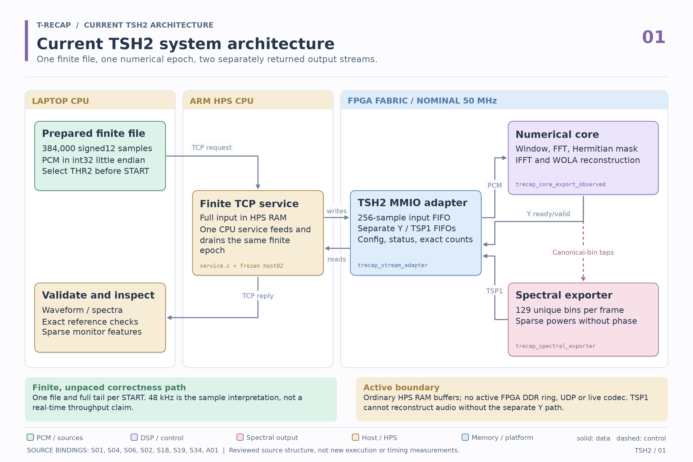

# T-RECAP Phase 2

**Current verified application: finite-file FPGA spectral sparsification, waveform reconstruction, and laptop spectral monitoring.**

The [main project README](https://github.com/DatDinhh/T_RECAP#readme) explains the objective, architecture, processed-audio spectrograms, measured data/workload tradeoffs, and design verification. Start there for a visual overview. This page maps the implementation and reproduction paths.

## Current profile and objective

The **TSH2 finite-file profile** retains the FFT, tunable squared-magnitude threshold, and IFFT/WOLA reconstruction. It additionally exports sparse spectral powers so a compatible host consumer can avoid processing omitted bins. Evaluation measures waveform distortion, spectral packet bytes, and host consumer time separately.



The [current eight-view TSH2 atlas](docs/architecture/tsh2/README.md) details finite frames, transform storage, epoch/feed-drain sequencing, TSP1/Y outputs, TCP/HPS/MMIO, configuration/backpressure and clock/reset/verification boundaries.

A laptop uploads complete PCM input to the ARM HPS over TCP. The HPS buffers it and interleaves MMIO writes to the FPGA's input FIFO with reads from waveform and spectral output FIFOs. The FPGA produces reconstructed samples and phase-free TSP1 powers; the HPS returns both outputs. Laptop software validates and visualizes them, then computes spectral features or monitoring events.

This path is finite and unpaced. Threshold and packet mode remain fixed during an epoch. Ready/valid output flow control and spectral-record credit can pause progress while preserving overlap state. Live microphone/codec operation, hard real-time transport, and original DDR-ring/UDP acceptance remain separate work.

| Current profile | Recorded value |
|---|---|
| Signal geometry | Signed 12-bit input; 256-point FFT/IFFT; 128-sample hop; 384-sample reconstruction delay |
| Full physical epoch | 384,000 input samples; 3,001 frames; 384,512 full-tail waveform samples |
| Numerical control | Fixed precision `F = 15`; unsigned 56-bit squared-magnitude `THR2`; DC protected |
| Hardware | DE1-SoC at nominal 50 MHz; source-bound fit uses 6,521 ALMs, 47 M10Ks and 35 DSP blocks |
| Latest registered campaign | 14 fresh RTL suites and 58 physical epochs, with exact numerical/packet checks |

The [results guide](docs/project_overview/README.md) separates current physical captures, historical host timing, software-reference monitor replay, and original architecture studies. Read the denominators before comparing figures. No qualified electrical energy saving or FPGA advantage over the laptop is claimed.

## Choose an entry point

| Goal | Start here |
|---|---|
| Understand the application and view results | [Main README](https://github.com/DatDinhh/T_RECAP#readme), [figures and provenance](docs/project_overview/README.md) |
| Explore the current architecture in detail | [Eight-view TSH2 atlas](docs/architecture/tsh2/README.md) |
| Review the DV methodology and outcome | [Verification portfolio](verification/README.md), [academic PDF and LaTeX](docs/verification/portfolio/README.md) |
| Run reproducible off-board RTL tests | [Portable TSH2 package](verification/tsh2/README.md) |
| Inspect physical run evidence | [58-case campaign ledger](docs/results/verification_20261017/README.md) |
| Read the actual finite-file application source | [TSH2 workbench archive](profiles/tsh2/README.md) |
| Build the shared numerical model | [C++ reference model](sw/reference_model/README.md) |
| Explore the original broad architecture | [Historical atlas, 2026-09-14](docs/architecture/diagrams/README.md), [design](docs/architecture/architecture_design.md), [specification](docs/specs/README.md) |
| View a recorded demonstration | [Spectral Studio repository](https://github.com/DatDinhh/trecap-spectral-studio) |

## Reproduce portable verification

Run from this `phase2/` directory with Python 3.12:

```sh
python verification/tsh2/run.py --check-package
python docs/results/verification_20261017/export_public_evidence.py --check docs/results/verification_20261017
```

The first command checks source/fixture admission and scoreboard controls; it does not run a DUT. For actual RTL simulation with a ModelSim-compatible installation:

```sh
python verification/tsh2/run.py --suite regression --sim-bin /path/to/modelsim/bin --out ../../tsh2_regression_01
```

Use a fresh output directory. The package contains project-generated synthetic stimuli and exact checkers; no board or third-party recording is required. See its README for dependencies, smoke tests, logs, event coverage, and JUnit results.

For the C++20 reference model, use CMake 3.24 or later:

```sh
cmake --preset verify
cmake --build --preset verify --parallel 2
ctest --preset verify
```

GitHub Actions executes source hygiene, RTL frontend elaboration, reference functional tests, checker qualification, and public evidence integrity on Linux and Windows. Licensed simulator runs and board measurements have their own receipts. The [verification scope](verification/README.md) records remaining requirements and separates procedural SystemVerilog checking from formal or UVM claims.

## Source map and deployment boundaries

| Path | Role |
|---|---|
| `rtl/`, `spec/`, `config/` | Shared datapath and original architecture source/contracts |
| `sw/reference_model/` | Fixed-point arithmetic, finite reference processing and artifact generation |
| `profiles/tsh2/` | Archived finite TCP/MMIO profile, stream wrapper, consumer, monitor and local visualizer |
| `verification/tsh2/` | Self-contained admitted RTL source/fixtures and portable simulator runner |
| `verification/campaign_sources/` | Accepted directed bench archive for the larger campaign |
| `sim/` | Original simulation environments and reference adapter |
| `sw/hps/`, `sw/pc_dashboard/` | Original DDR/UDP transport and dashboard implementation |
| `platform/`, `constraints/` | Platform Designer boundary, board setup and timing/pin constraints |
| `artifacts/` | Shared coefficients, synthetic vectors, numerical expectations and manifests |
| `docs/` | Current verification/results and explicitly scoped historical design records |
| `legacy/` | Historical material excluded from active builds |

The TSH2 archive preserves maintained source, not every fitted/generated dependency or runtime plan. Its [README](profiles/tsh2/README.md) lists missing external artifacts and fresh admission requirements. Do not treat the old DDR/UDP dashboard launch instructions as a TSH2 board deployment. The recorded web demonstration does not give remote users access to a physical board.

## Earlier architecture and experiments

The original Phase 2 plan includes BRAM replay, LINE-IN, optional ADC input, nonbackpressuring telemetry taps, a reserved-DDR ring, HPS UDP transport, and a desktop dashboard. Those sources and design documents remain available, but successful TSH2 verification does not close every original requirement. The earlier overview is preserved [at its reviewed commit](https://github.com/DatDinhh/T_RECAP/blob/351ff6a8ef9f7ebd9893a531d71ac7626f95a0e2/phase2/README.md).

- [Original Lite fit and JTAG checkpoint](docs/results/de1soc_lite_bram_20260915.md): the earlier 21,220-ALM image, not the current TSH2 fit.
- [FPGA-only power study](docs/results/board_power_20260925/README.md): physical measurements that do not establish an electrical energy saving.
- [ARM HPS timing study](docs/results/hps_cpu_benchmark_20260925/README.md): a comparison with the CPU on the board, not the laptop, with explicit timer exclusions.
- [IFFT operand isolation](experiments/ifft_zero_isolation/README.md): a separate experimental overlay.
- [Original build sequence](docs/architecture/build_order.md) and [documentation guide](docs/README.md): component implementation and historical bring-up procedures.

See [contributing](CONTRIBUTING.md) for source ownership and generated-file rules, and [repository maintenance](docs/repository_maintenance.md) for publication checks.
