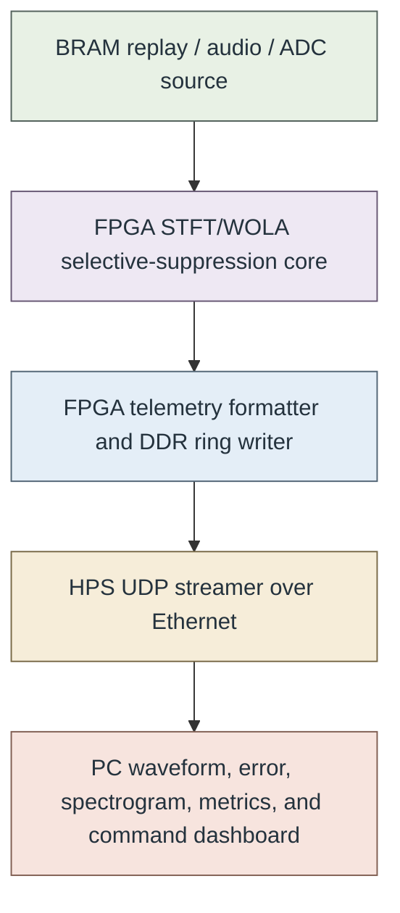

# Baseline PDF page 002

Historical baseline. Front matter 1. [Original PDF page](../../specs/t_recap_phase2_integrated_spec.pdf#page=2).

[Previous](page-001.md) | [Index](../README.md) | [Next](page-003.md)

[Edit Markdown and LaTeX source](../source/baseline/page-002.md). Equations are rendered locally as SVG.

## Executive Summary

This document merges the T-RECAP Phase 2 Core Algorithm Specification, the Ethernet/HPS DDR Telemetry Specification, Revision G, and the Core Implementation Repository Architecture Specification, Revision D, into one formal implementation contract. The first part freezes the deterministic fixed-point STFT/WOLA selective-suppression core. The second part freezes the DE1-SoC telemetry path used to stream waveform, spectrum, metrics, status, and control information between FPGA fabric, HPS DDR, HPS Ethernet, and the PC dashboard. The third part freezes the implementation repository structure, generated contracts, module ownership, build hygiene, and core-first implementation cuts. The core algorithm remains the source of truth for bit-accurate correctness. It defines signed 12-bit sample scale, FFT length L = 256, hop size H = 128, fractional precision F = 15, scheduling cushion G = 128, exact delay D = L + G = 384, active-after-windowing finite-stream scoring, coefficient artifacts, exact custom radix-2 FFT/IFFT integer algorithms, Hermitian canonicalization, magnitude-squared thresholding, WOLA reconstruction, metrics, artifacts, and acceptance criteria. The telemetry architecture is explicitly separate from the correctness path. FPGA fabric owns the live source, STFT/WOLA core, telemetry taps, packet formatting, and DDR ring writer. HPS owns Ethernet transport, UDP forwarding, command reception, control/status register access, and optional patching of diagnostic status fields. The PC owns visualization and user control. If the PC dashboard, HPS streamer, Ethernet link, or DDR ring falls behind, telemetry may be dropped and counted, but the STFT/WOLA core shall continue processing samples without backpressure. The integrated system direction is therefore:

The transport contract is deliberately non-stalling: if the PC dashboard, Ethernet, HPS streamer, DDR ring, packet FIFO, or telemetry writer falls behind, telemetry may be dropped and counted, but the STFT/WOLA core shall continue processing samples. The final correctness path remains BRAM replay with frozen artifacts, not live Ethernet telemetry. The repository architecture contract is deliberately implementation-focused. It does not define the verification repository. It freezes the source tree, generated header flow, filelists, module API rules, clock and reset ownership, Platform Designer ownership, coefficient ROM ownership, memory primitive policy, and the required C0 core-first implementation cut before telemetry, HPS bridge, Ethernet dashboard, or live audio integration becomes active implementation work.
