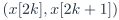
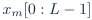
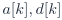
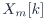
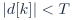
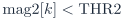
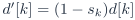
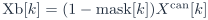
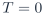
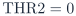

# Baseline PDF page 014

Historical Part I, core algorithm. Printed page 1. [Original PDF page](../../specs/t_recap_phase2_integrated_spec.pdf#page=14).

[Previous](page-013.md) | [Index](../README.md) | [Next](page-015.md)

[Edit Markdown and LaTeX source](../source/baseline/page-014.md). Equations are rendered locally as SVG.

## Part I - Core Algorithm and Signoff Contract

## 1 Overview and Scope

### 1.1 Purpose

Part I of this integrated specification is the source-of-truth contract for the Phase 2 T-RECAP mathematical core. It is written for the software golden model, RTL-equivalent model, simulation scoreboards, BRAM replay signoff, and deterministic reconstruction/metric evaluation. It is not a SystemVerilog architecture document. It does not specify module names, pin assignments, packet formats, HPS software, or a PC dashboard. Those layers shall preserve the core behavior defined here.

### 1.2 Problem statement

The Phase 2 core problem is:

Define a causal fixed-point STFT/WOLA operator for a real-valued stream. The operator suppresses low-energy spectral bins under a frozen arithmetic contract and reconstructs a delayed time-domain output for bit-accurate verification.

### 1.3 Continuity from Phase 1

Phase 1 grouped the stream into non-overlapping pairs, applied a two-sample Haar transform, suppressed the detail term when |d[k]| < T , and reconstructed the pair. When T = 0, the condition |d[k]| < 0 is never true, so Phase 1 has exact lossless reconstruction. Phase 2 preserves the same selective-suppression idea but moves the transform domain from two-sample Haar pairs to overlapped STFT frames. The T = 0 identity property does not transfer exactly because Phase 2 contains quantized windows, twiddles, FFT/IFFT rounding, WOLA accumulation, and final output rounding. The Phase 2 no-suppression condition is therefore deterministic near-lossless, not exact lossless.

**Table 1. Mathematical continuity from Phase 1 to Phase 2.**

| Concept | Phase 1: Haar | Phase 2: STFT/WOLA |
| --- | --- | --- |
| Streaming unit | Pair  | Overlapped frame  |
| Transform output |  |  |
| Suppression variable |  |  |
| Mask action |  |  |
| Reconstruction | Inverse Haar | IFFT + synthesis window + WOLA |
| Correctness anchor | Exact lossless at  | Deterministic near-lossless at  |
| Metrics | Suppressed pairs and time error | Suppressed eligible bins, kept spectral total, and time error |
