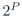
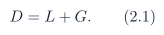
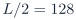
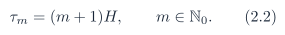

# Baseline PDF page 015

Historical Part I, core algorithm. Printed page 2. [Original PDF page](../../specs/t_recap_phase2_integrated_spec.pdf#page=15).

[Previous](page-014.md) | [Index](../README.md) | [Next](page-016.md)

[Edit Markdown and LaTeX source](../source/baseline/page-015.md). Equations are rendered locally as SVG.

### 1.4 Core boundary

The core consumes a signed sample stream x[n] ∈ SN and produces a signed reconstructed stream y[n] ∈ SN . The following items are wrappers outside the mathematical core:

- ADC unsigned-to-signed conversion and optional DC blocking,

- audio-codec sample formatting,

- HPS software and control registers,

- transport packetization, including HPS DDR, Ethernet/UDP, UART/USB if used, and PC visualization,

- board switches, LEDs, seven-segment displays, and

- SystemVerilog module decomposition.

## 2 Parameters, Timing, and Finite-Stream Policy

### 2.1 Baseline parameters

Let L =  be the FFT length and H = L/2 be the hop. Let G ≥ 0 be a scheduling cushion measured in sample periods. The exact causal delay is

**Table 2. Revision J baseline parameters.**

| Symbol | Meaning | Baseline |
| --- | --- | --- |
|  | External signed input/output sample width | 12 |
|  | FFT length | 256 |
|  | Number of radix-2 stages,  | 8 |
|  | Hop size |  |
|  | Fractional width for windows, twiddles, FFT data, and WOLA domain | 15 |
|  | Scheduling cushion from frame trigger to first allowed WOLA contribution |  |
|  | Exact causal delay |  samples |
| THR2 | Internal threshold register in the magnitude-squared domain | Programmable unsigned -bit integer |
| `PROTECT_DC` | Force DC bin to be kept | 1 |
| `PROTECT_NYQ` | Force Nyquist bin to be kept | 0 |

### 2.2 Frame timing

A frame trigger occurs whenever the accepted sample count reaches a positive multiple of H:

