# Baseline PDF page 016

Historical Part I, core algorithm. Printed page 3. [Original PDF page](../../specs/t_recap_phase2_integrated_spec.pdf#page=16).

[Previous](page-015.md) | [Index](../README.md) | [Next](page-017.md)

[Edit Markdown and LaTeX source](../source/baseline/page-016.md). Equations are rendered locally as SVG.

At trigger time 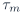, the frame contains the most recent  samples ending at 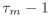:

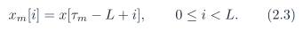

That frame contributes to output slots 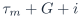. Therefore sample 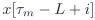 contributes to 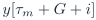, which establishes the delay .

### 2.3 Finite-stream signoff policy

For a finite input vector 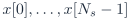, define zero extension:

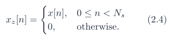

Revision J signoff vectors require 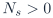. Empty input is not a signoff case. The default finite-stream policy is `full_tail`. Revision J defines the signoff frame set by active overlap after analysis-windowing, not only by raw finite-input overlap:

This prevents a zero-window edge frame from contributing artificial all-zero frame statistics when the only remaining real input sample lies at an analysis-window index whose quantized coefficient is zero. For the periodic square-root Hann baseline, 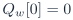 and 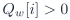 for 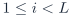, so the active-frame set reduces to

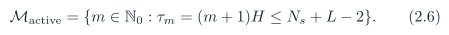

For , the required closed-form frame-count invariant is therefore

Let

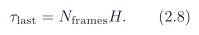

The full-tail emitted length is

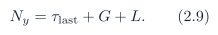

For a future window table with a different zero pattern, the general definition of  is normative and the closed-form shortcut above must be re-derived. Under `full_tail`, the driver shall continue asserting sample ticks after the  real input samples. Every post-input tick uses 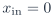 from the zero-extended stream, and ticks continue until exactly 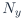 output samples have been emitted. These post-input values are flush samples. They are not counted as original input samples. A board replay or RTL testbench that stops sample-enable immediately after  real samples is not executing the Revision J finite-stream contract. An optional diagnostic policy `fixed_delay_truncate` may set

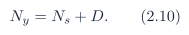

That policy intentionally truncates post-interval tail energy and is not the Revision J signoff default.
