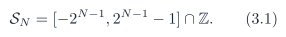
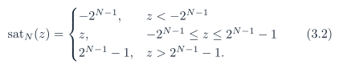
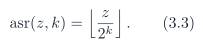
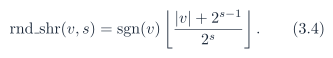
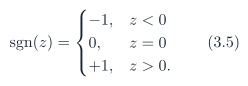
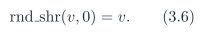
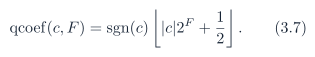

# Baseline PDF page 017

Historical Part I, core algorithm. Printed page 4. [Original PDF page](../../specs/t_recap_phase2_integrated_spec.pdf#page=17).

[Previous](page-016.md) | [Index](../README.md) | [Next](page-018.md)

[Edit Markdown and LaTeX source](../source/baseline/page-017.md). Equations are rendered locally as SVG.

## 3 Bit-Accurate Fixed-Point Contract

### 3.1 Sample range and saturation

An -bit signed two’s-complement sample belongs to

The output saturation operator is

Internal wraparound is not allowed in the visible core contract. Revision J guarantees bit-accurate behavior on the frozen signoff vector set. For arbitrary legal -bit input streams outside that set, an implementation shall either provision widths according to a separate worst-case proof or expose overflow flags that are checked by the verification environment. Such arbitrary streams are not part of Revision J signoff unless that additional proof or flag policy is supplied.

### 3.2 Arithmetic shift and rounded right shift

Let asr(z, k) denote sign-preserving arithmetic right shift by k bits. For k ≥ 0, it is equivalent to

For example, asr(-3, 1) = -2. All quantizing right shifts use round-to-nearest with ties away from zero. For s ≥ 1,

The sign function is frozen as

The zero-shift case is defined as

For complex values, `rnd_shr` applies component-wise. Define rnd2(q) = `rnd_shr`(q, 1).

### 3.3 Coefficient quantization and storage widths

All shared coefficient tables use

This is round-to-nearest with ties away from zero. Independent use of a language-default round() is not allowed unless it is proven bit-for-bit equivalent. The storage contract is mandatory:
