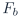
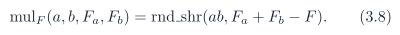
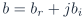
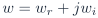
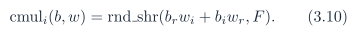
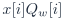

# Baseline PDF page 018

Historical Part I, core algorithm. Printed page 5. [Original PDF page](../../specs/t_recap_phase2_integrated_spec.pdf#page=18).

[Previous](page-017.md) | [Index](../README.md) | [Next](page-019.md)

[Edit Markdown and LaTeX source](../source/baseline/page-018.md). Equations are rendered locally as SVG.

- Window coefficients  are nonnegative and stored in unsigned  bits. For F = 15, the range is 0 to 32768.

- Custom FFT and IFFT twiddle coefficients are stored in signed  bits. For F = 15, both -32768 and +32768 are representable. A signed 16-bit Q1.15 ROM is not the Revision J baseline because it cannot represent +1.0 exactly.

### 3.4 Fixed-point products and complex multiplication

If integer a has  fractional bits and integer b has  fractional bits, then ab has  fractional bits. To return to F fractional bits,

provided . For complex multiplication with  and , each component with F fractional bits,

No truncation may occur before the full-precision product sums are formed. For a complex multiply whose data operands have signed width  and twiddle operands have signed width , product terms shall use at least  signed bits. Product sums and differences shall use at least  signed bits before `rnd_shr`(·, F ). For analysis windowing,  shall be formed exactly with at least  signed product bits before storage. For synthesis windowing,  shall be formed with at least  signed product bits before `rnd_shr`(·, F ). For magnitude-squared, each square shall be formed exactly and the sum shall have at least  unsigned bits. Internal storage overflow is an error condition. Internal values shall not silently wrap or saturate unless a later revision explicitly defines that behavior.
