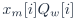
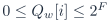
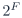
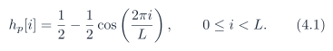
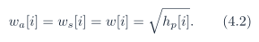
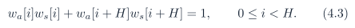

# Baseline PDF page 019

Historical Part I, core algorithm. Printed page 6. [Original PDF page](../../specs/t_recap_phase2_integrated_spec.pdf#page=19).

[Previous](page-018.md) | [Index](../README.md) | [Next](page-020.md)

[Edit Markdown and LaTeX source](../source/baseline/page-019.md). Equations are rendered locally as SVG.

### 3.5 Internal width schedule

**Table 3. Revision J minimum internal widths for the custom radix-2 baseline.**

| Quantity | Symbol | Width rule | Baseline |
| --- | --- | --- | --- |
| External sample |  | signed  | 12 |
| Window coefficient |  | unsigned  | 16 |
| Twiddle coefficient |  | signed  | 17 |
| Analysis-windowed input |  | signed  | 27 |
| Forward FFT stored real/imag |  | signed  | 28 |
| Forward pre-round add/sub |  | signed  | 29 |
| Canonical pre-round add/sub |  | signed  | 29 |
| Canonical real/imag |  | signed  | 28 |
| Magnitude-squared and THR2 |  | unsigned  | 56 |
| Unscaled IFFT stored real/imag |  | signed  | 36 |
| Synthesis-windowed sample |  | signed  | 36 |
| OLA accumulator entry |  | signed  | 37 |
| Aggregate spectral sums |  | At least  or arbitrary precision | run dependent |
| Time-error sums |  | Large enough for all emitted samples or arbitrary precision | run dependent |

The golden model should use arbitrary-precision integers for metric accumulators. RTL shall either provision enough accumulator width for the selected run length or expose and check overflow flags. Although the analysis product  may be formed internally in at least  bits, the frozen baseline coefficient range  guarantees that the exact product fits in signed  bits. Storage into  is therefore a range-checked exact assignment. It is not truncation. If a future coefficient table permits values above , the  rule must be re-derived.

## 4 STFT/WOLA Core Mathematics

### 4.1 Periodic square-root Hann window

Define the periodic Hann sequence

The analysis and synthesis windows are identical:

For H = L/2, ideal complementarity is

