# Baseline PDF page 020

Historical Part I, core algorithm. Printed page 7. [Original PDF page](../../specs/t_recap_phase2_integrated_spec.pdf#page=20).

[Previous](page-019.md) | [Index](../README.md) | [Next](page-021.md)

[Edit Markdown and LaTeX source](../source/baseline/page-020.md). Equations are rendered locally as SVG.

The quantized table is 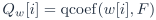.

### 4.2 Analysis windowing and normalized FFT

For frame m,

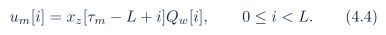

The intended normalized forward transform is

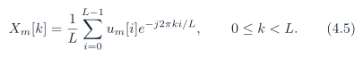

For the custom baseline, Algorithm 4 is normative.

### 4.3 Hermitian canonicalization

For self-conjugate bins,

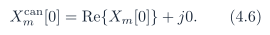

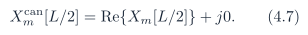

For 1 ≤ k ≤ L/2 - 1,

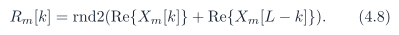

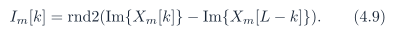

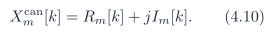

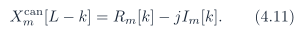

All threshold decisions use , not the raw FFT output.

### 4.4 Magnitude-squared mask

For unique bins 0 ≤ k ≤ L/2,

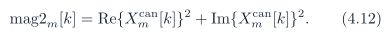

The preliminary mask bit before protection is

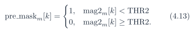

The final mask is initialized as 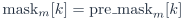 and may then be modified only by the protection rules in Section 4.5. The comparison is unsigned, full precision, and performed in the magnitude-squared domain. The threshold register width is 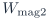:

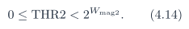

Out-of-range values are illegal for core signoff.
