# Baseline PDF page 021

Historical Part I, core algorithm. Printed page 8. [Original PDF page](../../specs/t_recap_phase2_integrated_spec.pdf#page=21).

[Previous](page-020.md) | [Index](../README.md) | [Next](page-022.md)

[Edit Markdown and LaTeX source](../source/baseline/page-021.md). Equations are rendered locally as SVG.

### 4.5 Protection rules and masked spectrum

Define

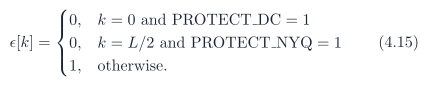

After threshold comparison, if `PROTECT_DC`= 1, force 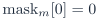. If `PROTECT_NYQ`= 1, force 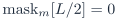. The preliminary value `pre_mask` is retained only for debug reporting and never controls synthesis. The masked spectrum is denoted . For ,

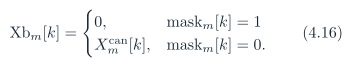

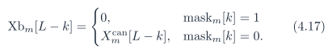

For self-conjugate bins,

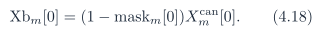

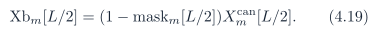

The result is conjugate symmetric by construction.

### 4.6 Unscaled IFFT, synthesis window, and WOLA

The intended inverse is unscaled:

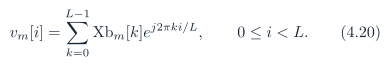

For the custom baseline, Algorithm 5 is normative. The synthesized frame contribution is

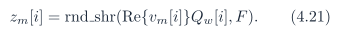

Each frame adds into the output accumulator:

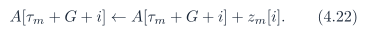

The emitted sample and delayed error are

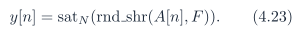

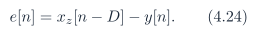
