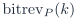
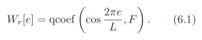
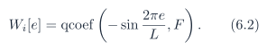
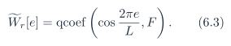
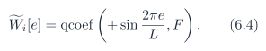
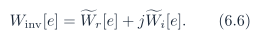

# Baseline PDF page 024

Historical Part I, core algorithm. Printed page 11. [Original PDF page](../../specs/t_recap_phase2_integrated_spec.pdf#page=24).

[Previous](page-023.md) | [Index](../README.md) | [Next](page-025.md)

[Edit Markdown and LaTeX source](../source/baseline/page-024.md). Equations are rendered locally as SVG.

INV3. If THR2= 0, then every eligible mask decision is zero.

INV4. For ,  by construction.

INV5. Bins 0 and L/2 are real-valued after canonicalization.

INV6. All precision-reducing shifts use `rnd_shr`(·) or rnd2(·).

INV7. The OLA accumulator shall not wrap internally on signoff vectors.

INV8. The signoff frame count equals  under the Revision J active-window finite-stream policy.

## 6 Exact Custom FFT/IFFT Integer Algorithms

This section freezes the custom radix-2 baseline. If a vendor FFT IP is used, Appendix A replaces this section for bit-accurate purposes.

### 6.1 Bit reversal and twiddle tables

Let  denote -bit bit reversal. Forward twiddles are





Inverse twiddles are





Define the complex twiddle table aliases




Algorithms 4 and 5 shall use these aliases. The inverse twiddle table is a frozen artifact and shall not be regenerated implicitly inside RTL.

### Algorithm 4 Exact custom FFTnorm integer algorithm

```text
Require: real input vector u[0:L - 1] with F fractional bits; L = 2^P ; frozen forward twiddle table Wfwd[e]
Ensure: normalized complex spectrum X[0:L - 1] in natural order
1: for k = 0 to L - 1 do
2:    A[k] ← u[bitrevP (k)] + j0
3: end for
4: for s = 1 to P do
```
