# Baseline PDF page 026

Historical Part I, core algorithm. Printed page 13. [Original PDF page](../../specs/t_recap_phase2_integrated_spec.pdf#page=26).

[Previous](page-025.md) | [Index](../README.md) | [Next](page-027.md)

[Edit Markdown and LaTeX source](../source/baseline/page-026.md). Equations are rendered locally as SVG.

Let 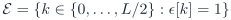. For one frame,

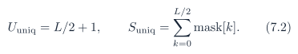

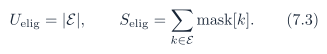

These are normalized spectral magnitude-squared totals for deterministic accounting. They are not direct physical energy measurements unless Parseval scaling is applied. The name `unique_suppressed_bins` means the final post-protection mask count over all unique bins. Under the current post-protection mask semantics, protected bins are forced to mask=0, so `unique_suppressed_bins` and `eligible_suppressed_bins` are equal whenever those protection rules are applied. The useful distinction is in the denominators: `unique_bins` includes protected bins, while `eligible_unique_bins` excludes them. The preferred workload proxy is therefore `eligible_suppressed_bins/eligible_unique_bins`. If a debug flow needs to know which protected bins would have been suppressed before protection, it shall use the optional bin-level `pre_mask` field rather than changing the frame-statistics counters.

### 7.2 Time-domain quality metrics

For 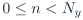,

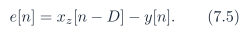

Required integer metrics are

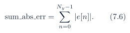

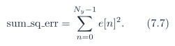

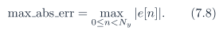

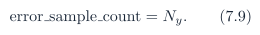

RMSE may be reported as a derived floating field, but the integer numerator and denominator are the signoff quantities.

### 7.3 Canonical memory-file encoding

All memh files contain exactly one value per line, lowercase hexadecimal digits only, no 0x prefix, no leading or trailing spaces, no blank lines, and exactly one LF line ending after each value in the canonical form. For an unsigned -bit memh file, each line shall contain exactly 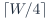 hexadecimal digits. The value shall satisfy 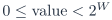. Readers shall mask to W bits and shall not sign-extend unsigned files.
