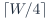

# Baseline PDF page 027

Historical Part I, core algorithm. Printed page 14. [Original PDF page](../../specs/t_recap_phase2_integrated_spec.pdf#page=27).

[Previous](page-026.md) | [Index](../README.md) | [Next](page-028.md)

[Edit Markdown and LaTeX source](../source/baseline/page-027.md). Equations are rendered locally as SVG.

For a signed -bit memh file, each line shall contain exactly  hexadecimal digits. The encoded value is the low W bits of the two’s-complement representation, zero-padded on the left to the required digit count. Readers shall mask to W bits first and then sign-extend from bit W - 1. The stream files `x_in.memh` and `y_out.memh` are signed -bit files. The window file `window_qw.memh` is an unsigned -bit file. All forward and inverse twiddle files are signed -bit files. For , every twiddle line has five hex digits:

+32768 → 08000, -32768 → 18000, -1 → 1ffff.

### 7.4 Canonical SHA-256 hashing

All memh SHA-256 fields, including coefficient hashes and stream hashes such as `x_in_sha256` or `y_out_sha256` when present, are computed over the logical integer vector, not arbitrary raw host bytes. To hash a table or stream, serialize each value according to the canonical memh rule for its declared signedness and width, using lowercase fixed-width hexadecimal plus one LF byte after every value. CRLF, uppercase hexadecimal, extra spaces, and blank lines are not canonical. A checker may normalize an input file to this canonical serialization before hashing, but config.json and `test_vectors.json` record hashes of the canonical serialization only.

### 7.5 Normative coefficient artifacts

The coefficient equations in Sections 4 and 6 define how the initial tables are generated. After the first frozen release, the coefficient memh files and their canonical SHA-256 hashes are normative for signoff. RTL shall use those artifacts directly or prove that its generated ROM contents match their canonical hashes. A regenerated table that is mathematically equivalent but hash-different is not a Revision J signoff table.

### 7.6 Frozen stream artifacts

The generator equations define how input vectors are constructed for the initial golden-model release. After a vector is frozen, `x_in.memh` and its canonical `x_in_sha256` are normative for signoff. Regenerating the same named vector with a different math library is not sufficient unless the canonical `x_in_sha256` matches. Signoff never depends on independently re-evaluating sin, cos, or π in a different math library after the vector has been frozen. The canonical stream hash is authoritative. After the golden model produces `y_out.memh`, the canonical `y_out_sha256` is also normative and shall be recorded in the stream-hash manifest. The mathematical generator name remains useful documentation, but frozen stream hashes are the authority used by RTL and board-replay checkers.

### 7.7 Artifact line counts

Every required artifact has a fixed row count for a given signoff vector:
