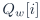
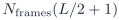
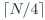
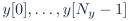
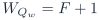

# Baseline PDF page 028

Historical Part I, core algorithm. Printed page 15. [Original PDF page](../../specs/t_recap_phase2_integrated_spec.pdf#page=28).

[Previous](page-027.md) | [Index](../README.md) | [Next](page-029.md)

[Edit Markdown and LaTeX source](../source/baseline/page-028.md). Equations are rendered locally as SVG.

- `window_qw.memh` shall contain exactly L lines. Line i stores  for i = 0, . . . , L - 1.

- `twiddle_re.memh`, `twiddle_im.memh`, `twiddle_inv_re.memh`, and `twiddle_inv_im.memh` shall each contain exactly L lines. Line e stores the coefficient for e = 0, . . . , L - 1.

- `x_in.memh` shall contain exactly  lines.

- `y_out.memh` shall contain exactly  lines.

- `frame_stats.csv` shall contain one header row plus exactly  data rows.

- Conditional `bin_stats.csv`: when required for a vector, one header row plus exactly  data rows. The baseline stores L twiddle entries for a simple artifact contract, even though a hardware implementation may store fewer entries internally after a separate ROM-addressing proof. Internal ROM compaction shall not change the external artifact contract. The `bin_stats.csv` artifact is conditional:

- If the file is not required for a vector, omit `bin_stats_data_rows` from `artifact_rows`.

- If that row-count field is present, then `bin_stats.csv` shall be present and shall contain exactly that number of data rows.

### 7.8 Required artifacts

**Table 4. Required stream and coefficient artifacts.**

| Artifact | Contract |
| --- | --- |
| `x_in.memh` | Input stream in signed -bit two’s-complement hex, exactly  digits per line. |
| `y_out.memh` | Reconstructed stream  in the same signed -bit format. |
| `window_qw.memh` | Quantized window ROM , unsigned width . |
| `twiddle_re.memh` | Forward twiddle real table, signed width . |
| `twiddle_im.memh` | Forward twiddle imaginary table, signed width . |
| `twiddle_inv_re.memh` | Inverse twiddle real table, signed width . |
| `twiddle_inv_im.memh` | Inverse twiddle imaginary table, signed width . |

**Table 5. Required metadata, statistics, and signoff artifacts.**

| Artifact | Contract |
| --- | --- |
| config.json | Configuration metadata, contract strings, width fields, threshold mapping, and coefficient hashes. |
| `test_vectors.json` | Frozen test-vector manifest with generator parameters, threshold, protection flags, and tail policy. |
| `quality_bounds.json` | Frozen no-suppression quality limits per vector after the first golden-model release. |
| `frame_stats.csv` | One row per signoff frame with mandatory columns below. |
| metrics.json | Aggregate signoff metrics under the exact schema below. |
| `bin_stats.csv` | Conditional debug artifact for near-threshold and small regression vectors. |
