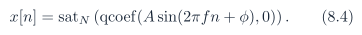
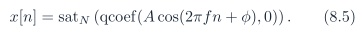
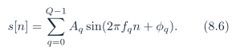
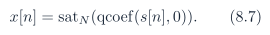
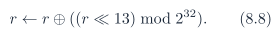
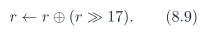
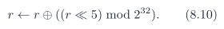
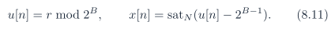

# Baseline PDF page 034

Historical Part I, core algorithm. Printed page 21. [Original PDF page](../../specs/t_recap_phase2_integrated_spec.pdf#page=34).

[Previous](page-033.md) | [Index](../README.md) | [Next](page-035.md)

[Edit Markdown and LaTeX source](../source/baseline/page-034.md). Equations are rendered locally as SVG.

sine and exact-bin sine. For amplitude A, normalized frequency f , and phase ϕ, where f is measured in cycles per sample and ϕ is measured in radians,

Exact-bin sine uses f = k/L for frozen integer bin k. For exact-bin sine, 0 ≤ k ≤ L/2. For k = 0 or k = L/2, cosine is preferred for nonzero deterministic content because sine at phase zero can generate an all-zero sequence.

cosine. For amplitude A, normalized frequency f in cycles per sample, and phase ϕ in radians,

`multitone_sine_sum`. For Q tones with amplitudes Aq , normalized frequencies fq in cycles per sample, and phases ϕq in radians,

The sum is formed in real arithmetic first. The operator qcoef(·, 0) is applied once to the final sum. Per-tone integer rounding before summation is not allowed unless a separate generator name freezes that behavior.

`uniform_noise_xorshift32`. Let r be a nonzero 32-bit unsigned seed. For every sample, update with unsigned 32-bit wraparound:

For frozen noise bit width B,

The frozen noise bit width shall satisfy 1 ≤ B ≤ 32. The value B = 0 is illegal, and B > 32 is illegal because the generator state is exactly 32 bits. If B > N , the vector intentionally exercises clipping through satN and shall declare that intent in `test_vectors.json`. A stochastic vector is not frozen unless it declares generator name, seed, B, Ns , threshold, protection flags, and tail policy.

### 8.3 Golden-model quality bounds

Bit-for-bit agreement between RTL and the golden model proves implementation equivalence. It does not prove that the golden model has the intended reconstruction quality. Therefore, the global `quality_bounds.json` manifest shall freeze no-suppression quality limits per vector after the first complete golden-model release. It shall include at least `max_abs_err`, `sum_sq_err`, and `error_sample_count`. Do not invent these numbers in the specification. Run the golden model first, then freeze them.
