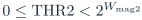
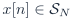
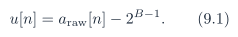
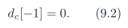
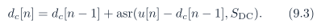
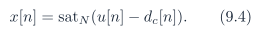
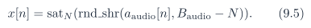

# Baseline PDF page 035

Historical Part I, core algorithm. Printed page 22. [Original PDF page](../../specs/t_recap_phase2_integrated_spec.pdf#page=35).

[Previous](page-034.md) | [Index](../README.md) | [Next](page-036.md)

[Edit Markdown and LaTeX source](../source/baseline/page-035.md). Equations are rendered locally as SVG.

### 8.4 Acceptance criteria

A Phase 2 core implementation passes Revision J signoff only if all of the following hold:

AC1. The golden model generates all required artifacts for every vector in `test_vectors.json` using the generators in Section 8.2.

AC2. Coefficient artifacts and hashes match under the canonical memh and SHA-256 rules.

AC3. Stream artifacts `x_in.memh` and `y_out.memh` match the recorded canonical `x_in_sha256` and `y_out_sha256` hashes.

AC4. All required artifacts have the exact row counts specified in Section 7.7 and in config.json `artifact_rows`.

AC5. THR2 is an unsigned -bit integer and satisfies .

AC6. For THR2= 0, every eligible mask decision is zero.

AC7. The output length follows the declared `tail_policy`. Revision J signoff uses `full_tail` with zero flush ticks until all  outputs are emitted.

AC8. No-suppression golden-model quality fields satisfy `quality_bounds.json`.

AC9. RTL simulation matches `y_out.memh` sample-for-sample.

AC10. RTL simulation matches every row of `frame_stats.csv` exactly.

AC11. RTL simulation matches every mandatory field in metrics.json exactly.

AC12. For vectors that require `bin_stats.csv`, canonical real/imag, mag2, eligibility, `pre_mask`, and final mask fields match exactly.

AC13. BRAM replay on the FPGA board matches the mandatory artifacts before live input is used for demonstration.

AC14. Overflow or wrap flags, if present, remain deasserted on the frozen signoff vector set.

## 9 Live Source Abstraction and Threshold Mapping

The core begins after input adaptation. Every live source must map to . For a raw unsigned B-bit ADC source,

For an audio-codec source with ,

If , a separate left-shift or sign-extension rule shall be frozen before use.
