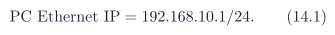
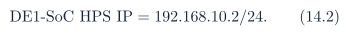

# Baseline PDF page 039

Historical Part II, DDR and UDP telemetry. Printed page 26. [Original PDF page](../../specs/t_recap_phase2_integrated_spec.pdf#page=39).

[Previous](page-038.md) | [Index](../README.md) | [Next](page-040.md)

[Edit Markdown and LaTeX source](../source/baseline/page-039.md). Equations are rendered locally as SVG.

evictable. The Revision G baseline shall implement either resident-record eviction of the lowestpriority packet or scheduler/reservation logic that guarantees high-priority admission before enqueue. A pre-writer shed or evicted telemetry record shall increment `PACKET_FIFO_DROP_COUNT` and may set `OVERFLOW_FLAGS.packet_fifo_overflow`. An implementation that uses only simple full-FIFO drop of the incoming record shall not claim the Revision G “STATUS dropped last” behavior.

### 13.4 Signoff Rule

Ethernet telemetry is an observability and demonstration layer. It may be scaled, decimated, compressed, truncated, or dropped. Correctness signoff remains BRAM replay plus golden artifact comparison. The live Ethernet dashboard shall not be used as the primary bit-accurate correctness artifact.

## 14 Physical Connection Profile

### 14.1 Required Connections

For Ethernet operation, the recommended physical setup is:

- 12 V DE1-SoC power adapter.

- PC USB to DE1-SoC J13 USB-Blaster II for FPGA programming.

- PC USB to DE1-SoC J4 HPS UART for HPS console and Linux debug.

- DE1-SoC RJ45 Ethernet to PC Ethernet port, router, or switch.

- optional audio line-in and line-out cables for live audio demonstration.

### 14.2 Recommended Demo Topology

For a controlled final demo, a direct static-IP Ethernet link is recommended:

The HPS sends telemetry UDP packets to the PC and listens for command UDP packets from the PC.

## 15 Level-3 Architecture

### 15.1 Top-Level Dataflow

The forward telemetry path is:

FPGA source/core/taps → telemetry formatter → DDR ring writer → HPS DDR ring reader → UDP streamer → PC dashboard.
