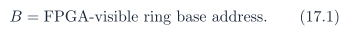
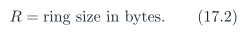
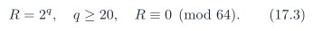
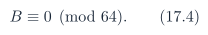
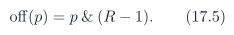
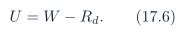
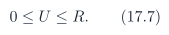

# Baseline PDF page 049

Historical Part II, DDR and UDP telemetry. Printed page 36. [Original PDF page](../../specs/t_recap_phase2_integrated_spec.pdf#page=49).

[Previous](page-048.md) | [Index](../README.md) | [Next](page-050.md)

[Edit Markdown and LaTeX source](../source/baseline/page-049.md). Equations are rendered locally as SVG.

1. HPS-written control values crossing into FPGA logic shall use synchronizers, handshakes, or commit mechanisms.

2. Multi-bit counters exposed to HPS shall be latched into snapshot registers before HPS reads low/high halves.

3. Rd crossing from the HPS CSR domain to the DDR writer domain shall use the `RING_RD_COMMIT` handshake, not independent bit synchronizers.

4. W crossing from the DDR writer domain to the HPS-visible CSR domain shall use the `RING_WR_SNAPSHOT` mechanism or an equivalent handshake scheme.

5. Telemetry taps shall never backpressure the STFT/WOLA core. If a tap event cannot be accepted, the tap event shall be dropped and counted.

## 17 DDR Ring Buffer Contract

### 17.1 Ring Size, Base Address, and Alignment

The DDR telemetry ring is a contiguous HPS-visible memory region. Let:

The ring size shall satisfy:

The base address shall satisfy:

If the FPGA bus address decoder requires naturally aligned power-of-two regions, then the stronger condition B ≡ 0 (mod R) shall also hold. A recommended first implementation is R = 32 MiB.

### 17.2 Absolute Pointers

The ring uses 64-bit monotonic byte pointers rather than modulo-only pointers. Let W be the producer pointer and Rd be the consumer pointer. The physical byte offset is:

where R is a power of two. The number of used bytes is:

The ring state is valid only when:

