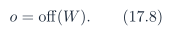
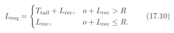
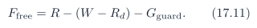
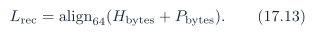

# Baseline PDF page 050

Historical Part II, DDR and UDP telemetry. Printed page 37. [Original PDF page](../../specs/t_recap_phase2_integrated_spec.pdf#page=50).

[Previous](page-049.md) | [Index](../README.md) | [Next](page-051.md)

[Edit Markdown and LaTeX source](../source/baseline/page-050.md). Equations are rendered locally as SVG.

### 17.3 Ring Initialization Rule

Ring initialization shall clear stale producer/consumer state before telemetry is enabled. The baseline sequence is:

1. HPS clears `CONTROL.telemetry_enable` and `CONTROL.ring_writer_enable`.

2. HPS pulses `CONTROL.telemetry_soft_reset`.

3. HPS writes `RING_BASE_LO`, `RING_BASE_HI`, and `RING_SIZE_BYTES`.

4. HPS pulses `RING_CONFIG_COMMIT` while telemetry is disabled.

5. HPS writes `RING_RD_LO_SHADOW`=0 and `RING_RD_HI_SHADOW`=0.

6. HPS pulses `RING_RD_COMMIT`.

7. Only after the preceding steps may HPS set `CONTROL.ring_writer_enable`=1 and `CONTROL.telemetry_enable`=1. A telemetry soft reset or `RING_CONFIG_COMMIT` while telemetry is disabled shall reset the FPGA producer pointer W to zero. HPS shall commit Rd = 0 before enabling the ring writer. This prevents stale pointers after board reset, HPS restart, or ring reconfiguration.

### 17.4 Free Space Rule Including Wrap

Before writing a record of aligned length Lrec , the FPGA shall compute the current offset and the physical tail space:

If the record would cross the physical end of the ring, the required free space is the tail consumed by the WRAP record plus the actual record:

The available free space is:

where Gguard ≥ 64 bytes. A packet may be written only when:

If not, the packet shall be dropped and `DMA_DROP_COUNT` shall increment. Checking only Ffree ≥ Lrec is not sufficient when a WRAP record is required.

### 17.5 Record Alignment and WRAP Record

For normal telemetry records, the aligned record length is:

