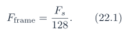

# Baseline PDF page 065

Historical Part II, DDR and UDP telemetry. Printed page 52. [Original PDF page](../../specs/t_recap_phase2_integrated_spec.pdf#page=65).

[Previous](page-064.md) | [Index](../README.md) | [Next](page-066.md)

[Edit Markdown and LaTeX source](../source/baseline/page-065.md). Equations are rendered locally as SVG.

### 21.3 Command Source Rule and Security Scope

The HPS command listener shall accept commands only from a configured trusted PC IP address, or from the direct-link peer established by the first valid PING handshake. Commands from other source IP addresses or unexpected source ports shall be rejected and counted. This Revision G command protocol is intended for isolated lab/demo networks. It is not authenticated or encrypted and shall not be exposed to an untrusted network.

### 21.4 Command Safety Rules

The HPS shall reject commands with invalid magic, unsupported version, a packet length other than 28 bytes, nonzero CRC field, illegal command type, illegal source mode, out-of-range THR2, illegal packet-enable reserved bits, attempts to enable reserved-disabled `PEAKS_EN/DEBUG_EN`, zero decimation, or illegal spectrum shift. Rejected commands shall increment the appropriate HPSowned or CSR-owned command-reject counter. HPS-owned rejects shall not modify FPGA CSRs or FPGA sticky flags. CSR-owned rejects may set sticky status flags according to Table 13, but shall not otherwise modify active state. For `SET_THR2`, HPS shall write `THR2_LO`, write `THR2_HI`, and then pulse `THR2_COMMIT`. For `SET_SOURCE_MODE`, HPS shall obey the source-mode change rule instead of writing active source state asynchronously.

## 22 Telemetry Scheduling and Bandwidth

### 22.1 Frame Rate

For the Phase 2 baseline with hop H = 128, the frame rate is:

At Fs = 48 kS/s, this is 375 frames/s. At Fs = 100 kS/s, this is 781.25 frames/s.

### 22.2 Recommended Packet Rates

**Table 25. Recommended packet scheduling.**

| Packet | Audio 48 kS/s | ADC 100 kS/s |
| --- | --- | --- |
| WAVE | Full-rate or decimate by 2 | Full-rate or decimate by 2 to 4. |
| SPEC129 | Every frame | Every frame if PC can plot. Otherwise every 2 frames. |
| SPEC64 | Optional | Preferred if dashboard load is high. |
| METRICS | 20 to 30 Hz | 20 to 30 Hz. |
| STATUS | 5 to 10 Hz | 5 to 10 Hz. |
