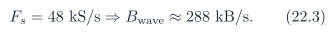
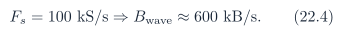

# Baseline PDF page 066

Historical Part II, DDR and UDP telemetry. Printed page 53. [Original PDF page](../../specs/t_recap_phase2_integrated_spec.pdf#page=66).

[Previous](page-065.md) | [Index](../README.md) | [Next](page-067.md)

[Edit Markdown and LaTeX source](../source/baseline/page-066.md). Equations are rendered locally as SVG.

### 22.3 Bandwidth Estimates

For waveform telemetry with three signed 16-bit channels:

Thus:

These rates are small for Ethernet. PC plotting and HPS software behavior are more likely bottlenecks than Ethernet bandwidth.

## 23 Memory Allocation and Cache Policy

### 23.1 Option A: Reserved DDR Region

A first prototype may reserve a physical DDR region and map it from HPS userspace. This is faster to implement but less clean than a kernel driver. If used:

- Linux shall not allocate the reserved region for unrelated memory.

- the mapping shall be non-cacheable or explicitly invalidated before each read.

- the address written to `RING_BASE` shall be the FPGA-visible bus address, not a userspace virtual address.

### 23.2 Option B: DMA-Coherent Kernel Driver

A more formal implementation may use a kernel driver that allocates a DMA-coherent buffer, exposes the buffer to userspace, and writes the FPGA-visible physical/bus address into the CSR map. This is cleaner but is not required for first bring-up.

## 24 PC Dashboard Contract

### 24.1 Required Plots

The dashboard shall support:

- waveform plot of x[n - D] and y[n].

- time-domain error plot e[n] = x[n - D] - y[n].

- spectrogram heatmap using SPEC64 or SPEC129.

- suppression overlay or bucket-level suppression ratio.

- line plots for eligible suppression ratio and kept-energy ratio.
