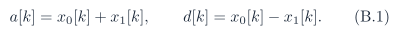
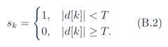
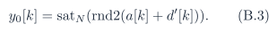
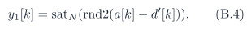

# Baseline PDF page 102

Historical appendices and references. Printed page 89. [Original PDF page](../../specs/t_recap_phase2_integrated_spec.pdf#page=102).

[Previous](page-101.md) | [Index](../README.md) | [Next](page-103.md)

[Edit Markdown and LaTeX source](../source/baseline/page-102.md). Equations are rendered locally as SVG.

## Appendices

## A Vendor FFT IP Contract Checklist

If a vendor FFT IP core replaces Algorithms 4 and 5, the following fields become mandatory in config.json and design documentation:

- IP vendor, IP name, and IP version.

- FFT length and transform direction support.

- input order and output order.

- scaling schedule or block-floating configuration.

- rounding mode.

- saturation, wrapping, or overflow behavior.

- twiddle precision and convention.

- complex input/output packing convention.

- latency from frame acceptance to output availability.

- DC/Nyquist handling if a real-input optimization is used.

- exact reset and first-frame behavior relevant to artifacts. A mathematically equivalent FFT is not sufficient for bit-accurate signoff if it does not reproduce the same integer outputs.

## B Phase 1 Mathematical Anchor

For each Phase 1 pair,

The suppression flag is 1,

The modified detail is d′ [k] = (1 - sk )d[k], and reconstruction is

If T = 0, the condition |d[k]| < 0 is never true, so d′ [k] = d[k] and Phase 1 reconstructs exactly. Phase 2 inherits the verification principle rather than the exact identity: every approximation must be explicit and reproducible.
