# T-RECAP complete editable specification

**Threshold-based Reduction and Encoding for Configurable Analysis Pipelines.**

This document contains the complete historical 106-page specification followed by the finite-record audio, acceleration and RF implementation contracts. The historical core, DDR/UDP telemetry proposal and repository plan retain their original scope. The current appendix states how TSH2 and TRF1 differ from that plan. Historical requirements are not statements that every proposed feature is implemented.

[Reading guide and page index](README.md) | [Current profiles and RF](#current-profiles-and-rf)

| Historical part | Source PDF pages | Start |
| --- | --- | --- |
| Front matter | 1 to 13 | [Cover](#pdf-page-001) |
| Part I, algorithm and signoff | 14 to 36 | [Part I](#pdf-page-014) |
| Part II, DDR and UDP telemetry | 37 to 72 | [Part II](#pdf-page-037) |
| Part III, repository architecture | 73 to 101 | [Part III](#pdf-page-073) |
| Appendices and references | 102 to 106 | [Appendices](#pdf-page-102) |

The editable source pages preserve source-page boundaries for comparison. Equation, algorithm and table numbers refer to the historical document. The original PDF remains unchanged.

<a id="pdf-page-001"></a>

## Baseline PDF page 001

Historical baseline. Cover. [Original PDF page](../specs/t_recap_phase2_integrated_spec.pdf#page=1).

[Index](README.md) | [Next](baseline/page-002.md)

[Edit Markdown and LaTeX source](source/baseline/page-001.md). Equations are rendered locally as SVG.

### T-RECAP: Transform-domain Representation and Energy-aware Computation Accelerator with Controlled Precision

#### Phase 2 Algorithm, Ethernet/HPS Telemetry, and Repository Architecture Specification

Real-Time Fixed-Point STFT/WOLA Selective Suppression with DE1-SoC Telemetry and Core Repository Architecture.

Formal algorithm, signoff, DDR ring, HPS, Ethernet, UDP, PC dashboard, and repository architecture contract.

| Field | Historical document value |
| --- | --- |
| Team Name | Sigma Force, Team #2 |
| Team Members | Dat Dinh, Dat Huynh, Paul Applebee, Kyung Jae Son |
| Project Mentor | Dr. Chao Wang |
| Platform Target | DE1-SoC FPGA fabric, HPS DDR, HPS Ethernet |
| Date | May 4, 2026 |

**Scope notice.** This document has three normative parts. Part I freezes the Phase 2 mathematical STFT/WOLA core and signoff artifacts. Part II freezes the Ethernet/HPS DDR telemetry and command architecture. Part III freezes the core implementation repository architecture. HPS and PC functions are transport, observability, and control infrastructure. They do not replace BRAM replay signoff or perform the STFT/WOLA core computation.

<a id="pdf-page-002"></a>

## Baseline PDF page 002

Historical baseline. Front matter 1. [Original PDF page](../specs/t_recap_phase2_integrated_spec.pdf#page=2).

[Previous](baseline/page-001.md) | [Index](README.md) | [Next](baseline/page-003.md)

[Edit Markdown and LaTeX source](source/baseline/page-002.md). Equations are rendered locally as SVG.

### Executive Summary

This document merges the T-RECAP Phase 2 Core Algorithm Specification, the Ethernet/HPS DDR Telemetry Specification, Revision G, and the Core Implementation Repository Architecture Specification, Revision D, into one formal implementation contract. The first part freezes the deterministic fixed-point STFT/WOLA selective-suppression core. The second part freezes the DE1-SoC telemetry path used to stream waveform, spectrum, metrics, status, and control information between FPGA fabric, HPS DDR, HPS Ethernet, and the PC dashboard. The third part freezes the implementation repository structure, generated contracts, module ownership, build hygiene, and core-first implementation cuts. The core algorithm remains the source of truth for bit-accurate correctness. It defines signed 12-bit sample scale, FFT length L = 256, hop size H = 128, fractional precision F = 15, scheduling cushion G = 128, exact delay D = L + G = 384, active-after-windowing finite-stream scoring, coefficient artifacts, exact custom radix-2 FFT/IFFT integer algorithms, Hermitian canonicalization, magnitude-squared thresholding, WOLA reconstruction, metrics, artifacts, and acceptance criteria. The telemetry architecture is explicitly separate from the correctness path. FPGA fabric owns the live source, STFT/WOLA core, telemetry taps, packet formatting, and DDR ring writer. HPS owns Ethernet transport, UDP forwarding, command reception, control/status register access, and optional patching of diagnostic status fields. The PC owns visualization and user control. If the PC dashboard, HPS streamer, Ethernet link, or DDR ring falls behind, telemetry may be dropped and counted, but the STFT/WOLA core shall continue processing samples without backpressure. The integrated system direction is therefore:

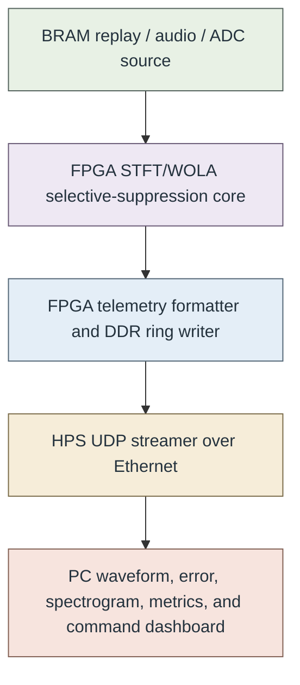

The transport contract is deliberately non-stalling: if the PC dashboard, Ethernet, HPS streamer, DDR ring, packet FIFO, or telemetry writer falls behind, telemetry may be dropped and counted, but the STFT/WOLA core shall continue processing samples. The final correctness path remains BRAM replay with frozen artifacts, not live Ethernet telemetry. The repository architecture contract is deliberately implementation-focused. It does not define the verification repository. It freezes the source tree, generated header flow, filelists, module API rules, clock and reset ownership, Platform Designer ownership, coefficient ROM ownership, memory primitive policy, and the required C0 core-first implementation cut before telemetry, HPS bridge, Ethernet dashboard, or live audio integration becomes active implementation work.

<a id="pdf-page-003"></a>

## Baseline PDF page 003

Historical baseline. Front matter 2. [Original PDF page](../specs/t_recap_phase2_integrated_spec.pdf#page=3).

[Previous](baseline/page-002.md) | [Index](README.md) | [Next](baseline/page-004.md)

[Edit Markdown and LaTeX source](source/baseline/page-003.md). Equations are rendered locally as SVG.

### Contents

| Entry | Printed page |
| --- | --- |
| Part I - Core Algorithm and Signoff Contract | [1](baseline/page-014.md) |
| 1 Overview and Scope | [1](baseline/page-014.md) |
| 1.1 Purpose | [1](baseline/page-014.md) |
| 1.2 Problem statement | [1](baseline/page-014.md) |
| 1.3 Continuity from Phase 1 | [1](baseline/page-014.md) |
| 1.4 Core boundary | [2](baseline/page-015.md) |
| 2 Parameters, Timing, and Finite-Stream Policy | [2](baseline/page-015.md) |
| 2.1 Baseline parameters | [2](baseline/page-015.md) |
| 2.2 Frame timing | [2](baseline/page-015.md) |
| 2.3 Finite-stream signoff policy | [3](baseline/page-016.md) |
| 3 Bit-Accurate Fixed-Point Contract | [4](baseline/page-017.md) |
| 3.1 Sample range and saturation | [4](baseline/page-017.md) |
| 3.2 Arithmetic shift and rounded right shift | [4](baseline/page-017.md) |
| 3.3 Coefficient quantization and storage widths | [4](baseline/page-017.md) |
| 3.4 Fixed-point products and complex multiplication | [5](baseline/page-018.md) |
| 3.5 Internal width schedule | [6](baseline/page-019.md) |
| 4 STFT/WOLA Core Mathematics | [6](baseline/page-019.md) |
| 4.1 Periodic square-root Hann window | [6](baseline/page-019.md) |
| 4.2 Analysis windowing and normalized FFT | [7](baseline/page-020.md) |
| 4.3 Hermitian canonicalization | [7](baseline/page-020.md) |
| 4.4 Magnitude-squared mask | [7](baseline/page-020.md) |
| 4.5 Protection rules and masked spectrum | [8](baseline/page-021.md) |
| 4.6 Unscaled IFFT, synthesis window, and WOLA | [8](baseline/page-021.md) |
| 5 Normative Core Algorithm Tables | [9](baseline/page-022.md) |
| 5.1 Required invariants | [10](baseline/page-023.md) |
| 6 Exact Custom FFT/IFFT Integer Algorithms | [11](baseline/page-024.md) |
| 6.1 Bit reversal and twiddle tables | [11](baseline/page-024.md) |
| 7 Metrics and Artifact Contract | [12](baseline/page-025.md) |

<a id="pdf-page-004"></a>

## Baseline PDF page 004

Historical baseline. Front matter 3. [Original PDF page](../specs/t_recap_phase2_integrated_spec.pdf#page=4).

[Previous](baseline/page-003.md) | [Index](README.md) | [Next](baseline/page-005.md)

[Edit Markdown and LaTeX source](source/baseline/page-004.md). Equations are rendered locally as SVG.

### Contents

| Entry | Printed page |
| --- | --- |
| 7.1 Spectral metrics | [12](baseline/page-025.md) |
| 7.2 Time-domain quality metrics | [13](baseline/page-026.md) |
| 7.3 Canonical memory-file encoding | [13](baseline/page-026.md) |
| 7.4 Canonical SHA-256 hashing | [14](baseline/page-027.md) |
| 7.5 Normative coefficient artifacts | [14](baseline/page-027.md) |
| 7.6 Frozen stream artifacts | [14](baseline/page-027.md) |
| 7.7 Artifact line counts | [14](baseline/page-027.md) |
| 7.8 Required artifacts | [15](baseline/page-028.md) |
| 7.9 CSV field contracts | [16](baseline/page-029.md) |
| 7.10 JSON integer rule and schemas | [16](baseline/page-029.md) |
| 8 Signoff Test Suite, Generators, and Acceptance Criteria | [19](baseline/page-032.md) |
| 8.1 Required test-vector classes | [19](baseline/page-032.md) |
| 8.2 Frozen generator algorithms | [20](baseline/page-033.md) |
| 8.3 Golden-model quality bounds | [21](baseline/page-034.md) |
| 8.4 Acceptance criteria | [22](baseline/page-035.md) |
| 9 Live Source Abstraction and Threshold Mapping | [22](baseline/page-035.md) |
| 10 Throughput and Power Interpretation | [23](baseline/page-036.md) |
| 11 Conclusion | [23](baseline/page-036.md) |
| Part II - Ethernet/HPS DDR Telemetry and Control Architecture | [24](baseline/page-037.md) |
| 12 Purpose and Scope | [24](baseline/page-037.md) |
| 12.1 Purpose | [24](baseline/page-037.md) |
| 12.2 Relationship to Part I | [24](baseline/page-037.md) |
| 12.3 Non-Goals | [24](baseline/page-037.md) |
| 13 System Boundary and Ownership Rules | [25](baseline/page-038.md) |
| 13.1 Core Ownership Rule | [25](baseline/page-038.md) |
| 13.2 Transport Ownership Rule | [25](baseline/page-038.md) |
| 13.3 Non-Stall Rule | [25](baseline/page-038.md) |
| 13.4 Signoff Rule | [26](baseline/page-039.md) |
| 14 Physical Connection Profile | [26](baseline/page-039.md) |

<a id="pdf-page-005"></a>

## Baseline PDF page 005

Historical baseline. Front matter 4. [Original PDF page](../specs/t_recap_phase2_integrated_spec.pdf#page=5).

[Previous](baseline/page-004.md) | [Index](README.md) | [Next](baseline/page-006.md)

[Edit Markdown and LaTeX source](source/baseline/page-005.md). Equations are rendered locally as SVG.

### Contents

| Entry | Printed page |
| --- | --- |
| 14.1 Required Connections | [26](baseline/page-039.md) |
| 14.2 Recommended Demo Topology | [26](baseline/page-039.md) |
| 15 Level-3 Architecture | [26](baseline/page-039.md) |
| 15.1 Top-Level Dataflow | [26](baseline/page-039.md) |
| 15.2 Functional Blocks | [27](baseline/page-040.md) |
| 15.3 DE1-SoC Bridge and Address-Mapping Assumption | [27](baseline/page-040.md) |
| 16 CSR Register Contract | [28](baseline/page-041.md) |
| 16.1 Register Access Rules | [28](baseline/page-041.md) |
| 16.2 CSR Map | [28](baseline/page-041.md) |
| 16.3 Version Compatibility Rule | [30](baseline/page-043.md) |
| 16.4 CSR Bit Definitions | [30](baseline/page-043.md) |
| 16.5 Spectrum Packet Selection Rule | [31](baseline/page-044.md) |
| 16.6 Atomic 64-bit Pointer Transfer | [33](baseline/page-046.md) |
| 16.7 Core Counter Snapshot Rule | [34](baseline/page-047.md) |
| 16.8 Sticky-Flag Clear Rule | [34](baseline/page-047.md) |
| 16.9 Command-Reject Counter Ownership | [34](baseline/page-047.md) |
| 16.10 Packet-FIFO Drop Accounting Rule | [34](baseline/page-047.md) |
| 16.11 Threshold Commit Rule | [35](baseline/page-048.md) |
| 16.12 Source-Mode Change Rule | [35](baseline/page-048.md) |
| 16.13 Clock-Domain Crossing Requirements | [35](baseline/page-048.md) |
| 17 DDR Ring Buffer Contract | [36](baseline/page-049.md) |
| 17.1 Ring Size, Base Address, and Alignment | [36](baseline/page-049.md) |
| 17.2 Absolute Pointers | [36](baseline/page-049.md) |
| 17.3 Ring Initialization Rule | [37](baseline/page-050.md) |
| 17.4 Free Space Rule Including Wrap | [37](baseline/page-050.md) |
| 17.5 Record Alignment and WRAP Record | [37](baseline/page-050.md) |
| 17.6 Memory Coherency Requirement | [38](baseline/page-051.md) |
| 18 DDR Packet Record Format | [38](baseline/page-051.md) |
| 18.1 Common Header | [38](baseline/page-051.md) |
| 18.2 Header Flags | [39](baseline/page-052.md) |
| 18.3 Timestamp Semantics | [40](baseline/page-053.md) |

<a id="pdf-page-006"></a>

## Baseline PDF page 006

Historical baseline. Front matter 5. [Original PDF page](../specs/t_recap_phase2_integrated_spec.pdf#page=6).

[Previous](baseline/page-005.md) | [Index](README.md) | [Next](baseline/page-007.md)

[Edit Markdown and LaTeX source](source/baseline/page-006.md). Equations are rendered locally as SVG.

### Contents

| Entry | Printed page |
| --- | --- |
| 18.4 Packet Types | [40](baseline/page-053.md) |
| 18.5 Packet Validation Rules | [40](baseline/page-053.md) |
| 18.6 Maximum Payload Rules | [41](baseline/page-054.md) |
| 18.7 Commit Protocol | [42](baseline/page-055.md) |
| 19 Telemetry Payload Formats | [43](baseline/page-056.md) |
| 19.1 Magnitude Compression Operator | [43](baseline/page-056.md) |
| 19.2 WAVE Payload | [43](baseline/page-056.md) |
| 19.3 SPEC129 Payload | [44](baseline/page-057.md) |
| 19.4 SPEC64 Payload | [44](baseline/page-057.md) |
| 19.5 METRICS Payload | [45](baseline/page-058.md) |
| 19.6 STATUS Ownership and HPS Patch Rule | [46](baseline/page-059.md) |
| 19.7 STATUS Payload | [47](baseline/page-060.md) |
| 20 HPS UDP Streamer Contract | [48](baseline/page-061.md) |
| 20.1 HPS Responsibilities | [48](baseline/page-061.md) |
| 20.2 UDP Datagrams and Fragmentation Policy | [48](baseline/page-061.md) |
| 20.3 Nonblocking Send Rule | [48](baseline/page-061.md) |
| 20.4 HPS Streamer Algorithm | [49](baseline/page-062.md) |
| 20.5 Runtime Packet Validation Checklist | [50](baseline/page-063.md) |
| 20.6 Ethernet Port Assignments | [50](baseline/page-063.md) |
| 21 PC Command Contract | [51](baseline/page-064.md) |
| 21.1 Command Header | [51](baseline/page-064.md) |
| 21.2 Command Types and Valid Ranges | [51](baseline/page-064.md) |
| 21.3 Command Source Rule and Security Scope | [52](baseline/page-065.md) |
| 21.4 Command Safety Rules | [52](baseline/page-065.md) |
| 22 Telemetry Scheduling and Bandwidth | [52](baseline/page-065.md) |
| 22.1 Frame Rate | [52](baseline/page-065.md) |
| 22.2 Recommended Packet Rates | [52](baseline/page-065.md) |
| 22.3 Bandwidth Estimates | [53](baseline/page-066.md) |
| 23 Memory Allocation and Cache Policy | [53](baseline/page-066.md) |
| 23.1 Option A: Reserved DDR Region | [53](baseline/page-066.md) |

<a id="pdf-page-007"></a>

## Baseline PDF page 007

Historical baseline. Front matter 6. [Original PDF page](../specs/t_recap_phase2_integrated_spec.pdf#page=7).

[Previous](baseline/page-006.md) | [Index](README.md) | [Next](baseline/page-008.md)

[Edit Markdown and LaTeX source](source/baseline/page-007.md). Equations are rendered locally as SVG.

### Contents

| Entry | Printed page |
| --- | --- |
| 23.2 Option B: DMA-Coherent Kernel Driver | [53](baseline/page-066.md) |
| 24 PC Dashboard Contract | [53](baseline/page-066.md) |
| 24.1 Required Plots | [53](baseline/page-066.md) |
| 24.2 Dashboard Update Rate | [54](baseline/page-067.md) |
| 24.3 Packet Loss Handling | [54](baseline/page-067.md) |
| 25 Startup and Shutdown Sequence | [54](baseline/page-067.md) |
| 25.1 Startup Sequence | [54](baseline/page-067.md) |
| 25.2 Shutdown Sequence | [55](baseline/page-068.md) |
| 26 Failure Modes and Required Counters | [55](baseline/page-068.md) |
| 27 Acceptance Criteria | [56](baseline/page-069.md) |
| 28 First Implementation Scope | [58](baseline/page-071.md) |
| 28.1 Required First-Demo Scope | [58](baseline/page-071.md) |
| 28.2 Deferred Optional Scope | [58](baseline/page-071.md) |
| 29 Development Milestones | [59](baseline/page-072.md) |
| 30 Conclusion | [59](baseline/page-072.md) |
| Part III - Core Implementation Repository Architecture | [60](baseline/page-073.md) |
| 31 Repository Architecture Executive Summary | [60](baseline/page-073.md) |
| 32 Scope and Inputs | [61](baseline/page-074.md) |
| 32.1 Normative inputs | [61](baseline/page-074.md) |
| 32.2 In scope | [61](baseline/page-074.md) |
| 32.3 Out of scope | [62](baseline/page-075.md) |
| 33 Architectural Principles | [62](baseline/page-075.md) |
| 33.1 Non-negotiable implementation rules | [62](baseline/page-075.md) |
| 33.2 Ownership diagram | [62](baseline/page-075.md) |
| 34 Repository Layout | [63](baseline/page-076.md) |
| 34.1 Normative top-level tree | [63](baseline/page-076.md) |

<a id="pdf-page-008"></a>

## Baseline PDF page 008

Historical baseline. Front matter 7. [Original PDF page](../specs/t_recap_phase2_integrated_spec.pdf#page=8).

[Previous](baseline/page-007.md) | [Index](README.md) | [Next](baseline/page-009.md)

[Edit Markdown and LaTeX source](source/baseline/page-008.md). Equations are rendered locally as SVG.

### Contents

| Entry | Printed page |
| --- | --- |
| 34.2 Directory responsibilities | [65](baseline/page-078.md) |
| 35 Generated Shared Contract Flow | [66](baseline/page-079.md) |
| 35.1 Purpose | [66](baseline/page-079.md) |
| 35.2 Schema files | [66](baseline/page-079.md) |
| 35.3 Generated outputs | [67](baseline/page-080.md) |
| 35.4 Generated-file commit policy | [67](baseline/page-080.md) |
| 35.5 Generated filelists | [68](baseline/page-081.md) |
| 35.6 Normative CSR map rule | [68](baseline/page-081.md) |
| 36 SystemVerilog Interface and Typedef Baseline | [69](baseline/page-082.md) |
| 36.1 Package organization | [69](baseline/page-082.md) |
| 36.2 Core sample and frame typedefs | [69](baseline/page-082.md) |
| 36.3 Telemetry record typedefs | [69](baseline/page-082.md) |
| 36.4 Core tap interface rule | [70](baseline/page-083.md) |
| 37 Module API, Parameter, and Naming Rules | [71](baseline/page-084.md) |
| 37.1 Parameter ownership | [71](baseline/page-084.md) |
| 37.2 Port naming rules | [71](baseline/page-084.md) |
| 37.3 Coding style baseline | [71](baseline/page-084.md) |
| 38 RTL Layer Ownership | [72](baseline/page-085.md) |
| 38.1 Layer partition | [72](baseline/page-085.md) |
| 38.2 Dataflow | [72](baseline/page-085.md) |
| 39 RTL Module Inventory | [73](baseline/page-086.md) |
| 39.1 Source modules | [73](baseline/page-086.md) |
| 39.2 Core modules | [73](baseline/page-086.md) |
| 39.3 FFT modules | [74](baseline/page-087.md) |
| 39.4 Telemetry modules | [74](baseline/page-087.md) |
| 39.5 HPS bridge modules | [74](baseline/page-087.md) |
| 39.6 DE1-SoC platform modules | [75](baseline/page-088.md) |
| 39.7 Top-level build variants | [75](baseline/page-088.md) |
| 40 Dependency Rules | [76](baseline/page-089.md) |

<a id="pdf-page-009"></a>

## Baseline PDF page 009

Historical baseline. Front matter 8. [Original PDF page](../specs/t_recap_phase2_integrated_spec.pdf#page=9).

[Previous](baseline/page-008.md) | [Index](README.md) | [Next](baseline/page-010.md)

[Edit Markdown and LaTeX source](source/baseline/page-009.md). Equations are rendered locally as SVG.

### Contents

| Entry | Printed page |
| --- | --- |
| 41 Clock and Reset Ownership | [77](baseline/page-090.md) |
| 41.1 Clock-domain baseline | [77](baseline/page-090.md) |
| 41.2 CDC rules | [77](baseline/page-090.md) |
| 42 Platform Designer and DE1-SoC Ownership | [77](baseline/page-090.md) |
| 42.1 Platform files | [77](baseline/page-090.md) |
| 42.2 Platform Designer generated-artifact policy | [78](baseline/page-091.md) |
| 42.3 Bridge assumptions | [78](baseline/page-091.md) |
| 42.4 Address map file | [79](baseline/page-092.md) |
| 43 Software Implementation Layout | [79](baseline/page-092.md) |
| 43.1 Golden software | [79](baseline/page-092.md) |
| 43.2 HPS software | [79](baseline/page-092.md) |
| 43.3 HPS runtime configuration manifest | [80](baseline/page-093.md) |
| 43.4 PC dashboard software | [80](baseline/page-093.md) |
| 44 Runtime and Build Profiles | [81](baseline/page-094.md) |
| 44.1 Profile separation rule | [81](baseline/page-094.md) |
| 44.2 Example profile | [81](baseline/page-094.md) |
| 45 Coefficient ROM and Memory Primitive Policy | [81](baseline/page-094.md) |
| 45.1 Coefficient ROM ownership | [81](baseline/page-094.md) |
| 45.2 Memory primitive policy | [82](baseline/page-095.md) |
| 46 Artifact and Data Layout | [82](baseline/page-095.md) |
| 46.1 Artifact directories | [82](baseline/page-095.md) |
| 46.2 Artifact authority rule | [83](baseline/page-096.md) |
| 47 Legacy and Deprecated Document Quarantine | [83](baseline/page-096.md) |
| 47.1 Phase 1 quarantine | [83](baseline/page-096.md) |
| 47.2 Deprecated Phase 2 warning | [83](baseline/page-096.md) |
| 48 Build System Architecture | [84](baseline/page-097.md) |
| 48.1 Required build targets | [84](baseline/page-097.md) |
| 49 Implementation Milestones | [85](baseline/page-098.md) |

<a id="pdf-page-010"></a>

## Baseline PDF page 010

Historical baseline. Front matter 9. [Original PDF page](../specs/t_recap_phase2_integrated_spec.pdf#page=10).

[Previous](baseline/page-009.md) | [Index](README.md) | [Next](baseline/page-011.md)

[Edit Markdown and LaTeX source](source/baseline/page-010.md). Equations are rendered locally as SVG.

### Contents

| Entry | Printed page |
| --- | --- |
| 50 Implementation Cuts | [85](baseline/page-098.md) |
| 50.1 Core Implementation Cut C0 | [85](baseline/page-098.md) |
| 50.2 Transport Implementation Cut T0 | [86](baseline/page-099.md) |
| 51 First Implementation Scope | [86](baseline/page-099.md) |
| 51.1 Core-first required now: Cut C0 | [86](baseline/page-099.md) |
| 51.2 First full-demo scope after C0/T0 | [87](baseline/page-100.md) |
| 51.3 Deferred | [87](baseline/page-100.md) |
| 52 Repository Acceptance Criteria | [87](baseline/page-100.md) |
| 53 Conclusion | [88](baseline/page-101.md) |
| Appendices | [89](baseline/page-102.md) |
| A Vendor FFT IP Contract Checklist | [89](baseline/page-102.md) |
| B Phase 1 Mathematical Anchor | [89](baseline/page-102.md) |
| C Repository Recommended File Inventory | [90](baseline/page-103.md) |
| D Repository Minimum Documentation Files | [91](baseline/page-104.md) |

<a id="pdf-page-011"></a>

## Baseline PDF page 011

Historical baseline. Front matter 10. [Original PDF page](../specs/t_recap_phase2_integrated_spec.pdf#page=11).

[Previous](baseline/page-010.md) | [Index](README.md) | [Next](baseline/page-012.md)

[Edit Markdown and LaTeX source](source/baseline/page-011.md). Equations are rendered locally as SVG.

### List of Algorithms

| Entry | Printed page |
| --- | --- |
| 1 Finite-stream Phase 2 core operator with full-tail scoring | [9](baseline/page-022.md) |
| 2 ProcessFrameAnalysisMask: frame construction, FFT, canonicalization, masking, and frame statistics | [9](baseline/page-022.md) |
| 3 ProcessFrameSynthesisWOLA: IFFT, synthesis window, and WOLA accumulation . | [10](baseline/page-023.md) |
| 4 Exact custom FFTnorm integer algorithm | [11](baseline/page-024.md) |
| 5 Exact custom IFFTunscaled integer algorithm | [12](baseline/page-025.md) |
| 6 FPGA DDR record write and commit protocol with correct wrap-space accounting . | [42](baseline/page-055.md) |
| 7 HPS DDR ring consumer and UDP streamer | [49](baseline/page-062.md) |

<a id="pdf-page-012"></a>

## Baseline PDF page 012

Historical baseline. Front matter 11. [Original PDF page](../specs/t_recap_phase2_integrated_spec.pdf#page=12).

[Previous](baseline/page-011.md) | [Index](README.md) | [Next](baseline/page-013.md)

[Edit Markdown and LaTeX source](source/baseline/page-012.md). Equations are rendered locally as SVG.

### List of Tables

| Entry | Printed page |
| --- | --- |
| 1 Mathematical continuity from Phase 1 to Phase 2 | [1](baseline/page-014.md) |
| 2 Revision J baseline parameters | [2](baseline/page-015.md) |
| 3 Revision J minimum internal widths for the custom radix-2 baseline | [6](baseline/page-019.md) |
| 4 Required stream and coefficient artifacts | [15](baseline/page-028.md) |
| 5 Required metadata, statistics, and signoff artifacts | [15](baseline/page-028.md) |
| 6 Required mathematical signoff vector classes | [20](baseline/page-033.md) |
| 7 Level-3 functional block responsibilities | [27](baseline/page-040.md) |
| 8 Normative CSR map for Level-3 Ethernet/HPS telemetry, Revision G | [28](baseline/page-041.md) |
| 9 CONTROL bit definitions | [30](baseline/page-043.md) |
| 10 PACKET_ENABLE bit definitions | [31](baseline/page-044.md) |
| 11 STATUS bit definitions | [32](baseline/page-045.md) |
| 12 DMA_STATUS bit definitions | [32](baseline/page-045.md) |
| 13 OVERFLOW_FLAGS and CLEAR_STICKY_FLAGS bit definitions | [33](baseline/page-046.md) |
| 14 DDR telemetry packet header | [39](baseline/page-052.md) |
| 15 Common flags bit definitions | [39](baseline/page-052.md) |
| 16 Telemetry packet types | [40](baseline/page-053.md) |
| 17 Maximum and exact payload-size rules by packet type | [41](baseline/page-054.md) |
| 18 Exact WAVE payload layout | [43](baseline/page-056.md) |
| 19 Exact SPEC129 payload layout | [44](baseline/page-057.md) |
| 20 Exact SPEC64 payload layout | [45](baseline/page-058.md) |
| 21 Baseline METRICS payload layout | [46](baseline/page-059.md) |
| 22 Baseline STATUS payload layout | [47](baseline/page-060.md) |
| 23 PC-to-HPS command packet | [51](baseline/page-064.md) |
| 24 PC command types and valid argument ranges | [51](baseline/page-064.md) |
| 25 Recommended packet scheduling | [52](baseline/page-065.md) |
| 26 Failure modes and required observability | [55](baseline/page-068.md) |
| 27 Recommended Level-3 development milestones | [59](baseline/page-072.md) |
| 28 Repository directory responsibilities | [65](baseline/page-078.md) |
| 29 Generated-contract schema files | [67](baseline/page-080.md) |
| 30 Generated header outputs | [67](baseline/page-080.md) |
| 31 Required generated filelists | [68](baseline/page-081.md) |
| 32 RTL API and naming rules | [71](baseline/page-084.md) |

<a id="pdf-page-013"></a>

## Baseline PDF page 013

Historical baseline. Front matter 12. [Original PDF page](../specs/t_recap_phase2_integrated_spec.pdf#page=13).

[Previous](baseline/page-012.md) | [Index](README.md) | [Next](baseline/page-014.md)

[Edit Markdown and LaTeX source](source/baseline/page-013.md). Equations are rendered locally as SVG.

### List of Tables

| Entry | Printed page |
| --- | --- |
| 33 RTL layer ownership | [72](baseline/page-085.md) |
| 34 Input-source module inventory | [73](baseline/page-086.md) |
| 35 Core RTL module inventory | [73](baseline/page-086.md) |
| 36 FFT/IFFT module inventory | [74](baseline/page-087.md) |
| 37 Telemetry module inventory | [74](baseline/page-087.md) |
| 38 HPS bridge module inventory | [75](baseline/page-088.md) |
| 39 DE1-SoC platform module inventory | [75](baseline/page-088.md) |
| 40 Top-level build variants | [76](baseline/page-089.md) |
| 41 Clock/reset domain ownership | [77](baseline/page-090.md) |
| 42 Baseline memory primitive wrappers | [82](baseline/page-095.md) |
| 43 Core implementation build targets | [84](baseline/page-097.md) |
| 44 Implementation milestones for the core repository | [85](baseline/page-098.md) |
| 45 Core-first implementation cut C0 | [86](baseline/page-099.md) |

<a id="pdf-page-014"></a>

## Baseline PDF page 014

Historical Part I, core algorithm. Printed page 1. [Original PDF page](../specs/t_recap_phase2_integrated_spec.pdf#page=14).

[Previous](baseline/page-013.md) | [Index](README.md) | [Next](baseline/page-015.md)

[Edit Markdown and LaTeX source](source/baseline/page-014.md). Equations are rendered locally as SVG.

### Part I - Core Algorithm and Signoff Contract

### 1 Overview and Scope

#### 1.1 Purpose

Part I of this integrated specification is the source-of-truth contract for the Phase 2 T-RECAP mathematical core. It is written for the software golden model, RTL-equivalent model, simulation scoreboards, BRAM replay signoff, and deterministic reconstruction/metric evaluation. It is not a SystemVerilog architecture document. It does not specify module names, pin assignments, packet formats, HPS software, or a PC dashboard. Those layers shall preserve the core behavior defined here.

#### 1.2 Problem statement

The Phase 2 core problem is:

Define a causal fixed-point STFT/WOLA operator for a real-valued stream. The operator suppresses low-energy spectral bins under a frozen arithmetic contract and reconstructs a delayed time-domain output for bit-accurate verification.

#### 1.3 Continuity from Phase 1

Phase 1 grouped the stream into non-overlapping pairs, applied a two-sample Haar transform, suppressed the detail term when |d[k]| < T , and reconstructed the pair. When T = 0, the condition |d[k]| < 0 is never true, so Phase 1 has exact lossless reconstruction. Phase 2 preserves the same selective-suppression idea but moves the transform domain from two-sample Haar pairs to overlapped STFT frames. The T = 0 identity property does not transfer exactly because Phase 2 contains quantized windows, twiddles, FFT/IFFT rounding, WOLA accumulation, and final output rounding. The Phase 2 no-suppression condition is therefore deterministic near-lossless, not exact lossless.

**Table 1. Mathematical continuity from Phase 1 to Phase 2.**

| Concept | Phase 1: Haar | Phase 2: STFT/WOLA |
| --- | --- | --- |
| Streaming unit | Pair 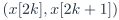 | Overlapped frame  |
| Transform output | 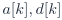 |  |
| Suppression variable |  |  |
| Mask action | 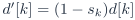 |  |
| Reconstruction | Inverse Haar | IFFT + synthesis window + WOLA |
| Correctness anchor | Exact lossless at  | Deterministic near-lossless at  |
| Metrics | Suppressed pairs and time error | Suppressed eligible bins, kept spectral total, and time error |

<a id="pdf-page-015"></a>

## Baseline PDF page 015

Historical Part I, core algorithm. Printed page 2. [Original PDF page](../specs/t_recap_phase2_integrated_spec.pdf#page=15).

[Previous](baseline/page-014.md) | [Index](README.md) | [Next](baseline/page-016.md)

[Edit Markdown and LaTeX source](source/baseline/page-015.md). Equations are rendered locally as SVG.

#### 1.4 Core boundary

The core consumes a signed sample stream x[n] ∈ SN and produces a signed reconstructed stream y[n] ∈ SN . The following items are wrappers outside the mathematical core:

- ADC unsigned-to-signed conversion and optional DC blocking,

- audio-codec sample formatting,

- HPS software and control registers,

- transport packetization, including HPS DDR, Ethernet/UDP, UART/USB if used, and PC visualization,

- board switches, LEDs, seven-segment displays, and

- SystemVerilog module decomposition.

### 2 Parameters, Timing, and Finite-Stream Policy

#### 2.1 Baseline parameters

Let L = 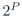 be the FFT length and H = L/2 be the hop. Let G ≥ 0 be a scheduling cushion measured in sample periods. The exact causal delay is

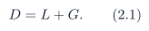

**Table 2. Revision J baseline parameters.**

| Symbol | Meaning | Baseline |
| --- | --- | --- |
|  | External signed input/output sample width | 12 |
|  | FFT length | 256 |
|  | Number of radix-2 stages,  | 8 |
|  | Hop size | 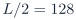 |
|  | Fractional width for windows, twiddles, FFT data, and WOLA domain | 15 |
|  | Scheduling cushion from frame trigger to first allowed WOLA contribution |  |
|  | Exact causal delay |  samples |
| THR2 | Internal threshold register in the magnitude-squared domain | Programmable unsigned -bit integer |
| `PROTECT_DC` | Force DC bin to be kept | 1 |
| `PROTECT_NYQ` | Force Nyquist bin to be kept | 0 |


#### 2.2 Frame timing

A frame trigger occurs whenever the accepted sample count reaches a positive multiple of H:

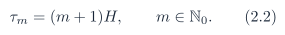

<a id="pdf-page-016"></a>

## Baseline PDF page 016

Historical Part I, core algorithm. Printed page 3. [Original PDF page](../specs/t_recap_phase2_integrated_spec.pdf#page=16).

[Previous](baseline/page-015.md) | [Index](README.md) | [Next](baseline/page-017.md)

[Edit Markdown and LaTeX source](source/baseline/page-016.md). Equations are rendered locally as SVG.

At trigger time , the frame contains the most recent  samples ending at :

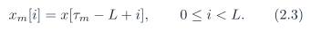

That frame contributes to output slots . Therefore sample 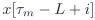 contributes to 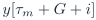, which establishes the delay .

#### 2.3 Finite-stream signoff policy

For a finite input vector 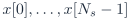, define zero extension:

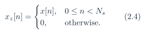

Revision J signoff vectors require . Empty input is not a signoff case. The default finite-stream policy is `full_tail`. Revision J defines the signoff frame set by active overlap after analysis-windowing, not only by raw finite-input overlap:


This prevents a zero-window edge frame from contributing artificial all-zero frame statistics when the only remaining real input sample lies at an analysis-window index whose quantized coefficient is zero. For the periodic square-root Hann baseline,  and  for , so the active-frame set reduces to


For , the required closed-form frame-count invariant is therefore


Let


The full-tail emitted length is

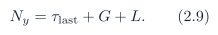

For a future window table with a different zero pattern, the general definition of  is normative and the closed-form shortcut above must be re-derived. Under `full_tail`, the driver shall continue asserting sample ticks after the  real input samples. Every post-input tick uses  from the zero-extended stream, and ticks continue until exactly  output samples have been emitted. These post-input values are flush samples. They are not counted as original input samples. A board replay or RTL testbench that stops sample-enable immediately after  real samples is not executing the Revision J finite-stream contract. An optional diagnostic policy `fixed_delay_truncate` may set

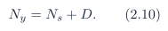

That policy intentionally truncates post-interval tail energy and is not the Revision J signoff default.

<a id="pdf-page-017"></a>

## Baseline PDF page 017

Historical Part I, core algorithm. Printed page 4. [Original PDF page](../specs/t_recap_phase2_integrated_spec.pdf#page=17).

[Previous](baseline/page-016.md) | [Index](README.md) | [Next](baseline/page-018.md)

[Edit Markdown and LaTeX source](source/baseline/page-017.md). Equations are rendered locally as SVG.

### 3 Bit-Accurate Fixed-Point Contract

#### 3.1 Sample range and saturation

An -bit signed two’s-complement sample belongs to

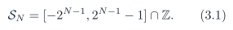

The output saturation operator is

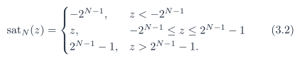

Internal wraparound is not allowed in the visible core contract. Revision J guarantees bit-accurate behavior on the frozen signoff vector set. For arbitrary legal -bit input streams outside that set, an implementation shall either provision widths according to a separate worst-case proof or expose overflow flags that are checked by the verification environment. Such arbitrary streams are not part of Revision J signoff unless that additional proof or flag policy is supplied.

#### 3.2 Arithmetic shift and rounded right shift

Let asr(z, k) denote sign-preserving arithmetic right shift by k bits. For k ≥ 0, it is equivalent to

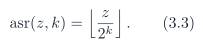

For example, asr(-3, 1) = -2. All quantizing right shifts use round-to-nearest with ties away from zero. For s ≥ 1,


The sign function is frozen as

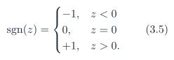

The zero-shift case is defined as

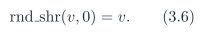

For complex values, `rnd_shr` applies component-wise. Define rnd2(q) = `rnd_shr`(q, 1).

#### 3.3 Coefficient quantization and storage widths

All shared coefficient tables use

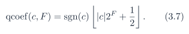

This is round-to-nearest with ties away from zero. Independent use of a language-default round() is not allowed unless it is proven bit-for-bit equivalent. The storage contract is mandatory:

<a id="pdf-page-018"></a>

## Baseline PDF page 018

Historical Part I, core algorithm. Printed page 5. [Original PDF page](../specs/t_recap_phase2_integrated_spec.pdf#page=18).

[Previous](baseline/page-017.md) | [Index](README.md) | [Next](baseline/page-019.md)

[Edit Markdown and LaTeX source](source/baseline/page-018.md). Equations are rendered locally as SVG.

- Window coefficients  are nonnegative and stored in unsigned  bits. For F = 15, the range is 0 to 32768.

- Custom FFT and IFFT twiddle coefficients are stored in signed  bits. For F = 15, both -32768 and +32768 are representable. A signed 16-bit Q1.15 ROM is not the Revision J baseline because it cannot represent +1.0 exactly.

#### 3.4 Fixed-point products and complex multiplication

If integer a has  fractional bits and integer b has  fractional bits, then ab has  fractional bits. To return to F fractional bits,

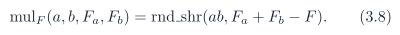

provided . For complex multiplication with 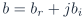 and , each component with F fractional bits,


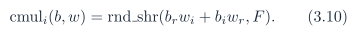

No truncation may occur before the full-precision product sums are formed. For a complex multiply whose data operands have signed width  and twiddle operands have signed width , product terms shall use at least  signed bits. Product sums and differences shall use at least  signed bits before `rnd_shr`(·, F ). For analysis windowing, 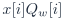 shall be formed exactly with at least  signed product bits before storage. For synthesis windowing,  shall be formed with at least  signed product bits before `rnd_shr`(·, F ). For magnitude-squared, each square shall be formed exactly and the sum shall have at least  unsigned bits. Internal storage overflow is an error condition. Internal values shall not silently wrap or saturate unless a later revision explicitly defines that behavior.

<a id="pdf-page-019"></a>

## Baseline PDF page 019

Historical Part I, core algorithm. Printed page 6. [Original PDF page](../specs/t_recap_phase2_integrated_spec.pdf#page=19).

[Previous](baseline/page-018.md) | [Index](README.md) | [Next](baseline/page-020.md)

[Edit Markdown and LaTeX source](source/baseline/page-019.md). Equations are rendered locally as SVG.

#### 3.5 Internal width schedule

**Table 3. Revision J minimum internal widths for the custom radix-2 baseline.**

| Quantity | Symbol | Width rule | Baseline |
| --- | --- | --- | --- |
| External sample |  | signed  | 12 |
| Window coefficient |  | unsigned  | 16 |
| Twiddle coefficient |  | signed  | 17 |
| Analysis-windowed input |  | signed  | 27 |
| Forward FFT stored real/imag |  | signed  | 28 |
| Forward pre-round add/sub |  | signed  | 29 |
| Canonical pre-round add/sub |  | signed  | 29 |
| Canonical real/imag |  | signed  | 28 |
| Magnitude-squared and THR2 |  | unsigned  | 56 |
| Unscaled IFFT stored real/imag |  | signed  | 36 |
| Synthesis-windowed sample |  | signed  | 36 |
| OLA accumulator entry |  | signed  | 37 |
| Aggregate spectral sums |  | At least  or arbitrary precision | run dependent |
| Time-error sums |  | Large enough for all emitted samples or arbitrary precision | run dependent |


The golden model should use arbitrary-precision integers for metric accumulators. RTL shall either provision enough accumulator width for the selected run length or expose and check overflow flags. Although the analysis product  may be formed internally in at least  bits, the frozen baseline coefficient range 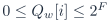 guarantees that the exact product fits in signed  bits. Storage into  is therefore a range-checked exact assignment. It is not truncation. If a future coefficient table permits values above 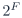, the  rule must be re-derived.

### 4 STFT/WOLA Core Mathematics

#### 4.1 Periodic square-root Hann window

Define the periodic Hann sequence

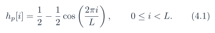

The analysis and synthesis windows are identical:

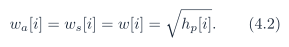

For H = L/2, ideal complementarity is

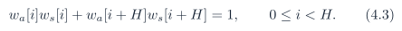

<a id="pdf-page-020"></a>

## Baseline PDF page 020

Historical Part I, core algorithm. Printed page 7. [Original PDF page](../specs/t_recap_phase2_integrated_spec.pdf#page=20).

[Previous](baseline/page-019.md) | [Index](README.md) | [Next](baseline/page-021.md)

[Edit Markdown and LaTeX source](source/baseline/page-020.md). Equations are rendered locally as SVG.

The quantized table is .

#### 4.2 Analysis windowing and normalized FFT

For frame m,

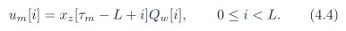

The intended normalized forward transform is

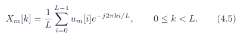

For the custom baseline, Algorithm 4 is normative.

#### 4.3 Hermitian canonicalization

For self-conjugate bins,


For 1 ≤ k ≤ L/2 - 1,

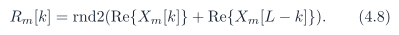

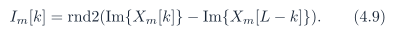


All threshold decisions use , not the raw FFT output.

#### 4.4 Magnitude-squared mask

For unique bins 0 ≤ k ≤ L/2,


The preliminary mask bit before protection is


The final mask is initialized as  and may then be modified only by the protection rules in Section 4.5. The comparison is unsigned, full precision, and performed in the magnitude-squared domain. The threshold register width is :


Out-of-range values are illegal for core signoff.

<a id="pdf-page-021"></a>

## Baseline PDF page 021

Historical Part I, core algorithm. Printed page 8. [Original PDF page](../specs/t_recap_phase2_integrated_spec.pdf#page=21).

[Previous](baseline/page-020.md) | [Index](README.md) | [Next](baseline/page-022.md)

[Edit Markdown and LaTeX source](source/baseline/page-021.md). Equations are rendered locally as SVG.

#### 4.5 Protection rules and masked spectrum

Define

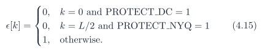

After threshold comparison, if `PROTECT_DC`= 1, force 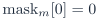. If `PROTECT_NYQ`= 1, force 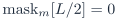. The preliminary value `pre_mask` is retained only for debug reporting and never controls synthesis. The masked spectrum is denoted . For ,

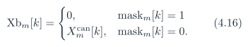

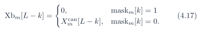

For self-conjugate bins,

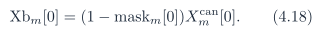

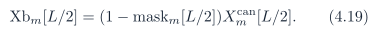

The result is conjugate symmetric by construction.

#### 4.6 Unscaled IFFT, synthesis window, and WOLA

The intended inverse is unscaled:

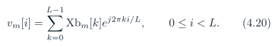

For the custom baseline, Algorithm 5 is normative. The synthesized frame contribution is

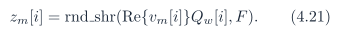

Each frame adds into the output accumulator:

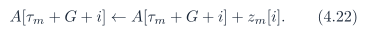

The emitted sample and delayed error are

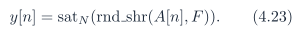

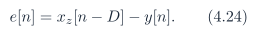

<a id="pdf-page-022"></a>

## Baseline PDF page 022

Historical Part I, core algorithm. Printed page 9. [Original PDF page](../specs/t_recap_phase2_integrated_spec.pdf#page=22).

[Previous](baseline/page-021.md) | [Index](README.md) | [Next](baseline/page-023.md)

[Edit Markdown and LaTeX source](source/baseline/page-022.md). Equations are rendered locally as SVG.

### 5 Normative Core Algorithm Tables

The algorithms in this section are normative mathematical procedures, not SystemVerilog module descriptions. To avoid notation ambiguity, the implementation-facing algorithm tables use ASCII identifiers: Xb for the masked spectrum, mag2 for the magnitude-squared array, `pre_mask` for the preliminary threshold result, and mask for the final post-protection unique-bin mask.

#### Algorithm 1 Finite-stream Phase 2 core operator with full-tail scoring

```text
Require: finite input vector x[0:Ns - 1] with Ns > 0; frozen parameters (N, L, H, F, G, D); frozen coefficient tables; threshold
    register THR2
Ensure: output vector y[0:Ny - 1], delayed-error metrics, aggregate frame metrics
 1: Nframes ← ⌊(Ns + L - 2)/H⌋
 2: tau_last ← Nframes H
 3: Ny ← tau_last + G + L
 4: initialize xring[0:L - 1] ← 0, ola[0:D - 1] ← 0
 5: initialize wr ← 0, rd ← 0, sample_count ← 0, frame_count ← 0
 6: initialize all frame-statistic and time-error accumulators to zero
 7: for n = 0 to Ny - 1 do
 8:     xin ← x[n] if 0 ≤ n < Ns , else 0                                            ▷ zero flush sample after real input ends
 9:     xref ← x[n - D] if 0 ≤ n - D < Ns , else 0
10:      xring[wr] ← xin
11:      wr ← (wr + 1) mod L
12:      y[n] ← sat_N (rnd_shr(ola[rd], F ))
13:      e[n] ← xref - y[n]
14:      update sum_abs_err, sum_sq_err, max_abs_err, and error_sample_count
15:      ola[rd] ← 0
16:      rd ← (rd + 1) mod D
17:      sample_count ← sample_count + 1
18:      if sample_count mod H = 0 and sample_count ≤ tau_last then
19:          (Xb, mag2, pre_mask, mask, frame_stats) ← ProcessFrameAnalysisMask(xring, wr, THR2)
20:          ProcessFrameSynthesisWOLA(Xb, frame_stats, ola, rd, G)
21:          frame_count ← frame_count + 1
22:      end if
23: end for
24: assert frame_count = Nframes
25: return (y, Ny , frame_count, frame_stats, metrics)
```

#### Algorithm 2 ProcessFrameAnalysisMask: frame construction, FFT, canonicalization, masking,

and frame statistics

```text
Require: input ring buffer xring[0:L - 1], write pointer wr, threshold register THR2
Ensure: masked spectrum Xb[0:L - 1], unique-bin mag2[0:L/2], pre-protection mask bits pre_mask[0:L/2], final mask bits
    mask[0:L/2], frame statistics
 1: for i = 0 to L - 1 do
 2:    xf [i] ← xring[(wr + i) mod L]                                                                    ▷ oldest to newest
 3:    u[i] ← xf [i]Qw[i]                                                           ▷ F fractional bits; no rounding here
 4: end for
 5: X ← FFTnorm (u)
 6: Xcan[0] ← Re{X[0]} + j0
 7: Xcan[L/2] ← Re{X[L/2]} + j0
 8: for k = 1 to L/2 - 1 do
 9:    R ← rnd2(Re{X[k]} + Re{X[L - k]})
10:     I ← rnd2(Im{X[k]} - Im{X[L - k]})
```

<a id="pdf-page-023"></a>

## Baseline PDF page 023

Historical Part I, core algorithm. Printed page 10. [Original PDF page](../specs/t_recap_phase2_integrated_spec.pdf#page=23).

[Previous](baseline/page-022.md) | [Index](README.md) | [Next](baseline/page-024.md)

[Edit Markdown and LaTeX source](source/baseline/page-023.md). Equations are rendered locally as SVG.

```text
11:     Xcan[k] <- R + jI
12:     Xcan[L - k] <- R - jI
13: end for
14: for k = 0 to L/2 do
15:     mag2[k] <- Re{Xcan[k]}^2 + Im{Xcan[k]}^2
16:     pre_mask[k] <- 1 if mag2[k] < THR2 else 0
17:     mask[k] <- pre_mask[k]
18: end for
19: if PROTECT_DC = 1 then
20:     mask[0] <- 0
21: end if
22: if PROTECT_NYQ = 1 then
23:     mask[L/2] <- 0
24: end if
25: for k = 0 to L/2 do
26:     eligible[k] <- epsilon[k]
27:     wgt[k] <- 1 if k in {0, L/2} else 2
28: end for
29: unique_bins_this_frame <- L/2 + 1
30: unique_suppressed_bins_this_frame <- sum(k=0..L/2, mask[k])
31: eligible_unique_bins_this_frame <- sum(k=0..L/2, eligible[k])
32: eligible_suppressed_bins_this_frame <- sum(k=0..L/2, eligible[k]*mask[k])
33: eligible_total_mag2_this_frame <- sum(k=0..L/2, eligible[k]*wgt[k]*mag2[k])
34: eligible_kept_mag2_this_frame <- sum(k=0..L/2, eligible[k]*(1-mask[k])*wgt[k]*mag2[k])
35: for k = 1 to L/2 - 1 do
36:     if mask[k] = 1 then
37:         Xb[k] <- 0, Xb[L - k] <- 0
38:     else
39:         Xb[k] <- Xcan[k], Xb[L - k] <- Xcan[L - k]
40:     end if
41: end for
42: Xb[0] <- 0 if mask[0] = 1 else Xcan[0]
43: Xb[L/2] <- 0 if mask[L/2] = 1 else Xcan[L/2]
44: return (Xb, mag2, pre_mask, mask, frame_stats)
```

#### Algorithm 3 ProcessFrameSynthesisWOLA: IFFT, synthesis window, and WOLA accumulation

```text
Require: masked spectrum Xb[0:L - 1], frame statistics, OLA ring buffer ola[0:D - 1], read pointer rd, scheduling cushion G
Ensure: updated OLA ring buffer and aggregate spectral statistics
1: v ← IFFTunscaled (Xb)
2: for i = 0 to L - 1 do
3:    vr [i] ← Re{v[i]}
4:    z[i] ← rnd_shr(vr [i]Qw [i], F )
5:    pi ← (rd + G + i) mod D
6:    ola[pi ] ←ola[pi ] + z[i]
7: end for
8: update unique-bin and eligible-bin suppression totals using frame_stats
9: update eligible_kept_mag2 and eligible_total_mag2 aggregate sums using frame_stats
```

#### 5.1 Required invariants

INV1. Every emitted sample y[n] is compared against xz [n - D].

INV2. Under `full_tail`, post-input samples after Ns + D - 1 are scored against zero.

<a id="pdf-page-024"></a>

## Baseline PDF page 024

Historical Part I, core algorithm. Printed page 11. [Original PDF page](../specs/t_recap_phase2_integrated_spec.pdf#page=24).

[Previous](baseline/page-023.md) | [Index](README.md) | [Next](baseline/page-025.md)

[Edit Markdown and LaTeX source](source/baseline/page-024.md). Equations are rendered locally as SVG.

INV3. If THR2= 0, then every eligible mask decision is zero.

INV4. For ,  by construction.

INV5. Bins 0 and L/2 are real-valued after canonicalization.

INV6. All precision-reducing shifts use `rnd_shr`(·) or rnd2(·).

INV7. The OLA accumulator shall not wrap internally on signoff vectors.

INV8. The signoff frame count equals  under the Revision J active-window finite-stream policy.

### 6 Exact Custom FFT/IFFT Integer Algorithms

This section freezes the custom radix-2 baseline. If a vendor FFT IP is used, Appendix A replaces this section for bit-accurate purposes.

#### 6.1 Bit reversal and twiddle tables

Let 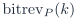 denote -bit bit reversal. Forward twiddles are

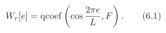

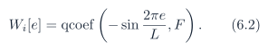

Inverse twiddles are

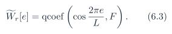


Define the complex twiddle table aliases


Algorithms 4 and 5 shall use these aliases. The inverse twiddle table is a frozen artifact and shall not be regenerated implicitly inside RTL.

#### Algorithm 4 Exact custom FFTnorm integer algorithm

```text
Require: real input vector u[0:L - 1] with F fractional bits; L = 2^P ; frozen forward twiddle table Wfwd[e]
Ensure: normalized complex spectrum X[0:L - 1] in natural order
1: for k = 0 to L - 1 do
2:    A[k] ← u[bitrevP (k)] + j0
3: end for
4: for s = 1 to P do
```

<a id="pdf-page-025"></a>

## Baseline PDF page 025

Historical Part I, core algorithm. Printed page 12. [Original PDF page](../specs/t_recap_phase2_integrated_spec.pdf#page=25).

[Previous](baseline/page-024.md) | [Index](README.md) | [Next](baseline/page-026.md)

[Edit Markdown and LaTeX source](source/baseline/page-025.md). Equations are rendered locally as SVG.

```text
 5:   span ← 2^s, half ← 2^(s-1)
 6:   for base = 0 to L - 1 step span do
 7:      for j = 0 to half - 1 do
 8:          e ← jL/span
 9:          t ← cmul(A[base + j + half ], Wfwd[e])
10:           a ← A[base + j]
11:           A[base + j] ← rnd2(a + t)
12:           A[base + j + half ] ← rnd2(a - t)
13:       end for
14:    end for
15: end for
16: return X ← A
```

#### Algorithm 5 Exact custom IFFTunscaled integer algorithm

```text
Require: conjugate-symmetric masked spectrum Xb[0:L - 1] with F fractional bits; frozen inverse twiddle table Winv[e]
Ensure: unscaled complex time-domain vector v[0:L - 1] in natural order
 1: for k = 0 to L - 1 do
 2:    B[k] ←Xb[bitrevP (k)]
 3: end for
 4: for s = 1 to P do
 5:    span ← 2^s, half ← 2^(s-1)
 6:    for base = 0 to L - 1 step span do
 7:        for j = 0 to half - 1 do
 8:           e ← jL/span
 9:           t ← cmul(B[base + j + half ], Winv[e])
10:            a ← B[base + j]
11:            B[base + j] ← a + t
12:            B[base + j + half ] ← a - t
13:         end for
14:     end for
15: end for
16: return v ← B
```

All additions and subtractions in Algorithms 4 and 5 shall be sign-extended before the defined rounding or storage step. Silent truncation before rnd2, `rnd_shr`, or threshold comparison is not allowed.

### 7 Metrics and Artifact Contract

#### 7.1 Spectral metrics

The unique-bin weight is


<a id="pdf-page-026"></a>

## Baseline PDF page 026

Historical Part I, core algorithm. Printed page 13. [Original PDF page](../specs/t_recap_phase2_integrated_spec.pdf#page=26).

[Previous](baseline/page-025.md) | [Index](README.md) | [Next](baseline/page-027.md)

[Edit Markdown and LaTeX source](source/baseline/page-026.md). Equations are rendered locally as SVG.

Let . For one frame,


These are normalized spectral magnitude-squared totals for deterministic accounting. They are not direct physical energy measurements unless Parseval scaling is applied. The name `unique_suppressed_bins` means the final post-protection mask count over all unique bins. Under the current post-protection mask semantics, protected bins are forced to mask=0, so `unique_suppressed_bins` and `eligible_suppressed_bins` are equal whenever those protection rules are applied. The useful distinction is in the denominators: `unique_bins` includes protected bins, while `eligible_unique_bins` excludes them. The preferred workload proxy is therefore `eligible_suppressed_bins/eligible_unique_bins`. If a debug flow needs to know which protected bins would have been suppressed before protection, it shall use the optional bin-level `pre_mask` field rather than changing the frame-statistics counters.

#### 7.2 Time-domain quality metrics

For ,


Required integer metrics are


RMSE may be reported as a derived floating field, but the integer numerator and denominator are the signoff quantities.

#### 7.3 Canonical memory-file encoding

All memh files contain exactly one value per line, lowercase hexadecimal digits only, no 0x prefix, no leading or trailing spaces, no blank lines, and exactly one LF line ending after each value in the canonical form. For an unsigned -bit memh file, each line shall contain exactly  hexadecimal digits. The value shall satisfy . Readers shall mask to W bits and shall not sign-extend unsigned files.

<a id="pdf-page-027"></a>

## Baseline PDF page 027

Historical Part I, core algorithm. Printed page 14. [Original PDF page](../specs/t_recap_phase2_integrated_spec.pdf#page=27).

[Previous](baseline/page-026.md) | [Index](README.md) | [Next](baseline/page-028.md)

[Edit Markdown and LaTeX source](source/baseline/page-027.md). Equations are rendered locally as SVG.

For a signed -bit memh file, each line shall contain exactly  hexadecimal digits. The encoded value is the low W bits of the two’s-complement representation, zero-padded on the left to the required digit count. Readers shall mask to W bits first and then sign-extend from bit W - 1. The stream files `x_in.memh` and `y_out.memh` are signed -bit files. The window file `window_qw.memh` is an unsigned -bit file. All forward and inverse twiddle files are signed -bit files. For , every twiddle line has five hex digits:

+32768 → 08000, -32768 → 18000, -1 → 1ffff.

#### 7.4 Canonical SHA-256 hashing

All memh SHA-256 fields, including coefficient hashes and stream hashes such as `x_in_sha256` or `y_out_sha256` when present, are computed over the logical integer vector, not arbitrary raw host bytes. To hash a table or stream, serialize each value according to the canonical memh rule for its declared signedness and width, using lowercase fixed-width hexadecimal plus one LF byte after every value. CRLF, uppercase hexadecimal, extra spaces, and blank lines are not canonical. A checker may normalize an input file to this canonical serialization before hashing, but config.json and `test_vectors.json` record hashes of the canonical serialization only.

#### 7.5 Normative coefficient artifacts

The coefficient equations in Sections 4 and 6 define how the initial tables are generated. After the first frozen release, the coefficient memh files and their canonical SHA-256 hashes are normative for signoff. RTL shall use those artifacts directly or prove that its generated ROM contents match their canonical hashes. A regenerated table that is mathematically equivalent but hash-different is not a Revision J signoff table.

#### 7.6 Frozen stream artifacts

The generator equations define how input vectors are constructed for the initial golden-model release. After a vector is frozen, `x_in.memh` and its canonical `x_in_sha256` are normative for signoff. Regenerating the same named vector with a different math library is not sufficient unless the canonical `x_in_sha256` matches. Signoff never depends on independently re-evaluating sin, cos, or π in a different math library after the vector has been frozen. The canonical stream hash is authoritative. After the golden model produces `y_out.memh`, the canonical `y_out_sha256` is also normative and shall be recorded in the stream-hash manifest. The mathematical generator name remains useful documentation, but frozen stream hashes are the authority used by RTL and board-replay checkers.

#### 7.7 Artifact line counts

Every required artifact has a fixed row count for a given signoff vector:

<a id="pdf-page-028"></a>

## Baseline PDF page 028

Historical Part I, core algorithm. Printed page 15. [Original PDF page](../specs/t_recap_phase2_integrated_spec.pdf#page=28).

[Previous](baseline/page-027.md) | [Index](README.md) | [Next](baseline/page-029.md)

[Edit Markdown and LaTeX source](source/baseline/page-028.md). Equations are rendered locally as SVG.

- `window_qw.memh` shall contain exactly L lines. Line i stores  for i = 0, . . . , L - 1.

- `twiddle_re.memh`, `twiddle_im.memh`, `twiddle_inv_re.memh`, and `twiddle_inv_im.memh` shall each contain exactly L lines. Line e stores the coefficient for e = 0, . . . , L - 1.

- `x_in.memh` shall contain exactly  lines.

- `y_out.memh` shall contain exactly  lines.

- `frame_stats.csv` shall contain one header row plus exactly  data rows.

- Conditional `bin_stats.csv`: when required for a vector, one header row plus exactly  data rows. The baseline stores L twiddle entries for a simple artifact contract, even though a hardware implementation may store fewer entries internally after a separate ROM-addressing proof. Internal ROM compaction shall not change the external artifact contract. The `bin_stats.csv` artifact is conditional:

- If the file is not required for a vector, omit `bin_stats_data_rows` from `artifact_rows`.

- If that row-count field is present, then `bin_stats.csv` shall be present and shall contain exactly that number of data rows.

#### 7.8 Required artifacts

**Table 4. Required stream and coefficient artifacts.**

| Artifact | Contract |
| --- | --- |
| `x_in.memh` | Input stream in signed -bit two’s-complement hex, exactly  digits per line. |
| `y_out.memh` | Reconstructed stream  in the same signed -bit format. |
| `window_qw.memh` | Quantized window ROM , unsigned width . |
| `twiddle_re.memh` | Forward twiddle real table, signed width . |
| `twiddle_im.memh` | Forward twiddle imaginary table, signed width . |
| `twiddle_inv_re.memh` | Inverse twiddle real table, signed width . |
| `twiddle_inv_im.memh` | Inverse twiddle imaginary table, signed width . |


**Table 5. Required metadata, statistics, and signoff artifacts.**

| Artifact | Contract |
| --- | --- |
| config.json | Configuration metadata, contract strings, width fields, threshold mapping, and coefficient hashes. |
| `test_vectors.json` | Frozen test-vector manifest with generator parameters, threshold, protection flags, and tail policy. |
| `quality_bounds.json` | Frozen no-suppression quality limits per vector after the first golden-model release. |
| `frame_stats.csv` | One row per signoff frame with mandatory columns below. |
| metrics.json | Aggregate signoff metrics under the exact schema below. |
| `bin_stats.csv` | Conditional debug artifact for near-threshold and small regression vectors. |

<a id="pdf-page-029"></a>

## Baseline PDF page 029

Historical Part I, core algorithm. Printed page 16. [Original PDF page](../specs/t_recap_phase2_integrated_spec.pdf#page=29).

[Previous](baseline/page-028.md) | [Index](README.md) | [Next](baseline/page-030.md)

[Edit Markdown and LaTeX source](source/baseline/page-029.md). Equations are rendered locally as SVG.

#### 7.9 CSV field contracts

The required `frame_stats.csv` header is exactly one logical CSV line, wrapped below only for page layout:

```csv
frame_idx,unique_bins,unique_suppressed_bins,
eligible_unique_bins,eligible_suppressed_bins,
eligible_kept_mag2,eligible_total_mag2
```

For `frame_stats.csv`, all values are decimal unsigned integers. The field `frame_idx` is zero-based and equals m for trigger . Rows shall be emitted in increasing `frame_idx` order from 0 to . When present, the required `bin_stats.csv` header is exactly:

```csv
frame_idx,bin_idx,real,imag,mag2,eligible,pre_mask,mask
```

For `bin_stats.csv`, `frame_idx` and `bin_idx` are unsigned decimal integers, real and imag are signed decimal integers, mag2 is an unsigned decimal integer, and eligible, `pre_mask`, and mask are unsigned 0/1 values. Rows shall be emitted in increasing `frame_idx` order and, within each frame, in increasing `bin_idx` order from 0 to L/2.

#### 7.10 JSON integer rule and schemas

All aggregate counters, all fields derived from mag2, and every integer field wider than 53 bits shall be encoded as decimal strings. Small configuration integers may be JSON numbers. Checkers shall parse decimal-string signoff fields as arbitrary-precision integers. Generator parameters shall not rely on binary floating-point parsing for signoff. Normalized frequencies are represented by integer fields `f_num` and `f_den`, meaning f = `f_num/f_den` as an exact rational number. Phase fields are represented as `phase_rad` decimal strings and shall be parsed as exact decimal values before evaluation. Legacy frequency strings of the form "a/b" are not part of the Revision J schema. The JSON blocks below are illustrative schema examples, not ready-to-freeze artifact files. Placeholder strings such as `<sha256-hex>` and `<decimal-string>` shall be replaced before a file is accepted by a parser or committed as a frozen manifest. Literal ellipses are not legal values in Revision J artifact JSON.

config.json.

```json
{
    "configuration": {
      "N": 12, "L": 256, "P": 8, "H": 128, "F": 15,
      "G": 128, "D": 384, "Ns": 4096, "Ny": 4608,
      "frames": 33, "THR2": "0",
      "PROTECT_DC": 1, "PROTECT_NYQ": 0
    },
    "contract": {
      "fft_mode": "custom_radix2_dit_bitrev_in_natural_out",
      "rounding_mode": "round_nearest_ties_away_from_zero",
      "tail_policy": "full_tail",
```

<a id="pdf-page-030"></a>

## Baseline PDF page 030

Historical Part I, core algorithm. Printed page 17. [Original PDF page](../specs/t_recap_phase2_integrated_spec.pdf#page=30).

[Previous](baseline/page-029.md) | [Index](README.md) | [Next](baseline/page-031.md)

[Edit Markdown and LaTeX source](source/baseline/page-030.md). Equations are rendered locally as SVG.

```json
      "threshold_mapping": "raw_thr2"
    },
    "widths": {
      "W_Qw": 16, "W_tw": 17, "W_u": 27,
      "W_fft": 28, "W_fft_pre": 29,
      "W_can_pre": 29, "W_can": 28,
      "W_mag2": 56, "W_ifft": 36,
      "W_z": 36, "W_ola": 37
    },
    "hashes": {
      "window_qw_sha256": "<sha256-hex>",
      "twiddle_re_sha256": "<sha256-hex>",
      "twiddle_im_sha256": "<sha256-hex>",
      "twiddle_inv_re_sha256": "<sha256-hex>",
      "twiddle_inv_im_sha256": "<sha256-hex>"
    },
    "stream_hashes": {
      "x_in_sha256": "<sha256-hex>",
      "y_out_sha256": "<sha256-hex>"
    },
    "artifact_rows": {
      "window_qw": 256,
      "twiddle_re": 256,
      "twiddle_im": 256,
      "twiddle_inv_re": 256,
      "twiddle_inv_im": 256,
      "x_in": 4096,
      "y_out": 4608,
      "frame_stats_data_rows": 33,
      "bin_stats_data_rows": 4257
    }
}
```

metrics.json.

```json
{
    "configuration": {
      "N": 12, "L": 256, "P": 8, "H": 128, "F": 15,
      "G": 128, "D": 384,
      "Ns": 4096, "Ny": 4608, "frames": 33,
      "THR2": "0",
      "PROTECT_DC": 1, "PROTECT_NYQ": 0
    },
    "contract": {
      "fft_mode": "custom_radix2_dit_bitrev_in_natural_out",
      "rounding_mode": "round_nearest_ties_away_from_zero",
      "tail_policy": "full_tail",
      "memh_encoding": "fixed_width_lowercase_hex_lf",
      "hash_rule": "logical_integer_vector_fixed_width_hex_lf"
    },
    "widths": {
      "W_Qw": 16, "W_tw": 17, "W_u": 27,
      "W_fft": 28, "W_fft_pre": 29,
      "W_can_pre": 29, "W_can": 28,
      "W_mag2": 56, "W_ifft": 36,
      "W_z": 36, "W_ola": 37
    },
    "hashes": {
      "window_qw_sha256": "<sha256-hex>",
      "twiddle_re_sha256": "<sha256-hex>",
      "twiddle_im_sha256": "<sha256-hex>",
      "twiddle_inv_re_sha256": "<sha256-hex>",
      "twiddle_inv_im_sha256": "<sha256-hex>"
    },
    "stream_hashes": {
      "x_in_sha256": "<sha256-hex>",
```

<a id="pdf-page-031"></a>

## Baseline PDF page 031

Historical Part I, core algorithm. Printed page 18. [Original PDF page](../specs/t_recap_phase2_integrated_spec.pdf#page=31).

[Previous](baseline/page-030.md) | [Index](README.md) | [Next](baseline/page-032.md)

[Edit Markdown and LaTeX source](source/baseline/page-031.md). Equations are rendered locally as SVG.

```json
      "y_out_sha256": "<sha256-hex>"
    },
    "suppression_totals": {
      "unique_bins": "4257",
      "unique_suppressed_bins": "0",
      "eligible_unique_bins": "4224",
      "eligible_suppressed_bins": "0"
    },
    "spectral_totals": {
      "eligible_kept_mag2": "123456789012345",
      "eligible_total_mag2": "123456789012345"
    },
    "time_domain_errors": {
      "sum_abs_err": "123",
      "sum_sq_err": "456",
      "max_abs_err": "3",
      "error_sample_count": "4608"
    }
}
```

`test_vectors.json`.

```json
{
    "schema": "trecap_phase2_test_vectors_v1",
    "generator_version": "phase2_generators_revision_j",
    "generator_source_sha256": "<sha256-hex>",
    "vectors": [
      {
        "name": "zero_Ns4096_thr0",
        "Ns": 4096,
        "generator": "constant",
        "parameters": { "value": 0 },
        "THR2": "0",
        "PROTECT_DC": 1,
        "PROTECT_NYQ": 0,
        "tail_policy": "full_tail",
        "rounding": "round_nearest_ties_away_from_zero",
        "x_in_sha256": "<sha256-hex>",
        "y_out_sha256": "<sha256-hex>"
      },
      {
        "name": "near_threshold_multitone_example",
        "Ns": 4096,
        "generator": "multitone_sine_sum",
        "parameters": {
          "tones": [
            {"amplitude": 512, "f_num": 16, "f_den": 256, "phase_rad": "0"},
            {"amplitude": 128, "f_num": 23, "f_den": 256, "phase_rad": "0.5"}
          ]
        },
        "THR2": "<decimal-string>",
        "PROTECT_DC": 1,
        "PROTECT_NYQ": 0,
        "tail_policy": "full_tail",
        "rounding": "round_nearest_ties_away_from_zero",
        "x_in_sha256": "<sha256-hex>",
        "y_out_sha256": "<sha256-hex>"
      }
    ]
}
```

`quality_bounds.json`. Revision J treats `quality_bounds.json` as a single global quality-bound manifest under `artifacts/manifests/quality_bounds.json`. The manifest is keyed by vector name. It is not a separate per-vector file.

<a id="pdf-page-032"></a>

## Baseline PDF page 032

Historical Part I, core algorithm. Printed page 19. [Original PDF page](../specs/t_recap_phase2_integrated_spec.pdf#page=32).

[Previous](baseline/page-031.md) | [Index](README.md) | [Next](baseline/page-033.md)

[Edit Markdown and LaTeX source](source/baseline/page-032.md). Equations are rendered locally as SVG.

```json
{
    "configuration": {
      "N": 12, "L": 256, "H": 128, "F": 15,
      "G": 128, "D": 384, "THR2": "0",
      "PROTECT_DC": 1, "PROTECT_NYQ": 0,
      "tail_policy": "full_tail"
    },
    "generator_version": "phase2_generators_revision_j",
    "hashes": {
      "window_qw_sha256": "<sha256-hex>",
      "twiddle_re_sha256": "<sha256-hex>",
      "twiddle_im_sha256": "<sha256-hex>",
      "twiddle_inv_re_sha256": "<sha256-hex>",
      "twiddle_inv_im_sha256": "<sha256-hex>"
    },
    "bounds": {
      "zero_Ns4096_thr0": {
        "x_in_sha256": "<sha256-hex>",
        "y_out_sha256": "<sha256-hex>",
        "max_abs_err": "0",
        "sum_sq_err": "0",
        "error_sample_count": "4608"
      }
    }
}
```

The numbers shown above are schema examples. Placeholder strings are not legal frozen artifact values. Final quality-bound values shall be generated by the frozen golden model and then frozen with documented engineering margin.

### 8 Signoff Test Suite, Generators, and Acceptance Criteria

#### 8.1 Required test-vector classes

The exact instances are frozen in `test_vectors.json`. A vector is not a signoff vector unless its length, generator parameters, threshold, seed or phase, rounding mode, protection flags, and tail policy appear in that manifest.

<a id="pdf-page-033"></a>

## Baseline PDF page 033

Historical Part I, core algorithm. Printed page 20. [Original PDF page](../specs/t_recap_phase2_integrated_spec.pdf#page=33).

[Previous](baseline/page-032.md) | [Index](README.md) | [Next](baseline/page-034.md)

[Edit Markdown and LaTeX source](source/baseline/page-033.md). Equations are rendered locally as SVG.

**Table 6. Required mathematical signoff vector classes.**

| Test class | Purpose | Required |
| --- | --- | --- |
| Zero input | Confirms zero-extension, windowing, FFT/IFFT, WOLA, and output rounding do not create nonzero samples. | Yes |
| No suppression, THR2 = 0 | Confirms all eligible masks are zero and establishes near-lossless baseline error. | Yes |
| Impulse and step | Exercises startup, flush, delay D, and WOLA alignment. | Yes |
| Exact-bin tone sweep | Verifies dominant-bin placement and expected window-shaped spectral spread. | Yes |
| Off-bin tone sweep | Exercises leakage behavior under the periodic square-root Hann window. | Yes |
| Near-threshold multitone | Verifies full-precision unsigned threshold decisions and Hermitian-pair consistency. | Yes |
| Noise-only stream | Characterizes suppression ratio, kept-energy ratio, and error under low-value content. | Yes |
| High-amplitude headroom | Confirms no internal wraparound on the frozen width schedule. | Yes |
| Short finite stream | Forces startup, flush, and full-tail scoring. | Yes |
| Rectangular-window diagnostic | Debug-only exact one-bin sinusoid test. Not part of the normal core. | Optional |


#### 8.2 Frozen generator algorithms

Generator names in `test_vectors.json` refer to the exact integer generators below. All generated samples are finally clipped by satN . Frequency parameters in JSON use `f_num` and `f_den`. The mathematical symbol f below denotes the exact rational value `f_num/f_den`. Phase parameters use `phase_rad` decimal strings. The equations define construction before freezing. After freezing, `x_in.memh` and `x_in_sha256` are the signoff source of truth. For sine, cosine, and multitone generators, the frozen generator implementation shall be identified by `generator_version` and `generator_source_sha256`. A regenerated vector is accepted only when its canonical `x_in_sha256` matches the frozen manifest. Differences caused by host math libraries, π constants, floating-point precision, or decimal parsing are not acceptable implementation variations after a vector has been frozen.

constant. For integer value c,


impulse. For index n0 and amplitude A,


step. For index n0 and amplitude A,


<a id="pdf-page-034"></a>

## Baseline PDF page 034

Historical Part I, core algorithm. Printed page 21. [Original PDF page](../specs/t_recap_phase2_integrated_spec.pdf#page=34).

[Previous](baseline/page-033.md) | [Index](README.md) | [Next](baseline/page-035.md)

[Edit Markdown and LaTeX source](source/baseline/page-034.md). Equations are rendered locally as SVG.

sine and exact-bin sine. For amplitude A, normalized frequency f , and phase ϕ, where f is measured in cycles per sample and ϕ is measured in radians,


Exact-bin sine uses f = k/L for frozen integer bin k. For exact-bin sine, 0 ≤ k ≤ L/2. For k = 0 or k = L/2, cosine is preferred for nonzero deterministic content because sine at phase zero can generate an all-zero sequence.

cosine. For amplitude A, normalized frequency f in cycles per sample, and phase ϕ in radians,


`multitone_sine_sum`. For Q tones with amplitudes Aq , normalized frequencies fq in cycles per sample, and phases ϕq in radians,


The sum is formed in real arithmetic first. The operator qcoef(·, 0) is applied once to the final sum. Per-tone integer rounding before summation is not allowed unless a separate generator name freezes that behavior.

`uniform_noise_xorshift32`. Let r be a nonzero 32-bit unsigned seed. For every sample, update with unsigned 32-bit wraparound:


For frozen noise bit width B,


The frozen noise bit width shall satisfy 1 ≤ B ≤ 32. The value B = 0 is illegal, and B > 32 is illegal because the generator state is exactly 32 bits. If B > N , the vector intentionally exercises clipping through satN and shall declare that intent in `test_vectors.json`. A stochastic vector is not frozen unless it declares generator name, seed, B, Ns , threshold, protection flags, and tail policy.

#### 8.3 Golden-model quality bounds

Bit-for-bit agreement between RTL and the golden model proves implementation equivalence. It does not prove that the golden model has the intended reconstruction quality. Therefore, the global `quality_bounds.json` manifest shall freeze no-suppression quality limits per vector after the first complete golden-model release. It shall include at least `max_abs_err`, `sum_sq_err`, and `error_sample_count`. Do not invent these numbers in the specification. Run the golden model first, then freeze them.

<a id="pdf-page-035"></a>

## Baseline PDF page 035

Historical Part I, core algorithm. Printed page 22. [Original PDF page](../specs/t_recap_phase2_integrated_spec.pdf#page=35).

[Previous](baseline/page-034.md) | [Index](README.md) | [Next](baseline/page-036.md)

[Edit Markdown and LaTeX source](source/baseline/page-035.md). Equations are rendered locally as SVG.

#### 8.4 Acceptance criteria

A Phase 2 core implementation passes Revision J signoff only if all of the following hold:

AC1. The golden model generates all required artifacts for every vector in `test_vectors.json` using the generators in Section 8.2.

AC2. Coefficient artifacts and hashes match under the canonical memh and SHA-256 rules.

AC3. Stream artifacts `x_in.memh` and `y_out.memh` match the recorded canonical `x_in_sha256` and `y_out_sha256` hashes.

AC4. All required artifacts have the exact row counts specified in Section 7.7 and in config.json `artifact_rows`.

AC5. THR2 is an unsigned -bit integer and satisfies .

AC6. For THR2= 0, every eligible mask decision is zero.

AC7. The output length follows the declared `tail_policy`. Revision J signoff uses `full_tail` with zero flush ticks until all  outputs are emitted.

AC8. No-suppression golden-model quality fields satisfy `quality_bounds.json`.

AC9. RTL simulation matches `y_out.memh` sample-for-sample.

AC10. RTL simulation matches every row of `frame_stats.csv` exactly.

AC11. RTL simulation matches every mandatory field in metrics.json exactly.

AC12. For vectors that require `bin_stats.csv`, canonical real/imag, mag2, eligibility, `pre_mask`, and final mask fields match exactly.

AC13. BRAM replay on the FPGA board matches the mandatory artifacts before live input is used for demonstration.

AC14. Overflow or wrap flags, if present, remain deasserted on the frozen signoff vector set.

### 9 Live Source Abstraction and Threshold Mapping

The core begins after input adaptation. Every live source must map to . For a raw unsigned B-bit ADC source,


For an audio-codec source with ,


If , a separate left-shift or sign-extension rule shall be frozen before use.

<a id="pdf-page-036"></a>

## Baseline PDF page 036

Historical Part I, core algorithm. Printed page 23. [Original PDF page](../specs/t_recap_phase2_integrated_spec.pdf#page=36).

[Previous](baseline/page-035.md) | [Index](README.md) | [Next](baseline/page-037.md)

[Edit Markdown and LaTeX source](source/baseline/page-036.md). Equations are rendered locally as SVG.

Human-facing threshold controls are wrappers. If an amplitude-domain threshold Tamp,QF is exposed, then


For an 8-bit switch preset, a valid wrapper may define


but Kthr and the preset mapping shall be frozen in config.json. Directly interpreting the switch value as raw THR2 is allowed only if declared explicitly.

Wrapper computation of  shall be performed in a width large enough to hold the full square. The resulting threshold shall then be checked against . Out-of-range wrapper thresholds are illegal for the core signoff contract unless the wrapper explicitly defines saturation or clipping outside the core contract and records that policy in `config.json`.

### 10 Throughput and Power Interpretation

Let Fs be the input sample rate and fclk be the FPGA fabric clock. The number of fabric cycles per hop is


A burst-style implementation that begins frame processing at τm must make its frame contribution available before slot τm + G, so


With G = H, this becomes Tframe < H/Fs . The baseline core computes the STFT every frame. Suppressed-bin count is therefore a workload proxy, not direct proof of power reduction. A real power-reduction claim requires a later downstream stage that uses the mask to skip feature extraction, detector operations, coefficient transport, memory writes, or other work.

### 11 Conclusion

This specification defines the Phase 2 T-RECAP core as a deterministic fixed-point STFT/WOLA selective-suppression operator. Revision J freezes the items that usually cause golden-model and RTL drift: coefficient representability, coefficient ROM widths, arithmetic shift behavior on negative integers, rounded shifts including zero-shift, active-window full-tail finite-stream scoring, exact custom radix-2 FFT/IFFT ordering, explicit forward/inverse twiddle aliases, inverse twiddle artifacts, full-precision unsigned threshold comparison, internal product widths, eligible spectral accounting, canonical signed and unsigned memh encodings and hashes, exact artifact line counts, conditional binstats row-count semantics, CSV row order, exact JSON schemas, stream hashes, wrapper threshold overflow policy, and frozen test-vector generator algorithms including `multitone_sine_sum`.

<a id="pdf-page-037"></a>

## Baseline PDF page 037

Historical Part II, DDR and UDP telemetry. Printed page 24. [Original PDF page](../specs/t_recap_phase2_integrated_spec.pdf#page=37).

[Previous](baseline/page-036.md) | [Index](README.md) | [Next](baseline/page-038.md)

[Edit Markdown and LaTeX source](source/baseline/page-037.md). Equations are rendered locally as SVG.

### Part II - Ethernet/HPS DDR Telemetry and Control Architecture

Part II defines the real-time observability and command layer. It does not redefine the STFT/WOLA arithmetic core. It moves already-computed core observability signals from FPGA fabric through HPS DDR and HPS Ethernet to the PC.

### 12 Purpose and Scope

#### 12.1 Purpose

The purpose of this document is to specify the real-time Ethernet telemetry and control path for the Phase 2 T-RECAP implementation on DE1-SoC. The design target is a high-observability demonstration in which the PC displays:

- delayed input waveform, reconstructed output waveform, and time-domain error.

- real-time spectrogram based on compressed magnitude-squared bins.

- mask/suppression overlay or mask-derived statistics.

- suppression ratio, kept-energy ratio, error metrics, drop counters, and overflow flags.

- live threshold and source-mode controls.

#### 12.2 Relationship to Part I

This addendum does not replace the Phase 2 core mathematical specification. The core specification remains normative for:

- STFT/WOLA frame timing, hop size, delay, and finite-stream scoring.

- fixed-point rounding, saturation, coefficient quantization, FFT/IFFT arithmetic, and Hermitian canonicalization.

- magnitude-squared thresholding and mask construction.

- BRAM replay signoff artifacts and golden-model comparison. This addendum is a transport and observability specification. It defines how already-computed core signals are moved to a PC dashboard and how PC commands are returned to the FPGA through the HPS.

#### 12.3 Non-Goals

The following items are outside the scope of this document:

- redefining the STFT/WOLA core or its arithmetic contract.

- defining SystemVerilog module decomposition or signal-level RTL implementation.

- defining Linux kernel-driver source code.

<a id="pdf-page-038"></a>

## Baseline PDF page 038

Historical Part II, DDR and UDP telemetry. Printed page 25. [Original PDF page](../specs/t_recap_phase2_integrated_spec.pdf#page=38).

[Previous](baseline/page-037.md) | [Index](README.md) | [Next](baseline/page-039.md)

[Edit Markdown and LaTeX source](source/baseline/page-038.md). Equations are rendered locally as SVG.

- using the HPS to compute FFT, IFFT, WOLA, magnitude-squared, masks, or error metrics.

- treating Ethernet dashboard output as a replacement for BRAM replay signoff.

### 13 System Boundary and Ownership Rules

#### 13.1 Core Ownership Rule

The FPGA fabric owns the real-time signal-processing path:

source → STFT/WOLA suppression core → y[n].

The HPS is not permitted to process sample-by-sample data for the purpose of reconstruction or mask decision. Its role is limited to transport, logging, command handling, and register access.

#### 13.2 Transport Ownership Rule

The HPS owns Ethernet because the DE1-SoC Ethernet path is HPS-facing. The board manual describes Gigabit Ethernet support through an external KSZ9021RN PHY and the HPS Ethernet MAC function [6]. Therefore, the practical Ethernet architecture is HPS-mediated transport, not direct FPGA Ethernet.

#### 13.3 Non-Stall Rule

The telemetry system shall not backpressure the STFT/WOLA core. Telemetry taps are valid-only from the point of view of the core. The telemetry formatter may sample, buffer, or drop tap events, but it shall never assert backpressure into the sample path, frame-trigger path, FFT/IFFT path, WOLA path, or core metrics path. If a packet FIFO is full, the DDR writer is busy, a DDR waitrequest persists, the ring does not have enough free space, HPS is late, or Ethernet is unavailable, the implementation shall drop telemetry records according to the packet-priority order frozen below and increment a drop counter. It shall not stall the sample clock, frame trigger, FFT/IFFT schedule, WOLA output, or core metrics accumulation.


Revision G freezes the packet-priority order for priority-based telemetry shedding: priority 0 is lowest and is dropped first for WAVE. Priority 1 is used for SPEC64/SPEC129. Priority 2 is used for METRICS. Priority 3 is highest and is dropped last for STATUS. WRAP is a ring-control record rather than a normal telemetry record and does not participate in PC-visible packet scheduling. Priority shedding is an admission guarantee, not merely a descriptive label. A priority-aware packet FIFO shall not drop an incoming higher-priority record while a lower-priority resident record is

<a id="pdf-page-039"></a>

## Baseline PDF page 039

Historical Part II, DDR and UDP telemetry. Printed page 26. [Original PDF page](../specs/t_recap_phase2_integrated_spec.pdf#page=39).

[Previous](baseline/page-038.md) | [Index](README.md) | [Next](baseline/page-040.md)

[Edit Markdown and LaTeX source](source/baseline/page-039.md). Equations are rendered locally as SVG.

evictable. The Revision G baseline shall implement either resident-record eviction of the lowestpriority packet or scheduler/reservation logic that guarantees high-priority admission before enqueue. A pre-writer shed or evicted telemetry record shall increment `PACKET_FIFO_DROP_COUNT` and may set `OVERFLOW_FLAGS.packet_fifo_overflow`. An implementation that uses only simple full-FIFO drop of the incoming record shall not claim the Revision G “STATUS dropped last” behavior.

#### 13.4 Signoff Rule

Ethernet telemetry is an observability and demonstration layer. It may be scaled, decimated, compressed, truncated, or dropped. Correctness signoff remains BRAM replay plus golden artifact comparison. The live Ethernet dashboard shall not be used as the primary bit-accurate correctness artifact.

### 14 Physical Connection Profile

#### 14.1 Required Connections

For Ethernet operation, the recommended physical setup is:

- 12 V DE1-SoC power adapter.

- PC USB to DE1-SoC J13 USB-Blaster II for FPGA programming.

- PC USB to DE1-SoC J4 HPS UART for HPS console and Linux debug.

- DE1-SoC RJ45 Ethernet to PC Ethernet port, router, or switch.

- optional audio line-in and line-out cables for live audio demonstration.

#### 14.2 Recommended Demo Topology

For a controlled final demo, a direct static-IP Ethernet link is recommended:


The HPS sends telemetry UDP packets to the PC and listens for command UDP packets from the PC.

### 15 Level-3 Architecture

#### 15.1 Top-Level Dataflow

The forward telemetry path is:

FPGA source/core/taps → telemetry formatter → DDR ring writer → HPS DDR ring reader → UDP streamer → PC dashboard.

<a id="pdf-page-040"></a>

## Baseline PDF page 040

Historical Part II, DDR and UDP telemetry. Printed page 27. [Original PDF page](../specs/t_recap_phase2_integrated_spec.pdf#page=40).

[Previous](baseline/page-039.md) | [Index](README.md) | [Next](baseline/page-041.md)

[Edit Markdown and LaTeX source](source/baseline/page-040.md). Equations are rendered locally as SVG.

The reverse command path is:

PC command → HPS command parser → CSR writes → FPGA control shadow/commit.

#### 15.2 Functional Blocks

**Table 7. Level-3 functional block responsibilities.**

| Block | Responsibility |
| --- | --- |
| Core telemetry taps | Observe already-existing FPGA core signals such as delayed input, reconstructed output, time-domain error, compressed spectral bins, mask bits, frame metrics, and status flags. |
| Telemetry formatter | Builds packet payloads for waveform, spectrum, metrics, status, and optional debug records. |
| DDR ring writer | Writes formatted records to HPS-visible DDR and commits the producer pointer after write completion. |
| CSR bank | Exposes configuration, control, status, thresholds, packet-enable masks, ring base/size, producer/consumer pointers, and drop counters. |
| HPS UDP streamer | Reads committed records, sends UDP datagrams to the PC, receives commands, and writes CSR updates. |
| PC dashboard | Plots waveform, error, spectrogram, metrics, status, and provides live control input. |


#### 15.3 DE1-SoC Bridge and Address-Mapping Assumption

The Level-3 writer is an FPGA-side bus master connected to HPS-visible DDR through the FPGAto-HPS SDRAM bridge, FPGA-to-HPS bridge, or an equivalent Platform Designer integration. The exact interconnect name may differ by project configuration, but the following address rule is normative:

`RING_BASE` is the address as seen by the FPGA DDR writer bus master. It is not a Linux virtual address.

HPS software is responsible for translating the allocated or reserved DDR physical address into the FPGA-visible bus address required by the platform integration. CSR registers are accessed through the HPS-to-FPGA lightweight bridge or an equivalent memory-mapped CSR bridge. The DDR ring shall be located in a memory region that Linux will not allocate for unrelated purposes. If a userspace /dev/mem prototype is used, the region shall be reserved from Linux. If a kernel driver is used, the driver shall allocate or expose a DMA-safe buffer and shall provide the FPGA-visible base address to the CSR bank.

<a id="pdf-page-041"></a>

## Baseline PDF page 041

Historical Part II, DDR and UDP telemetry. Printed page 28. [Original PDF page](../specs/t_recap_phase2_integrated_spec.pdf#page=41).

[Previous](baseline/page-040.md) | [Index](README.md) | [Next](baseline/page-042.md)

[Edit Markdown and LaTeX source](source/baseline/page-041.md). Equations are rendered locally as SVG.

### 16 CSR Register Contract

#### 16.1 Register Access Rules

Control and status registers are memory-mapped through an HPS-to-FPGA bridge. All CSR words are 32-bit aligned, 32-bit accessible, and little-endian. Multiword values are transferred through explicit snapshot or commit mechanisms. Independent low/high half updates are not a valid transfer for live pointers or thresholds. A register write from HPS shall not directly change active core behavior in the middle of a frame unless the register is explicitly defined as asynchronous. Threshold and source-mode updates shall use shadow/commit mechanisms and shall become active only at a safe boundary.

#### 16.2 CSR Map

**Table 8. Normative CSR map for Level-3 Ethernet/HPS telemetry, Revision G.**

| Offset | Name | Access | Meaning |
| --- | --- | --- | --- |
| 0x000 | ID | R | Numeric little-endian CSR value 0x54524350. TRCP is only the human mnemonic. Software shall compare the numeric value read from the CSR, not raw ASCII bytes. |
| 0x004 | VERSION | R | Transport specification version packed as VERSION[31:16]=major and VERSION[15:0]=minor. Revision G shall report 0x0001_0007. The minor value 7 is intentional and shall be used by HPS software for compatibility checks. |
| 0x008 | CONTROL | R/W | Level and write-one-pulse control bits. Bit definitions are frozen in Table 9. |
| 0x00C | STATUS | R | Live transport state bits. Bit definitions are frozen in Table 11. |
| 0x010 | `THR2_LO` | W | Shadow threshold bits [31 : 0]. |
| 0x014 | `THR2_HI` | W | Shadow threshold bits [55 : 32]. Upper bits beyond bit 55 shall be zero. |
| 0x018 | `THR2_COMMIT` | W1P | Writing 1 requests active threshold update at the next frame boundary. |
| 0x01C | `PACKET_ENABLE` | R/W | Packet-enable bitmask. Bit definitions are frozen in Table 10. |
| 0x020 | `WAVE_DECIM` | R/W | Waveform sample decimation factor. Valid range is 1 ≤ `WAVE_DECIM` ≤ 65535. The active value shall be reported as WAVE.stride. |
| 0x024 | `SPEC_MODE` | R/W | 0 disables spectrum, 1 selects SPEC64, 2 selects SPEC129. Other values are illegal. |
| 0x028 | `SPEC_SHIFT` | R/W | Right shift before clamping mag2 to `uint16_t`. For baseline Wmag2 = 56, valid range is 0 through 55. |

<a id="pdf-page-042"></a>

## Baseline PDF page 042

Historical Part II, DDR and UDP telemetry. Printed page 29. [Original PDF page](../specs/t_recap_phase2_integrated_spec.pdf#page=42).

[Previous](baseline/page-041.md) | [Index](README.md) | [Next](baseline/page-043.md)

[Edit Markdown and LaTeX source](source/baseline/page-042.md). Equations are rendered locally as SVG.

**Table 8. Normative CSR map, continued.**

| Offset | Name | Access | Meaning |
| --- | --- | --- | --- |
| 0x02C | `SOURCE_MODE_SHADOW` | W | Shadow source mode: 0 BRAM replay, 1 ADC live, 2 audio wrapper, 3 diagnostic source. |
| 0x030 | `SOURCE_MODE_COMMIT` | W1P | Writing 1 requests an atomic source-mode update under the source-mode change rule. The baseline commit resets affected source-adapter and stream-alignment state at a safe boundary. |
| 0x034 | `RING_BASE_LO` | W | FPGA-visible DDR ring base address bits [31 : 0]. |
| 0x038 | `RING_BASE_HI` | W | FPGA-visible DDR ring base address bits [63 : 32], if used by the bridge. |
| 0x03C | `RING_SIZE_BYTES` | W | Ring size in bytes. Must be a power of two and a multiple of 64. |
| 0x040 | `RING_CONFIG_COMMIT` | W1P | Latches base/size into the writer when telemetry is disabled. |
| 0x044 | `RING_WR_SNAPSHOT` | W1P | HPS writes 1 to request an atomic snapshot of the FPGA-owned producer pointer. |
| 0x048 | `RING_WR_LO_SNAP` | R | Latched producer pointer bits [31 : 0]. |
| 0x04C | `RING_WR_HI_SNAP` | R | Latched producer pointer bits [63 : 32]. |
| 0x050 | `RING_RD_LO_SHADOW` | W | HPS-owned consumer pointer shadow bits [31 : 0]. |
| 0x054 | `RING_RD_HI_SHADOW` | W | HPS-owned consumer pointer shadow bits [63 : 32]. |
| 0x058 | `RING_RD_COMMIT` | W1P | Writing 1 makes the shadow consumer pointer visible to the FPGA writer through a CDC-safe commit. |
| 0x05C | `DMA_DROP_COUNT` | R | Number of telemetry records dropped by the FPGA writer. |
| 0x060 | `DMA_PACKET_COUNT` | R | Number of telemetry records committed to DDR. |
| 0x064 | `DMA_STATUS` | R | DDR writer status bits. Bit definitions are frozen in Table 12. |
| 0x068 | `CORE_COUNT_SNAPSHOT` | W1P | HPS writes 1 to latch coherent sample and frame counters into snapshot registers. |
| 0x06C | `FRAME_COUNT_SNAP_LO` | R | Latched STFT frame count bits [31 : 0]. |
| 0x070 | `FRAME_COUNT_SNAP_HI` | R | Latched STFT frame count bits [63 : 32]. |
| 0x074 | `SAMPLE_COUNT_SNAP_LO` | R | Latched core sample count bits [31 : 0]. |
| 0x078 | `SAMPLE_COUNT_SNAP_HI` | R | Latched core sample count bits [63 : 32]. |
| 0x07C | `OVERFLOW_FLAGS` | R | Sticky overflow/error/status flags. Bit definitions are frozen in Table 13. |
| 0x080 | `CLEAR_STICKY_FLAGS` | W1C | Write-one-to-clear mask using the same bit map as `OVERFLOW_FLAGS`. |
| 0x084 | `CSR_COMMAND_REJECT_COUNT` | R | Number of command or state-change requests rejected by FPGA/CSR safety logic after HPS validation. HPS-owned rejects are held in HPS software status counters. |

<a id="pdf-page-043"></a>

## Baseline PDF page 043

Historical Part II, DDR and UDP telemetry. Printed page 30. [Original PDF page](../specs/t_recap_phase2_integrated_spec.pdf#page=43).

[Previous](baseline/page-042.md) | [Index](README.md) | [Next](baseline/page-044.md)

[Edit Markdown and LaTeX source](source/baseline/page-043.md). Equations are rendered locally as SVG.

**Table 8. Normative CSR map, continued.**

| Offset | Name | Access | Meaning |
| --- | --- | --- | --- |
| 0x088 | `PACKET_FIFO_DROP_COUNT` | R | Number of telemetry tap events or formatted telemetry packets dropped before acceptance by the DDR ring writer because a telemetry packet FIFO was full or could not accept the event. This counter is distinct from `DMA_DROP_COUNT`. |


#### 16.3 Version Compatibility Rule

HPS software shall check VERSION before enabling telemetry. The register packing is VERSION[31:16] = major and VERSION[15:0] = minor. Revision G shall report VERSION = 0x0001_0007. If the major version does not match the expected major version, the HPS shall reject the transport configuration and leave telemetry disabled. Minor-version mismatches may be accepted only if the HPS software explicitly supports the advertised minor version.

#### 16.4 CSR Bit Definitions

Table 9 freezes whether each CONTROL bit is a persistent level or a write-one pulse. Writing zero to a W1P bit has no effect. Writing one to a W1P bit shall not modify persistent level bits.

**Table 9. CONTROL bit definitions.**

| Bit | Name | Type | Meaning |
| --- | --- | --- | --- |
| 0 | `telemetry_enable` | Level | 1 enables the telemetry writer. 0 disables the writer after the current record completes or is dropped. |
| 1 | `telemetry_soft_reset` | W1P | Resets the telemetry formatter, packet FIFOs, writer FSM, and transport counters. |
| 2 | `clear_metrics` | W1P | Requests a core metric clear at a safe frame/sample boundary. |
| 3 | reserved | - | Reserved in Revision G. Sticky flags are cleared directly by writing a one-mask to `CLEAR_STICKY_FLAGS`. |
| 4 | `ring_writer_enable` | Level | Enables DDR ring writes after the ring is configured. |
| 31:5 | reserved | - | Shall be written as zero and ignored on read. |

<a id="pdf-page-044"></a>

## Baseline PDF page 044

Historical Part II, DDR and UDP telemetry. Printed page 31. [Original PDF page](../specs/t_recap_phase2_integrated_spec.pdf#page=44).

[Previous](baseline/page-043.md) | [Index](README.md) | [Next](baseline/page-045.md)

[Edit Markdown and LaTeX source](source/baseline/page-044.md). Equations are rendered locally as SVG.

**Table 10. PACKET_ENABLE bit definitions.**

| Bit | Name | Meaning |
| --- | --- | --- |
| 0 | `WAVE_EN` | Enable waveform packets. |
| 1 | `SPEC_EN` | Enable spectrum packets. The spectrum format is selected only by `SPEC_MODE`. |
| 2 | `METRICS_EN` | Enable metrics packets. |
| 3 | `STATUS_EN` | Enable status packets. |
| 4 | `PEAKS_EN` | Reserved-disabled in Revision G baseline. Shall be zero unless an implementation-specific extension freezes an exact PEAKS payload layout and size limit. |
| 5 | `DEBUG_EN` | Reserved-disabled in Revision G baseline. Shall be zero unless an implementation-specific extension freezes an exact DEBUG payload layout and size limit. |
| 31:6 | reserved | Shall be zero. Commands setting reserved or reserved-disabled bits shall be rejected in the Revision G baseline. |


In the Revision G baseline, `PEAKS_EN` and `DEBUG_EN` are treated as reserved-disabled features. Commands setting either bit shall be rejected unless an implementation-specific extension explicitly defines exact PEAKS/DEBUG payload layouts, maximum sizes, and PC parser behavior.

#### 16.5 Spectrum Packet Selection Rule

`SPEC_MODE` is the authoritative spectrum-format selector. `PACKET_ENABLE.SPEC_EN` is only the packet gate. Spectrum telemetry shall be generated only under the following conditions:

- `SPEC_EN`=0: no spectrum packet shall be generated, regardless of `SPEC_MODE`.

- `SPEC_EN`=1 and `SPEC_MODE`=0: no spectrum packet shall be generated.

- `SPEC_EN`=1 and `SPEC_MODE`=1: generate SPEC64 packets.

- `SPEC_EN`=1 and `SPEC_MODE`=2: generate SPEC129 packets. Values of `SPEC_MODE` other than 0, 1, or 2 are illegal and shall be rejected by command/config validation. This rule intentionally avoids separate `SPEC64_EN` and `SPEC129_EN` bits. There is only one spectrum enable and one format selector.

<a id="pdf-page-045"></a>

## Baseline PDF page 045

Historical Part II, DDR and UDP telemetry. Printed page 32. [Original PDF page](../specs/t_recap_phase2_integrated_spec.pdf#page=45).

[Previous](baseline/page-044.md) | [Index](README.md) | [Next](baseline/page-046.md)

[Edit Markdown and LaTeX source](source/baseline/page-045.md). Equations are rendered locally as SVG.

**Table 11. STATUS bit definitions.**

| Bit | Name | Meaning |
| --- | --- | --- |
| 0 | `telemetry_enabled` | Active telemetry-enable state. |
| 1 | `ring_writer_enabled` | Active DDR ring-writer enable state. |
| 2 | `ring_configured` | Ring base and size have been committed and accepted. |
| 3 | `writer_busy` | DDR writer is actively writing or committing a record. |
| 4 | `core_alive` | Core/sample activity heartbeat toggled or asserted by the FPGA. |
| 5 | `malformed_config` | Current ring/control configuration is malformed or not accepted. |
| 6 | `ring_full` | Ring has insufficient free space for at least one scheduled telemetry record. |
| 7 | `packet_fifo_full` | Telemetry packet FIFO has reached full condition. |
| 8 | `thr2_commit_pending` | A THR2 commit is pending safe-frame application. |
| 9 | `source_commit_pending` | A source-mode commit is pending safe application. |
| 31:10 | reserved | Shall read as zero unless a later revision assigns the bit. |


**Table 12. DMA_STATUS bit definitions.**

| Bit | Name | Meaning |
| --- | --- | --- |
| 0 | `writer_idle` | DDR writer FSM is idle. |
| 1 | `writer_busy` | DDR writer FSM is processing a record or waiting for write completion. |
| 2 | `no_space` | Last attempted record did not fit under the free-space rule. |
| 3 | `malformed_config` | Base, size, or alignment configuration is invalid. |
| 4 | `ring_full` | Ring occupancy has reached the writer’s full threshold. |
| 5 | `packet_fifo_full` | Packet FIFO full condition is active or was recently observed. |
| 6 | `ddr_wait` | Writer is blocked by DDR/Avalon waitrequest or equivalent bus backpressure. |
| 7 | `drop_active` | A telemetry record is currently being dropped or was dropped in the current writer service interval. |
| 31:8 | reserved | Shall read as zero unless a later revision assigns the bit. |

<a id="pdf-page-046"></a>

## Baseline PDF page 046

Historical Part II, DDR and UDP telemetry. Printed page 33. [Original PDF page](../specs/t_recap_phase2_integrated_spec.pdf#page=46).

[Previous](baseline/page-045.md) | [Index](README.md) | [Next](baseline/page-047.md)

[Edit Markdown and LaTeX source](source/baseline/page-046.md). Equations are rendered locally as SVG.

**Table 13. OVERFLOW_FLAGS and CLEAR_STICKY_FLAGS bit definitions.**

| Bit | Name | Meaning / clear behavior |
| --- | --- | --- |
| 0 | `arithmetic_overflow` | Core arithmetic overflow or unexpected internal range violation was observed. Write 1 to `CLEAR_STICKY_FLAGS`[0] to clear. |
| 1 | `ola_overflow` | OLA accumulator overflow or saturation-risk condition was observed. Write 1 to clear. |
| 2 | `ring_overflow` | Ring occupancy rule was violated or would have been violated without dropping. Write 1 to clear. |
| 3 | `packet_fifo_overflow` | Packet FIFO overflow/drop condition occurred. Write 1 to clear. |
| 4 | `malformed_packet` | Malformed DDR record or packet header was observed. Write 1 to clear. |
| 5 | `illegal_command` | FPGA/CSR-side illegal command or illegal CSR safety request was observed. Write 1 to clear. |
| 6 | `cdc_error` | CDC protocol violation or invalid snapshot/commit condition was detected. Write 1 to clear. |
| 7 | `threshold_range_error` | Requested THR2 was outside the legal 56-bit baseline range. Write 1 to clear. |
| 8 | `source_mode_error` | Illegal or unsafe source-mode transition was requested. Write 1 to clear. |
| 9 | `oversized_record` | Record exceeded the Revision G UDP size bound or packet-type maximum. Write 1 to clear. |
| 31:10 | reserved | Shall read as zero. Writing ones to reserved bits in `CLEAR_STICKY_FLAGS` has no effect. |


#### 16.6 Atomic 64-bit Pointer Transfer

All 64-bit ring pointers exposed through 32-bit CSR halves shall use an atomic snapshot/commit protocol. For the FPGA-owned producer pointer W , the HPS shall read it as follows:

1. HPS writes `RING_WR_SNAPSHOT`=1.

2. The CSR bank latches the current 64-bit producer pointer into `RING_WR_LO_SNAP` and `RING_WR_HI_SNAP`.

3. HPS reads the latched low and high words. For the HPS-owned consumer pointer Rd , the HPS shall write it as follows:

1. HPS writes `RING_RD_LO_SHADOW`.

2. HPS writes `RING_RD_HI_SHADOW`.

3. HPS writes `RING_RD_COMMIT`=1.

4. The FPGA writer consumes the committed 64-bit value only after a CDC-safe synchronization or handshake.

<a id="pdf-page-047"></a>

## Baseline PDF page 047

Historical Part II, DDR and UDP telemetry. Printed page 34. [Original PDF page](../specs/t_recap_phase2_integrated_spec.pdf#page=47).

[Previous](baseline/page-046.md) | [Index](README.md) | [Next](baseline/page-048.md)

[Edit Markdown and LaTeX source](source/baseline/page-047.md). Equations are rendered locally as SVG.

Independent low/high half updates are not a valid pointer transfer.

#### 16.7 Core Counter Snapshot Rule

The HPS shall not read live multiword sample or frame counters by independently sampling low and high halves. To read coherent core counters, the HPS shall:

1. write `CORE_COUNT_SNAPSHOT`=1.

2. read `FRAME_COUNT_SNAP_LO` and `FRAME_COUNT_SNAP_HI`.

3. read `SAMPLE_COUNT_SNAP_LO` and `SAMPLE_COUNT_SNAP_HI`. The frame-count and sample-count snapshot registers shall remain stable until the next `CORE_COUNT_SNAPSHOT` request. Reading the snapshot registers shall not modify the counters.

#### 16.8 Sticky-Flag Clear Rule

`CLEAR_STICKY_FLAGS` is a write-one-to-clear mask register. Writing a 1 to bit b clears sticky flag b. Writing a 0 to bit b leaves sticky flag b unchanged. CONTROL[3] is reserved in Revision G and shall not be used as a second clear mechanism. The bit positions for `CLEAR_STICKY_FLAGS` are identical to Table 13.

#### 16.9 Command-Reject Counter Ownership

The CSR-visible `CSR_COMMAND_REJECT_COUNT` counts only rejects caused by FPGA/CSR safety logic after the HPS has accepted a command for CSR translation. HPS-owned rejects: wrong source IP, wrong UDP port, malformed command header, bad command magic, unsupported command type, or HPS-side range validation failure remain in HPS software counters. In patched STATUS packets, `command_reject_count` shall report the low 32 bits of:

`hps_command_reject_count` + `csr_command_reject_count`.

The HPS shall not write HPS-only command reject counts back into the FPGA CSR bank unless a later revision defines an explicit HPS-owned counter register. HPS-owned command rejects shall not set `OVERFLOW_FLAGS.illegal_command` or any other FPGA sticky flag. FPGA/CSR-side rejected requests may increment `CSR_COMMAND_REJECT_COUNT` and may set `OVERFLOW_FLAGS.illegal_command`.

#### 16.10 Packet-FIFO Drop Accounting Rule

`PACKET_FIFO_DROP_COUNT` counts telemetry drops that occur before the DDR writer accepts a packet for ring-space scheduling. These drops can occur when a telemetry tap event or already formatted telemetry packet reaches a packet FIFO that is full, temporarily unable to accept the event, or evicts/sheds a lower-priority resident record under the priority-admission rule. `DMA_DROP_COUNT` counts telemetry records dropped by the FPGA DDR writer after the record has reached the writer scheduling/free-space stage, including drops caused by insufficient ring free space, oversized records, writer blocking, or the writer’s explicit priority/drop policy.

<a id="pdf-page-048"></a>

## Baseline PDF page 048

Historical Part II, DDR and UDP telemetry. Printed page 35. [Original PDF page](../specs/t_recap_phase2_integrated_spec.pdf#page=48).

[Previous](baseline/page-047.md) | [Index](README.md) | [Next](baseline/page-049.md)

[Edit Markdown and LaTeX source](source/baseline/page-048.md). Equations are rendered locally as SVG.

`OVERFLOW_FLAGS.packet_fifo_overflow` is the sticky indicator that at least one packet-FIFO drop occurred. `PACKET_FIFO_DROP_COUNT` is the corresponding quantitative counter. Drops counted by `PACKET_FIFO_DROP_COUNT` are not required to increment `DMA_DROP_COUNT`, because the DDR writer has not yet accepted those packets.

#### 16.11 Threshold Commit Rule

The HPS shall update the 56-bit THR2 value using `THR2_LO`, `THR2_HI`, and `THR2_COMMIT`. The upper unused bits of `THR2_HI` shall be zero. Valid values satisfy


The FPGA shall copy the shadow value into the active threshold only at a frame boundary. This avoids tearing a 56-bit threshold while a frame is being analyzed.


#### 16.12 Source-Mode Change Rule

A source-mode change can disturb delay alignment, input-ring contents, OLA contents, metrics continuity, and source-adapter state. Therefore, a source-mode update shall be atomic and shall not mix samples from different sources inside one active stream interval. The Revision G baseline source-mode commit sequence is:

1. disable the telemetry writer or otherwise mark the upcoming telemetry interval as discontinuous.

2. clear metrics or mark a metrics discontinuity before the new source contributes samples.

3. stop accepting old-source samples.

4. clear the affected source adapter state.

5. clear input-ring, OLA-ring, delay-alignment, and frame-scheduler state when those states depend on the previous source.

6. latch `SOURCE_MODE_SHADOW`.

7. activate the new source only at a sample boundary.

8. re-enable telemetry only after the active source and alignment state are coherent. An implementation-defined safe-frame-boundary commit is allowed only if it performs the same state-reset or discontinuity-marking obligations above. Commands that request an illegal source mode or unsafe source-mode transition shall be rejected and counted.

#### 16.13 Clock-Domain Crossing Requirements

The implementation shall not rely on unsynchronized multi-bit sampling across clock domains. The following rules are normative:

<a id="pdf-page-049"></a>

## Baseline PDF page 049

Historical Part II, DDR and UDP telemetry. Printed page 36. [Original PDF page](../specs/t_recap_phase2_integrated_spec.pdf#page=49).

[Previous](baseline/page-048.md) | [Index](README.md) | [Next](baseline/page-050.md)

[Edit Markdown and LaTeX source](source/baseline/page-049.md). Equations are rendered locally as SVG.

1. HPS-written control values crossing into FPGA logic shall use synchronizers, handshakes, or commit mechanisms.

2. Multi-bit counters exposed to HPS shall be latched into snapshot registers before HPS reads low/high halves.

3. Rd crossing from the HPS CSR domain to the DDR writer domain shall use the `RING_RD_COMMIT` handshake, not independent bit synchronizers.

4. W crossing from the DDR writer domain to the HPS-visible CSR domain shall use the `RING_WR_SNAPSHOT` mechanism or an equivalent handshake scheme.

5. Telemetry taps shall never backpressure the STFT/WOLA core. If a tap event cannot be accepted, the tap event shall be dropped and counted.

### 17 DDR Ring Buffer Contract

#### 17.1 Ring Size, Base Address, and Alignment

The DDR telemetry ring is a contiguous HPS-visible memory region. Let:


The ring size shall satisfy:


The base address shall satisfy:


If the FPGA bus address decoder requires naturally aligned power-of-two regions, then the stronger condition B ≡ 0 (mod R) shall also hold. A recommended first implementation is R = 32 MiB.

#### 17.2 Absolute Pointers

The ring uses 64-bit monotonic byte pointers rather than modulo-only pointers. Let W be the producer pointer and Rd be the consumer pointer. The physical byte offset is:


where R is a power of two. The number of used bytes is:


The ring state is valid only when:


<a id="pdf-page-050"></a>

## Baseline PDF page 050

Historical Part II, DDR and UDP telemetry. Printed page 37. [Original PDF page](../specs/t_recap_phase2_integrated_spec.pdf#page=50).

[Previous](baseline/page-049.md) | [Index](README.md) | [Next](baseline/page-051.md)

[Edit Markdown and LaTeX source](source/baseline/page-050.md). Equations are rendered locally as SVG.

#### 17.3 Ring Initialization Rule

Ring initialization shall clear stale producer/consumer state before telemetry is enabled. The baseline sequence is:

1. HPS clears `CONTROL.telemetry_enable` and `CONTROL.ring_writer_enable`.

2. HPS pulses `CONTROL.telemetry_soft_reset`.

3. HPS writes `RING_BASE_LO`, `RING_BASE_HI`, and `RING_SIZE_BYTES`.

4. HPS pulses `RING_CONFIG_COMMIT` while telemetry is disabled.

5. HPS writes `RING_RD_LO_SHADOW`=0 and `RING_RD_HI_SHADOW`=0.

6. HPS pulses `RING_RD_COMMIT`.

7. Only after the preceding steps may HPS set `CONTROL.ring_writer_enable`=1 and `CONTROL.telemetry_enable`=1. A telemetry soft reset or `RING_CONFIG_COMMIT` while telemetry is disabled shall reset the FPGA producer pointer W to zero. HPS shall commit Rd = 0 before enabling the ring writer. This prevents stale pointers after board reset, HPS restart, or ring reconfiguration.

#### 17.4 Free Space Rule Including Wrap

Before writing a record of aligned length Lrec , the FPGA shall compute the current offset and the physical tail space:


If the record would cross the physical end of the ring, the required free space is the tail consumed by the WRAP record plus the actual record:


The available free space is:


where Gguard ≥ 64 bytes. A packet may be written only when:


If not, the packet shall be dropped and `DMA_DROP_COUNT` shall increment. Checking only Ffree ≥ Lrec is not sufficient when a WRAP record is required.

#### 17.5 Record Alignment and WRAP Record

For normal telemetry records, the aligned record length is:


<a id="pdf-page-051"></a>

## Baseline PDF page 051

Historical Part II, DDR and UDP telemetry. Printed page 38. [Original PDF page](../specs/t_recap_phase2_integrated_spec.pdf#page=51).

[Previous](baseline/page-050.md) | [Index](README.md) | [Next](baseline/page-052.md)

[Edit Markdown and LaTeX source](source/baseline/page-051.md). Equations are rendered locally as SVG.

where Hbytes = 32 for the baseline packet header and Pbytes is the payload length. This equation applies to normal records only. A WRAP record uses the special effective length rule below. Records shall start on 64-byte-aligned offsets and shall not cross the physical end of the ring. If a normal record would cross the end of the ring and sufficient free space exists for the required wrap, the writer shall first commit a WRAP record. A WRAP record has:

- `packet_type` = 0x007F.

- `payload_bytes` = 0.

- effective DDR record length equal to R - o, not align64 (32 + `payload_bytes`).

- valid only when o = ̸ 0, R - o ≥ 64, and the physical tail contains the 32-byte header plus zero padding.

- all bytes after the 32-byte header through the physical end of the ring set to zero. After the WRAP record is committed, W ← W + (R - o), the next record starts at offset zero, and the normal packet may be written. The generic Lrec = align64 (32 + `payload_bytes`) rule shall not be used to advance across a WRAP record. WRAP records shall not consume a PC-visible telemetry sequence number. The seq field in a WRAP record is ignored and shall be zero or equal to the previous committed normal telemetry sequence. Revision G allocates and increments the global sequence counter only after a normal telemetry record is accepted and committed to DDR. Packet-FIFO drops and DDR-writer drops before commit do not consume sequence numbers. Those loss events are visible through `PACKET_FIFO_DROP_COUNT` and `DMA_DROP_COUNT`, not through PC sequence gaps. PC sequence-gap detection shall use modulo- arithmetic: the expected next sequence is (`previous_seq` + 1) mod 232 . Thus `sequence_gap_count` refers to gaps in the committed/forwarded telemetry sequence, not pre-commit FPGA drops.

#### 17.6 Memory Coherency Requirement

The DDR ring memory shall be mapped as non-cacheable, strongly ordered, or DMA-coherent from the HPS reader’s point of view. If a cached mapping is used, the implementation shall explicitly invalidate cache lines before reading each committed record. Reading stale cached ring data is a contract violation. The FPGA shall complete all DDR writes for a record before updating the producer pointer. The HPS shall treat the atomically-read producer pointer as the commit boundary. The HPS shall not read beyond the committed producer pointer.

### 18 DDR Packet Record Format

#### 18.1 Common Header

All DDR telemetry records use the 32-byte header in Table 14. All fields are little-endian and packed with no implicit C padding. Numeric multi-byte fields shall be parsed as little-endian integers. The telemetry magic is a numeric constant. Receivers shall compare the parsed `uint32_t` value to 0x54524350. The raw byte sequence in memory for that numeric value is 50 43 52 54, so implementations shall not compare the byte stream to the ASCII string TRCP. The same header

<a id="pdf-page-052"></a>

## Baseline PDF page 052

Historical Part II, DDR and UDP telemetry. Printed page 39. [Original PDF page](../specs/t_recap_phase2_integrated_spec.pdf#page=52).

[Previous](baseline/page-051.md) | [Index](README.md) | [Next](baseline/page-053.md)

[Edit Markdown and LaTeX source](source/baseline/page-052.md). Equations are rendered locally as SVG.

may be forwarded directly in the UDP datagram when the total datagram payload is below the configured maximum.

**Table 14. DDR telemetry packet header.**

| Offset | Field | Type | Meaning |
| --- | --- | --- | --- |
| 0 | magic | `uint32_t` | Numeric little-endian magic constant 0x54524350. TRCP is a human mnemonic only. |
| 4 | version | `uint16_t` | Header/protocol version. Revision G uses 1. |
| 6 | `header_bytes` | `uint16_t` | Header length. Revision G uses 32. |
| 8 | `packet_type` | `uint16_t` | Type code from Table 16. |
| 10 | flags | `uint16_t` | Common and packet-specific flags from Table 15. |
| 12 | seq | `uint32_t` | PC-visible sequence number for normal telemetry records. WRAP records do not consume sequence numbers. |
| 16 | timestamp | `uint64_t` | Packet timestamp. Semantics are frozen in Section 18.3. |
| 24 | `payload_bytes` | `uint32_t` | Number of valid payload bytes after the header. |
| 28 | `header_crc` | `uint32_t` | Revision G disables header CRC. This field shall be transmitted as zero. Receivers shall not compute CRC and shall reject nonzero values. |


#### 18.2 Header Flags

**Table 15. Common flags bit definitions.**

| Bit | Name | Meaning |
| --- | --- | --- |
| 0 | `payload_truncated` | Payload was truncated for live display. |
| 1 | `payload_scaled` | Numeric payload values are scaled display values rather than full signoff integers. |
| 2 | `aggregate_metrics` | METRICS payload contains aggregate counters. |
| 3 | `per_frame_metrics` | METRICS payload contains per-frame counters. |
| 4 | `crc_enabled` | Shall be 0 in Revision G because CRC is disabled. |
| 5 | `status_diagnostic` | Valid only for HPS-synthesized diagnostic STATUS packets. Such packets are not part of the normal telemetry sequence stream. |
| 15:6 | reserved | Shall be zero. Packets with reserved flag bits set shall be rejected by the HPS or PC parser. |


Flag bit `status_diagnostic` is legal only for STATUS packets generated by HPS as diagnostic responses. It shall be zero for normal FPGA-originated and HPS-patched records. The HPS and PC parser shall reject this bit on WAVE, SPEC64, SPEC129, METRICS, and WRAP records. For HPS-synthesized diagnostic STATUS packets, seq shall be zero and shall be ignored by HPS and PC sequence-gap logic.

<a id="pdf-page-053"></a>

## Baseline PDF page 053

Historical Part II, DDR and UDP telemetry. Printed page 40. [Original PDF page](../specs/t_recap_phase2_integrated_spec.pdf#page=53).

[Previous](baseline/page-052.md) | [Index](README.md) | [Next](baseline/page-054.md)

[Edit Markdown and LaTeX source](source/baseline/page-053.md). Equations are rendered locally as SVG.

#### 18.3 Timestamp Semantics

The header timestamp field shall be interpreted by packet type:

- WAVE: sample index of the first represented output sample. It shall equal `sample_base` in the payload.

- SPEC64 and SPEC129: STFT frame index associated with the spectrum payload.

- METRICS: frame index for per-frame metrics, or the latest frame index included in the aggregate metrics.

- STATUS: current core sample count when the packet is FPGA-originated or HPS-patched from an FPGA-originated record. For HPS-synthesized diagnostic STATUS packets, the timestamp is the latest coherent core sample count known to HPS and the `status_diagnostic` flag shall be set.

- WRAP: ignored and shall be zero.

#### 18.4 Packet Types

**Table 16. Telemetry packet types.**

| Code | Name | Purpose |
| --- | --- | --- |
| 0x0001 | WAVE | Time-domain delayed input, reconstructed output, and error. |
| 0x0002 | SPEC64 | 64-bucket compressed spectrum with bucket suppression counts. |
| 0x0003 | SPEC129 | 129 unique-bin compressed spectrum for baseline L = 256. |
| 0x0004 | METRICS | Frame or aggregate metrics. |
| 0x0005 | STATUS | Source mode, sample rate, active threshold, overflow flags, and drop counters. |
| 0x0006 | PEAKS | Reserved optional top-K peak-bin summary. Reserved-disabled in Revision G baseline. |
| 0x007E | DEBUG | Reserved optional low-rate debug record. Reserved-disabled in Revision G baseline. |
| 0x007F | WRAP | Ring wrap marker. Payload length is zero. |


#### 18.5 Packet Validation Rules

Before forwarding or consuming a record, the HPS shall validate:

1. magic == 0x54524350.

2. version is supported.

3. `header_bytes` == 32.

4. `packet_type` is known.

5. reserved and packet-illegal flag bits are zero. `status_diagnostic` may be set only for HPSsynthesized diagnostic STATUS.

<a id="pdf-page-054"></a>

## Baseline PDF page 054

Historical Part II, DDR and UDP telemetry. Printed page 41. [Original PDF page](../specs/t_recap_phase2_integrated_spec.pdf#page=54).

[Previous](baseline/page-053.md) | [Index](README.md) | [Next](baseline/page-055.md)

[Edit Markdown and LaTeX source](source/baseline/page-054.md). Equations are rendered locally as SVG.

6. `payload_bytes` satisfies the packet-specific rule in Table 17.

7. for normal records, Lrec = align64 (32 + `payload_bytes`) is valid and does not exceed the ring size minus the guard. For WRAP, the effective record length is R - off(Rd ), not align64 (32).

8. normal records do not cross the ring end. Only WRAP records may consume the physical tail region, and a WRAP record shall consume the entire remaining tail.

9. `header_crc` == 0 in Revision G. Revision G baseline malformed-record policy is disable-and-reset, not byte scanning. On a malformed DDR record, the HPS shall increment `malformed_record_count`, disable the telemetry writer, commit the current consumer pointer, and require telemetry soft reset plus ring reconfiguration before streaming resumes. Byte-scanning resynchronization through the ring is not part of the Revision G baseline. Malformed records shall not cause an out-of-bounds DDR read.

#### 18.6 Maximum Payload Rules

The HPS shall validate packet-specific payload sizes using Table 17. The Revision G UDP nofragmentation rule requires:


Records that violate the packet-specific rule or the global UDP limit are malformed or oversized as indicated in the table.

**Table 17. Maximum and exact payload-size rules by packet type.**

| Packet | Payload-size rule | Notes |
| --- | --- | --- |
| WAVE | `payload_bytes` = 16 + 6 nsamp, with 1 ≤ nsamp ≤ 192 | Recommended first value is 128 samples. Hard maximum follows 32+16+6 nsamp ≤ 1200. |
| SPEC129 | exactly 287 | Baseline L = 256: 129 uint16 bins plus 17 mask bytes. |
| SPEC64 | exactly 268 | 64 uint16 buckets plus 64 suppressed counts plus 64 eligible counts. |
| METRICS | exactly 56 | One metrics class per packet in Revision G. |
| STATUS | exactly 72 | HPS may patch a local UDP transmit copy. HPS-synthesized diagnostic STATUS packets shall set `status_diagnostic`. |
| WRAP | exactly 0 | Not forwarded to PC. Payload length is zero, but the DDR effective record length is the full physical tail R - o. |
| PEAKS, DEBUG | reserved-disabled in baseline | Commands setting reserved-disabled PEAKS/DEBUG enable bits shall be rejected unless a later extension defines exact payload layouts and size limits. |

<a id="pdf-page-055"></a>

## Baseline PDF page 055

Historical Part II, DDR and UDP telemetry. Printed page 42. [Original PDF page](../specs/t_recap_phase2_integrated_spec.pdf#page=55).

[Previous](baseline/page-054.md) | [Index](README.md) | [Next](baseline/page-056.md)

[Edit Markdown and LaTeX source](source/baseline/page-055.md). Equations are rendered locally as SVG.

#### 18.7 Commit Protocol

The producer pointer is the only commit signal. A record is visible to HPS only after the FPGA has completed all writes for that record and then updated the producer pointer. The HPS shall not infer committed data from partially written headers.

#### Algorithm 6 FPGA DDR record write and commit protocol with correct wrap-space accounting

```text
Require: packet payload P , packet type T , current producer pointer W , committed consumer
    pointer Rd
Ensure: either one committed DDR record or one dropped telemetry packet
 1: Hbytes ← 32
 2: Pbytes ← |P |
 3: Lrec ← align64 (Hbytes + Pbytes )
 4: o ← W & (ring_size - 1)
 5: Ttail ← ring_size - o
 6: if o + Lrec > ring_size then
 7:     Lreq ← Ttail + Lrec
 8: else
 9:     Lreq ← Lrec
10: end if
11: Ffree ← ring_size - (W - Rd ) - Gguard
12: if Ffree < Lreq then
13:     increment DMA_DROP_COUNT
14:     discard packet
15:     return
16: end if
17: if o + Lrec > ring_size then
18:     write a WRAP header at B + o
19:     write zero padding through the end of the ring
20:     wait for all WRAP writes to complete
21:     W ← W + Ttail ; commit producer pointer
22:     o←0
23: end if
24: write packet header at B + o
25: write packet payload immediately after header
26: write zero padding up to 64-byte alignment
27: wait for all DDR write transactions for this record to complete
28: W ← W + Lrec
29: commit producer pointer W
```

<a id="pdf-page-056"></a>

## Baseline PDF page 056

Historical Part II, DDR and UDP telemetry. Printed page 43. [Original PDF page](../specs/t_recap_phase2_integrated_spec.pdf#page=56).

[Previous](baseline/page-055.md) | [Index](README.md) | [Next](baseline/page-057.md)

[Edit Markdown and LaTeX source](source/baseline/page-056.md). Equations are rendered locally as SVG.

### 19 Telemetry Payload Formats

All telemetry payload fields are little-endian and packed with no implicit C padding. Each packet type defines exact byte offsets, array order, and unused-bit behavior. Live Ethernet telemetry is not a correctness artifact. Exact signoff remains BRAM replay plus the core artifact contract.

#### 19.1 Magnitude Compression Operator

For unsigned integer input z ≥ 0, define the display clamp operator:


The SPEC64 and SPEC129 payloads shall apply clip16 after the configured unsigned right shift. No signed saturation is used for spectrum display compression.

#### 19.2 WAVE Payload

The WAVE payload is interleaved by sample. The three channels are:

{xdel [i], yout [i], e[i]}, e[i] = xdel [i] - yout [i].

For Phase 2, xdel [i] is the input delayed by the core delay D = L + G, not the raw input sample.

**Table 18. Exact WAVE payload layout.**

| Offset | Field | Type | Meaning |
| --- | --- | --- | --- |
| 0 | `sample_base` | `uint64_t` | Sample index of the first represented output sample. Must equal header timestamp. |
| 8 | nsamp | `uint16_t` | Number of interleaved sample triples. Shall satisfy 1 ≤ nsamp ≤ 192. |
| 10 | channels | `uint16_t` | Shall equal 3. |
| 12 | stride | `uint16_t` | Sample-index stride between adjacent represented triples. Shall equal the active `WAVE_DECIM`. |
| 14 | reserved | `uint16_t` | Shall be zero. |
| 16 | sample[0].xdel | `int16_t` | First delayed-input sample. |
| 18 | sample[0].yout | `int16_t` | First output sample. |
| 20 | sample[0].err | `int16_t` | First time-domain error sample. |
| 16 + 6i | sample[i].xdel | `int16_t` | Delayed input for represented sample i. |
| 18 + 6i | sample[i].yout | `int16_t` | Reconstructed output for represented sample i. |
| 20 + 6i | sample[i].err | `int16_t` | Error for represented sample i. |


The represented output sample index for triple i is

`sample_base` + i · stride.

<a id="pdf-page-057"></a>

## Baseline PDF page 057

Historical Part II, DDR and UDP telemetry. Printed page 44. [Original PDF page](../specs/t_recap_phase2_integrated_spec.pdf#page=57).

[Previous](baseline/page-056.md) | [Index](README.md) | [Next](baseline/page-058.md)

[Edit Markdown and LaTeX source](source/baseline/page-057.md). Equations are rendered locally as SVG.

For full-rate waveform telemetry, stride=1. For decimated waveform telemetry, stride shall equal the active `WAVE_DECIM`. Therefore the PC dashboard shall use `sample_base` + i · stride, not `sample_base` + i, for time-axis reconstruction. Thus `payload_bytes`=16 + 6 · nsamp. The waveform scheduler shall choose nsamp so that the DDR record and UDP datagram remain below the configured maximum. The Revision G WAVE payload is valid for the baseline N = 12 sample width. If N is raised above 15, the WAVE.err field width shall be revised or the display-error field shall be explicitly saturated for display.

#### 19.3 SPEC129 Payload

For baseline L = 256, unique bins are k = 0, . . . , 128. The SPEC129 payload carries compressed magnitude-squared values and final mask bits.

**Table 19. Exact SPEC129 payload layout.**

| Offset | Field | Type | Meaning |
| --- | --- | --- | --- |
| 0 | `frame_idx` | `uint64_t` | STFT frame index. Must equal header timestamp. |
| 8 | nbin | `uint16_t` | Shall equal 129. |
| 10 | `spec_shift` | `uint16_t` | Right shift used before `uint16_t` clamp. |
| 12 | spec129[0] | `uint16_t` | clip16 (mag2[0] ≫ `spec_shift`). |
| 12 + 2k | spec129[k] | `uint16_t` | Compressed unique-bin magnitude for bin k. |
| 270 | `mask_bits`[0] | `uint8_t` | Packed final post-protection mask bits, LSB-first. |
| 270+j | `mask_bits`[j] | `uint8_t` | Bit b represents bin k = 8j + b. |


Unused bits in the final mask byte shall be zero. For L = 256, `payload_bytes`=287.

#### 19.4 SPEC64 Payload

SPEC64 is a lower-bandwidth heatmap format. Bucket b ∈ {0, . . . , 63} covers:


The display magnitude is:


Revision G also carries per-bucket suppression counts so that the PC can draw a mask overlay even when SPEC129 is disabled.

<a id="pdf-page-058"></a>

## Baseline PDF page 058

Historical Part II, DDR and UDP telemetry. Printed page 45. [Original PDF page](../specs/t_recap_phase2_integrated_spec.pdf#page=58).

[Previous](baseline/page-057.md) | [Index](README.md) | [Next](baseline/page-059.md)

[Edit Markdown and LaTeX source](source/baseline/page-058.md). Equations are rendered locally as SVG.

**Table 20. Exact SPEC64 payload layout.**

| Offset | Field | Type | Meaning |
| --- | --- | --- | --- |
| 0 | `frame_idx` | `uint64_t` | STFT frame index. Must equal header timestamp. |
| 8 | nbin | `uint16_t` | Shall equal 64. |
| 10 | `spec_shift` | `uint16_t` | Right shift used before `uint16_t` clamp. |
| 12 | spec64[0] | `uint16_t` | Compressed bucket magnitude. |
| 12 + 2b | spec64[b] | `uint16_t` | Compressed magnitude for bucket b. |
| 140 | `suppressed_count`[0] | `uint8_t` | Number of final masked bins in bucket 0. |
| 140 + b | `suppressed_count`[b] | `uint8_t` | Number of final masked bins in bucket b. |
| 204 | `eligible_count`[0] | `uint8_t` | Number of eligible bins in bucket 0. |
| 204 + b | `eligible_count`[b] | `uint8_t` | Number of eligible bins in bucket b. |


For L = 256, `payload_bytes`=268. The PC may display bucket suppression as the ratio


when `eligible_count`[b] is nonzero.

#### 19.5 METRICS Payload

Revision G baseline METRICS packets shall carry exactly one metrics class per packet. Exactly one of `per_frame_metrics` and `aggregate_metrics` shall be set. Setting both bits or neither bit is illegal in Revision G unless a later revision defines a larger payload with separate per-frame and aggregate sections. For Revision G, `payload_scaled` shall be zero for METRICS packets. Scaled display metrics are reserved for a later revision unless explicit scale metadata is added to the payload. Therefore, the fields in Table 21 are low 64-bit integer words of the selected core counters unless stated otherwise.

<a id="pdf-page-059"></a>

## Baseline PDF page 059

Historical Part II, DDR and UDP telemetry. Printed page 46. [Original PDF page](../specs/t_recap_phase2_integrated_spec.pdf#page=59).

[Previous](baseline/page-058.md) | [Index](README.md) | [Next](baseline/page-060.md)

[Edit Markdown and LaTeX source](source/baseline/page-059.md). Equations are rendered locally as SVG.

**Table 21. Baseline METRICS payload layout.**

| Offset | Field | Type | Meaning |
| --- | --- | --- | --- |
| 0 | `frame_idx` | `uint64_t` | Frame index associated with the metrics. |
| 8 | `eligible_unique_bins` | `uint32_t` | Eligible unique-bin denominator for the selected metrics class. |
| 12 | `eligible_suppressed_bins` | `uint32_t` | Eligible suppressed-bin count for the selected metrics class. |
| 16 | `eligible_kept_mag2_lo` | `uint64_t` | Low 64 bits of the selected counter. |
| 24 | `eligible_total_mag2_lo` | `uint64_t` | Low 64 bits of the selected counter. |
| 32 | `sum_abs_err_lo` | `uint64_t` | Low 64 bits of the selected counter. |
| 40 | `sum_sq_err_lo` | `uint64_t` | Low 64 bits of the selected counter. |
| 48 | `max_abs_err` | `uint32_t` | Maximum absolute error in sample units. |
| 52 | `overflow_flags` | `uint32_t` | Sticky overflow/status flags. |


For aggregate METRICS, `eligible_unique_bins` and `eligible_suppressed_bins` are low-32-bit modulo- display counters, and the low-64-bit fields are modulo- display counters. Exact signoff counters remain in the core artifact files, not live Ethernet telemetry. If the implementation can determine that any omitted high bits are nonzero, it shall set the common `payload_truncated` flag. Revision G keeps `payload_scaled`=0 for METRICS. Scaled display metrics require a later revision with explicit scale metadata.

#### 19.6 STATUS Ownership and HPS Patch Rule

The baseline FPGA telemetry formatter may generate a STATUS record containing FPGA-owned fields such as sample count, frame count, source mode, sample rate, packet-enable mask, DMA drop count, overflow flags, and active THR2. Some status fields are HPS-owned because only the HPS UDP streamer can observe UDP send failures, malformed DDR records, oversized records, command rejects, and PC-visible sequence gaps. Therefore, Revision G permits two status paths. First, the HPS may patch the local UDP transmit copy of an FPGA-originated STATUS record. This patched packet remains part of the normal telemetry sequence stream. Second, the HPS may synthesize a diagnostic STATUS packet when telemetry is disabled or in response to PING. Such a packet shall set the `status_diagnostic` header flag, shall set the header seq field to zero, shall not be written back into the DDR ring, and shall not participate in PC-visible sequence-gap detection. The HPS shall not modify WAVE, SPEC64, SPEC129, or METRICS payloads. A patched STATUS packet shall preserve FPGA-owned fields and insert HPS-owned counters in the locations defined by Table 22.

<a id="pdf-page-060"></a>

## Baseline PDF page 060

Historical Part II, DDR and UDP telemetry. Printed page 47. [Original PDF page](../specs/t_recap_phase2_integrated_spec.pdf#page=60).

[Previous](baseline/page-059.md) | [Index](README.md) | [Next](baseline/page-061.md)

[Edit Markdown and LaTeX source](source/baseline/page-060.md). Equations are rendered locally as SVG.

#### 19.7 STATUS Payload

The STATUS packet is low-rate and shall be sent even when waveform or spectrum packets are disabled, unless `STATUS_EN`=0.

**Table 22. Baseline STATUS payload layout.**

| Offset | Field | Type | Meaning |
| --- | --- | --- | --- |
| 0 | `sample_count` | `uint64_t` | Current core sample count. Must equal header timestamp for FPGA-originated and HPS-patched STATUS packets. For diagnostic STATUS, it is the latest coherent core sample count known to HPS. |
| 8 | `frame_count` | `uint64_t` | Current STFT frame count. |
| 16 | `source_mode` | `uint32_t` | Active source mode. |
| 20 | `sample_rate` | `uint32_t` | Nominal live sample rate in samples per second. |
| 24 | `packet_enable` | `uint32_t` | Active packet-enable mask. |
| 28 | `dma_drop_count` | `uint32_t` | DDR-writer/ring-space drop counter low word. This is the low word of `DMA_DROP_COUNT`. |
| 32 | `udp_send_error_count` | `uint32_t` | HPS UDP send-failure counter low word. |
| 36 | `malformed_record_count` | `uint32_t` | HPS malformed-DDR-record counter low word. |
| 40 | `oversized_record_count` | `uint32_t` | HPS oversized-record counter low word. |
| 44 | `command_reject_count` | `uint32_t` | Combined HPS-owned and CSR-owned rejected-command counter low word. |
| 48 | `sequence_gap_count` | `uint32_t` | Committed/forwarded telemetry sequence gaps observed by HPS, excluding pre-commit FPGA drops. Otherwise zero. |
| 52 | `overflow_flags` | `uint32_t` | Sticky overflow/status flags. |
| 56 | `thr2_lo` | `uint32_t` | Active THR2[31:0]. |
| 60 | `thr2_hi` | `uint32_t` | Active THR2[55:32] in low bits. |
| 64 | `packet_fifo_drop_count` | `uint32_t` | Pre-writer packet-FIFO drop counter low word. This is the low word of `PACKET_FIFO_DROP_COUNT`. |
| 68 | reserved | `uint32_t` | Shall be zero. |


For Revision G, `STATUS.payload_bytes` shall equal 72. A STATUS record with any other payload size shall be rejected by the HPS/PC parser unless a later compatible revision explicitly defines a different STATUS layout. The two drop counters shall not be merged: `dma_drop_count` identifies DDR-writer, ring-space, oversized-record, or writer-policy drops after the DDR writer has accepted a record. `packet_fifo_drop_count` identifies pre-writer packet-FIFO or telemetry tap drops before

<a id="pdf-page-061"></a>

## Baseline PDF page 061

Historical Part II, DDR and UDP telemetry. Printed page 48. [Original PDF page](../specs/t_recap_phase2_integrated_spec.pdf#page=61).

[Previous](baseline/page-060.md) | [Index](README.md) | [Next](baseline/page-062.md)

[Edit Markdown and LaTeX source](source/baseline/page-061.md). Equations are rendered locally as SVG.

the DDR writer accepts a record.

### 20 HPS UDP Streamer Contract

#### 20.1 HPS Responsibilities

The HPS software shall:

1. configure Ethernet and the PC destination address.

2. map the FPGA CSR window.

3. map the DDR ring buffer according to Section 17.6.

4. disable the telemetry writer and perform telemetry soft reset.

5. configure ring base/size, packet enables, decimation, and spectrum shift.

6. commit ring configuration, commit Rd = 0, and only then enable the FPGA telemetry writer.

7. atomically snapshot the producer pointer, read committed records, validate records, and forward valid records by UDP.

8. apply the Revision G malformed-record disable-and-reset policy.

9. commit the consumer pointer through `RING_RD_COMMIT`.

10. receive PC commands and translate accepted commands into CSR writes.

#### 20.2 UDP Datagrams and Fragmentation Policy

Revision G does not support telemetry protocol fragmentation. The FPGA packet scheduler shall not generate records whose header plus payload exceeds:


The HPS shall drop and count any oversized record instead of fragmenting it. This avoids IP fragmentation under a standard Ethernet MTU and keeps the PC parser deterministic. Each UDP datagram shall contain exactly one telemetry record header and its payload. Padding bytes used for DDR 64-byte alignment shall not be transmitted over UDP.

#### 20.3 Nonblocking Send Rule

The HPS UDP socket shall be nonblocking or shall use a bounded send timeout. If sendto() fails, would block, or exceeds the bounded timeout, the HPS shall:

1. increment `udp_send_error_count`.

2. drop that UDP datagram.

3. advance the local DDR consumer pointer for the consumed record.

4. commit the new consumer pointer to FPGA.

<a id="pdf-page-062"></a>

## Baseline PDF page 062

Historical Part II, DDR and UDP telemetry. Printed page 49. [Original PDF page](../specs/t_recap_phase2_integrated_spec.pdf#page=62).

[Previous](baseline/page-061.md) | [Index](README.md) | [Next](baseline/page-063.md)

[Edit Markdown and LaTeX source](source/baseline/page-062.md). Equations are rendered locally as SVG.

5. continue streaming unless a diagnostic mode explicitly requests stop-on-error. The HPS shall not stop advancing Rd indefinitely because the PC dashboard is slow or disconnected.

#### 20.4 HPS Streamer Algorithm

#### Algorithm 7 HPS DDR ring consumer and UDP streamer

```text
Require: configured CSR base, DDR ring mapping, UDP destination
 1: configure Ethernet and UDP socket as nonblocking or bounded-timeout
 2: clear CONTROL.telemetry_enable and CONTROL.ring_writer_enable
 3: pulse CONTROL.telemetry_soft_reset
 4: configure ring base, ring size, packet enables, decimation, and spectrum shift
 5: pulse RING_CONFIG_COMMIT while telemetry is disabled
 6: Rd ← 0
 7: write RING_RD_LO_SHADOW=0 and RING_RD_HI_SHADOW=0
 8: pulse RING_RD_COMMIT
 9: write CONTROL.ring_writer_enable=1 and CONTROL.telemetry_enable=1
10: while streaming do
11:     request RING_WR_SNAPSHOT
12:     W ← latched 64-bit producer pointer
13:     while Rd != W do
14:        read candidate record header at B + off(Rd )
15:        validate header and payload bounds using Section 20.5
16:        if record is malformed then
17:            increment malformed-record counter
18:            disable telemetry writer
19:            commit current Rd through RING_RD_COMMIT
20:            require telemetry soft reset and ring reconfiguration before streaming resumes
21:            break
22:        end if
23:        if packet type is WRAP then
24:            Rd ← Rd + (R - off(Rd ))
25:            commit Rd through RING_RD_COMMIT
26:            continue
27:        end if
28:        if record exceeds Pudp,max then
29:            increment oversized-record counter; drop UDP datagram
30:        else
31:            send header and payload as one UDP datagram
32:            if send would block or fails then
33:                increment udp_send_error_count; drop datagram
34:            end if
35:        end if
36:        Rd ← Rd + align64 (32 + payload_bytes)
```

<a id="pdf-page-063"></a>

## Baseline PDF page 063

Historical Part II, DDR and UDP telemetry. Printed page 50. [Original PDF page](../specs/t_recap_phase2_integrated_spec.pdf#page=63).

[Previous](baseline/page-062.md) | [Index](README.md) | [Next](baseline/page-064.md)

[Edit Markdown and LaTeX source](source/baseline/page-063.md). Equations are rendered locally as SVG.

```text
37:       commit Rd through RING_RD_COMMIT
38:    end while
39:    poll command UDP socket and process accepted commands
40: end while
```

#### 20.5 Runtime Packet Validation Checklist

The HPS shall validate at least the following before forwarding a record:

- correct magic, supported version, and `header_bytes`=32.

- known packet type.

- reserved and packet-illegal flag bits zero. `status_diagnostic` may be set only for HPSsynthesized diagnostic STATUS.

- for METRICS, exactly one of `aggregate_metrics` and `per_frame_metrics` is set and `payload_scaled`=0.

- `payload_bytes` exactly matches the required size for fixed-size payloads, or is within bounds for variable-size WAVE.

- WAVE.channels=3, WAVE.nsamp≥ 1, WAVE.stride≥ 1, and WAVE.reserved=0 when packet type is WAVE.

- SPEC129.nbin=129. SPEC64.nbin=64.

- unused mask bits in SPEC129 are zero.

- normal records do not cross the ring boundary. WRAP records consume exactly the remaining physical tail and are advanced using R - off(Rd ).

- `header_crc`=0 in Revision G.

#### 20.6 Ethernet Port Assignments

A recommended default is:


The PC IP address should be configured statically for a direct board-to-PC link. For example:


<a id="pdf-page-064"></a>

## Baseline PDF page 064

Historical Part II, DDR and UDP telemetry. Printed page 51. [Original PDF page](../specs/t_recap_phase2_integrated_spec.pdf#page=64).

[Previous](baseline/page-063.md) | [Index](README.md) | [Next](baseline/page-065.md)

[Edit Markdown and LaTeX source](source/baseline/page-064.md). Equations are rendered locally as SVG.

### 21 PC Command Contract

#### 21.1 Command Header

Commands sent from PC to HPS use a compact UDP command format. The HPS validates the command, checks the source, and translates accepted commands into CSR writes. All PC command fields are little-endian and packed with no implicit C padding. The Revision G command packet length is exactly 28 bytes. The command magic is parsed as a little-endian `uint32_t` numeric constant, not as four literal transmitted ASCII characters.

**Table 23. PC-to-HPS command packet.**

| Offset | Field | Type | Meaning |
| --- | --- | --- | --- |
| 0 | magic | `uint32_t` | Numeric little-endian constant 0x54524343. TRCC is a human mnemonic only. |
| 4 | version | `uint16_t` | Command version. Revision G uses 1. |
| 6 | `cmd_type` | `uint16_t` | Command type from Table 24. |
| 8 | seq | `uint32_t` | PC command sequence number. |
| 12 | arg0 | `uint32_t` | Command-specific argument. |
| 16 | arg1 | `uint32_t` | Command-specific argument. |
| 20 | arg2 | `uint32_t` | Command-specific argument. |
| 24 | crc32 | `uint32_t` | Revision G disables command CRC. This field shall be zero. HPS shall not compute CRC and shall reject nonzero values. |


#### 21.2 Command Types and Valid Ranges

**Table 24. PC command types and valid argument ranges.**

| Code | Name | Action and range |
| --- | --- | --- |
| 0x0001 | `SET_THR2` | arg0=low 32 bits, arg1=high bits. Upper bits beyond bit 55 shall be zero. Valid  . |
| 0x0002 | `CLEAR_METRICS` | HPS pulses metrics clear through `CONTROL.clear_metrics`. Arguments shall be zero. |
| 0x0003 | `SET_SOURCE_MODE` | arg0∈ {0, 1, 2, 3}. Source-mode change rule applies. |
| 0x0004 | `SET_PACKET_ENABLE` | arg0 uses bits from Table 10. Reserved bits shall be zero. `PEAKS_EN` and `DEBUG_EN` shall also be zero in Revision G unless a later exact extension is defined. |
| 0x0005 | `SET_WAVE_DECIM` | 1 ≤ arg0 ≤ 65535. A power of two is recommended but not required. |
| 0x0006 | `SET_SPEC_SHIFT` | For baseline Wmag2 = 56, 0 ≤ arg0 ≤ 55. |
| 0x0007 | PING | HPS returns a STATUS packet. No separate ACK packet exists in Revision G. If HPS synthesizes the response instead of forwarding a cached FPGA-originated STATUS, it shall set `status_diagnostic`. Arguments shall be ignored. |

<a id="pdf-page-065"></a>

## Baseline PDF page 065

Historical Part II, DDR and UDP telemetry. Printed page 52. [Original PDF page](../specs/t_recap_phase2_integrated_spec.pdf#page=65).

[Previous](baseline/page-064.md) | [Index](README.md) | [Next](baseline/page-066.md)

[Edit Markdown and LaTeX source](source/baseline/page-065.md). Equations are rendered locally as SVG.

#### 21.3 Command Source Rule and Security Scope

The HPS command listener shall accept commands only from a configured trusted PC IP address, or from the direct-link peer established by the first valid PING handshake. Commands from other source IP addresses or unexpected source ports shall be rejected and counted. This Revision G command protocol is intended for isolated lab/demo networks. It is not authenticated or encrypted and shall not be exposed to an untrusted network.

#### 21.4 Command Safety Rules

The HPS shall reject commands with invalid magic, unsupported version, a packet length other than 28 bytes, nonzero CRC field, illegal command type, illegal source mode, out-of-range THR2, illegal packet-enable reserved bits, attempts to enable reserved-disabled `PEAKS_EN/DEBUG_EN`, zero decimation, or illegal spectrum shift. Rejected commands shall increment the appropriate HPSowned or CSR-owned command-reject counter. HPS-owned rejects shall not modify FPGA CSRs or FPGA sticky flags. CSR-owned rejects may set sticky status flags according to Table 13, but shall not otherwise modify active state. For `SET_THR2`, HPS shall write `THR2_LO`, write `THR2_HI`, and then pulse `THR2_COMMIT`. For `SET_SOURCE_MODE`, HPS shall obey the source-mode change rule instead of writing active source state asynchronously.

### 22 Telemetry Scheduling and Bandwidth

#### 22.1 Frame Rate

For the Phase 2 baseline with hop H = 128, the frame rate is:


At Fs = 48 kS/s, this is 375 frames/s. At Fs = 100 kS/s, this is 781.25 frames/s.

#### 22.2 Recommended Packet Rates

**Table 25. Recommended packet scheduling.**

| Packet | Audio 48 kS/s | ADC 100 kS/s |
| --- | --- | --- |
| WAVE | Full-rate or decimate by 2 | Full-rate or decimate by 2 to 4. |
| SPEC129 | Every frame | Every frame if PC can plot. Otherwise every 2 frames. |
| SPEC64 | Optional | Preferred if dashboard load is high. |
| METRICS | 20 to 30 Hz | 20 to 30 Hz. |
| STATUS | 5 to 10 Hz | 5 to 10 Hz. |

<a id="pdf-page-066"></a>

## Baseline PDF page 066

Historical Part II, DDR and UDP telemetry. Printed page 53. [Original PDF page](../specs/t_recap_phase2_integrated_spec.pdf#page=66).

[Previous](baseline/page-065.md) | [Index](README.md) | [Next](baseline/page-067.md)

[Edit Markdown and LaTeX source](source/baseline/page-066.md). Equations are rendered locally as SVG.

#### 22.3 Bandwidth Estimates

For waveform telemetry with three signed 16-bit channels:


Thus:


These rates are small for Ethernet. PC plotting and HPS software behavior are more likely bottlenecks than Ethernet bandwidth.

### 23 Memory Allocation and Cache Policy

#### 23.1 Option A: Reserved DDR Region

A first prototype may reserve a physical DDR region and map it from HPS userspace. This is faster to implement but less clean than a kernel driver. If used:

- Linux shall not allocate the reserved region for unrelated memory.

- the mapping shall be non-cacheable or explicitly invalidated before each read.

- the address written to `RING_BASE` shall be the FPGA-visible bus address, not a userspace virtual address.

#### 23.2 Option B: DMA-Coherent Kernel Driver

A more formal implementation may use a kernel driver that allocates a DMA-coherent buffer, exposes the buffer to userspace, and writes the FPGA-visible physical/bus address into the CSR map. This is cleaner but is not required for first bring-up.

### 24 PC Dashboard Contract

#### 24.1 Required Plots

The dashboard shall support:

- waveform plot of x[n - D] and y[n].

- time-domain error plot e[n] = x[n - D] - y[n].

- spectrogram heatmap using SPEC64 or SPEC129.

- suppression overlay or bucket-level suppression ratio.

- line plots for eligible suppression ratio and kept-energy ratio.

<a id="pdf-page-067"></a>

## Baseline PDF page 067

Historical Part II, DDR and UDP telemetry. Printed page 54. [Original PDF page](../specs/t_recap_phase2_integrated_spec.pdf#page=67).

[Previous](baseline/page-066.md) | [Index](README.md) | [Next](baseline/page-068.md)

[Edit Markdown and LaTeX source](source/baseline/page-067.md). Equations are rendered locally as SVG.

- status panel with active THR2, source mode, drop counters, overflow flags, packet rate, and sequence gaps. The dashboard-derived kept-energy ratio is `eligible_kept_mag2/eligible_total_mag2`. If `eligible_total_mag2` is zero, the dashboard shall display the ratio as N/A and shall omit that sample from rolling averages, trend lines, and threshold summaries. It shall not coerce the value to 0 or 1. The dashboard shall display both `dma_drop_count` and `packet_fifo_drop_count`. The first counter identifies DDR-writer/ring-space drops after packet acceptance by the DDR writer. The second counter identifies pre-writer packet-FIFO drops. These counters shall not be merged in the Revision G baseline.

#### 24.2 Dashboard Update Rate

The PC GUI shall not redraw on every UDP datagram. The receiver shall parse UDP packets on a background thread or asynchronous receive loop and store data in ring buffers. The GUI thread shall consume the most recent buffered data at 20 to 30 Hz. Packet parsing shall not block UDP receive.

#### 24.3 Packet Loss Handling

The PC dashboard shall track the seq field in each normal forwarded telemetry header. Missing sequence numbers shall be counted and displayed. Sequence-gap detection shall use modulo- arithmetic:


WRAP records are not forwarded and do not consume PC-visible sequence numbers. HPS-synthesized diagnostic STATUS packets with `status_diagnostic`=1 shall also be ignored for sequence-gap detection. Packet loss is acceptable for live visualization but shall be visible to the user.

### 25 Startup and Shutdown Sequence

#### 25.1 Startup Sequence

The baseline startup sequence is:

1. Keep `CONTROL.telemetry_enable`=0 and `CONTROL.ring_writer_enable`=0.

2. Pulse `CONTROL.telemetry_soft_reset`.

3. Allocate or reserve the DDR ring region in HPS-visible memory.

4. Write `RING_BASE_LO`, `RING_BASE_HI`, and `RING_SIZE_BYTES`.

5. Pulse `RING_CONFIG_COMMIT` while telemetry is disabled.

6. Write `RING_RD_LO_SHADOW`=0 and `RING_RD_HI_SHADOW`=0.

7. Pulse `RING_RD_COMMIT`.

<a id="pdf-page-068"></a>

## Baseline PDF page 068

Historical Part II, DDR and UDP telemetry. Printed page 55. [Original PDF page](../specs/t_recap_phase2_integrated_spec.pdf#page=68).

[Previous](baseline/page-067.md) | [Index](README.md) | [Next](baseline/page-069.md)

[Edit Markdown and LaTeX source](source/baseline/page-068.md). Equations are rendered locally as SVG.

8. Verify that the FPGA producer pointer W is reset to zero using `RING_WR_SNAPSHOT`.

9. Configure THR2 shadow registers and pulse `THR2_COMMIT` if a non-default threshold is required.

10. Configure `WAVE_DECIM`, `SPEC_MODE`, and `SPEC_SHIFT`. Set `PACKET_ENABLE` initially to `STATUS_EN` only.

11. Enable `CONTROL.ring_writer_enable`.

12. Enable `CONTROL.telemetry_enable`.

13. Start or verify the HPS UDP streamer.

14. Start the PC dashboard and verify that valid STATUS packets are received.

15. After STATUS telemetry is verified, enable `WAVE_EN`, `SPEC_EN`, and `METRICS_EN` as needed for the demo.

16. Verify sequence numbers, packet sizes, timestamp semantics, and drop/error counters on the PC dashboard. STATUS-only bring-up reduces debug complexity. Waveform, spectrum, and metrics packets should be enabled only after the ring, UDP streamer, and PC parser are proven alive.

#### 25.2 Shutdown Sequence

The HPS shall disable telemetry writer enable before releasing the DDR ring mapping. The FPGA core may continue processing samples while telemetry is disabled.

### 26 Failure Modes and Required Counters

**Table 26. Failure modes and required observability.**

| Failure mode | Required behavior | Required counter/status |
| --- | --- | --- |
| Ring full | Drop telemetry, continue core. | `DMA_DROP_COUNT`, ring-full flag. |
| Packet FIFO full | Drop the affected telemetry tap event or formatted telemetry packet. Do not backpressure the STFT/WOLA core. | `PACKET_FIFO_DROP_COUNT`. Packet-FIFO overflow sticky flag. `STATUS/DMA_STATUS` live-full indicators. |
| Malformed DDR record | HPS disables telemetry and requires soft reset plus ring reconfiguration. Byte-scanning resync is not in baseline. | Malformed-record count. |
| UDP send failure | HPS drops datagram and advances consumer pointer. | `udp_send_error_count`. |

<a id="pdf-page-069"></a>

## Baseline PDF page 069

Historical Part II, DDR and UDP telemetry. Printed page 56. [Original PDF page](../specs/t_recap_phase2_integrated_spec.pdf#page=69).

[Previous](baseline/page-068.md) | [Index](README.md) | [Next](baseline/page-070.md)

[Edit Markdown and LaTeX source](source/baseline/page-069.md). Equations are rendered locally as SVG.

**Table 26. Failure modes and required observability, continued.**

| Failure mode | Required behavior | Required counter/status |
| --- | --- | --- |
| Illegal command | Reject command and do not modify active state. | HPS reject counter plus `CSR_COMMAND_REJECT_COUNT`. |
| CDC violation detected | Raise sticky flag and optionally disable telemetry. | CDC error flag. |
| Oversized record | HPS drops record. FPGA scheduler should avoid generating it. | Oversized-record count. |


### 27 Acceptance Criteria

A Level-3 implementation passes this transport supplement only if all of the following are true:

AC1. FPGA core processing continues when Ethernet is disconnected or the PC dashboard is closed.

AC2. Telemetry backpressure never stalls the STFT/WOLA sample path, frame trigger, FFT/IFFT engine, WOLA output, or core metrics path.

AC3. When the telemetry packet FIFO is intentionally forced full, the STFT/WOLA core shall continue processing without backpressure. `PACKET_FIFO_DROP_COUNT` shall increment for dropped pre-writer telemetry events or packets, `OVERFLOW_FLAGS.packet_fifo_overflow` shall be set, and `STATUS.packet_fifo_drop_count` shall expose the low 32 bits of `PACKET_FIFO_DROP_COUNT` to the PC dashboard. `DMA_DROP_COUNT` shall not be required to increment for drops that occur before the DDR writer accepts the record.

AC4. The HPS can read the FPGA ID and VERSION registers and write a harmless control register through the CSR bridge.

AC5. All 64-bit ring pointers use the Revision G snapshot/commit protocol. No torn low/high pointer transfer is accepted.

AC6. Core sample and frame counters are read only through `CORE_COUNT_SNAPSHOT` and coherent snapshot registers.

AC7. Ring initialization disables telemetry, resets transport state, commits ring configuration, resets producer pointer W = 0, commits Rd = 0, and only then enables the writer.

AC8. The ring writer uses the correct wrap-space rule Lreq = Ttail + Lrec when a normal record would cross the end of the ring.

AC9. WRAP records do not consume PC-visible telemetry sequence numbers. Sequence gaps are reported only for normal forwarded records.

AC10. DDR records use the 32-byte header, 64-byte alignment, little-endian fields, no implicit padding, and exact payload layouts defined in this document.

AC11. HPS validates packet headers, payload lengths, reserved flags, known packet types, and ringboundary conditions before forwarding UDP datagrams.

AC12. Packet payload sizes satisfy Table 17, including WAVE.nsamp range 1 to 192 and WAVE.stride semantics, exact SPEC129, SPEC64, METRICS, `STATUS.payload_bytes`=72 in Revision G, and

<a id="pdf-page-070"></a>

## Baseline PDF page 070

Historical Part II, DDR and UDP telemetry. Printed page 57. [Original PDF page](../specs/t_recap_phase2_integrated_spec.pdf#page=70).

[Previous](baseline/page-069.md) | [Index](README.md) | [Next](baseline/page-071.md)

[Edit Markdown and LaTeX source](source/baseline/page-070.md). Equations are rendered locally as SVG.

`WRAP.payload_bytes`=0. The PC parser shall reject STATUS records with any other payload size unless a later compatible revision explicitly defines a different layout.

AC13. Spectrum packet generation uses `PACKET_ENABLE.SPEC_EN` plus authoritative `SPEC_MODE`. `PACKET_ENABLE` shall not contain separate `SPEC64_EN` and `SPEC129_EN` controls in Revision G.

AC14. METRICS packets set exactly one of `per_frame_metrics` and `aggregate_metrics`, and set `payload_scaled`=0 in Revision G.

AC15. The HPS may patch local UDP transmit copies of FPGA-originated STATUS packets. HPSsynthesized diagnostic STATUS packets shall set `status_diagnostic`, shall set seq=0, shall not be written into the DDR ring, and shall not participate in sequence-gap detection. The HPS does not modify committed DDR ring contents, WAVE, SPEC64, SPEC129, or METRICS payloads.

AC16. UDP telemetry is sent as one record per datagram with no Revision G protocol fragmentation. Oversized records are dropped and counted.

AC17. HPS UDP sends are nonblocking or bounded-timeout. Send failure increments a counter and does not prevent consumer-pointer advancement.

AC18. Malformed DDR records use the Revision G disable-and-reset policy. Byte-scanning ring resynchronization is not accepted in baseline.

AC19. Sticky flags are cleared only through `CLEAR_STICKY_FLAGS` write-one-to-clear semantics. CONTROL[3] is reserved.

AC20. PC command packets are accepted only from the configured trusted PC or validated direct-link peer.

AC21. Commands with out-of-range arguments are rejected and counted, including  , `WAVE_DECIM`=0, illegal `SOURCE_MODE`, reserved or reserved-disabled packet-enable bits including `PEAKS_EN/DEBUG_EN`, or illegal `SPEC_SHIFT`.

AC22. `SET_THR2` changes the active threshold only through the shadow/commit frame-boundary rule.

AC23. `SET_SOURCE_MODE` obeys the source-mode change rule and does not silently mix metrics from different sources.

AC24. PC dashboard detects telemetry sequence gaps using modulo- arithmetic and reports packet loss without crashing. Diagnostic STATUS packets marked with `status_diagnostic`=1 are excluded from this check.

AC25. PING returns a STATUS packet only. No undefined ACK packet is used in Revision G.

AC26. Aggregate METRICS low-32-bit eligible-bin counters are interpreted modulo- , low-64-bit counters are interpreted modulo- , and `payload_truncated` is set when known omitted high bits are nonzero.

AC27. Real WAVE, SPEC64 or SPEC129, METRICS, and STATUS packets can be plotted live.

AC28. BRAM replay and golden artifacts remain the correctness signoff path. Ethernet telemetry is not used as a substitute for bit-accurate artifact comparison.

<a id="pdf-page-071"></a>

## Baseline PDF page 071

Historical Part II, DDR and UDP telemetry. Printed page 58. [Original PDF page](../specs/t_recap_phase2_integrated_spec.pdf#page=71).

[Previous](baseline/page-070.md) | [Index](README.md) | [Next](baseline/page-072.md)

[Edit Markdown and LaTeX source](source/baseline/page-071.md). Equations are rendered locally as SVG.

### 28 First Implementation Scope

Revision G intentionally keeps optional transport features in the specification for future growth, but the first successful Level-3 bring-up shall not attempt every optional packet or software path at once.

#### 28.1 Required First-Demo Scope

The first demo implementation shall include:

- CSR bridge bring-up and register read/write sanity checks.

- ring initialization, reset, producer/consumer pointer commit, and dummy STATUS records.

- WAVE packets for delayed input, reconstructed output, and error.

- exactly one spectrum mode for first integration, either SPEC64 or SPEC129.

- METRICS packets with Revision G flags and unscaled low-64-bit values.

- `SET_THR2` command path with frame-boundary commit.

- drop/error counters and PC-side sequence-gap display.

#### 28.2 Deferred Optional Scope

The following features are reserved for later integration and shall not block the first demo:

- PEAKS packet.

- DEBUG packet.

- CRC enablement.

- kernel DMA-coherent driver path.

- simultaneous support for both SPEC64 and SPEC129 in one scheduler.

<a id="pdf-page-072"></a>

## Baseline PDF page 072

Historical Part II, DDR and UDP telemetry. Printed page 59. [Original PDF page](../specs/t_recap_phase2_integrated_spec.pdf#page=72).

[Previous](baseline/page-071.md) | [Index](README.md) | [Next](baseline/page-073.md)

[Edit Markdown and LaTeX source](source/baseline/page-072.md). Equations are rendered locally as SVG.

### 29 Development Milestones

**Table 27. Recommended Level-3 development milestones.**

| Milestone | Name | Pass condition |
| --- | --- | --- |
| M0 | HPS Ethernet bring-up | PC can ping HPS. HPS sends dummy UDP counter to PC. |
| M1 | CSR bridge | HPS reads FPGA ID. HPS writes a harmless control register. |
| M2 | DDR ring dummy writer | FPGA writes dummy STATUS records into DDR. HPS forwards them over UDP. |
| M3 | Waveform telemetry | PC plots x[n - D], y[n], and e[n]. |
| M4 | Metrics telemetry | PC plots eligible suppression ratio and kept-energy ratio. |
| M5 | Spectrum telemetry | PC plots SPEC129 or SPEC64 spectrogram. |
| M6 | PC-to-FPGA commands | PC changes THR2. FPGA applies it at frame boundary. |
| M7 | Full live demo | Live audio/ADC source, processed output, Ethernet dashboard, and stable counters. |


### 30 Conclusion

This addendum defines the Level-3 transport architecture for a fully functional T-RECAP Phase 2 DE1-SoC demonstration. The FPGA fabric remains responsible for deterministic real-time signal processing. The HPS provides the Ethernet and DDR bridge needed for high-bandwidth live visualization. The PC receives UDP telemetry and sends control commands, but it is not part of the signal-processing correctness path. Revision G is intentionally strict about ownership, memory ordering, packet records, atomic pointer semantics, CDC rules, command safety, packet validation, separate pre-writer versus DDR-writer drop accounting, and non-stall drop behavior. These details matter because the final demo should be visually rich without weakening the core verification story. A correct implementation of this addendum will allow real-time waveform plots, error plots, spectrograms, live metrics, and threshold control while preserving the Phase 2 core contract and BRAM replay signoff.

<a id="pdf-page-073"></a>

## Baseline PDF page 073

Historical Part III, repository architecture. Printed page 60. [Original PDF page](../specs/t_recap_phase2_integrated_spec.pdf#page=73).

[Previous](baseline/page-072.md) | [Index](README.md) | [Next](baseline/page-074.md)

[Edit Markdown and LaTeX source](source/baseline/page-073.md). Equations are rendered locally as SVG.

### Part III - Core Implementation Repository Architecture

Part III translates the frozen core and telemetry contracts into an implementation repository. It defines the tree, generated shared contracts, filelists, RTL layer ownership, HPS and PC software layout, build profiles, coefficient ROM ownership, memory primitive rules, and staged implementation cuts. It deliberately excludes verification architecture, which will be specified separately after the implementation repository is frozen.

### 31 Repository Architecture Executive Summary

Phase 2 is an implementation project, not a single demonstration file. The final system has a deterministic FPGA STFT/WOLA core, a frozen artifact flow, a non-stalling telemetry path, an HPS-mediated Ethernet path, and a PC dashboard. The repository must therefore separate implementation ownership before code begins. Revision D keeps the scope focused on the core implementation repository. It adds the implementation discipline needed before substantial RTL is written. Verification directories, scoreboards, regression hierarchy, assertion packages, and testbench inventory remain intentionally deferred. This revision adds source-of-truth filelists, generated-file commit rules, module API and naming rules, clock/reset ownership, compile-only smoke checks, Platform Designer artifact policy, runtime profile separation, coefficient ROM ownership, memory primitive policy, top-level build variants, and a core-first implementation cut. It also fixes three consistency issues before freeze: generated software header paths, minimum documentation inventory, and the distinction between the core-first implementation cut and the first full-demo scope. The design rule is unchanged:

The FPGA fabric owns all real-time signal processing. The HPS performs transport and control only. The PC visualizes and sends commands only. BRAM replay remains the correctness signoff path.

This document adds the following implementation-critical decisions:

1. `trecap_ddr_ring_writer.sv` belongs to `rtl/hps_bridge/`, not rtl/telemetry/. Telemetry produces formatted records. The HPS bridge writes records to DDR.

2. CSR maps, packet layouts, core constants, and cross-language packet definitions shall be generated from one source of truth under spec/generated/.

3. The CSR map is normative, not recommended. RTL, HPS C code, and Python dashboard code shall consume generated headers from the same schema.

4. Core SystemVerilog interfaces and typedefs shall be frozen in generated or checked packages before packetizers and bridge logic are implemented.

5. DE1-SoC Platform Designer, address-map, and constraint files have explicit ownership under rtl/platform/de1soc/ and constraints/de1soc/.

6. HPS physical address mapping and UDP target configuration shall be captured in a runtime manifest, not hard-coded in multiple files.

<a id="pdf-page-074"></a>

## Baseline PDF page 074

Historical Part III, repository architecture. Printed page 61. [Original PDF page](../specs/t_recap_phase2_integrated_spec.pdf#page=74).

[Previous](baseline/page-073.md) | [Index](README.md) | [Next](baseline/page-075.md)

[Edit Markdown and LaTeX source](source/baseline/page-074.md). Equations are rendered locally as SVG.

7. Legacy Phase 1 code shall be quarantined under legacy/phase1/ and must not compile into the Phase 2 root build.

8. RTL compile order shall be generated by `scripts/gen_filelists.py`. Ad-hoc compile-order guessing is forbidden.

9. Generated SV/C/Python headers shall be checked into the repository and checked for deterministic regeneration.

10. Core-first Cut C0 shall be completed before telemetry, HPS bridge, Ethernet dashboard, or live audio integration is treated as active implementation work.

### 32 Scope and Inputs

#### 32.1 Normative inputs

The repository architecture is based on three higher-level documents:

1. Core Formal Specification, Revision J: controls the bit-accurate STFT/WOLA algorithm, finite-stream policy, fixed-point arithmetic, artifacts, and algorithmic signoff contract.

2. Ethernet/HPS DDR Telemetry Specification, Revision G: controls CSR registers, DDR record format, packet payloads, command semantics, and UDP transport behavior.

3. Integrated Phase 2 Specification: combines the core and transport contracts into a single system-level specification.

This document does not relax or override those contracts. If this repository document and the integrated contract disagree, the integrated contract wins.

#### 32.2 In scope

This document defines:

- repository tree and directory ownership.

- generated-header flow for shared constants.

- RTL module partitioning and module inventory.

- ownership boundaries between core, telemetry, HPS bridge, and platform wrappers.

- cross-layer dependency rules.

- SystemVerilog package/typedef/interface baseline.

- Platform Designer/Qsys and address-map ownership.

- HPS and PC software implementation layout.

- artifact and generated data layout.

- legacy Phase 1 quarantine rules.

- build targets and implementation milestones.

<a id="pdf-page-075"></a>

## Baseline PDF page 075

Historical Part III, repository architecture. Printed page 62. [Original PDF page](../specs/t_recap_phase2_integrated_spec.pdf#page=75).

[Previous](baseline/page-074.md) | [Index](README.md) | [Next](baseline/page-076.md)

[Edit Markdown and LaTeX source](source/baseline/page-075.md). Equations are rendered locally as SVG.

#### 32.3 Out of scope

This document does not define:

- verification repository structure.

- scoreboards, monitors, assertion hierarchy, or regression test inventory.

- UVM or non-UVM verification architecture.

- detailed waveform-level debugging policy.

- final resource utilization or timing-closure results.

A later verification architecture document shall define testbench layout, scoreboards, monitors, assertions, coverage, and regression strategy.

### 33 Architectural Principles

#### 33.1 Non-negotiable implementation rules

1. Core independence. rtl/core/ shall build without HPS, Ethernet, DDR ring, UDP packets, dashboard code, or board-specific wrappers.

2. BRAM replay first. The core repository shall include a BRAM replay source and artifactdriven golden-model flow before live audio or Ethernet integration is accepted.

3. Generated constants only. CSR offsets, packet type IDs, packet payload sizes, status bit positions, and transport version numbers shall come from generated shared headers.

4. No split ownership of DDR writer. Telemetry formats records. The HPS bridge owns DDR record building, wrap handling, producer pointer commit, and the DDR write master.

5. Telemetry cannot stall core. A full telemetry path drops records and increments counters. It shall not backpressure sample input, frame scheduling, FFT/IFFT, WOLA, or core metrics.

6. HPS does not process signal samples. HPS software may read records, patch outgoing STATUS copies, send UDP, receive commands, and write CSRs. It shall not compute FFT, IFFT, masks, WOLA, or reconstruction error.

7. Deprecated files are quarantined. Phase 1 files and older Phase 2 drafts shall be isolated so that the Phase 2 root build cannot accidentally compile or depend on them.

#### 33.2 Ownership diagram

```text
PC dashboard
  packet parser + plots + command client
        ^
        | UDP Ethernet
        v
HPS software
  DDR ring reader + UDP streamer + command server + CSR writer
        ^
```

<a id="pdf-page-076"></a>

## Baseline PDF page 076

Historical Part III, repository architecture. Printed page 63. [Original PDF page](../specs/t_recap_phase2_integrated_spec.pdf#page=76).

[Previous](baseline/page-075.md) | [Index](README.md) | [Next](baseline/page-077.md)

[Edit Markdown and LaTeX source](source/baseline/page-076.md). Equations are rendered locally as SVG.

```text
        | HPS-FPGA bridge + HPS DDR
        v
FPGA HPS bridge layer
  CSR bank + pointer control + DDR record builder + DDR ring writer
        ^
        | formatted record stream
        v
FPGA telemetry layer
  packet scheduler + WAVE/SPEC/METRICS/STATUS packetizers + packet FIFO
        ^
        | non-stalling core taps
        v
FPGA core layer
  source -> STFT/FFT -> mask -> IFFT/WOLA -> metrics
        ^
        | samples
        v
BRAM replay / LINE-IN audio / ADC / diagnostics
```

### 34 Repository Layout

#### 34.1 Normative top-level tree

The initial Phase 2 implementation repository shall use the directory tree below. Verification-specific directories are intentionally absent.

```text
T_RECAP_Phase2/
  README.md
  Makefile
  .gitignore

  docs/
    specs/
    architecture/
    bringup/
    deprecation/

  spec/
    generated/
      core_config.json
      csr_map.json
      packet_layouts.json
      interface_types.json
      gen_manifest.json

  config/
    profiles/
      baseline_core.json
      sim_core_only.json
      de1soc_bram_replay.json
      de1soc_linein_demo.json
```

<a id="pdf-page-077"></a>

## Baseline PDF page 077

Historical Part III, repository architecture. Printed page 64. [Original PDF page](../specs/t_recap_phase2_integrated_spec.pdf#page=77).

[Previous](baseline/page-076.md) | [Index](README.md) | [Next](baseline/page-078.md)

[Edit Markdown and LaTeX source](source/baseline/page-077.md). Equations are rendered locally as SVG.

```text
     telemetry_status_only.json
     telemetry_full_demo.json

scripts/
  gen_headers.py
  gen_filelists.py
  package_artifacts.py
  lint_repo_layout.py
  check_generated.py

filelists/
  rtl_core.f
  rtl_core_plus_fft.f
  rtl_telemetry.f
  rtl_hps_bridge.f
  rtl_de1soc_full.f
  quartus_de1soc.qsf.inc

rtl/
  include/
     generated/
  common/
  interfaces/
  sources/
  core/
  fft/
  telemetry/
  hps_bridge/
  platform/de1soc/
  top/

sw/
  golden/
    generated/
  hps/
    include/generated/
  pc_dashboard/
    generated/

artifacts/
  coefficients/
  test_vectors/
  golden/
  manifests/
  telemetry_captures/

constraints/
  de1soc/

platform/
  de1soc/
    qsys/
    address_map/
    generated_notes/
```

<a id="pdf-page-078"></a>

## Baseline PDF page 078

Historical Part III, repository architecture. Printed page 65. [Original PDF page](../specs/t_recap_phase2_integrated_spec.pdf#page=78).

[Previous](baseline/page-077.md) | [Index](README.md) | [Next](baseline/page-079.md)

[Edit Markdown and LaTeX source](source/baseline/page-078.md). Equations are rendered locally as SVG.

```text
legacy/
  phase1/
  deprecated_phase2_docs/

runs/
```

#### 34.2 Directory responsibilities

**Table 28. Repository directory responsibilities.**

| Directory | Responsibility |
| --- | --- |
| docs/specs/ | Frozen specifications, including the integrated spec, core spec, telemetry spec, and this architecture document. |
| docs/architecture/ | Module maps, dependency rules, interface notes, build-order notes, and implementation ownership records. |
| docs/bringup/ | DE1-SoC programming, HPS Ethernet setup, LINE-IN audio setup, and board connection notes. |
| docs/deprecation/ | Explicit warnings for old Phase 1/Phase 2 documents, including the rule that old delay assumptions such as D = L are deprecated. |
| spec/generated/ | Single source of truth for generated constants, CSR map, packet layouts, interface types, and generation manifests. |
| config/profiles/ | Runtime/build/demo profiles. These are not normative constants. They select source mode, packet enable, sample rate, and dashboard behavior for a run. |
| scripts/ | Header generation, filelist generation, repo layout checks, artifact packaging, and helper scripts. |
| filelists/ | Generated compile and build-order filelists. Build tools consume these instead of ad-hoc source ordering. |
| rtl/include/ | SystemVerilog packages generated or checked from spec/generated/. No hand-coded conflicting constants. |
| rtl/common/ | Reusable hardware utilities: reset synchronizers, FIFOs, skid buffers, ROM wrappers, fixed-point helpers, CDC helpers. |
| rtl/interfaces/ | Interface wrappers and typed port bundles for samples, frame events, core taps, records, CSR, and write channels. |
| rtl/sources/ | BRAM replay source, audio adapter, ADC adapter, diagnostic source, and source mux. |
| rtl/core/ | STFT/WOLA core excluding FFT/IFFT implementation files. This layer has no HPS/Ethernet dependency. |
| rtl/fft/ | Custom FFT/IFFT implementation or vendor-IP wrapper. Arithmetic behavior must match the core spec. |
| rtl/telemetry/ | Packet scheduler, WAVE/SPEC/METRICS/STATUS packetizers, packet FIFO, telemetry top. No DDR write master. |
| `rtl/hps_bridge/` | CSR bank, CSR shadow/commit, ring pointer control, DDR record builder, DDR ring writer, HPS bridge top. |

<a id="pdf-page-079"></a>

## Baseline PDF page 079

Historical Part III, repository architecture. Printed page 66. [Original PDF page](../specs/t_recap_phase2_integrated_spec.pdf#page=79).

[Previous](baseline/page-078.md) | [Index](README.md) | [Next](baseline/page-080.md)

[Edit Markdown and LaTeX source](source/baseline/page-079.md). Equations are rendered locally as SVG.

**Table 28. Repository directory responsibilities, continued.**

| Directory | Responsibility |
| --- | --- |
| rtl/platform/de1soc/ | Board wrappers, clock/reset, audio codec wrapper, ADC wrapper, Platform Designer wrapper. |
| rtl/top/ | Integration top modules for core-only, core+telemetry, and full DE1-SoC builds. |
| sw/golden/ | Coefficient generation, vector generation, golden model, artifact writer/checker, quality-bound generation. |
| sw/hps/ | HPS UDP streamer, CSR access, ring reader, command server, status patcher, runtime config. |
| `sw/pc_dashboard/` | UDP packet parser, plotting dashboard, command client, and PC configuration. |
| artifacts/ | Frozen coefficients, vectors, outputs, manifests, and captured telemetry logs. |
| constraints/de1soc/ | QSF, SDC, and pin assignment files for DE1-SoC. |
| platform/de1soc/ | Platform Designer/Qsys files, address maps, SOPCINFO location notes, and generated-system notes. |
| legacy/ | Quarantined Phase 1 code and deprecated Phase 2 drafts. Nothing here is part of the Phase 2 build. |
| runs/ | Generated local build/run outputs. Not source-controlled by default. |


### 35 Generated Shared Contract Flow

#### 35.1 Purpose

Manual duplication of constants across SystemVerilog, C, and Python is not acceptable for this project. The following items are too easy to mismatch:

- CSR offsets such as `PACKET_FIFO_DROP_COUNT`.

- transport version fields such as major 1, minor 7.

- STATUS payload size 72.

- packet type IDs for WAVE, SPEC64, SPEC129, METRICS, STATUS, and WRAP.

- packet-enable bit positions and `SPEC_MODE` values.

- overflow-flag bit positions.

- core constants such as N = 12, L = 256, H = 128, F = 15, G = 128, and D = 384.

Therefore, the repository shall use one schema source under spec/generated/ and generate implementation headers from that source.

#### 35.2 Schema files

<a id="pdf-page-080"></a>

## Baseline PDF page 080

Historical Part III, repository architecture. Printed page 67. [Original PDF page](../specs/t_recap_phase2_integrated_spec.pdf#page=80).

[Previous](baseline/page-079.md) | [Index](README.md) | [Next](baseline/page-081.md)

[Edit Markdown and LaTeX source](source/baseline/page-080.md). Equations are rendered locally as SVG.

**Table 29. Generated-contract schema files.**

| File | Purpose |
| --- | --- |
| `core_config.json` | Core parameters, widths, artifact row-count names, source-mode IDs, and default baseline configuration. |
| `csr_map.json` | Normative CSR offsets, access type, reset value, bit fields, write semantics, and ownership. |
| `packet_layouts.json` | Normative DDR/UDP packet types, header fields, payload byte sizes, payload field offsets, and packet-specific flags. |
| `interface_types.json` | Shared SystemVerilog interface and struct field definitions used by core, telemetry, and HPS bridge layers. |
| `gen_manifest.json` | Generation metadata, generator version, expected output files, and hashes of generated headers. |


#### 35.3 Generated outputs

The script `scripts/gen_headers.py` shall generate the files listed in Table 30. Generated files shall contain a banner stating that they are generated and shall not be hand-edited.

**Table 30. Generated header outputs.**

| Generated file | Consumer |
| --- | --- |
| `rtl/include/generated/trecap_core_pkg.sv` | Core constants, widths, source-mode IDs, delay parameters, and artifact-related constants. |
| `rtl/include/generated/trecap_csr_pkg.sv` | CSR offsets, bit positions, reset values, access semantics, and transport VERSION values. |
| `rtl/include/generated/trecap_packet_pkg.sv` | Packet type IDs, payload sizes, max packet lengths, flag bits, and STATUS layout constants. |
| `rtl/include/generated/trecap_iface_pkg.sv` | Shared packed structs for sample, frame, mask stats, metrics, record metadata, and HPS bridge control. |
| `sw/hps/include/generated/trecap_csr.h` | HPS C CSR offsets, bit masks, VERSION fields, and command-safe constants. |
| `sw/hps/include/generated/trecap_packet.h` | HPS C packet IDs, header layout, payload offsets, and exact payload sizes. |
| `sw/pc_dashboard/generated/trecap_packet.py` | Python packet constants, struct formats, payload sizes, and parser validation fields. |
| `sw/golden/generated/trecap_config.py` | Golden-model constants derived from the same core schema. |


#### 35.4 Generated-file commit policy

Revision D uses the senior-project practical policy. Generated headers are checked into the repository. The repository also keeps the schema files that produce them. This avoids Quartus, HPS, and dashboard builds failing because a generated file was absent, while still making regeneration deterministic.

<a id="pdf-page-081"></a>

## Baseline PDF page 081

Historical Part III, repository architecture. Printed page 68. [Original PDF page](../specs/t_recap_phase2_integrated_spec.pdf#page=81).

[Previous](baseline/page-080.md) | [Index](README.md) | [Next](baseline/page-082.md)

[Edit Markdown and LaTeX source](source/baseline/page-081.md). Equations are rendered locally as SVG.

1. Generated SV/C/Python headers shall be committed under rtl/include/generated/, sw/hps/ include/generated/, `sw/pc_dashboard/generated/`, and sw/golden/generated/.

2. `scripts/gen_headers.py` shall emit `spec/generated/gen_manifest.json` containing source schema hashes, generator version, generated output paths, and generated output hashes.

3. make check-generated shall regenerate all headers and fail if any regenerated output differs from the checked-in generated file.

4. Generated files shall contain a header banner: AUTO-GENERATED - DO NOT EDIT.

5. Manual edits to generated files are invalid. Required changes shall be made in the schema and regenerated.

#### 35.5 Generated filelists

SystemVerilog compile order is part of the implementation contract. Packages must compile before interfaces, interfaces before modules, and core modules before integration tops. Therefore, compile/build order shall be generated, not guessed manually.

**Table 31. Required generated filelists.**

| Filelist | Purpose |
| --- | --- |
| `filelists/rtl_core.f` | Core packages, common helpers, interfaces, source adapter stubs, and partial core modules. This is a skeleton smoke filelist when FFT is separated. It is not sufficient for Cut C0 signoff. |
| `filelists/rtl_core_plus_fft.f` | Core filelist plus FFT/IFFT modules or wrappers. |
| `filelists/rtl_telemetry.f` | Core tap typedefs plus telemetry packet scheduler, packetizers, and packet FIFO. |
| `filelists/rtl_hps_bridge.f` | Generated packages, telemetry record types, CSR bank, ring pointer control, record builder, and DDR ring writer. |
| `filelists/rtl_de1soc_full.f` | Full DE1-SoC top-level build including platform wrappers and Platform Designer boundary. |
| `filelists/quartus_de1soc.qsf.inc` | Generated or maintained Quartus file assignment include for the DE1-SoC build. |


`scripts/gen_filelists.py` owns these outputs. No compile or synthesis flow shall rely on hand-written source ordering outside these filelists. If a module is not present in the proper filelist, it is not part of that build cut. Cut C0 shall use `filelists/rtl_core_plus_fft.f`. `Filelists/rtl_core.f` is only a partial skeleton smoke target when FFT/IFFT files are separated.

#### 35.6 Normative CSR map rule

The CSR map is normative. It shall not be described as recommended in the implementation repository. If a CSR offset, bit, access semantic, or reset value differs from `csr_map.json`, the implementation is out of contract.

<a id="pdf-page-082"></a>

## Baseline PDF page 082

Historical Part III, repository architecture. Printed page 69. [Original PDF page](../specs/t_recap_phase2_integrated_spec.pdf#page=82).

[Previous](baseline/page-081.md) | [Index](README.md) | [Next](baseline/page-083.md)

[Edit Markdown and LaTeX source](source/baseline/page-082.md). Equations are rendered locally as SVG.

All CSR consumers - SystemVerilog CSR bank, HPS C code, and Python command tooling - shall use generated definitions from `csr_map.json`. Hand-coded duplicated CSR offsets are not allowed outside generated headers.

### 36 SystemVerilog Interface and Typedef Baseline

#### 36.1 Package organization

The minimum package set is:

```text
rtl/include/
  generated/
    trecap_core_pkg.sv        // generated core parameters and widths
    trecap_csr_pkg.sv         // generated CSR constants
    trecap_packet_pkg.sv      // generated packet constants
    trecap_iface_pkg.sv       // generated or schema-checked typedefs
  trecap_math_pkg.sv          // hand-written fixed-point helper declarations if needed
  trecap_build_pkg.sv         // optional hand-written wrappers around generated
    constants
```

#### 36.2 Core sample and frame typedefs

The exact field names may be generated from `interface_types.json`, but the following shapes are the baseline contract.

```systemverilog
typedef struct packed {
  logic                         valid;
  logic signed [T_SAMPLE_W-1:0] data;
  logic [63:0]                  sample_idx;
} trecap_sample_t;

typedef struct packed {
  logic        valid;
  logic [63:0] frame_idx;
  logic [63:0] trigger_sample_idx;
} trecap_frame_event_t;

typedef struct packed {
  logic [31:0] unique_bins;
  logic [31:0] unique_suppressed_bins;
  logic [31:0] eligible_unique_bins;
  logic [31:0] eligible_suppressed_bins;
  logic [63:0] eligible_kept_mag2_lo;
  logic [63:0] eligible_total_mag2_lo;
  logic        mag2_truncated;
} trecap_frame_stats_t;
```

#### 36.3 Telemetry record typedefs

<a id="pdf-page-083"></a>

## Baseline PDF page 083

Historical Part III, repository architecture. Printed page 70. [Original PDF page](../specs/t_recap_phase2_integrated_spec.pdf#page=83).

[Previous](baseline/page-082.md) | [Index](README.md) | [Next](baseline/page-084.md)

[Edit Markdown and LaTeX source](source/baseline/page-083.md). Equations are rendered locally as SVG.

```systemverilog
typedef enum logic [15:0] {
  TPKT_WAVE    = 16'h0001,
  TPKT_SPEC64 = 16'h0002,
  TPKT_SPEC129 = 16'h0003,
  TPKT_METRICS = 16'h0004,
  TPKT_STATUS = 16'h0005,
  TPKT_WRAP    = 16'h007f
} trecap_packet_type_e;

typedef struct packed {
  logic                      valid;
  trecap_packet_type_e       packet_type;
  logic [15:0]               flags;
  logic [31:0]               seq;
  logic [63:0]               timestamp;
  logic [15:0]               payload_bytes;
  logic [1:0]                drop_priority;
} trecap_record_meta_t;
```

The packet FIFO shall carry `trecap_record_meta_t` plus payload bytes. If an implementation stores payload bytes in a separate RAM, metadata and payload commit shall remain atomic at the record boundary. Internal Revision G metadata may store `payload_bytes` in 16 bits because every legal Revision G UDP datagram satisfies 32 + Pbytes ≤ 1200, so `payload_bytes` is at most 1168. The 32-bit DDR/UDP header field shall zero-extend this internal value. The `drop_priority` field is normative when priority-based telemetry shedding is implemented: priority 0 is lowest and is dropped first for WAVE. Priority 1 is used for SPEC64/SPEC129. Priority 2 is used for METRICS. Priority 3 is highest and is dropped last for STATUS. The packet FIFO admission logic shall use this field to evict or shed lower-priority records, or shall reserve enough high-priority capacity to satisfy the admission guarantee in Section 13.3.

#### 36.4 Core tap interface rule

Telemetry taps observe the core. They do not control the core.

```text
core output tap_sample_valid
core output tap_x_delayed
core output tap_y_out
core output tap_error
core output tap_sample_idx

core output tap_frame_valid
core output tap_frame_idx
core output tap_mag2_unique_bins
core output tap_mask_unique_bins
core output tap_frame_stats
```

No telemetry signal shall drive a ready signal into the core sample path, frame scheduler, FFT/IFFT path, WOLA path, or metrics accumulator.

<a id="pdf-page-084"></a>

## Baseline PDF page 084

Historical Part III, repository architecture. Printed page 71. [Original PDF page](../specs/t_recap_phase2_integrated_spec.pdf#page=84).

[Previous](baseline/page-083.md) | [Index](README.md) | [Next](baseline/page-085.md)

[Edit Markdown and LaTeX source](source/baseline/page-084.md). Equations are rendered locally as SVG.

### 37 Module API, Parameter, and Naming Rules

#### 37.1 Parameter ownership

1. All RTL modules shall import constants from `trecap_core_pkg.sv`, `trecap_csr_pkg.sv`, `trecap_packet_pkg.sv`, and `trecap_iface_pkg.sv` as appropriate.

2. Hard-coded duplicates of L, H, F , N , G, D, packet types, CSR offsets, payload sizes, and VERSION values are forbidden.

3. Only top-level integration modules may override public parameters. Leaf modules shall use package constants unless explicitly designed as reusable primitives.

4. A reusable primitive may be parameterized by width or depth, but it shall not internally redefine T-RECAP contract constants.

#### 37.2 Port naming rules

**Table 32. RTL API and naming rules.**

| Signal class | Required naming convention |
| --- | --- |
| Clock | input logic clk. If multiple clocks exist, use suffixes such as `clk_core`, `clk_csr`, or `clk_avmm`. |
| Reset | Active-low reset named `rst_n`. Reset deassertion shall be synchronized per clock domain. |
| Valid-only taps | Use *_valid plus associated payload signals. No ready signal may return into core logic. |
| Ready/valid streams | Use `in_valid`, `in_ready`, `in_payload`, `out_valid`, `out_ready`, and `out_payload`. |
| Sample index | Use a uint64-equivalent logic [63:0] sample index. |
| Frame index | Use a uint64-equivalent logic [63:0] frame index. |
| Module names | Use trecap_* prefix except board-vendor wrappers. |
| Generated packages | Use trecap_*_pkg.sv. |


#### 37.3 Coding style baseline

The implementation repository shall include `docs/architecture/coding_style.md`. The minimum style rules are:

- SystemVerilog uses logic, `always_ff` for sequential logic, and `always_comb` for combinational logic.

- Sequential logic uses nonblocking assignments. Combinational logic uses blocking assignments.

- One RTL module per file, except small typedef/package files.

- HPS C code shall include generated headers from sw/hps/include/generated/. Hardware addresses shall come from runtime config, not hard-coded literals.

<a id="pdf-page-085"></a>

## Baseline PDF page 085

Historical Part III, repository architecture. Printed page 72. [Original PDF page](../specs/t_recap_phase2_integrated_spec.pdf#page=85).

[Previous](baseline/page-084.md) | [Index](README.md) | [Next](baseline/page-086.md)

[Edit Markdown and LaTeX source](source/baseline/page-085.md). Equations are rendered locally as SVG.

- HPS software shall not contain signal-processing algorithms.

- Python packet parsers shall import generated constants from `sw/pc_dashboard/generated/`. Dashboard parsers shall not duplicate packet offsets manually.

### 38 RTL Layer Ownership

#### 38.1 Layer partition

**Table 33. RTL layer ownership.**

| Layer | Directory | Ownership |
| --- | --- | --- |
| A | rtl/sources/ | Source adapters and source mux. Converts BRAM, audio, ADC, or diagnostic input into signed core sample ticks. |
| B | rtl/core/ + rtl/fft/ | STFT/WOLA algorithm path, including frame scheduler, FFT/IFFT, canonicalization, masking, WOLA, and metrics. |
| C | rtl/telemetry/ | Non-stalling observation and packet formatting. Produces formatted records but does not write DDR. |
| D | `rtl/hps_bridge/` | CSR bank, pointer control, DDR record builder, DDR ring writer, and HPS bridge top. |
| E | rtl/platform/de1soc/ + rtl/top/ | Board-specific integration, Platform Designer wrapper, clocks/resets, audio/ADC wrappers, and top-level port binding. |


#### 38.2 Dataflow

```text
source_mux
  -> input_ring
  -> frame_scheduler
  -> analysis_window
  -> fft256
  -> hermitian_canonicalizer
  -> mag2_mask
  -> spectrum_mask_builder
  -> ifft256
  -> synthesis_wola
  -> delay_error_metrics
  -> y_out

core taps
  -> telemetry packetizers
  -> packet_fifo
  -> hps_bridge record builder
  -> ddr_ring_writer
  -> HPS DDR ring
```

<a id="pdf-page-086"></a>

## Baseline PDF page 086

Historical Part III, repository architecture. Printed page 73. [Original PDF page](../specs/t_recap_phase2_integrated_spec.pdf#page=86).

[Previous](baseline/page-085.md) | [Index](README.md) | [Next](baseline/page-087.md)

[Edit Markdown and LaTeX source](source/baseline/page-086.md). Equations are rendered locally as SVG.

### 39 RTL Module Inventory

#### 39.1 Source modules

**Table 34. Input-source module inventory.**

| Module | Responsibility |
| --- | --- |
| `trecap_bram_replay_source.sv` | Feeds frozen `x_in.memh` samples and full-tail zero flush samples. Primary signoff source. |
| `trecap_audio_adapter.sv` | Maps audio codec samples into signed N = 12 core scale. LINE-IN is the first live-audio source. |
| `trecap_adc_adapter.sv` | Recenters unsigned ADC samples and optionally applies wrapper-level DC blocking. |
| `trecap_diagnostic_source.sv` | Produces deterministic hardware-generated debug streams such as ramp, impulse, and constant patterns. |
| `trecap_source_mux.sv` | Selects source mode. Source-mode changes shall reset source/core stream state or mark metric discontinuity. |


#### 39.2 Core modules

**Table 35. Core RTL module inventory.**

| Module | Responsibility |
| --- | --- |
| `trecap_core_top.sv` | Core-only integration wrapper. Shall build without HPS, DDR, Ethernet, or dashboard code. |
| `trecap_input_ring.sv` | Circular buffer holding the most recent L = 256 input samples. |
| `trecap_frame_scheduler.sv` | Generates frame events every H = 128 sample ticks and tracks frame index. |
| `trecap_analysis_window.sv` | Multiplies frame samples by frozen quantized square-root Hann coefficients. |
| `window_rom.sv` | ROM wrapper for frozen `window_qw.memh`. No internal sine/cosine/window generation is allowed in RTL. |
| `trecap_hermitian_canonicalizer.sv` | Canonicalizes mirrored bins before threshold decisions. |
| `trecap_mag2_mask.sv` | Computes mag2, `pre_mask`, protection rules, final mask, and per-frame count inputs. |
| `trecap_spectrum_mask_builder.sv` | Builds conjugate-symmetric masked spectrum Xb. |
| `trecap_synthesis_wola.sv` | Applies synthesis window and overlap-add into the OLA ring. |
| `trecap_delay_error_metrics.sv` | Aligns x[n - D] with y[n], computes error, and accumulates live metrics. |

<a id="pdf-page-087"></a>

## Baseline PDF page 087

Historical Part III, repository architecture. Printed page 74. [Original PDF page](../specs/t_recap_phase2_integrated_spec.pdf#page=87).

[Previous](baseline/page-086.md) | [Index](README.md) | [Next](baseline/page-088.md)

[Edit Markdown and LaTeX source](source/baseline/page-087.md). Equations are rendered locally as SVG.

#### 39.3 FFT modules

**Table 36. FFT/IFFT module inventory.**

| Module | Responsibility |
| --- | --- |
| `trecap_fft256.sv` | Normalized 256-point forward FFT wrapper or custom implementation. |
| `trecap_ifft256.sv` | Unscaled 256-point inverse FFT wrapper or custom implementation. |
| `complex_mul_q.sv` | Fixed-point complex multiply helper using the frozen rounding contract. |
| `bit_reverse_addr.sv` | Bit-reversal addressing helper if required by the selected FFT schedule. |
| `twiddle_rom.sv` | ROM wrapper for forward and inverse twiddle artifacts. |


#### 39.4 Telemetry modules

Telemetry modules format records. They do not own DDR writes.

**Table 37. Telemetry module inventory.**

| Module | Responsibility |
| --- | --- |
| `trecap_telemetry_top.sv` | Integrates packet scheduler, packetizers, and packet FIFO. Exposes formatted records to `rtl/hps_bridge/`. |
| `trecap_packet_scheduler.sv` | Selects packet type emission based on packet enables, source mode, event rate, and priority. |
| `trecap_wave_packetizer.sv` | Creates WAVE payloads containing interleaved xdelayed , yout , and error triples with stride semantics. |
| `trecap_spec_packetizer.sv` | Creates SPEC64 or SPEC129 payloads using compressed magnitude and mask information. |
| `trecap_metrics_packetizer.sv` | Creates METRICS payloads from per-frame or aggregate counters. |
| `trecap_status_packetizer.sv` | Creates FPGA-originated STATUS skeleton records. HPS may patch only the outgoing UDP copy. |
| `trecap_packet_fifo.sv` | Buffers formatted records before HPS-bridge acceptance. Full FIFO drops records and increments `PACKET_FIFO_DROP_COUNT`. |


#### 39.5 HPS bridge modules

<a id="pdf-page-088"></a>

## Baseline PDF page 088

Historical Part III, repository architecture. Printed page 75. [Original PDF page](../specs/t_recap_phase2_integrated_spec.pdf#page=88).

[Previous](baseline/page-087.md) | [Index](README.md) | [Next](baseline/page-089.md)

[Edit Markdown and LaTeX source](source/baseline/page-088.md). Equations are rendered locally as SVG.

**Table 38. HPS bridge module inventory.**

| Module | Responsibility |
| --- | --- |
| `trecap_csr_bank.sv` | Implements normative HPS-visible CSR registers, W1P controls, W1C sticky flags, VERSION reporting, and CSR-side command rejects. |
| `trecap_csr_shadow_commit.sv` | Provides shadow/commit logic for multi-word controls such as 56-bit THR2 and 64-bit ring pointers. |
| `trecap_ring_pointer_ctrl.sv` | Maintains producer and consumer pointer snapshots, preventing torn 64-bit pointer transfer. |
| `trecap_ddr_record_builder.sv` | Builds 32-byte record headers and 64-byte-aligned record bodies from formatted telemetry records. |
| `trecap_ddr_ring_writer.sv` | Owns DDR write master, WRAP/free-space logic, producer pointer commit, and `DMA_DROP_COUNT`. This module belongs only in `rtl/hps_bridge/`. |
| `trecap_hps_bridge_top.sv` | Integrates CSR bank, pointer control, record builder, DDR writer, CDC boundaries, and Platform Designer ports. |


#### 39.6 DE1-SoC platform modules

**Table 39. DE1-SoC platform module inventory.**

| Module | Responsibility |
| --- | --- |
| `de1_soc_trecap_top.sv` | Board-facing top module. Owns physical pins, board resets, and top-level integration. |
| `clock_reset_ctrl.sv` | Clock/reset conditioning and reset synchronization for fabric domains. |
| `audio_codec_wrapper.sv` | Audio codec interface and LINE-IN/LINE-OUT wrapper. |
| `adc_wrapper.sv` | ADC interface wrapper and sample tick generation if ADC mode is used. |
| `platform_designer_wrapper.sv` | Generated Platform Designer system wrapper boundary. |


#### 39.7 Top-level build variants

The repository shall provide explicit top-level build variants instead of one monolithic board top.

<a id="pdf-page-089"></a>

## Baseline PDF page 089

Historical Part III, repository architecture. Printed page 76. [Original PDF page](../specs/t_recap_phase2_integrated_spec.pdf#page=89).

[Previous](baseline/page-088.md) | [Index](README.md) | [Next](baseline/page-090.md)

[Edit Markdown and LaTeX source](source/baseline/page-089.md). Equations are rendered locally as SVG.

**Table 40. Top-level build variants.**

| Top module | Purpose |
| --- | --- |
| `trecap_core_only_top.sv` | Pure core wrapper. No board pins, HPS bridge, DDR writer, Ethernet, dashboard, or telemetry transport. |
| `trecap_core_bram_replay_top.sv` | BRAM replay source plus core plus artifact-facing outputs. Used for first core implementation cut. |
| `trecap_core_telemetry_top.sv` | Core plus telemetry packetizers and packet FIFO, but no DE1-SoC physical pins or Platform Designer boundary. |
| `trecap_de1soc_full_top.sv` | Full board top with Platform Designer/HPS, audio/ADC wrappers, telemetry bridge, and board pins. |


### 40 Dependency Rules

The allowed dependency graph is:

```text
rtl/include      -> no RTL dependencies
rtl/common       -> rtl/include
rtl/interfaces   -> rtl/include
rtl/sources      -> rtl/include, rtl/common, rtl/interfaces
rtl/fft          -> rtl/include, rtl/common, rtl/interfaces
rtl/core         -> rtl/include, rtl/common, rtl/interfaces, rtl/fft
rtl/telemetry    -> rtl/include, rtl/common, rtl/interfaces, core tap typedefs
rtl/hps_bridge   -> rtl/include, rtl/common, rtl/interfaces, telemetry record typedefs
rtl/platform     -> all RTL layers, board-specific only
rtl/top          -> integration only; may instantiate rtl/sources, rtl/core, rtl/
    telemetry, rtl/hps_bridge, and platform wrappers
```

Forbidden dependencies:

- rtl/core/ shall not import rtl/telemetry/, `rtl/hps_bridge/`, or rtl/sources/.

- rtl/core/ shall not know packet type IDs, UDP payload layout, or DDR ring layout.

- rtl/telemetry/ shall not contain `trecap_ddr_ring_writer.sv`.

- sw/golden/ shall not depend on sw/hps/ or `sw/pc_dashboard/`.

- sw/hps/ shall not implement signal-processing algorithms.

- `sw/pc_dashboard/` shall not be used as a core correctness authority.

- Switches, LEDs, HEX displays, GPIO pins, audio codec pins, and HPS CSR ports shall terminate only in rtl/platform/ or rtl/top/. No hidden board-demo logic is allowed inside rtl/core/.

<a id="pdf-page-090"></a>

## Baseline PDF page 090

Historical Part III, repository architecture. Printed page 77. [Original PDF page](../specs/t_recap_phase2_integrated_spec.pdf#page=90).

[Previous](baseline/page-089.md) | [Index](README.md) | [Next](baseline/page-091.md)

[Edit Markdown and LaTeX source](source/baseline/page-090.md). Equations are rendered locally as SVG.

### 41 Clock and Reset Ownership

#### 41.1 Clock-domain baseline

`clock_reset_ctrl.sv` owns board-level reset conditioning and clock-domain reset synchronization. The first implementation may use one fabric clock for the core, telemetry, and HPS bridge. Even in that single-clock bring-up, module boundaries shall preserve CDC-safe structure so that a later clock split does not require rewriting the architecture.

**Table 41. Clock/reset domain ownership.**

| Domain | Owned logic |
| --- | --- |
| Core domain | STFT/WOLA core, source samples, frame scheduler, FFT/IFFT control, WOLA output, and core metrics. |
| Telemetry domain | Packetizers and packet FIFO, unless intentionally the same as the core domain. |
| HPS bridge / Avalon domain | CSR bank, DDR ring writer, pointer control, Platform Designer bus ports, and DDR write master. |
| Board wrapper domain | Board clocks, reset conditioning, audio/ADC clocks if used, and platform-specific clock crossing wrappers. |


#### 41.2 CDC rules

1. No multi-bit signal may cross clock domains by independent bit synchronization.

2. Multi-bit transfers shall use an async FIFO, snapshot/commit handshake, Gray-coded counter protocol, or explicitly documented equivalent.

3. Reset deassertion shall be synchronized per clock domain.

4. HPS-written controls that affect the core, such as THR2 or source mode, shall cross using shadow/commit or safe-boundary update logic.

5. Telemetry taps shall never backpressure the STFT/WOLA core. If a packet FIFO or CDC FIFO cannot accept data, the telemetry event is dropped and the appropriate drop counter is incremented.

### 42 Platform Designer and DE1-SoC Ownership

#### 42.1 Platform files

The DE1-SoC Platform Designer/Qsys integration shall be owned by platform/de1soc/ and rtl/ platform/de1soc/.

platform/de1soc/ qsys/ `platform_designer.tcl` system.qsys // if project stores Qsys directly

<a id="pdf-page-091"></a>

## Baseline PDF page 091

Historical Part III, repository architecture. Printed page 78. [Original PDF page](../specs/t_recap_phase2_integrated_spec.pdf#page=91).

[Previous](baseline/page-090.md) | [Index](README.md) | [Next](baseline/page-092.md)

[Edit Markdown and LaTeX source](source/baseline/page-091.md). Equations are rendered locally as SVG.

`hps_config.tcl` `generate_system.sh` `address_map/` `address_map.md` `hps_bridge_regions.json` `sopcinfo_location.md` `generated_notes/` `generated_files_readme.md`

constraints/de1soc/ de1soc.qsf de1soc.sdc `pin_assignments.tcl` clocks.sdc

#### 42.2 Platform Designer generated-artifact policy

Platform Designer generated output directories shall not be hand-edited. The repository shall either commit the generated wrapper files needed for the Quartus build or provide a deterministic `platform_designer.tcl` flow that regenerates them. Revision D selects the practical senior-project policy:

- commit `platform_designer.tcl`, `hps_config.tcl`, and system.qsys once stable.

- commit .sopcinfo if HPS software or address-map scripts consume it.

- commit generated wrapper HDL only if the Quartus project directly depends on it.

- document the selected generated-file policy in `platform/de1soc/generated_notes/generated_files_readme.md`.

- never manually edit generated Platform Designer HDL.

#### 42.3 Bridge assumptions

The implementation assumes:

- HPS Ethernet is used for the final dashboard transport.

- HPS-to-FPGA lightweight bridge or equivalent CSR bridge exposes CSR registers to HPS software.

- FPGA-to-HPS SDRAM bridge or equivalent FPGA-side master path allows `trecap_ddr_ring_writer.sv` to write to HPS DDR.

- `RING_BASE` is an FPGA-visible bus address, not a Linux userspace virtual address.

- HPS software is responsible for translating reserved/allocated DDR physical addresses into the FPGA-visible address required by the platform integration.

<a id="pdf-page-092"></a>

## Baseline PDF page 092

Historical Part III, repository architecture. Printed page 79. [Original PDF page](../specs/t_recap_phase2_integrated_spec.pdf#page=92).

[Previous](baseline/page-091.md) | [Index](README.md) | [Next](baseline/page-093.md)

[Edit Markdown and LaTeX source](source/baseline/page-092.md). Equations are rendered locally as SVG.

#### 42.4 Address map file

`platform/de1soc/address_map/address_map.md` shall document:

- CSR base physical address from the HPS view.

- CSR span.

- FPGA-visible ring base address convention.

- HPS physical address convention.

- ring alignment requirements.

- bridge width, burst limits, and relevant waitrequest behavior.

- SOPCINFO or generated Platform Designer artifact location.

### 43 Software Implementation Layout

#### 43.1 Golden software

Golden software remains part of the implementation repository because it generates coefficients and frozen artifacts. It is not the verification architecture.

```text
sw/golden/
  include/
    fixed_point.hpp
    fft_radix2_int.hpp
    stft_wola_model.hpp
    artifacts.hpp
    canonical_hash.hpp
  src/
    fixed_point.cpp
    fft_radix2_int.cpp
    stft_wola_model.cpp
    artifacts.cpp
    canonical_hash.cpp
  tools/
    gen_coeffs.py
    gen_vectors.py
    artifact_check.py
    make_quality_bounds.py
  phase2_golden_model.cpp
```

#### 43.2 HPS software

```text
sw/hps/
  include/
    generated/
      trecap_csr.h             // generated from csr_map.json
      trecap_packet.h          // generated from packet_layouts.json
```

<a id="pdf-page-093"></a>

## Baseline PDF page 093

Historical Part III, repository architecture. Printed page 80. [Original PDF page](../specs/t_recap_phase2_integrated_spec.pdf#page=93).

[Previous](baseline/page-092.md) | [Index](README.md) | [Next](baseline/page-094.md)

[Edit Markdown and LaTeX source](source/baseline/page-093.md). Equations are rendered locally as SVG.

```text
  trecap_hps_config.h     // non-generated runtime-config API
src/
  trecap_udp_streamer.c
  csr_map.c
  ring_reader.c
  udp_sender.c
  command_server.c
  status_patch.c
  config.c
config/
  trecap_hps_config.json
scripts/
  setup_static_ip.sh
  run_udp_streamer.sh
  reserve_ddr_region_notes.md
```

The generated HPS headers shall exist only under sw/hps/include/generated/. Non-generated C files may include them, but shall not duplicate their CSR offsets, bit masks, packet IDs, or payload-size constants.

#### 43.3 HPS runtime configuration manifest

The HPS streamer shall read a configuration manifest instead of scattering physical addresses and UDP ports across source files.

```json
{
    "csr_base_phys": "0xff200000",
    "csr_span_bytes": 4096,
    "ring_base_hps_phys": "0x3e000000",
    "ring_base_fpga": "0x3e000000",
    "ring_size_bytes": 33554432,
    "telemetry_dst_ip": "192.168.10.1",
    "telemetry_dst_port": 5005,
    "command_listen_port": 5006,
    "trusted_command_peer": "192.168.10.1",
    "transport_version_major": 1,
    "transport_version_minor": 7
}
```

#### 43.4 PC dashboard software

```text
sw/pc_dashboard/
  generated/
    trecap_packet.py        // generated packet constants and parser helpers
  packet_parser.py
  dashboard.py
  ring_buffers.py
  plots.py
  command_client.py
  config.py
  configs/
```

<a id="pdf-page-094"></a>

## Baseline PDF page 094

Historical Part III, repository architecture. Printed page 81. [Original PDF page](../specs/t_recap_phase2_integrated_spec.pdf#page=94).

[Previous](baseline/page-093.md) | [Index](README.md) | [Next](baseline/page-095.md)

[Edit Markdown and LaTeX source](source/baseline/page-094.md). Equations are rendered locally as SVG.

```text
dashboard_direct_link.json
```

The generated Python packet constants shall exist under `sw/pc_dashboard/generated/`. If a short import wrapper is later added at `sw/pc_dashboard/trecap_packet.py`, that wrapper may only import from `sw/pc_dashboard/generated/trecap_packet.py`. It shall not contain a second hand-written copy of packet offsets or sizes. The dashboard shall display `dma_drop_count` and `packet_fifo_drop_count` separately. These counters identify different bottlenecks and shall not be merged in the implementation.

### 44 Runtime and Build Profiles

#### 44.1 Profile separation rule

`spec/generated/core_config.json` contains normative contract constants. Runtime and demo choices shall not be mixed into that file. Runtime choices belong under config/profiles/.

```text
config/profiles/
  baseline_core.json
  sim_core_only.json
  de1soc_bram_replay.json
  de1soc_linein_demo.json
  telemetry_status_only.json
  telemetry_full_demo.json
```

#### 44.2 Example profile

```json
{
    "profile_name": "de1soc_status_only_bringup",
    "source_mode": "bram_replay",
    "packet_enable": ["STATUS"],
    "spec_mode": "SPEC64",
    "wave_decim": 1,
    "sample_rate_hz": 48000,
    "transport_version_major": 1,
    "transport_version_minor": 7
}
```

Profiles may select source mode, packet enable, sample rate, dashboard defaults, and board-demo settings. They shall not redefine core arithmetic constants such as L, H, F , G, D, or packet payload layouts.

### 45 Coefficient ROM and Memory Primitive Policy

#### 45.1 Coefficient ROM ownership

The coefficient artifacts are owned by the golden/tooling layer and consumed by RTL ROM wrappers.

<a id="pdf-page-095"></a>

## Baseline PDF page 095

Historical Part III, repository architecture. Printed page 82. [Original PDF page](../specs/t_recap_phase2_integrated_spec.pdf#page=95).

[Previous](baseline/page-094.md) | [Index](README.md) | [Next](baseline/page-096.md)

[Edit Markdown and LaTeX source](source/baseline/page-095.md). Equations are rendered locally as SVG.

1. `sw/golden/tools/gen_coeffs.py` owns coefficient generation.

2. artifacts/coefficients/ owns frozen generated memh files and the coefficient manifest.

3. `rtl/core/window_rom.sv` may load only the frozen `window_qw.memh` artifact.

4. `rtl/fft/twiddle_rom.sv` may load only the frozen forward and inverse twiddle artifacts.

5. No RTL module shall generate sine, cosine, or window coefficients internally.

6. No separate hand-written coefficient table is allowed.

The required coefficient artifacts are:

```text
artifacts/coefficients/
  window_qw.memh
  twiddle_re.memh
  twiddle_im.memh
  twiddle_inv_re.memh
  twiddle_inv_im.memh
  coeff_manifest.json
```

#### 45.2 Memory primitive policy

All inferred RAMs shall be wrapped through rtl/common/ memory wrappers unless a module has a documented reason to instantiate vendor primitives directly.

**Table 42. Baseline memory primitive wrappers.**

| Wrapper | Purpose |
| --- | --- |
| `true_dual_port_ram.sv` | Shared wrapper for memories requiring two independent read/write ports. |
| `simple_dual_port_ram.sv` | Shared wrapper for one-write, one-read memories. |
| `sync_fifo.sv` | Same-clock FIFO wrapper for core or telemetry streams. |
| `async_fifo.sv` | CDC FIFO wrapper when producer and consumer clocks differ. |


Core modules shall not directly instantiate board-specific memory IP. Board/platform-specific memory IP belongs under rtl/platform/de1soc/ or in documented vendor wrappers.

### 46 Artifact and Data Layout

#### 46.1 Artifact directories

```text
artifacts/
  coefficients/
    window_qw.memh
    twiddle_re.memh
```

<a id="pdf-page-096"></a>

## Baseline PDF page 096

Historical Part III, repository architecture. Printed page 83. [Original PDF page](../specs/t_recap_phase2_integrated_spec.pdf#page=96).

[Previous](baseline/page-095.md) | [Index](README.md) | [Next](baseline/page-097.md)

[Edit Markdown and LaTeX source](source/baseline/page-096.md). Equations are rendered locally as SVG.

```text
  twiddle_im.memh
  twiddle_inv_re.memh
  twiddle_inv_im.memh
  coeff_manifest.json
test_vectors/
  test_vectors.json
  vector_name/
    x_in.memh
    config.json
golden/
  vector_name/
    y_out.memh
    frame_stats.csv
    metrics.json
manifests/
  quality_bounds.json
  artifact_index.json
  frozen_release_manifest.json
telemetry_captures/
  capture_name/
    packets.bin
    capture_manifest.json
```

#### 46.2 Artifact authority rule

After a vector or coefficient table is frozen, its canonical artifact and SHA-256 hash are the authority. Regenerating a vector from a generator equation is not sufficient unless the hash matches. This avoids math-library drift between Python, C++, MATLAB, and RTL ROM loaders.

### 47 Legacy and Deprecated Document Quarantine

#### 47.1 Phase 1 quarantine

The repository shall not leave Phase 1 files at the Phase 2 root. Phase 1 code shall be moved under:

```text
legacy/phase1/
  rtl/
  testbench/
  golden_model/
  docs/
```

Examples of files that shall not remain in the Phase 2 root include old Phase 1 run.py, `tb_top.sv`, viz.py, `golden_model.cpp`, and Haar-specific scoreboards or monitors.

#### 47.2 Deprecated Phase 2 warning

The root README.md shall contain a warning block: Deprecated documents:

<a id="pdf-page-097"></a>

## Baseline PDF page 097

Historical Part III, repository architecture. Printed page 84. [Original PDF page](../specs/t_recap_phase2_integrated_spec.pdf#page=97).

[Previous](baseline/page-096.md) | [Index](README.md) | [Next](baseline/page-098.md)

[Edit Markdown and LaTeX source](source/baseline/page-097.md). Equations are rendered locally as SVG.

Older Phase 2 Algorithm Report drafts are historical only. Do not use D = L for the current DE1-SoC baseline. Use the Integrated Phase 2 Specification Final: Core Revision J + Telemetry Revision G. Current baseline delay: D = L + G = 384 samples.

### 48 Build System Architecture

#### 48.1 Required build targets

**Table 43. Core implementation build targets.**

| Target | Purpose |
| --- | --- |
| make check-layout | Verify required folders exist, legacy Phase 1 files are quarantined, and no forbidden root files are present. |
| make gen-headers | Generate SV, C, and Python constants from spec/generated/. |
| make check-generated | Regenerate headers and fail if outputs differ from checked-in generated files. |
| make rtl-filelist | Generate compile/synthesis filelists from repository layout. |
| make lint-basic | Run syntax/style checks only. This is build hygiene, not verification. |
| make compile-core | Compile core packages, interfaces, source adapters, core, and FFT/IFFT modules or wrappers using `filelists/rtl_core_plus_fft.f` for Cut C0. |
| make compile-telemetry | Compile telemetry packetizers and packet FIFO only. |
| make compile-hps-bridge | Compile CSR bank, pointer control, record builder, and DDR ring writer only. |
| make coeffs | Generate coefficient memh files and coefficient manifest. |
| make vectors | Generate or validate frozen input vectors. |
| make golden | Run the golden model and emit expected artifacts. |
| make check-artifacts | Check memh line counts, hashes, CSV rows, and JSON schema. |
| make quartus-core-smoke | Build a reduced core-only Quartus project if available. |
| make quartus-de1soc | Build the full DE1-SoC Quartus project. |
| make hps-build | Build the HPS UDP streamer. |
| make dashboard-import | Import Python dashboard/parser modules and verify generated constants load. |
| make clean-runs | Remove generated run outputs. |


The compile-only targets above are not verification architecture. They are implementation smoke checks. They do not require scoreboards, monitors, assertions, or regression infrastructure. Verification-specific targets such as full regression, scoreboards, and coverage shall be defined in the later verification architecture document.

<a id="pdf-page-098"></a>

## Baseline PDF page 098

Historical Part III, repository architecture. Printed page 85. [Original PDF page](../specs/t_recap_phase2_integrated_spec.pdf#page=98).

[Previous](baseline/page-097.md) | [Index](README.md) | [Next](baseline/page-099.md)

[Edit Markdown and LaTeX source](source/baseline/page-098.md). Equations are rendered locally as SVG.

### 49 Implementation Milestones

**Table 44. Implementation milestones for the core repository.**

| Milestone | Task | Exit condition |
| --- | --- | --- |
| R0 | Restructure repository and quarantine legacy code. | Phase 2 root contains no active Phase 1 build files. |
| R1 | Add generated schema flow. | `gen_headers.py` produces SV/C/Python headers from one schema source. |
| R2 | Generate coefficients and frozen vectors. | Coefficient and vector manifests contain hashes and row counts. |
| R3 | Implement golden model skeleton. | Golden tool emits config.json, `x_in.memh`, and placeholder output artifacts. |
| R4 | Implement source and core RTL skeleton. | Core-only RTL compiles without telemetry/HPS/platform dependencies. |
| R5 | Implement FFT/IFFT and STFT/WOLA top modules. | Core exposes sample input, output, frame stats, and metric taps. |
| R6 | Implement telemetry packetizers. | Packetizers emit formatted records into packet FIFO. No DDR writer is inside telemetry. |
| R7 | Implement HPS bridge RTL. | CSR bank, pointer control, record builder, and DDR ring writer are integrated. |
| R8 | Add DE1-SoC platform integration. | Platform Designer wrapper, constraints, and address map are present. |
| R9 | Implement HPS UDP streamer. | HPS code consumes generated CSR/packet headers and runtime manifest. |
| R10 | Implement PC dashboard. | Dashboard consumes generated packet constants and displays required live panels. |
| R11 | Add LINE-IN audio wrapper. | Audio adapter maps controlled LINE-IN samples into signed core scale. |


### 50 Implementation Cuts

#### 50.1 Core Implementation Cut C0

Cut C0 is the first required implementation boundary. It exists to prevent the team from starting telemetry, Ethernet, HPS, dashboard, and audio integration before the core skeleton compiles.

<a id="pdf-page-099"></a>

## Baseline PDF page 099

Historical Part III, repository architecture. Printed page 86. [Original PDF page](../specs/t_recap_phase2_integrated_spec.pdf#page=99).

[Previous](baseline/page-098.md) | [Index](README.md) | [Next](baseline/page-100.md)

[Edit Markdown and LaTeX source](source/baseline/page-099.md). Equations are rendered locally as SVG.

**Table 45. Core-first implementation cut C0.**

| Class | Content |
| --- | --- |
| Required | rtl/include/, rtl/common/, rtl/interfaces/, rtl/sources/ `trecap_bram_replay_source.sv`, rtl/core/, rtl/fft/, sw/golden/, artifacts/coefficients/, `artifacts/test_vectors/`. |
| Excluded | rtl/telemetry/, `rtl/hps_bridge/`, sw/hps/, `sw/pc_dashboard/`, platform/ de1soc/, live audio, ADC, Ethernet, and HPS runtime integration. |
| Exit condition | make gen-headers, make rtl-filelist, make coeffs, make compile-core using `filelists/rtl_core_plus_fft.f`, and make golden complete without relying on telemetry/HPS/platform folders. |


#### 50.2 Transport Implementation Cut T0

Cut T0 begins only after C0 is stable. It adds telemetry packetizers, packet FIFO, HPS bridge, HPS software, PC dashboard, and DE1-SoC Platform Designer integration. T0 shall not alter the core arithmetic contract.

### 51 First Implementation Scope

#### 51.1 Core-first required now: Cut C0

The first implementation target is Cut C0. C0 is the core-only path and shall not require telemetry, HPS bridge logic, HPS software, PC dashboard software, Platform Designer integration, live audio, ADC, or Ethernet. It exists to make the arithmetic core buildable and artifact-driven before transport/demo code is introduced.

- Core schema generation and generated headers.

- Coefficient generator and coefficient artifact manifest.

- Frozen vector/artifact generation sufficient for BRAM replay.

- BRAM replay source and full-tail zero flush.

- Exact golden model path for Phase 2 artifacts.

- Core RTL skeleton using generated constants and filelists.

- FFT/IFFT implementation or wrapper shell with the selected contract clearly isolated.

- STFT/WOLA core with analysis windowing, Hermitian canonicalization, THR2 masking, synthesis windowing, and WOLA output.

- Core metrics and valid-only, non-stalling telemetry taps.

C0 exits only when make gen-headers, make rtl-filelist, make coeffs, make compile-core using `filelists/rtl_core_plus_fft.f`, and make golden complete without depending on telemetry/HPS/platform folders.

<a id="pdf-page-100"></a>

## Baseline PDF page 100

Historical Part III, repository architecture. Printed page 87. [Original PDF page](../specs/t_recap_phase2_integrated_spec.pdf#page=100).

[Previous](baseline/page-099.md) | [Index](README.md) | [Next](baseline/page-101.md)

[Edit Markdown and LaTeX source](source/baseline/page-100.md). Equations are rendered locally as SVG.

#### 51.2 First full-demo scope after C0/T0

The first full-demo implementation begins after C0 is stable and after the transport cut T0 is explicitly opened. These items are required for the first complete board demonstration, but they are not the first code to write.

- Telemetry packetizers for STATUS, WAVE, METRICS, and one spectrum mode.

- HPS bridge with normative CSR map, DDR record builder, and DDR ring writer.

- HPS UDP streamer and runtime config manifest.

- PC dashboard parser and plots.

- PC command path for THR2 and packet-enable control.

- LINE-IN wrapper for controlled audio demo.

#### 51.3 Deferred

- Verification repository architecture.

- Scoreboards, monitors, coverage, and regression hierarchy.

- PEAKS packet.

- DEBUG packet.

- CRC enable.

- Kernel DMA-coherent driver.

- Simultaneous SPEC64 and SPEC129 output.

- HPS/Linux audio path.

- PC-driven artifact signoff.

### 52 Repository Acceptance Criteria

The implementation repository is accepted when:

1. rtl/core/ can be inspected and built as a core-only layer without HPS, DDR, Ethernet, or dashboard code.

2. `trecap_ddr_ring_writer.sv` exists only under `rtl/hps_bridge/`.

3. spec/generated/ contains `csr_map.json`, `packet_layouts.json`, `core_config.json`, and `interface_types`. json.

4. `scripts/gen_headers.py` generates SystemVerilog, C, and Python constants from the same schemas.

5. CSR offsets and packet payload sizes are not hand-coded independently in RTL, HPS C, and Python.

6. platform/de1soc/ includes Platform Designer/Qsys ownership files and an address-map document.

<a id="pdf-page-101"></a>

## Baseline PDF page 101

Historical Part III, repository architecture. Printed page 88. [Original PDF page](../specs/t_recap_phase2_integrated_spec.pdf#page=101).

[Previous](baseline/page-100.md) | [Index](README.md) | [Next](baseline/page-102.md)

[Edit Markdown and LaTeX source](source/baseline/page-101.md). Equations are rendered locally as SVG.

7. `sw/hps/config/trecap_hps_config.json` exists and documents CSR base, ring addresses, ring size, and UDP ports.

8. legacy/phase1/ contains the old Haar proof-of-concept files, and those files are not part of the Phase 2 root build.

9. The root README.md warns that older Phase 2 drafts are deprecated and that the current baseline uses D = L + G = 384.

10. No verification-specific directory tree is required in this repository revision.

11. filelists/ contains the required generated filelists, and active builds consume those filelists.

12. Generated headers are checked in and make check-generated fails on regeneration drift.

13. `docs/architecture/module_api.md`, `docs/architecture/clock_reset_plan.md`, docs/architecture/ `generated_contracts.md`, and `docs/architecture/coding_style.md` exist.

14. `window_rom.sv` and `twiddle_rom.sv` consume frozen coefficient artifacts. No RTL coefficient generation exists.

15. Common RAM/FIFO wrappers exist under rtl/common/. Core modules do not instantiate board-specific memory IP directly.

16. Top-level build variants exist for core-only, BRAM replay core, core+telemetry, and full DE1-SoC builds.

17. Cut C0 can compile without telemetry, HPS bridge, HPS software, PC dashboard, live audio, ADC, or Platform Designer dependencies.

### 53 Conclusion

Revision D defines a cleaner implementation repository than the previous architecture draft. It keeps verification architecture out of scope, resolves DDR writer ownership, adds a generated sharedheader flow, makes the CSR map normative, freezes baseline interface typedefs, adds source-of-truth filelists, defines generated-file commit policy, adds clock/reset and module API rules, adds Platform Designer generated-artifact policy, adds HPS runtime profiles, defines coefficient ROM and memory wrapper ownership, adds top-level build variants, quarantines legacy Phase 1 code, and removes the remaining consistency issues in the generated software paths, minimum documentation list, and first-scope wording. This is the structure to use before writing real modules. The next step is not to build Ethernet or audio first. The next step is to restructure the repository, add generated constants, generate coefficients/vectors, and then implement the core-only RTL path.

<a id="pdf-page-102"></a>

## Baseline PDF page 102

Historical appendices and references. Printed page 89. [Original PDF page](../specs/t_recap_phase2_integrated_spec.pdf#page=102).

[Previous](baseline/page-101.md) | [Index](README.md) | [Next](baseline/page-103.md)

[Edit Markdown and LaTeX source](source/baseline/page-102.md). Equations are rendered locally as SVG.

### Appendices

### A Vendor FFT IP Contract Checklist

If a vendor FFT IP core replaces Algorithms 4 and 5, the following fields become mandatory in config.json and design documentation:

- IP vendor, IP name, and IP version.

- FFT length and transform direction support.

- input order and output order.

- scaling schedule or block-floating configuration.

- rounding mode.

- saturation, wrapping, or overflow behavior.

- twiddle precision and convention.

- complex input/output packing convention.

- latency from frame acceptance to output availability.

- DC/Nyquist handling if a real-input optimization is used.

- exact reset and first-frame behavior relevant to artifacts. A mathematically equivalent FFT is not sufficient for bit-accurate signoff if it does not reproduce the same integer outputs.

### B Phase 1 Mathematical Anchor

For each Phase 1 pair,


The suppression flag is 1,


The modified detail is d′ [k] = (1 - sk )d[k], and reconstruction is


If T = 0, the condition |d[k]| < 0 is never true, so d′ [k] = d[k] and Phase 1 reconstructs exactly. Phase 2 inherits the verification principle rather than the exact identity: every approximation must be explicit and reproducible.

<a id="pdf-page-103"></a>

## Baseline PDF page 103

Historical appendices and references. Printed page 90. [Original PDF page](../specs/t_recap_phase2_integrated_spec.pdf#page=103).

[Previous](baseline/page-102.md) | [Index](README.md) | [Next](baseline/page-104.md)

[Edit Markdown and LaTeX source](source/baseline/page-103.md). Equations are rendered locally as SVG.

### C Repository Recommended File Inventory

```text
rtl/include/
  generated/
    trecap_core_pkg.sv
    trecap_csr_pkg.sv
    trecap_packet_pkg.sv
    trecap_iface_pkg.sv
  trecap_math_pkg.sv
  trecap_build_pkg.sv

rtl/common/
  round_sat.sv
  reset_sync.sv
  sync_pulse.sv
  sync_bus_snapshot.sv
  skid_buffer.sv
  true_dual_port_ram.sv
  simple_dual_port_ram.sv
  sync_fifo.sv
  async_fifo.sv

rtl/sources/
  trecap_bram_replay_source.sv
  trecap_audio_adapter.sv
  trecap_adc_adapter.sv
  trecap_diagnostic_source.sv
  trecap_source_mux.sv

rtl/core/
  trecap_core_top.sv
  trecap_input_ring.sv
  trecap_frame_scheduler.sv
  trecap_analysis_window.sv
  window_rom.sv
  trecap_hermitian_canonicalizer.sv
  trecap_mag2_mask.sv
  trecap_spectrum_mask_builder.sv
  trecap_synthesis_wola.sv
  trecap_delay_error_metrics.sv

rtl/fft/
  trecap_fft256.sv
  trecap_ifft256.sv
  complex_mul_q.sv
  bit_reverse_addr.sv
  twiddle_rom.sv

rtl/telemetry/
  trecap_telemetry_top.sv
  trecap_packet_scheduler.sv
  trecap_wave_packetizer.sv
  trecap_spec_packetizer.sv
```

<a id="pdf-page-104"></a>

## Baseline PDF page 104

Historical appendices and references. Printed page 91. [Original PDF page](../specs/t_recap_phase2_integrated_spec.pdf#page=104).

[Previous](baseline/page-103.md) | [Index](README.md) | [Next](baseline/page-105.md)

[Edit Markdown and LaTeX source](source/baseline/page-104.md). Equations are rendered locally as SVG.

```text
   trecap_metrics_packetizer.sv
   trecap_status_packetizer.sv
   trecap_packet_fifo.sv

rtl/hps_bridge/
  trecap_csr_bank.sv
  trecap_csr_shadow_commit.sv
  trecap_ring_pointer_ctrl.sv
  trecap_ddr_record_builder.sv
  trecap_ddr_ring_writer.sv
  trecap_hps_bridge_top.sv

rtl/top/
  trecap_core_only_top.sv
  trecap_core_bram_replay_top.sv
  trecap_core_telemetry_top.sv
  trecap_de1soc_full_top.sv

rtl/platform/de1soc/
  de1_soc_trecap_top.sv
  clock_reset_ctrl.sv
  audio_codec_wrapper.sv
  adc_wrapper.sv
  platform_designer_wrapper.sv

filelists/
  rtl_core.f
  rtl_core_plus_fft.f
  rtl_telemetry.f
  rtl_hps_bridge.f
  rtl_de1soc_full.f
  quartus_de1soc.qsf.inc

config/profiles/
  baseline_core.json
  sim_core_only.json
  de1soc_bram_replay.json
  de1soc_linein_demo.json
  telemetry_status_only.json
  telemetry_full_demo.json
```

### D Repository Minimum Documentation Files

```text
docs/architecture/
  repo_architecture.md
  module_inventory.md
  interface_contracts.md
  module_api.md
  build_order.md
  generated_contracts.md
  generated_header_flow.md
```

<a id="pdf-page-105"></a>

## Baseline PDF page 105

Historical appendices and references. Printed page 92. [Original PDF page](../specs/t_recap_phase2_integrated_spec.pdf#page=105).

[Previous](baseline/page-104.md) | [Index](README.md) | [Next](baseline/page-106.md)

[Edit Markdown and LaTeX source](source/baseline/page-105.md). Equations are rendered locally as SVG.

```text
  clock_reset_plan.md
  coding_style.md

docs/bringup/
  de1_soc_connections.md
  hps_ethernet_bringup.md
  audio_linein_bringup.md
  bram_replay_signoff.md

docs/deprecation/
  deprecated_phase2_documents.md
  phase1_quarantine_notes.md
```

Verification documentation is intentionally absent from this revision. A later architecture document will add verification-specific documents, testbench structure, scoreboards, monitors, assertions, and regression ownership.

<a id="pdf-page-106"></a>

## Baseline PDF page 106

Historical appendices and references. Printed page 93. [Original PDF page](../specs/t_recap_phase2_integrated_spec.pdf#page=106).

[Previous](baseline/page-105.md) | [Index](README.md)

[Edit Markdown and LaTeX source](source/baseline/page-106.md). Equations are rendered locally as SVG.

### References

1. A. V. Oppenheim and R. W. Schafer, *Discrete-Time Signal Processing*, 3rd ed. Upper Saddle River, NJ, USA: Prentice Hall, 2010.

2. F. J. Harris, "On the use of windows for harmonic analysis with the discrete Fourier transform," *Proceedings of the IEEE*, vol. 66, no. 1, pp. 51-83, Jan. 1978. [DOI](https://doi.org/10.1109/PROC.1978.10837).

3. J. B. Allen and L. R. Rabiner, "A unified approach to short-time Fourier analysis and synthesis," *Proceedings of the IEEE*, vol. 65, no. 11, pp. 1558-1564, Nov. 1977. [DOI](https://doi.org/10.1109/PROC.1977.10770).

4. D. W. Griffin and J. S. Lim, "Signal estimation from modified short-time Fourier transform," *IEEE Transactions on Acoustics, Speech, and Signal Processing*, vol. 32, no. 2, pp. 236-243, Apr. 1984. [DOI](https://doi.org/10.1109/TASSP.1984.1164317).

5. U. Meyer-Baese, *Digital Signal Processing with Field Programmable Gate Arrays*, 4th ed. Berlin, Germany: Springer, 2014. [DOI](https://doi.org/10.1007/978-3-642-45309-0).

6. Terasic Technologies, *DE1-SoC User Manual*, rev. F/rev. G board manual, version 2.0.4, Jan. 2019. [Manufacturer document archive](https://www.terasic.com.tw/cgi-bin/page/archive.pl?Language=English&No=836&PartNo=4).

7. Intel Corporation, *Cyclone V Hard Processor System Technical Reference Manual*, document no. 683126, Feb. 2014. [Original cited PDF address](https://www.intel.com/programmable/technical-pdfs/683126.pdf).

8. Intel Corporation, *Avalon Interface Specifications*, version 22.3, Sep. 2025. [Original cited documentation](https://www.intel.com/content/www/us/en/docs/programmable/683091/current/introduction-to-the-interface-specifications.html).

9. IEEE Computer Society, *IEEE Standard for SystemVerilog, Unified Hardware Design, Specification, and Verification Language*, IEEE Std 1800-2023, Feb. 2024. [Standard listing](https://standards.ieee.org/ieee/1800/7743/).

10. J. Postel, "User Datagram Protocol," RFC 768, Internet Engineering Task Force, Aug. 1980. [DOI](https://doi.org/10.17487/RFC0768).

<a id="current-profiles-and-rf"></a>

## T-RECAP finite-record architecture and numerical contracts

[Edit Markdown and LaTeX source](source/current_profiles_and_rf.md). Equations are rendered locally as SVG.

[Algorithm specification index](README.md) | [Whole-system atlas](../architecture/system/README.md) | [Application results](../applications/README.md)

### Status and relationship to the original specification

This is an implementation supplement to the historical integrated specification transcribed in this folder. It describes the real-sample TSH2 and recorded-I/Q TRF1 build configurations of one T-RECAP architecture. It does not retrospectively change the original document's DDR ring, UDP telemetry or nonstalling assumptions. Those historical requirements and the finite-file application contracts are different configurations.

The input frontend and host register interface are selected at build time. TSH2 and TRF1 use separate fitted FPGA images, with one input contract active in each image. Recorded accelerometer axes reuse the real-sample path. Audio playback, step detection, RF decoding, plots and FLAC encoding remain host operations.


### 1. Shared numerical core

| Property | Current finite-file implementation |
| --- | --- |
| Input representation | Signed 12-bit real samples |
| Transform length | 256 samples |
| Hop | 128 samples |
| Coefficient fractional bits | 15 in the original common-core coefficients |
| Transaction input | 384,000 real samples |
| Complete reconstructed output | 384,512 Y samples including the finite tail |
| Analysis frames | 3,001 |
| Fixed comparison alignment | 384 samples in the qualified finite-file experiments |
| Spectral representation | 129 canonical bins for a real-input transform |
| Threshold register | Unsigned 56-bit THR2 |

The common chain remains framing and windowing, FFT, squared-magnitude decision, masking, IFFT and weighted overlap-add. The RF source adapter changes the input representation before this chain. It does not replace its FFT, mask or IFFT.

For complex FFT bin , the threshold statistic is


The decision preserves DC. For other eligible bins, equality is retained. Values below THR2 are suppressed. The corresponding real-spectrum symmetry is maintained by the common core. Nyquist is eligible for thresholding. The numeric threshold is in the implementation's fixed-point squared-magnitude units. It is not a decibel value, a percentage or a calibrated sound-pressure level.

Because input amplitude scaling changes squared magnitude, a gain change also changes the effective threshold. Tests must record input scaling and gain alongside THR2. Applying a threshold used on audio to acceleration or RF does not establish an equivalent physical cutoff.

### 2. Outputs and their information content

The core has two distinct products.

- **Y** is the reconstructed real sample stream from IFFT/WOLA. It retains the time-domain result needed for playback or subsequent signal analysis.
- **TSP1** is the version-1 spectral power packet format. Sparse packets carry retained bin identities and powers. These records omit phase and cannot independently reconstruct audio or complex I/Q.

For the existing full-format packet comparison, a dense record occupies 952 bytes. A sparse record containing  retained entries occupies  bytes. A sparse record can therefore be larger than dense when too many entries survive. Header and entry costs must be included in byte comparisons.

Dense and sparse representations at the same threshold should produce identical downstream features when the consumer implements the same calculation. Comparing these isolates representation and parsing costs. Comparing thresholded output with original input instead measures discarded information. Both comparisons are needed.

### 3. RF input contract

The file contains interleaved unsigned eight-bit components

```text
I[0], Q[0], I[1], Q[1], ... , I[N-1], Q[N-1]
```

The allowed pair count is . Sample rate and receiver center frequency are external metadata. The bytes do not contain those physical units. TRF1 is a recorded-file processor, not a radio-frequency analog front end.

Each byte  is centered as


The signed centered integers range from -255 to +255 in steps of two. Neither byte 127 nor 128 maps to exact zero. Startup history and flush samples are exact signed zero inserted internally after centering.

The source contract is defined in [the adapter specification](../../profiles/trf1/adapter/CONTRACT.md). The [independent reference](../../profiles/trf1/adapter/model/reference.py) uses full convolution rather than duplicating the RTL scheduler.

### 4. Fourfold interpolation

The floating prototype is

```python
4.0 * scipy.signal.firwin(81, 0.25, window=("kaiser", 8.6))
```

The stored coefficients are signed 18-bit integers with 16 fractional bits, obtained by nearest ties-to-even coefficient quantization. The published coefficient file, rather than a new library regeneration, defines the deployed integer filter.

Let  denote those stored integers. Let  and  be the centered integer sequences with three zeros inserted between input samples. The unrounded causal channel sums are


Outside the finite input interval, the sequences are zero. The RTL decomposes the filter into four phases with coefficients . Each phase schedules 21 positions, with indices beyond 80 contributing zero. A shared multiplier accumulates in a signed 36-bit register without intermediate rounding. Even phases use I history and odd phases use Q history because the subsequent quarter-rate mixer only needs that channel at each phase.

### 5. Real intermediate-frequency conversion

The conceptual operation on the interpolated complex stream is


This gives the successive channel and sign choices

```text
phase 0: +I
phase 1: -Q
phase 2: -I
phase 3: +Q
```

These are successive interpolated sample times, not four copies of a raw pair. The phase includes discarded startup samples and freezes correctly under output backpressure. The chosen sign convention matters for later I/Q recovery.

For complex input sample rate , the equivalent real output has sample rate  and center frequency . Thus a 250 ksample/s baseband file becomes a 1 Msample/s real-IF representation centered at 250 kHz. Its original radio carrier may have been 433.92 MHz, which the receiver had already downconverted. A 1 Msample/s representation is not a claim that this sequential hardware sustains that rate in real time.

### 6. Gain, rounding and saturation

The admitted gain shift  is in . After channel/sign selection, an integer accumulator  is divided by  with nearest rounding and half ties away from zero.


The emitted sample is


Clipping is recorded whenever  lies outside the signed 12-bit range. Counts advance on accepted output transfers, not stalled presentations. The normalized-input gains are 256, 512, 1024 and 2048 counts per unit. With the fixed coefficient set, gain shifts 0 and 1 have proven arithmetic headroom for every legal CU8 pattern. Higher gains can clip adversarial inputs.

The board register reset/CLEAR default is gain shift 1. The standalone reference helper has a different default argument, so experiment code must pass the intended gain explicitly. No per-file normalization is hidden inside the adapter.

### 7. Finite-file alignment and padding

The 81-tap linear-phase FIR has 40 causal output samples of delay. The adapter initializes histories to zero, processes the  admitted pairs followed by ten exact-zero pairs, discards the first 40 causal outputs and emits exactly  samples.

The separate finite-file wrapper then pads the shared core transaction to 384,000 real samples. This transaction padding is not additional recorded RF. The host records the valid real prefix  and uses that interval for physical time axes and RF packet-reduction denominators. Tail and boundary frames must be labeled when included.

The common core's reconstructed-output alignment is separate from the adapter's FIR startup crop. Applying only one of these alignments would compare different intervals.

### 8. Handshake and completion rules

An accepted start latches count and gain. An invalid count sets a configuration error until clear and accepts no samples. A busy transaction cannot accept another start.

An input pair transfers only when both input valid and ready are asserted. An output transfers only when output valid and ready are asserted. While stalled, the output sample, index, last flag and clip sideband remain stable. The final accepted adapter output produces an adapter completion pulse. That pulse is not full FFT/WOLA or host-retrieval completion.

Reset and synchronous clear cancel current ownership, clear histories and counters, and withdraw ready/valid outputs. There is no internal timer that guarantees progress against a permanently stalled host. Outer control code supplies watchdog and recovery policy.

The integrated input queue has 256 pair entries plus a separately tracked registered-prefetch stage. The prefetch handles the FIFO's one-cycle read response. Each output FIFO holds 1,024 words. The HPS interleaves bounded input writes with draining Y and spectral output to prevent finite queues from blocking progress indefinitely.

### 9. Board interface and data movement

| Contract item | TRF1 requirement |
| --- | --- |
| Profile identity | Magic `0x54524631` and ABI `0x00010000` |
| Source identity | Build-specific 256-bit SOURCE_ID |
| Input word | I in the low byte, Q in the next byte, upper 16 bits zero |
| Pair count | Configured only while idle, from 1 to 96,000 |
| Gain | Configured only while idle, shift 0 through 3 |
| Threshold | Shared 56-bit THR2 configuration |
| Successful core input count | 384,000 real samples |
| Successful adapter output count | Four times the configured pair count |
| Returned evidence | All Y, all TSP1, identity, epoch and status counters |

The [register specification](../../profiles/trf1/board/CONTRACT.md) contains exact offsets and bits. The [transport description](../../profiles/trf1/board/TRANSPORT.md) defines the archive boundary. A laptop uploads raw CU8 in a bounded archive to HPS RAM. A local ARM client validates the profile and feeds pairs through MMIO. Hardware performs interpolation, mixing, gain and the shared spectral algorithm. HPS returns a bounded results archive. Optional I/Q recovery and protocol decoding occur later on the laptop.

TSH2's real-sample service and TRF1's archive orchestration are distinct interfaces. An audio image must not accept raw I/Q as if it were PCM. Published source does not imply a completed RF drag-and-drop webpage or continuous USB receiver integration.

### 10. Verification and interpretation

The RF frontend and its enclosing build have independent numerical-reference comparisons, self-checking RTL tests, backpressure and reset recovery tests, wrapper/admission tests, host boundary tests and archived physical captures. See [the RF verification package](../../verification/rf_iq/README.md) and [its report](../verification/rf_iq/README.md).

TSH2 UVM and formal results cover their documented modules and assumptions. RF adapter verification is provided by its independent numerical model, self-checking RTL suites and source-bound physical captures. The RF adapter has no published UVM or formal signoff.

The unchanged threshold removes components because they are weak in the chosen representation. It cannot identify thermal origin, distinguish every wanted signal from interference or guarantee preservation of every protocol. Application validation therefore measures both background reduction and retained useful behavior. The [RF application page](../applications/rf/README.md) includes a case where a stronger threshold removes a decodable message.

The [audio application](../applications/audio/README.md) separates quantization savings from incremental threshold savings in FLAC. The [accelerometer application](../applications/accelerometer/README.md) separates fewer extra detections from newly missed steps. These are application-level acceptance questions, additional to correct RTL execution.
