# T-RECAP finite-record architecture and numerical contracts

[Edit Markdown and LaTeX source](source/current_profiles_and_rf.md). Equations are rendered locally as SVG.

[Algorithm specification index](README.md) | [Whole-system atlas](../architecture/system/README.md) | [Application results](../applications/README.md)

## Status and relationship to the original specification

This is an implementation supplement to the historical integrated specification transcribed in this folder. It describes the real-sample TSH2 and recorded-I/Q TRF1 build configurations of one T-RECAP architecture. It does not retrospectively change the original document's DDR ring, UDP telemetry or nonstalling assumptions. Those historical requirements and the finite-file application contracts are different configurations.

The input frontend and host register interface are selected at build time. TSH2 and TRF1 use separate fitted FPGA images, with one input contract active in each image. Recorded accelerometer axes reuse the real-sample path. Audio playback, step detection, RF decoding, plots and FLAC encoding remain host operations.

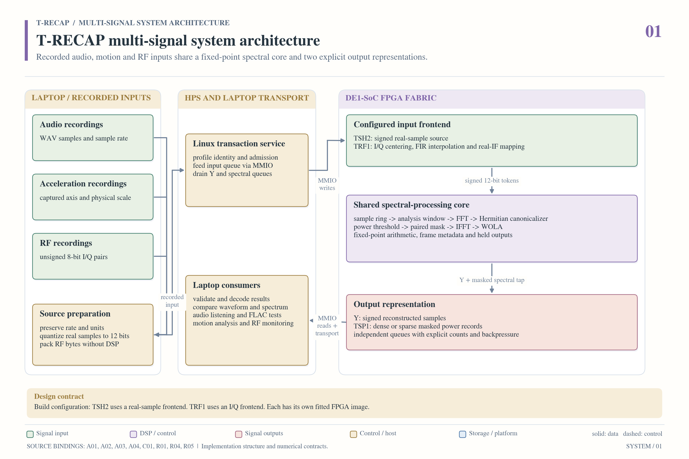

## 1. Shared numerical core

| Property | Current finite-file implementation |
| --- | --- |
| Input representation | Signed 12-bit real samples |
| Transform length | 256 samples |
| Hop | 128 samples |
| Coefficient fractional bits | 15 in the original common-core coefficients |
| Transaction input | 384,000 real samples |
| Complete reconstructed output | 384,512 Y samples including the finite tail |
| Analysis frames | 3,001 |
| Fixed comparison alignment | 384 samples in the qualified finite-file experiments |
| Spectral representation | 129 canonical bins for a real-input transform |
| Threshold register | Unsigned 56-bit THR2 |

The common chain remains framing and windowing, FFT, squared-magnitude decision, masking, IFFT and weighted overlap-add. The RF source adapter changes the input representation before this chain. It does not replace its FFT, mask or IFFT.

For complex FFT bin 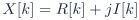, the threshold statistic is

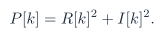

The decision preserves DC. For other eligible bins, equality is retained. Values below THR2 are suppressed. The corresponding real-spectrum symmetry is maintained by the common core. Nyquist is eligible for thresholding. The numeric threshold is in the implementation's fixed-point squared-magnitude units. It is not a decibel value, a percentage or a calibrated sound-pressure level.

Because input amplitude scaling changes squared magnitude, a gain change also changes the effective threshold. Tests must record input scaling and gain alongside THR2. Applying a threshold used on audio to acceleration or RF does not establish an equivalent physical cutoff.

## 2. Outputs and their information content

The core has two distinct products.

- **Y** is the reconstructed real sample stream from IFFT/WOLA. It retains the time-domain result needed for playback or subsequent signal analysis.
- **TSP1** is the version-1 spectral power packet format. Sparse packets carry retained bin identities and powers. These records omit phase and cannot independently reconstruct audio or complex I/Q.

For the existing full-format packet comparison, a dense record occupies 952 bytes. A sparse record containing  retained entries occupies  bytes. A sparse record can therefore be larger than dense when too many entries survive. Header and entry costs must be included in byte comparisons.

Dense and sparse representations at the same threshold should produce identical downstream features when the consumer implements the same calculation. Comparing these isolates representation and parsing costs. Comparing thresholded output with original input instead measures discarded information. Both comparisons are needed.

## 3. RF input contract

The file contains interleaved unsigned eight-bit components

```text
I[0], Q[0], I[1], Q[1], ... , I[N-1], Q[N-1]
```

The allowed pair count is 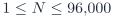. Sample rate and receiver center frequency are external metadata. The bytes do not contain those physical units. TRF1 is a recorded-file processor, not a radio-frequency analog front end.

Each byte  is centered as

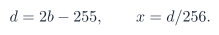

The signed centered integers range from -255 to +255 in steps of two. Neither byte 127 nor 128 maps to exact zero. Startup history and flush samples are exact signed zero inserted internally after centering.

The source contract is defined in [the adapter specification](../../profiles/trf1/adapter/CONTRACT.md). The [independent reference](../../profiles/trf1/adapter/model/reference.py) uses full convolution rather than duplicating the RTL scheduler.

## 4. Fourfold interpolation

The floating prototype is

```python
4.0 * scipy.signal.firwin(81, 0.25, window=("kaiser", 8.6))
```

The stored coefficients are signed 18-bit integers with 16 fractional bits, obtained by nearest ties-to-even coefficient quantization. The published coefficient file, rather than a new library regeneration, defines the deployed integer filter.

Let 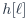 denote those stored integers. Let 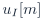 and 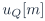 be the centered integer sequences with three zeros inserted between input samples. The unrounded causal channel sums are

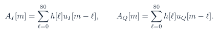

Outside the finite input interval, the sequences are zero. The RTL decomposes the filter into four phases with coefficients 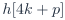. Each phase schedules 21 positions, with indices beyond 80 contributing zero. A shared multiplier accumulates in a signed 36-bit register without intermediate rounding. Even phases use I history and odd phases use Q history because the subsequent quarter-rate mixer only needs that channel at each phase.

## 5. Real intermediate-frequency conversion

The conceptual operation on the interpolated complex stream is

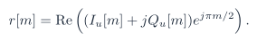

This gives the successive channel and sign choices

```text
phase 0: +I
phase 1: -Q
phase 2: -I
phase 3: +Q
```

These are successive interpolated sample times, not four copies of a raw pair. The phase includes discarded startup samples and freezes correctly under output backpressure. The chosen sign convention matters for later I/Q recovery.

For complex input sample rate , the equivalent real output has sample rate  and center frequency . Thus a 250 ksample/s baseband file becomes a 1 Msample/s real-IF representation centered at 250 kHz. Its original radio carrier may have been 433.92 MHz, which the receiver had already downconverted. A 1 Msample/s representation is not a claim that this sequential hardware sustains that rate in real time.

## 6. Gain, rounding and saturation

The admitted gain shift  is in 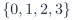. After channel/sign selection, an integer accumulator  is divided by 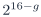 with nearest rounding and half ties away from zero.

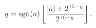

The emitted sample is

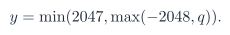

Clipping is recorded whenever  lies outside the signed 12-bit range. Counts advance on accepted output transfers, not stalled presentations. The normalized-input gains are 256, 512, 1024 and 2048 counts per unit. With the fixed coefficient set, gain shifts 0 and 1 have proven arithmetic headroom for every legal CU8 pattern. Higher gains can clip adversarial inputs.

The board register reset/CLEAR default is gain shift 1. The standalone reference helper has a different default argument, so experiment code must pass the intended gain explicitly. No per-file normalization is hidden inside the adapter.

## 7. Finite-file alignment and padding

The 81-tap linear-phase FIR has 40 causal output samples of delay. The adapter initializes histories to zero, processes the  admitted pairs followed by ten exact-zero pairs, discards the first 40 causal outputs and emits exactly  samples.

The separate finite-file wrapper then pads the shared core transaction to 384,000 real samples. This transaction padding is not additional recorded RF. The host records the valid real prefix  and uses that interval for physical time axes and RF packet-reduction denominators. Tail and boundary frames must be labeled when included.

The common core's reconstructed-output alignment is separate from the adapter's FIR startup crop. Applying only one of these alignments would compare different intervals.

## 8. Handshake and completion rules

An accepted start latches count and gain. An invalid count sets a configuration error until clear and accepts no samples. A busy transaction cannot accept another start.

An input pair transfers only when both input valid and ready are asserted. An output transfers only when output valid and ready are asserted. While stalled, the output sample, index, last flag and clip sideband remain stable. The final accepted adapter output produces an adapter completion pulse. That pulse is not full FFT/WOLA or host-retrieval completion.

Reset and synchronous clear cancel current ownership, clear histories and counters, and withdraw ready/valid outputs. There is no internal timer that guarantees progress against a permanently stalled host. Outer control code supplies watchdog and recovery policy.

The integrated input queue has 256 pair entries plus a separately tracked registered-prefetch stage. The prefetch handles the FIFO's one-cycle read response. Each output FIFO holds 1,024 words. The HPS interleaves bounded input writes with draining Y and spectral output to prevent finite queues from blocking progress indefinitely.

## 9. Board interface and data movement

| Contract item | TRF1 requirement |
| --- | --- |
| Profile identity | Magic `0x54524631` and ABI `0x00010000` |
| Source identity | Build-specific 256-bit SOURCE_ID |
| Input word | I in the low byte, Q in the next byte, upper 16 bits zero |
| Pair count | Configured only while idle, from 1 to 96,000 |
| Gain | Configured only while idle, shift 0 through 3 |
| Threshold | Shared 56-bit THR2 configuration |
| Successful core input count | 384,000 real samples |
| Successful adapter output count | Four times the configured pair count |
| Returned evidence | All Y, all TSP1, identity, epoch and status counters |

The [register specification](../../profiles/trf1/board/CONTRACT.md) contains exact offsets and bits. The [transport description](../../profiles/trf1/board/TRANSPORT.md) defines the archive boundary. A laptop uploads raw CU8 in a bounded archive to HPS RAM. A local ARM client validates the profile and feeds pairs through MMIO. Hardware performs interpolation, mixing, gain and the shared spectral algorithm. HPS returns a bounded results archive. Optional I/Q recovery and protocol decoding occur later on the laptop.

TSH2's real-sample service and TRF1's archive orchestration are distinct interfaces. An audio image must not accept raw I/Q as if it were PCM. Published source does not imply a completed RF drag-and-drop webpage or continuous USB receiver integration.

## 10. Verification and interpretation

The RF frontend and its enclosing build have independent numerical-reference comparisons, self-checking RTL tests, backpressure and reset recovery tests, wrapper/admission tests, host boundary tests and archived physical captures. See [the RF verification package](../../verification/rf_iq/README.md) and [its report](../verification/rf_iq/README.md).

TSH2 UVM and formal results cover their documented modules and assumptions. RF adapter verification is provided by its independent numerical model, self-checking RTL suites and source-bound physical captures. The RF adapter has no published UVM or formal signoff.

The unchanged threshold removes components because they are weak in the chosen representation. It cannot identify thermal origin, distinguish every wanted signal from interference or guarantee preservation of every protocol. Application validation therefore measures both background reduction and retained useful behavior. The [RF application page](../applications/rf/README.md) includes a case where a stronger threshold removes a decodable message.

The [audio application](../applications/audio/README.md) separates quantization savings from incremental threshold savings in FLAC. The [accelerometer application](../applications/accelerometer/README.md) separates fewer extra detections from newly missed steps. These are application-level acceptance questions, additional to correct RTL execution.
