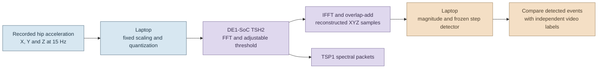
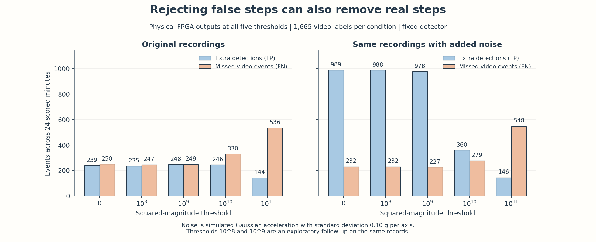
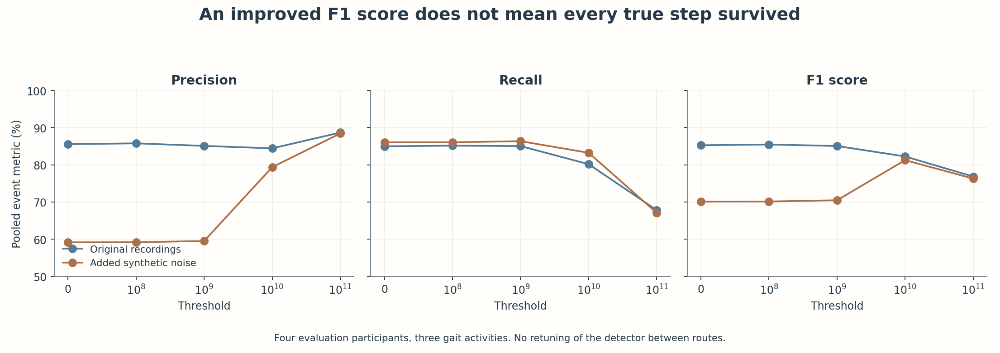
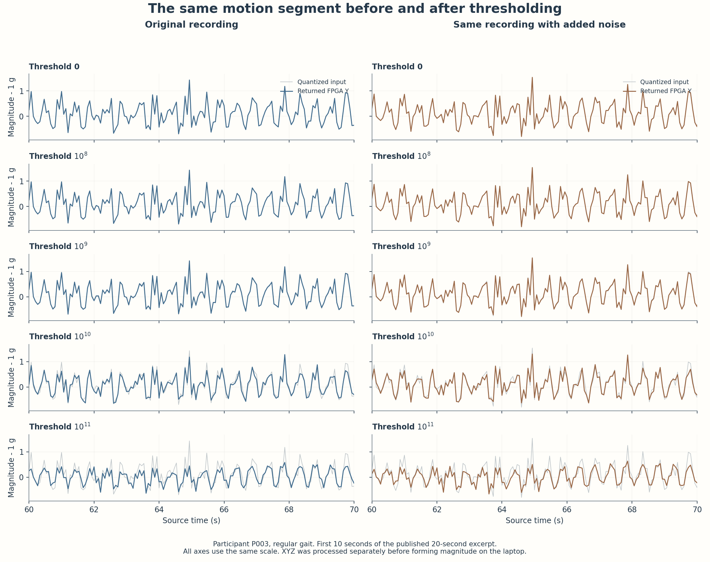

# Accelerometer application: preserving walking events

T-RECAP can process recorded acceleration through the same finite-file FFT, threshold and IFFT/WOLA pipeline used for audio. This experiment asks a concrete application question: **can spectral thresholding reduce false step detections while keeping real walking events?**

A walking-event detector can support an activity logger. It could also provide step events to a future indoor navigation system when GPS is unavailable. Such a system would additionally need heading, stride estimation and position correction. This experiment implements and evaluates the step-event component only.

**The hardware worked, but the application result was mixed.** With simulated noise, threshold `10^10` reduced extra detections from **989 to 360**, a **63.6% reduction**. It also increased missed video events from **232 to 279**. On the original recordings, it made both error counts worse. This is a measured tradeoff between suppressing fluctuations and retaining movement information.

## What ran where



Each axis passes through the FPGA separately. The laptop forms `sqrt(x*x + y*y + z*z) - 1 g` after receiving the reconstructed samples. The detector and event matching run on the laptop. TSP1 is the separate spectral output. The step counter uses reconstructed Y samples, not TSP1 power values.

These measurements used the existing **TSH2 finite-file image**, restored after the RF experiment. They did not change its RTL or bitstream design. Five physical transactions cover thresholds `0`, `10^8`, `10^9`, `10^10` and `10^11`. Every captured Y and TSP1 output matched its frozen expected output hash. Threshold zero reproduced the exact packed input after removing the fixed 384-sample alignment offset.

## Measured results

Each condition contains **24 scored minutes**, **12 recordings**, **four evaluation participants** and **1,665 video annotations**. Those annotations comprise 1,614 ordinary steps and 51 shifts. A true match must be within 0.25 seconds of an annotation, with at most one detection assigned to each annotation.

| Condition | Threshold | Matched events | Extra detections, FP | Missed events, FN | Precision | Recall | F1 |
| --- | ---: | ---: | ---: | ---: | ---: | ---: | ---: |
| Original | 0 | 1,415 | 239 | 250 | 85.55% | 84.98% | 85.27% |
| Original | 10^8 | 1,418 | 235 | 247 | 85.78% | 85.17% | 85.47% |
| Original | 10^9 | 1,416 | 248 | 249 | 85.10% | 85.05% | 85.07% |
| Original | 10^10 | 1,335 | 246 | 330 | 84.44% | 80.18% | 82.26% |
| Original | 10^11 | 1,129 | 144 | 536 | 88.69% | 67.81% | 76.86% |
| Added noise | 0 | 1,433 | 989 | 232 | 59.17% | 86.07% | 70.12% |
| Added noise | 10^8 | 1,433 | 988 | 232 | 59.19% | 86.07% | 70.14% |
| Added noise | 10^9 | 1,438 | 978 | 227 | 59.52% | 86.37% | 70.47% |
| Added noise | 10^10 | 1,386 | 360 | 279 | 79.38% | 83.24% | 81.27% |
| Added noise | 10^11 | 1,117 | 146 | 548 | 88.44% | 67.09% | 76.30% |



FP counts detections with no matched video event. FN counts video events without a matched detection. Both should be low. Comparing only the total detected count would hide cancellation between extra and missed events.

Threshold `10^10` improves noisy-condition F1 from **70.12% to 81.27%**, but recall falls from **86.07% to 83.24%**. The 47 additional misses include 39 ordinary steps and eight shifts. At `10^11`, suppressing more detections costs many more true events.



The lower thresholds have smaller effects. At `10^8`, the noisy condition loses just one of its 989 extra detections. At `10^9`, it loses 11 extra detections and has five fewer misses. These aggregate gains do not mean every previously detected event survived. At `10^9`, 11 previously matched noisy-condition events became misses while 16 different events were recovered. On original recordings, that threshold increases extra detections from 239 to 248.

No nonzero threshold passed the original frozen calibration gate. The selected setting therefore remained threshold zero. The `10^8` and `10^9` board measurements were an exploratory follow-up on records already examined in the first experiment. They are not a new independent validation set.

For context, the same detector after an offline CPU 3 Hz low-pass produced **595 FP and 246 FN** with added noise, versus **209 FP and 267 FN** on original recordings. This simple control was not separately optimized. It shows another point in the quality tradeoff and is not a CPU speed comparison. Full values are in [CPU control metrics](data/cpu_control_metrics.csv).

## Inspect the actual signals

The plot below shows participant P003 performing regular gait. The gray line is the exact quantized input. The colored line is formed from the actual returned XYZ waveforms. Every panel uses the same amplitude scale. Small differences at the lower thresholds are expected.



The displayed interval is source time 60 to 70 seconds. The downloadable CSV files cover **60 to 80 seconds**, or 300 samples per axis. The FPGA processed the full contextual records. The plot does not imply that the excerpt was processed in isolation.

| Signal | Original-recording condition | Added-noise condition |
| --- | --- | --- |
| Source input in g | [Measured XYZ](data/source_original_excerpt.csv) | [Measured XYZ plus simulated noise](data/source_added_noise_excerpt.csv) |
| Exact quantized FPGA input | [Input CSV](data/input_quantized_original_excerpt.csv) | [Input CSV](data/input_quantized_added_awgn_0p10g_excerpt.csv) |
| Actual FPGA output, threshold 0 | [Y CSV](data/fpga_original_t0_excerpt.csv) | [Y CSV](data/fpga_added_awgn_0p10g_t0_excerpt.csv) |
| Actual FPGA output, threshold 10^8 | [Y CSV](data/fpga_original_t100000000_excerpt.csv) | [Y CSV](data/fpga_added_awgn_0p10g_t100000000_excerpt.csv) |
| Actual FPGA output, threshold 10^9 | [Y CSV](data/fpga_original_t1000000000_excerpt.csv) | [Y CSV](data/fpga_added_awgn_0p10g_t1000000000_excerpt.csv) |
| Actual FPGA output, threshold 10^10 | [Y CSV](data/fpga_original_t10000000000_excerpt.csv) | [Y CSV](data/fpga_added_awgn_0p10g_t10000000000_excerpt.csv) |
| Actual FPGA output, threshold 10^11 | [Y CSV](data/fpga_original_t100000000000_excerpt.csv) | [Y CSV](data/fpga_added_awgn_0p10g_t100000000000_excerpt.csv) |

Input and output CSV files include physical g values, integer counts and the derived acceleration magnitude. [Event markers](data/event_excerpt.csv) come from the detector run on complete records. Running peak detection again on a cropped excerpt can change boundary decisions.

## Method and source

The source is the [Clemson Pedometer Evaluation Project](https://cecas.clemson.edu/~ahoover/pedometer/) by Mattfeld, Jesch and Hoover. Its [original dataset archive](https://cecas.clemson.edu/tracking/Pedometer/Data.zip) contains the recordings and video-derived labels. The project used hip XYZ at the original 15 Hz rate. Source data, selected recordings and label-file hashes are listed in [provenance](data/provenance.json).

1. P001 and P002 were used for calibration. P003 through P006 were reserved for evaluation. Regular, semi-regular and irregular gait were included.
2. The first 180 seconds of each recording supplied context. Only source time 30 to 150 seconds was scored.
3. The original condition used recorded measurements. The stress condition added independent Gaussian noise with standard deviation 0.10 g per axis using frozen seeds. Original recordings were not assumed noiseless.
4. Input values were rounded to the nearest integer at 256 counts per g, with ties to even. The signed 12-bit range was checked. No values were clipped, resampled or normalized per recording.
5. Scalar axis records were packed on hop-aligned boundaries with zero guards. The fixed FFT length was 256 and the hop was 128 samples. After processing, the known 384-sample offset was removed without searching for a favorable alignment.
6. The frozen peak detector used prominence 0.12 g, height 0 g and minimum spacing 0.4 seconds. Parameters were selected on original calibration data only.
7. One-to-one event matching maximized the number of matches within 0.25 seconds, then minimized total timing error. Ordinary-step and shift misses were also counted separately.

The complete unchanged detector implementation is [frozen_detector.py](code/frozen_detector.py). The compact export includes [per-recording scores](data/per_recording_metrics.csv), [pooled scores](data/metrics.csv), [event-preservation changes](data/low_threshold_event_changes.csv) and [experiment settings](data/experiment_summary.json).

The recorded provenance did not identify an explicit dataset redistribution license. The full dataset is therefore linked at its university source. This package contains only a small attributed numerical excerpt and derived project measurements. It does not copy the full source archive or infer dataset rights from an article license.

## What this establishes

The experiment demonstrates reuse of the audio-oriented processing path for real recorded accelerometer data and exposes its application-level quality tradeoff. It provides evidence that thresholding can suppress many false detections in a specific artificial-noise condition. It does **not** establish reliable rejection of real nuisance motion while preserving all true steps.

At 15 Hz, a 256-sample FFT spans **17.067 seconds** and a 128-sample hop spans **8.533 seconds**. These are the source-time spans of this finite-file experiment. This is not a live low-latency wearable implementation or a completed indoor positioning system. CPU workload, energy, FPGA speedup and machine-learning accuracy were not measured in this experiment.

## Replot and verify

The publication rechecked the original input, case, source and label hashes. It compared every full captured Y and TSP1 hash against the frozen expected hashes, then recomputed all **120 recording and threshold combinations** with the unchanged detector. No new board execution was performed for this documentation update.

From this directory, with Python, NumPy and Matplotlib installed, run:

```text
python replot.py
python replot.py --check
```

The first command recreates the figures from published numerical CSV files in a new `replotted_figures` directory. The second checks published file hashes, pooled score accounting and threshold-zero identity in the excerpts. The frozen detector additionally uses SciPy.

[Capture bindings](data/capture_bindings.json) identify the historical full captures, bitstream hash, axis offsets and exact excerpt ranges. [The publication manifest](manifest.json) binds the compact files. Full historical captures remain in the original project archive. Their hashes are references to archived evidence, not a claim that all capture bytes are distributed here.
