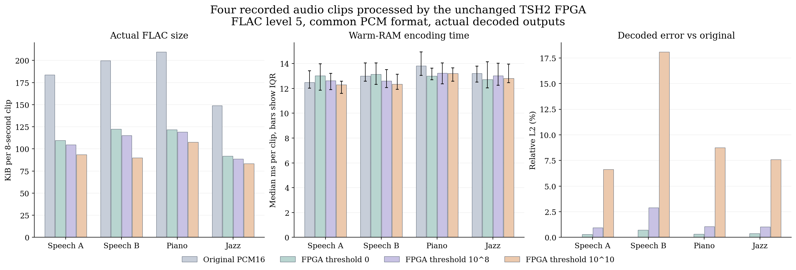
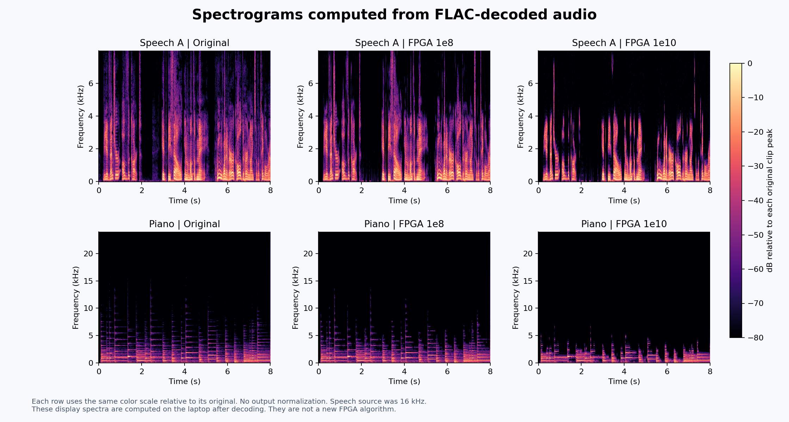
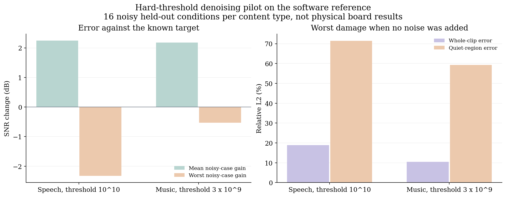

# Audio cleanup and FLAC preprocessing

[All three applications](../README.md) | [Listen locally](listen.html) | [Source credits](CREDITS.md)

## A concrete use case

Imagine a student recording narration and background music for a project video. The recording contains quiet background components. The student wants a smaller audio archive and wants to hear whether suppressing weak components helps or damages the recording.

T-RECAP can apply a tunable spectral threshold and return a reconstructed waveform. The user can compare the original, threshold 0 and stronger thresholds before choosing what to keep. A laptop then encodes that waveform as FLAC. This is a controllable tradeoff between retained signal detail and compressed size.

The hardware decides from spectral magnitude. It does not know which component is speech, music or unwanted noise. A quiet consonant or a fading note can be removed along with background noise. The measurements below therefore cover both useful reduction and unwanted damage.

## Two experiments with different evidence

| Experiment | Execution | What it answers |
| --- | --- | --- |
| Audio into FLAC | 12 archived physical DE1-SoC captures, 4 clips at 3 thresholds | Does thresholding change compressed bytes and encoder time, and what signal detail is lost? |
| Synthetic background noise | Qualified fixed-point software reference of the existing algorithm | Does the current hard threshold reduce error relative to a known target under controlled noise? |

The denoising examples are software results. They are not relabeled as hardware captures. Neither experiment uses the proposed soft filter or changes the FPGA architecture.

## Physical audio and compression workflow

```text
Public recording
  -> first 8 seconds, mono, 48 kHz, common fixed gain
  -> original PCM16 reference
  -> signed 12-bit quantization
  -> TSH2 FPGA FFT -> threshold -> IFFT/WOLA
  -> returned Y waveform, fixed 384-sample alignment
  -> PCM16 container with the same expansion for every threshold
  -> laptop FLAC level 5
  -> decode, verify, compare and listen
```

Every physical run returned 384,512 Y samples and 3,001 TSP1 frames. All complete Y and TSP1 streams matched the expected output. The listening files use 384,000 samples after the fixed alignment offset. TSP1 has no phase and is not used to reconstruct this audio.

The publication check independently reread all 12 full captured Y streams and verified that each published WAV equals the aligned board output multiplied by 16. See the [hardware-to-media bindings](data/hardware_media_binding.json). This is an audit of archived captures, not a new board run.

## What becomes smaller

All four clips combined give the following result. The original is a prepared PCM16 reference, not the byte count of the upstream Ogg file.

| Input to FLAC | Total FLAC bytes | Reduction vs original PCM16 route | Extra reduction vs FPGA threshold 0 |
| --- | ---: | ---: | ---: |
| Original PCM16 | 760,179 | 0% | Not applicable |
| FPGA threshold 0 | 456,689 | 39.92% | 0% |
| FPGA threshold 10^8 | 437,912 | 42.39% | 4.11% |
| FPGA threshold 10^10 | 383,763 | 49.52% | 15.97% |

**The extra 4.11% and 15.97% are the threshold contribution relative to the same quantized baseline.** Much of the original-to-FPGA size difference already occurs at threshold 0 because the input precision was reduced to 12 bits. It would be incorrect to attribute that entire difference to noise removal.



Every FLAC variant decodes exactly to its own encoder input. This makes the codec lossless for that particular waveform. Quantization and thresholding have already changed the waveform before FLAC, so the complete chain is lossy relative to the original PCM16 reference.

## What changes after decoding

| Clip | Threshold | FLAC size in KiB | Median encoding time in ms | Relative L2 error vs original |
| --- | ---: | ---: | ---: | ---: |
| Speech A | 0 | 109.68 | 13.016 | 0.299% |
| Speech A | 10^8 | 104.71 | 12.619 | 0.959% |
| Speech A | 10^10 | 93.59 | 12.304 | 6.632% |
| Speech B | 0 | 122.34 | 13.146 | 0.724% |
| Speech B | 10^8 | 115.21 | 12.612 | 2.891% |
| Speech B | 10^10 | 89.90 | 12.355 | 18.102% |
| Piano | 0 | 121.91 | 13.011 | 0.337% |
| Piano | 10^8 | 119.03 | 13.240 | 1.066% |
| Piano | 10^10 | 107.81 | 13.214 | 8.761% |
| Jazz | 0 | 92.05 | 12.713 | 0.373% |
| Jazz | 10^8 | 88.71 | 13.022 | 1.026% |
| Jazz | 10^10 | 83.47 | 12.810 | 7.588% |

See the [complete table including originals](data/flac_comparison.csv) and [all timing trials](data/flac_raw_trials.csv). The encoder benchmark uses 32 paired rounds after 3 warmups, 8 encodes per timed batch and randomized balanced route order on an Intel Core i7-8750H. It measures warm-RAM encoder construction, encoding, finalization and output materialization. It excludes FPGA, network, disk, preprocessing and decoding time.

Encoding time changes are small and inconsistent. Some music cases get slower relative to threshold 0, and the paired interval estimates do not support a general encoder speedup. Smaller compressed files are the demonstrated benefit here.

Relative L2 measures sample error, not the percentage of words or notes lost. Quiet regions can suffer much more than the whole-clip metric suggests. At 10^10, the recorded quiet-region errors range from about 19.88% to 69.82%. Speech B's STOI proxy falls from about 0.9982 at threshold 0 to 0.8805 at 10^10. No human listening acceptance threshold has been established.

## See the spectrum and hear the result



Read each row across from the original to threshold 0 and then to higher thresholds. Weak spectral regions become darker as components are suppressed. This is evidence of removal, not evidence that every removed component was noise. Use the same playback volume when comparing fading notes, consonants and background texture.

The [offline listening page](listen.html) contains all 16 physical-comparison WAVs and all 16 FLAC downloads. GitHub's file preview may not run the HTML player. Clone or download the repository and open that HTML file locally. The direct files below can also be downloaded.

| Clip | Prepared original WAV | FPGA threshold 0 WAV | FPGA 10^8 WAV | FPGA 10^10 WAV |
| --- | --- | --- | --- | --- |
| Speech A | [Original](media/speech_test_a/original_pcm16.wav) | [0](media/speech_test_a/fpga_t0.wav) | [10^8](media/speech_test_a/fpga_t100000000.wav) | [10^10](media/speech_test_a/fpga_t10000000000.wav) |
| Speech B | [Original](media/speech_test_b/original_pcm16.wav) | [0](media/speech_test_b/fpga_t0.wav) | [10^8](media/speech_test_b/fpga_t100000000.wav) | [10^10](media/speech_test_b/fpga_t10000000000.wav) |
| Piano | [Original](media/music_test_a/original_pcm16.wav) | [0](media/music_test_a/fpga_t0.wav) | [10^8](media/music_test_a/fpga_t100000000.wav) | [10^10](media/music_test_a/fpga_t10000000000.wav) |
| Jazz | [Original](media/music_test_b/original_pcm16.wav) | [0](media/music_test_b/fpga_t0.wav) | [10^8](media/music_test_b/fpga_t100000000.wav) | [10^10](media/music_test_b/fpga_t10000000000.wav) |

## Can it remove unwanted background noise?

The separate software pilot adds synthetic white hiss or colored noise with hum at 5 and 15 dB SNR. It also repeats each condition 12 dB quieter. One speech recording and one music recording select thresholds. Two other speakers and two other music recordings evaluate those fixed choices.

| Content | Selected threshold | Mean SNR gain over 16 noisy test cases | Worst SNR gain | Worst clean-only relative L2 error |
| --- | ---: | ---: | ---: | ---: |
| Speech | 10^10 | +2.246 dB | -2.326 dB | 18.91% |
| Music | 3 x 10^9 | +2.180 dB | -0.532 dB | 10.47% |



This shows a conditional benefit for some backgrounds, not a reliable general denoiser. Speech's mean STOI change is -0.02649. The strong dependence on level is expected for an absolute magnitude threshold. A quiet useful component can fall below the same threshold that a louder version survives.

The listening page also provides a known reference, noisy input and software-processed output for each of the four held-out clips. These examples use synthetic 5 dB hiss at the normal input level, selected by a fixed test condition rather than the best-looking result. There is no independent playback normalization. The noise experiment has its own preparation and level policy, so do not treat its files as the same inputs used in the FLAC experiment.

## What this application demonstrates

The existing architecture can serve as a tunable, lossy audio preprocessing stage. Its clearest measured result here is smaller FLAC output with a visible and audible fidelity tradeoff. The separate denoising pilot shows where weak-component suppression can help and where it damages useful content.

These results do not establish automatic separation of desired audio, universal perceived improvement, lower system power or faster end-to-end processing. They give a concrete demo in which a user can choose a threshold after comparing size, spectra and playback.

## Sources and reproducibility

The four 8-second excerpts come from a pinned [librosa/data revision](https://github.com/librosa/data/tree/38f4b06556fa0ff1acda5e677d8ba05d1bc0fff0). These are Ogg-derived examples, not lossless studio masters. Speech is originally 16 kHz, so resampling to 48 kHz does not restore missing bandwidth.

- [Source files, attribution and licenses](CREDITS.md)
- [Frozen FLAC method, with local paths normalized](data/flac_experiment_plan.json)
- [Physical sample and media identities](data/hardware_media_binding.json)
- [Denoising evaluation](data/denoising_evaluation.json) and [development-only threshold selection](data/denoising_selection.json)
- [Plot and listening-page generator](render.py)
- [Publication manifest](manifest.json)

The audio recordings retain their own licenses. In particular, the piano example and its derivatives are CC BY-NC 3.0 and are not covered by the repository's software license.
