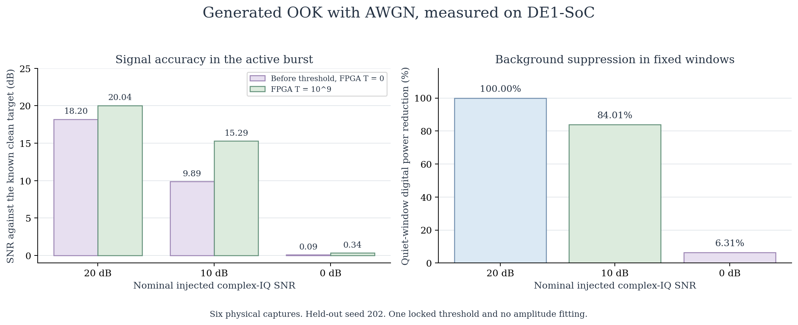
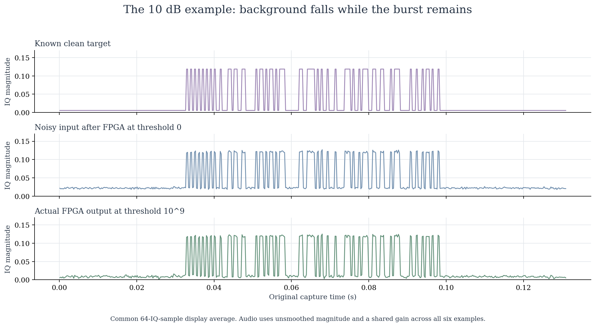
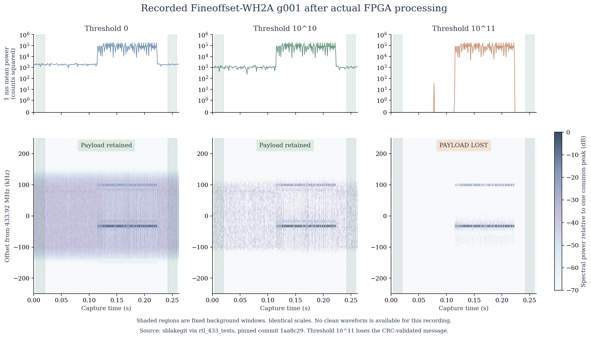

# RF application: suppressing weak background before inspecting sensor bursts

An RF receiver may capture a short sensor message surrounded by background energy. An engineer wants to inspect the burst, retain its message and avoid carrying every weak spectral component into a downstream monitor. T-RECAP provides an adjustable spectral threshold for that tradeoff.

The current example uses **actual DE1-SoC output from twelve retained physical runs**. The board received raw CU8 I/Q files. The TRF1 input adapter converted them into the real sample stream used by the existing FFT, threshold and IFFT/WOLA pipeline. The laptop then inspected the returned waveform and TSP1 spectrum and checked decoded sensor payloads. This page does not run the board or present a new capture campaign.

At a moderate threshold, two recorded sensor examples lost about 44% of their measured background power while retaining their expected messages. A stronger threshold lost the message in one example. This makes the application a controlled tradeoff between background suppression, spectral payload size and useful-signal retention.

**[Open the offline visual and listening demo](index.html)** after cloning the repository. It needs no server, internet connection or FPGA. GitHub may display the HTML source instead of running it. The [measured data](data/measurements.json), [all twelve physical cases as CSV](data/physical_cases.csv) and [source attribution](data/sources.json) are also available directly.

## What the board does

```text
Recorded or generated CU8 I/Q file
                |
                v
FPGA TRF1 input adapter
                |
                v
Existing FFT -> squared-magnitude threshold
                |                    |
                v                    v
          IFFT and WOLA           TSP1 packets
                |                    |
                v                    v
    Laptop waveform inspection   Spectral monitor
                |
                v
    Recovered I/Q and payload check
```

The threshold is expressed in the implementation's squared-magnitude units. It suppresses weak bins. It does not identify a component as unwanted noise because of its physical origin. A weak wanted signal can also be removed. TSP1 contains spectral power and retained-bin indices, so it supports monitoring. It does not preserve the phase needed to reconstruct I/Q by itself. The payload check here uses the separate reconstructed waveform path.

## Controlled white-noise example with a known target

The project generated an on-off keying burst and added independent complex additive white Gaussian noise, or AWGN. The carrier offset is 31.25 kHz and the I/Q rate is 250 ksample/s. This is a controlled model, not a recording of physical thermal noise. Threshold `10^9` was chosen using tuning seed 101, then locked before testing held-out seed 202 on the board.

| Nominal injected I/Q SNR | Measured baseline at threshold 0 | FPGA output at threshold 10^9 | SNR gain | Quiet-window power reduction |
| --- | ---: | ---: | ---: | ---: |
| 20 dB | 18.20 dB | 20.04 dB | 1.84 dB | 100.00% |
| 10 dB | 9.89 dB | 15.29 dB | 5.40 dB | 84.01% |
| 0 dB | 0.09 dB | 0.34 dB | 0.26 dB | 6.31% |



The 10 dB case moves closer to the known clean target. The same threshold has little benefit at 0 dB. Measured SNR includes the CU8 quantization and fixed-point adaptation path, so it differs from the nominal injected I/Q SNR. No amplitude or timing fitting is used. The controlled coherent bit check already had zero errors before filtering and still has zero after filtering. It assumes known carrier, phase and symbol timing, so it does not show an improvement in real receiver decoding.



The plot uses the same 64-I/Q-sample display average for all three curves. Its clean target is the generated waveform after the fixed-point RF adapter reference. The two measured curves come from actual FPGA captures. The [sample archive](data/awgn_samples.npz) contains the exact aligned samples behind these comparisons.

### Listen to the captured before and after signals

RF is outside human hearing. These WAV files use the magnitude of recovered I/Q to control an added **800 Hz tone**, with time slowed by **8 times**. They are a display mapping, not speech or sound transmitted by the source. All six files use one shared gain with no per-file normalization, automatic gain control or noise gate. Each has the same 0.3 s padding and 10 ms outer ramps.

| Generated input condition | Before threshold, actual FPGA T = 0 | After threshold, actual FPGA T = 10^9 | Original input file |
| --- | --- | --- | --- |
| 20 dB | [Listen or download WAV](audio/snr20_t0.wav) | [Listen or download WAV](audio/snr20_t1000000000.wav) | [Generated CU8](data/ook_snr20_seed202.cu8) |
| 10 dB | [Listen or download WAV](audio/snr10_t0.wav) | [Listen or download WAV](audio/snr10_t1000000000.wav) | [Generated CU8](data/ook_snr10_seed202.cu8) |
| 0 dB | [Listen or download WAV](audio/snr0_t0.wav) | [Listen or download WAV](audio/snr0_t1000000000.wav) | [Generated CU8](data/ook_snr0_seed202.cu8) |

Perceived loudness is not a calibrated RF quality measurement. Use the SNR, background-power and signal-retention checks together. The [audio manifest](audio/manifest.json) specifies the mapping and hashes.

## Recorded sensor transmissions with a real background

The second experiment uses two Fineoffset-WH2A temperature and humidity recordings contributed by **sblakegit** to `rtl_433_tests`. The source files have a 433.92 MHz center frequency, a 250 ksample/s complex rate and a 0.262144 s duration. The upstream metadata supplies expected sensor messages, but no clean waveform. Thermal, environmental and quantization contributions to the background are not separately known.

| Source | Threshold | Background AC power reduction | Active-burst change relative to baseline | Expected message |
| --- | ---: | ---: | ---: | --- |
| g001 | 0 | 0.00% | 0.00% relative L2 | Retained |
| g001 | 10^10 | 44.57% | 6.53% relative L2 | Retained |
| g001 | 10^11 | 100.00% | 14.26% relative L2 | **Lost** |
| g004 | 0 | 0.00% | 0.00% relative L2 | Retained |
| g004 | 10^10 | 44.12% | 6.41% relative L2 | Retained |
| g004 | 10^11 | 99.96% | 14.34% relative L2 | Retained |



All columns use identical time, frequency and power scales. The spectrogram is decoded from actual TSP1 packets. The upper curves show mean square of the returned real waveform in 1 ms blocks. Shaded background windows are 4 to 20 ms and 242.144 to 258.144 ms. Active-burst comparison uses 110 to 230 ms. These windows were selected from the original recordings.

At `10^10`, the payloads still match the expected CRC-validated messages. At `10^11`, g001 looks cleaner but no longer yields its expected message. Because there is no clean waveform, the active-burst percentage measures change from the baseline, not error against a perfect signal. The two recordings share a sensor family and are not a representative RF corpus.

The raw sources contain 14,351 and 14,697 endpoint I/Q components out of 131,072 components. Zero FPGA clipping does not establish that the original receiver avoided saturation. Exactly zero power refers only to finite digital background windows and does not imply infinite analog noise rejection.

## Data reduction is a separate benefit

The following counts include the TSP1 headers for the valid signal interval. They exclude the padded tail of the fixed-length board transaction. The comparison is against a compact dense TSP1 spectrum of the same frames, not against CU8, WAV or compressed files.

| Case | Threshold | Sparse bytes | Dense reference bytes | Spectral byte reduction |
| --- | ---: | ---: | ---: | ---: |
| AWGN, nominal 20 dB | 0 | 1,107,000 | 975,800 | -13.45% |
| AWGN, nominal 20 dB | 10^9 | 71,696 | 975,800 | 92.65% |
| AWGN, nominal 10 dB | 0 | 1,107,000 | 975,800 | -13.45% |
| AWGN, nominal 10 dB | 10^9 | 104,328 | 975,800 | 89.31% |
| AWGN, nominal 0 dB | 0 | 1,107,000 | 975,800 | -13.45% |
| AWGN, nominal 0 dB | 10^9 | 450,560 | 975,800 | 53.83% |
| Recorded g001 | 0 | 2,212,920 | 1,950,648 | -13.45% |
| Recorded g001 | 10^10 | 405,144 | 1,950,648 | 79.23% |
| Recorded g001 | 10^11 | 141,528 | 1,950,648 | 92.74% |
| Recorded g004 | 0 | 2,212,920 | 1,950,648 | -13.45% |
| Recorded g004 | 10^10 | 424,760 | 1,950,648 | 78.22% |
| Recorded g004 | 10^11 | 147,104 | 1,950,648 | 92.46% |

A negative reduction means the sparse packet is larger because it carries indices. At the moderate recorded threshold, fewer spectral bytes could reduce transfer or storage for a spectral monitor. This experiment did not measure RF-consumer CPU workload, electrical power or live throughput. The reconstructed I/Q decoder path is separate from a consumer that directly processes sparse TSP1 records.

## Evidence and reproduction

All twelve captured reconstructed waveforms and TSP1 streams matched their fixed-point references exactly. The recorded FPGA clip and drop counts were zero. These implementation checks establish agreement with the algorithm. They do not establish that every threshold preserves application information.

The separate [software screen](data/software_screen.json) retains all 76 rows, including thresholds `0`, `10^8`, `10^9`, `10^10` and `10^11`, the tuning seed, held-out seeds and controls. It is not additional board evidence. A clean-only software control changes by 9.05% active relative L2 at the selected threshold. The zero-output control and stronger-threshold cases are retained as failure examples rather than omitted.

To regenerate the figures and WAV files from the published arrays, install NumPy, SciPy and Matplotlib, then run this command in this folder:

```text
python render.py
```

The renderer verifies file hashes, checks all six measured AWGN SNR values against the known target and reads back each WAV. It does not access a board. [The render audit](render_audit.json) records package versions and the result. [Sample bindings](data/sample_bindings.json) distinguish complete captured-waveform hashes from the aligned intervals published here. [Plot bindings](data/plot_bindings.json) trace the recorded figures to actual Y and TSP1 captures. `manifest.json` lists the current publication files and their SHA-256 hashes.

## Original sources and attribution

- [Pinned upstream sample description](https://github.com/merbanan/rtl_433_tests/blob/1aa8c29d6b9383739d1aeed495dbc5069b704392/tests/fineoffset/fineoffset_wh2A/01/readme.md)
- [Original g001 CU8 recording](https://raw.githubusercontent.com/merbanan/rtl_433_tests/1aa8c29d6b9383739d1aeed495dbc5069b704392/tests/fineoffset/fineoffset_wh2A/01/g001_433.92M_250k.cu8), SHA-256 `b392fe8ed2a2a3851922700f11638127d9361aa5cf07df289ea39857057743af`
- [Original g004 CU8 recording](https://raw.githubusercontent.com/merbanan/rtl_433_tests/1aa8c29d6b9383739d1aeed495dbc5069b704392/tests/fineoffset/fineoffset_wh2A/01/g004_433.92M_250k.cu8), SHA-256 `59332e4e82d083ef506dd3b25590dd3eb0cce23a919bd3f5d43004492c4bd759`
- [Original device discussion](https://github.com/merbanan/rtl_433/issues/625)

The pinned repository root listing and sample README did not identify an explicit sample license. The external raw recordings and their derived listening files are not bundled or relicensed here. The figures report numerical observations with source attribution. Bundled downloadable inputs and listening examples use project-generated AWGN fixtures instead. The [source manifest](data/sources.json) records the upstream commit, hashes and this publication choice.
