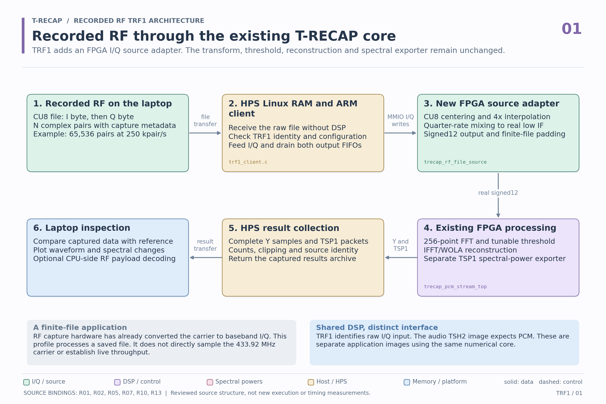
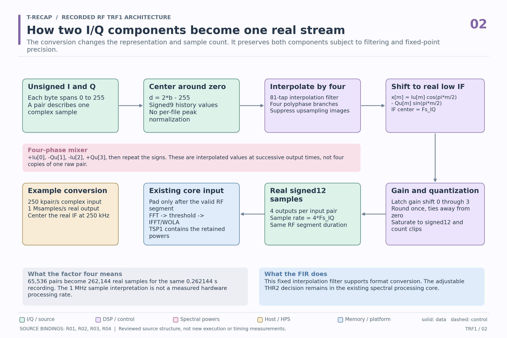
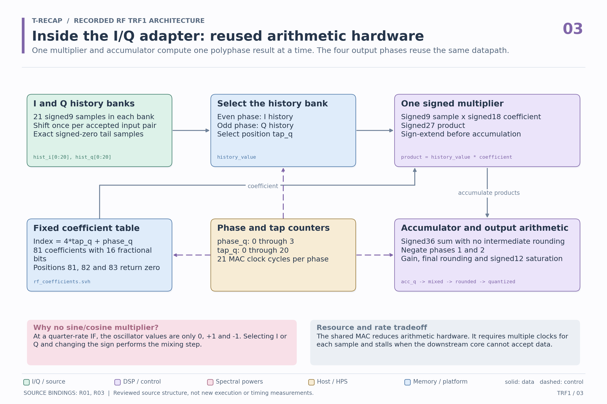
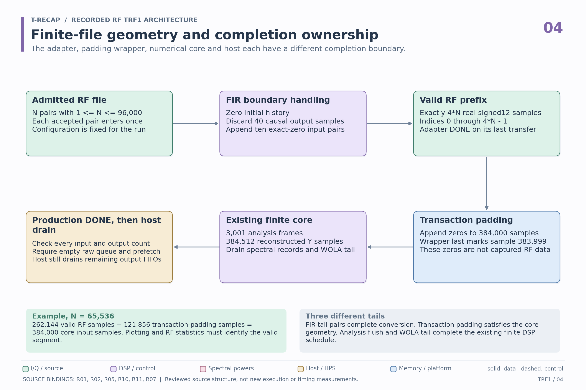
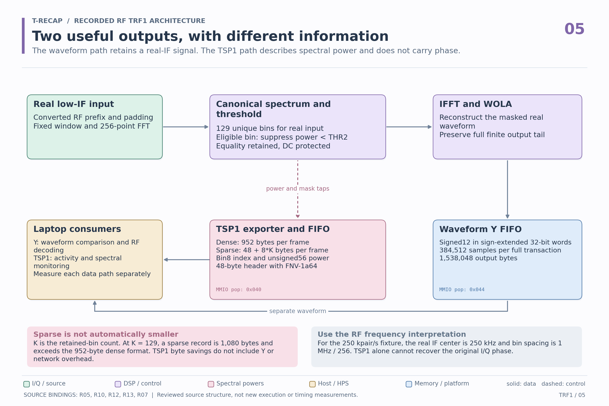
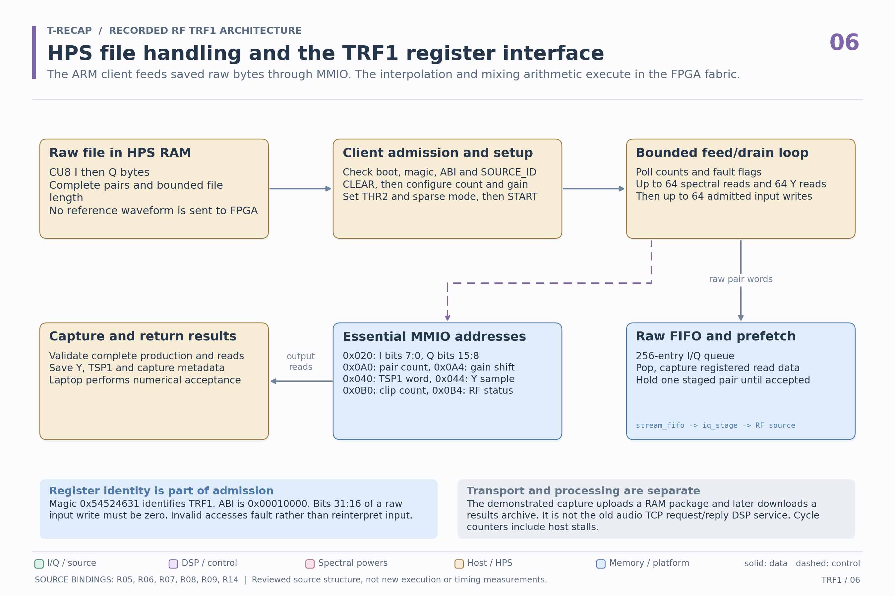
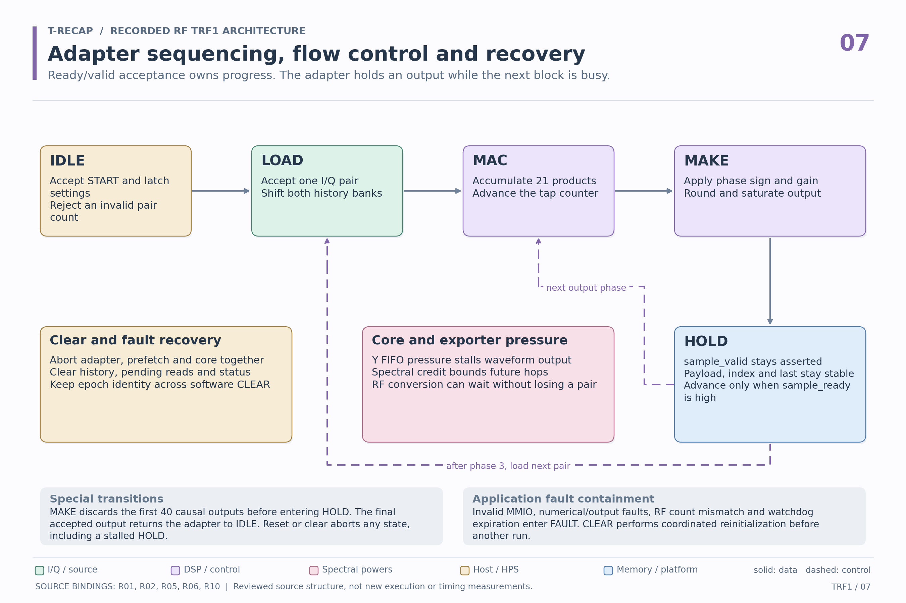
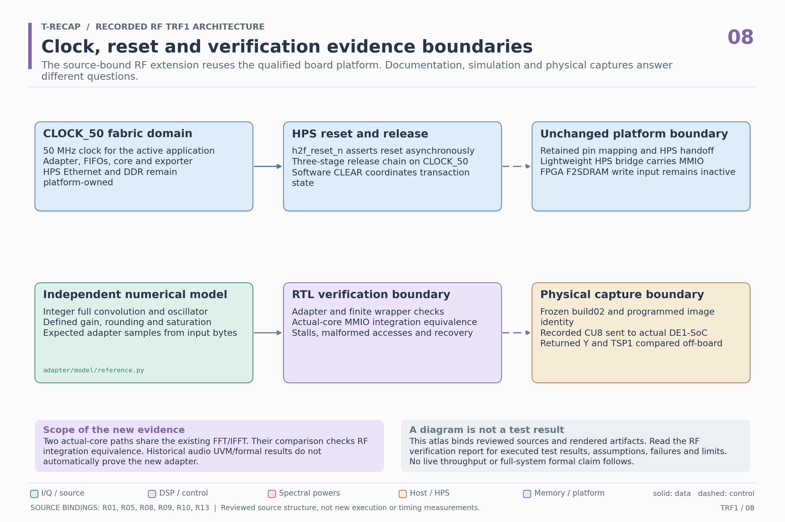

# Recorded RF architecture atlas

**T-RECAP: Threshold-based Reduction and Encoding for Controlled Audio Processing.**

These eight views explain the **TRF1 recorded RF application**. Raw unsigned eight-bit I/Q pairs enter a new FPGA adapter. It converts them to real signed12 samples for the existing FFT, threshold, IFFT/WOLA and TSP1 pipeline. TRF1 identifies this application and its register interface. It is separate from the PCM-input TSH2 image.

Open the [offline visual viewer](index.html) for navigation and zoom, or select an image below. All diagrams have editable SVG counterparts. The [existing audio atlas](../tsh2/README.md) remains intact with its original source bindings and verification scope.

The drawings describe the source-bound `build02` implementation. Drawing them does not run simulation, synthesize RTL or operate the board. The [RF verification supplement](../../verification/rf_iq/README.md) records executed checks and their limits. See the [published RF source profile](../../../profiles/trf1/README.md) and [runnable verification package](../../../verification/rf_iq/README.md).

| View | Diagram | Editable vector |
|---|---|---|
| 1. Complete recorded RF workflow | [PNG](01-system.png) | [SVG](01-system.svg) |
| 2. I/Q to real-IF representation | [PNG](02-signal-representation.png) | [SVG](02-signal-representation.svg) |
| 3. Adapter arithmetic hardware | [PNG](03-adapter-hardware.png) | [SVG](03-adapter-hardware.svg) |
| 4. Finite file and completion | [PNG](04-finite-file-completion.png) | [SVG](04-finite-file-completion.svg) |
| 5. Waveform and spectral outputs | [PNG](05-waveform-and-spectral-outputs.png) | [SVG](05-waveform-and-spectral-outputs.svg) |
| 6. Host and register interface | [PNG](06-host-and-registers.png) | [SVG](06-host-and-registers.svg) |
| 7. State machine and backpressure | [PNG](07-state-and-backpressure.png) | [SVG](07-state-and-backpressure.svg) |
| 8. Clock, reset and verification | [PNG](08-clock-reset-verification.png) | [SVG](08-clock-reset-verification.svg) |

## 1. Complete recorded RF workflow



The laptop supplies recorded CU8 bytes. The HPS stores the file in ordinary Linux RAM and the ARM client feeds I/Q pairs through the lightweight MMIO bridge. The new FPGA adapter performs interpolation, mixing and fixed-point conversion. The existing numerical core then applies the adjustable spectral threshold. The HPS collects complete Y and TSP1 outputs for laptop analysis.

The example recording was captured with the receiver tuned around 433.92 MHz. That carrier was already downconverted to baseband before the file was produced. The FPGA is not directly sampling 433.92 MHz. A CPU-side decoder may inspect the returned waveform, but no RF payload decoder was added to the FPGA.

## 2. I/Q to real-IF representation



An I/Q pair consists of two orthogonal components of one complex sample. Both components contribute to amplitude and phase. The adapter maps each unsigned byte `b` to the signed value `2*b - 255`, then performs fixed-coefficient interpolation and quarter-rate frequency translation.

Conceptually, for the interpolated components:

```text
x[m] = Iu[m] * cos(pi*m/2) - Qu[m] * sin(pi*m/2)
```

The signs cycle through `+I, -Q, -I, +Q` at successive interpolated output times. This does not repeat one raw pair four times or discard Q. The finite FIR, rounding and possible clipping prevent a claim of lossless conversion.

At an input interpretation of 250,000 complex pairs per second, the output represents 1,000,000 real samples per second with an IF center of 250 kHz. A 65,536-pair segment becomes 262,144 real samples representing the same 0.262144 seconds. These rates describe the signal, not the achieved processing throughput.

## 3. Adapter arithmetic hardware



The prototype filter has 81 taps. Four branches select `h[4*k+p]` for `k = 0..20` and phase `p = 0..3`, with coefficient positions above 80 returning zero. Two banks hold 21 signed9 history values each. A signed18 coefficient multiplies the selected history value. The signed27 product is extended into a signed36 accumulator.

One shared multiplier performs 21 accumulation cycles per phase. Even phases select I and odd phases select Q. Phases 1 and 2 negate the result. The design then applies gain, rounds once with ties away from zero, and saturates to the signed12 range. Clipping is counted explicitly. Gain shifts 0 and 1 have guaranteed headroom for the fixed coefficient set. Higher gains may clip.

The fixed interpolation filter supports conversion. The adjustable `THR2` decision remains in the existing spectral core.

## 4. Finite file and completion



The adapter accepts `N` pairs and emits exactly `4*N` valid real samples. Initial history is zero. It discards the first 40 causal FIR outputs and supplies ten exact-zero tail pairs to align the finite result. An exact zero is inserted internally rather than represented by CU8 byte 127 or 128.

The file-source wrapper pads after that valid RF prefix to the registered 384,000-sample core transaction. With 65,536 pairs, this adds 121,856 zero samples after the 262,144 valid samples. The core independently completes its analysis and WOLA tails, producing 3,001 frames and 384,512 Y samples.

Adapter DONE, wrapper DONE, application production DONE and completion of host reads are separate events. Production DONE can precede draining the final output FIFO entries. Statistics on the RF segment must account for padding and the core's 384-sample reconstruction alignment.

## 5. Waveform and spectral outputs



The Y path contains reconstructed real-IF samples in sign-extended 32-bit transport words. TSP1 contains squared magnitudes with bin indices in sparse mode and omits phase. It can support spectral activity monitoring, but cannot reconstruct the waveform or the original I/Q by itself.

Dense TSP1 uses 952 bytes per frame. Sparse TSP1 uses `48 + 8*K` bytes for `K` retained bins. Each sparse entry has an eight-bit bin index and a 56-bit power. At `K = 129`, sparse uses 1,080 bytes and is larger than dense. Sparse byte savings must therefore state the baseline and exclude neither Y nor framing silently. The reported spectral-only comparison does not count the separate Y stream or network overhead.

The 48-byte header uses FNV-1a64. The checksum covers header bytes 0 through 39 and the payload with padding, excluding the checksum field itself. The FFT uses 256 samples with hop 128. For the example 1 MHz real stream, FFT-bin spacing is 3,906.25 Hz.

## 6. Host and register interface



The demonstrated transport uploads a bounded RAM package, invokes a local ARM client and later downloads the result archive. The [transport guide](../../../profiles/trf1/board/TRANSPORT.md) documents this flow. It is separate from the historical audio TCP request/reply service.

The client checks boot identity, TRF1 magic `0x54524631`, ABI `0x00010000`, SOURCE_ID and geometry. A write at `0x020` carries I in bits 7:0 and Q in bits 15:8. Upper bits must be zero. Pair count and gain are configured while idle. The 256-entry raw FIFO has a registered read response, so a prefetch stage captures and holds the pair before passing it to the RF source.

The ARM loop interleaves up to 64 spectral-word reads, 64 Y reads and 64 admitted pair writes. It performs no interpolation, mixing or FFT. Successful capture requires exact counts and consistent completion and clipping status. The saved output still requires independent laptop validation. Fabric elapsed cycles include host-induced stalls.

## 7. State machine and backpressure



`IDLE` accepts the start configuration. `LOAD` shifts a new pair into the histories. `MAC` accumulates 21 products. `MAKE` applies phase sign, gain and quantization. `HOLD` keeps the output valid and stable until the receiver accepts it. The next phase returns to `MAC`. After phase 3, another group starts at `LOAD`. The final accepted sample returns to `IDLE`.

During startup, `MAKE` discards the 40 causal outputs before entering the ordinary `HOLD` path. This startup exception and reset transitions are stated beneath the diagram rather than drawn through every node.

The outer application has its own state machine and watchdog. Invalid MMIO, numerical faults, count mismatches or watchdog expiration enter FAULT. Coordinated CLEAR cancels the RF source, prefetched data, core and output ownership. Epoch identity is preserved across software CLEAR. The adapter itself has no internal stall timeout.

## 8. Clock, reset and verification



The active application uses CLOCK_50. The HPS `h2f_reset_n` signal asserts reset asynchronously and a three-stage chain releases it on fabric clock edges. The generated HPS clocks, Ethernet and external DDR remain platform-owned. The optional FPGA F2SDRAM write input is tied inactive in this image.

Adapter checks compare RTL with an independent integer-convolution model. Integration checks compare raw-I/Q RF input against independently prepared PCM entering the existing core. Both integration paths share the numerical core, so they establish RF integration equivalence rather than an independent proof of FFT arithmetic. Physical captures exercise the complete programmed system and are documented separately.

Historical audio UVM and local formal checks retain their original scope. They do not automatically prove the new RF block. The [RF verification supplement](../../verification/rf_iq/README.md) identifies fresh execution, retained physical evidence, checker qualification and remaining exclusions.

## Editable definitions and reproducibility

The [editable definitions](atlas_definitions.json) contain node positions, edges, captions and reviewed source hashes. The [generator](build_atlas.py) emits 2700 by 1800 PNGs and text-preserving SVGs. The [manifest](atlas_manifest.json) binds the generator, definitions, 14 public source files and all 16 image artifacts. The [visual-review record](visual_review.json) records inspection of the final render.

From the repository's `phase2` directory:

```sh
python docs/architecture/rf_iq/build_atlas.py --repo-root . --output docs/architecture/rf_iq --check
```

This integrity check uses Python's standard library. It validates identities, exact plate inventory, source bindings, SVG syntax and PNG dimensions. It does not verify the RTL behavior.

To render the reviewed definitions with Matplotlib and Pillow installed, use a new empty output directory:

```sh
python docs/architecture/rf_iq/build_atlas.py --repo-root . --output rf-atlas-render-01
```

Rendering checks text containment and routed-edge intersections with unrelated nodes. Visual review is still required after layout changes. Existing nonempty output directories are rejected. Source hashes establish identity, not functional correctness. The RF image SOURCE_ID is `1f567ac68e2f8d3affd51e73c7dad1c144795df2045eeb290d33a806f8a9d700`.

| Source ID | Public source |
|---|---|
| R01 | [I/Q adapter](../../../profiles/trf1/adapter/rtl/trecap_rf_iq_adapter.sv) |
| R02 | [Finite-file wrapper](../../../profiles/trf1/adapter/rtl/trecap_rf_file_source.sv) |
| R03 | [Coefficient table](../../../profiles/trf1/adapter/coefficients/rf_coefficients.svh) |
| R04 | [Independent reference](../../../profiles/trf1/adapter/model/reference.py) |
| R05 | [Board application adapter](../../../profiles/trf1/board/rtl/trecap_rf_board_adapter.sv) |
| R06 | [Transport FIFO](../../../profiles/trf1/board/rtl/stream_fifo.sv) |
| R07 | [ARM client](../../../profiles/trf1/board/host/trf1_client.c) |
| R08 | [Board top](../../../profiles/trf1/board/platform/trecap_hps_top.sv) |
| R09 | [Platform wrapper](../../../profiles/trf1/board/platform/platform_designer_wrapper.sv) |
| R10 | [Finite core top](../../../profiles/trf1/snapshot/generated/trecap_pcm_stream_top.sv) |
| R11 | [Finite core source](../../../profiles/trf1/snapshot/generated/trecap_pcm_stream_source.sv) |
| R12 | [Observed core](../../../profiles/trf1/snapshot/generated/trecap_core_export_observed.sv) |
| R13 | [Spectral exporter](../../../profiles/trf1/snapshot/generated/trecap_spectral_exporter.sv) |
| R14 | [Recorded-file transport](../../../profiles/trf1/board/TRANSPORT.md) |
