# T-RECAP system architecture atlas

**Threshold-based Reduction and Encoding for Configurable Analysis Pipelines**

Twenty coordinated views describe T-RECAP as a multi-signal processing system. Audio, acceleration and RF source contracts connect to a shared fixed-point spectral core, HPS transport and laptop applications. The atlas expands the overview into frame storage, arithmetic, memory schedules, packet serialization and transaction control.

[Open the offline gallery](index.html) | [Read the academic LaTeX atlas](TRECAP_System_Architecture_Atlas.pdf)

The build configuration selects TSH2 for real-sample inputs or TRF1 for I/Q inputs. Each profile has its own fitted image and instantiates the same numerical core. Profile identity, source geometry and result metadata define each finite transaction.

The colors identify responsibilities consistently. Sage denotes signal input, blue denotes storage or platform interfaces, lilac denotes DSP, peach denotes returned signal representations, and warm cream denotes host software or transaction control.

## Twenty coordinated views

| View | What it explains |
|---|---|
| [1. T-RECAP multi-signal system architecture](01-system-overview.png) | Recorded audio, motion and RF inputs share a fixed-point spectral core and two explicit output representations. |
| [2. Input contracts and build configurations](02-input-profiles.png) | Signal interpretation is preserved at the boundary while the common core receives a single real-sample token format. |
| [3. Shared fixed-point spectral datapath](03-shared-dsp.png) | Distributed ready/valid engines preserve sample identity, conjugate symmetry and exact rounding boundaries. |
| [4. I/Q frontend and real-IF source formation](04-rf-input-adapter.png) | Centering, polyphase filtering, quarter-rate mixing, rounding and finite alignment are explicit FPGA operations. |
| [5. Output representations and laptop applications](05-outputs-and-consumers.png) | Reconstructed samples and spectral packets answer different application questions and have separate data budgets. |
| [6. Host transport and finite transaction ownership](06-host-and-transactions.png) | The HPS owns hardware admission and queue servicing while the laptop owns source interpretation and result presentation. |
| [7. Control ownership and backpressure](07-control-and-backpressure.png) | Frame admission, held outputs, packet slots and queue occupancy coordinate progress without a global DSP state machine. |
| [8. Platform, implementation and verification evidence](08-platform-and-verification.png) | Source structure, fitted hardware, simulation, formal properties and application measurements form distinct evidence layers. |
| [9. Frame storage and analysis-window hardware](09-frame-window-hardware.png) | Accepted samples, tagged overlap storage, coefficient reads and frame-owned thresholds have distinct owners. |
| [10. FFT and IFFT memory engines](10-transform-memory-engines.png) | Two independent iterative engines each own a work RAM, coefficient ROM and registered butterfly. |
| [11. Canonical spectrum and threshold logic](11-canonical-mask-hardware.png) | Pair averaging, squared magnitude, comparison and complex zero selection preserve real-signal symmetry. |
| [12. Registered radix-2 butterfly arithmetic](12-butterfly-arithmetic.png) | Four parallel multipliers feed product registers, complex add/subtract, quantization and butterfly outputs. |
| [13. Synthesis window and overlap-add storage](13-wola-storage.png) | Frame collection, emit-before-add ordering, ring accumulation and a held output register implement reconstruction. |
| [14. TSP1 capture, checksum and packetization](14-spectral-packet-hardware.png) | Slot ownership, synchronous entry reads, record walking and byte packing turn observations into host records. |
| [15. I/Q polyphase multiply-accumulate datapath](15-rf-mac-datapath.png) | Selected history, coefficient ROM, one multiplier and a feedback accumulator implement four interpolation phases. |
| [16. I/Q adapter controller and finite alignment](16-rf-controller.png) | IDLE, LOAD, MAC, MAKE and HOLD coordinate filtering, startup cropping, output stalls and exact counts. |
| [17. Host register interface and ownership](17-mmio-register-interface.png) | Identity, idle configuration, raw input, output queues and completion counters occupy defined MMIO registers. |
| [18. FIFO storage, prefetch and backpressure](18-fifo-and-handshake.png) | Queue entries, in-flight reads and output registers own different pieces of the same transaction. |
| [19. Finite epoch state and exact tail geometry](19-finite-epoch-lifecycle.png) | Source feeding, analysis flushing, WOLA draining, production completion and host reception are distinct phases. |
| [20. Clock, reset and verification observability](20-clock-reset-observability.png) | Reset release, storage initialization, fault status and evidence observation points are part of the implementation. |

## 1. T-RECAP multi-signal system architecture

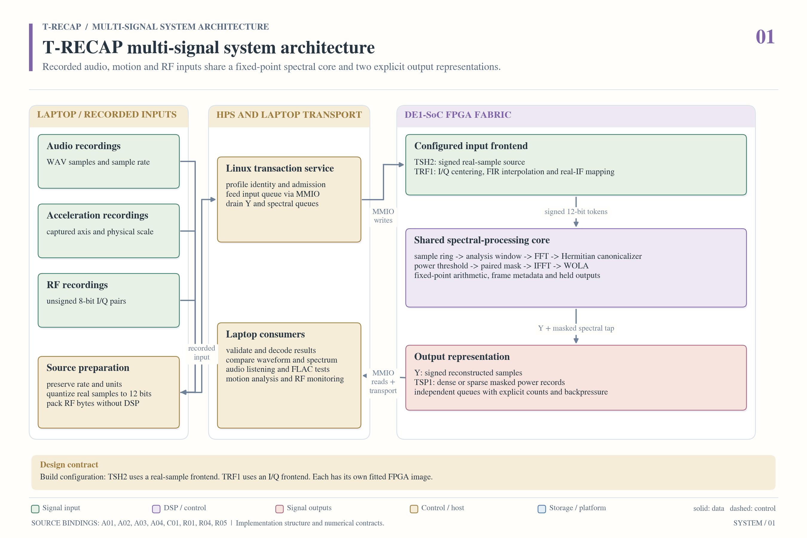

T-RECAP connects three recorded signal classes to one numerical processing design. Audio and individual acceleration axes use signed real-sample preparation. RF recordings retain their unsigned I/Q bytes until the FPGA frontend centers, interpolates and maps them to a real intermediate-frequency stream.

Linux on the DE1-SoC HPS owns the finite transaction. It verifies the fitted profile, writes source words and drains independent reconstructed-sample and spectral queues. The fabric performs the source conversion and shared fixed-point DSP. The laptop interprets outputs using the original sample rate, units and source metadata.

The implementation is selected at build time. TSH2 fits the real-sample application and TRF1 fits the I/Q application. Both instantiate the same spectral core. The frontend box expresses those configurations and is not a runtime selector. Module boundaries, memories and accepted-transfer behavior are expanded in the following nineteen views.

| Block | Responsibility |
|---|---|
| Audio recordings | WAV samples and sample rate. |
| Acceleration recordings | Captured axis and physical scale. |
| RF recordings | Unsigned 8-bit I/Q pairs. |
| Source preparation | Preserve rate and units. quantize real samples to 12 bits. pack RF bytes without DSP. |
| Linux transaction service | Profile identity and admission. feed input queue via MMIO. drain Y and spectral queues. |
| Configured input frontend | TSH2: signed real-sample source. TRF1: I/Q centering, FIR interpolation and real-IF mapping. |
| Shared spectral-processing core | Sample ring -> analysis window -> FFT -> Hermitian canonicalizer. power threshold -> paired mask -> IFFT -> WOLA. fixed-point arithmetic, frame metadata and held outputs. |
| Output representation | Y: signed reconstructed samples. TSP1: dense or sparse masked power records. independent queues with explicit counts and backpressure. |
| Laptop consumers | Validate and decode results. compare waveform and spectrum. audio listening and FLAC tests. motion analysis and RF monitoring. |

**Interpretation:** Build configuration: TSH2 uses a real-sample frontend. TRF1 uses an I/Q frontend. Each has its own fitted FPGA image.

Source bindings: A01, A02, A03, A04, C01, R01, R04, R05.

[Editable SVG](01-system-overview.svg) | [Vector PDF](01-system-overview.pdf)

## 2. Input contracts and build configurations

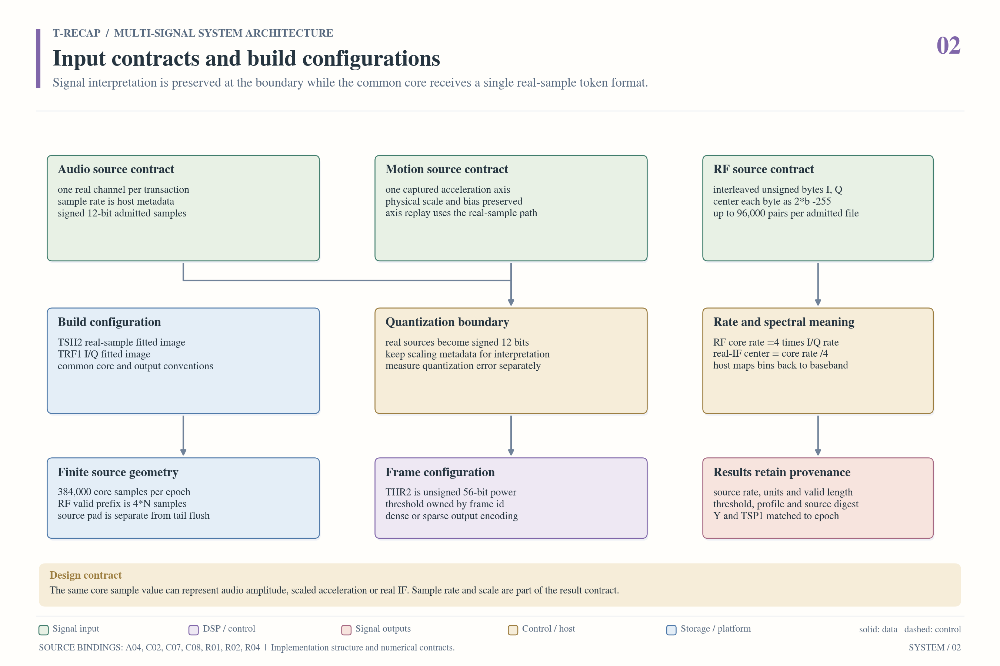

A source contract includes numerical representation, sample rate, valid length and physical meaning. Audio and motion inputs are prepared as signed 12-bit real samples. Motion axes are replayed individually with their scale metadata so output values can be interpreted in acceleration units.

RF uses interleaved unsigned 8-bit I/Q. The FPGA centers both components, interpolates by four and produces a real IF stream. Its core sample rate is four times the input complex sample rate. Consequently the numerical bin index must be interpreted with the appropriate frontend rate and IF mapping.

Profile identity is a build configuration checked before each transaction. Quantization, RF gain and thresholding are separate numerical operations. Result reports retain these settings rather than combining all input preparation error with the effect of the spectral threshold.

| Block | Responsibility |
|---|---|
| Audio source contract | One real channel per transaction. sample rate is host metadata. signed 12-bit admitted samples. |
| Motion source contract | One captured acceleration axis. physical scale and bias preserved. axis replay uses the real-sample path. |
| RF source contract | Interleaved unsigned bytes I, Q. center each byte as 2*b -255. up to 96,000 pairs per admitted file. |
| Rate and spectral meaning | RF core rate =4 times I/Q rate. real-IF center = core rate /4. host maps bins back to baseband. |
| Quantization boundary | Real sources become signed 12 bits. keep scaling metadata for interpretation. measure quantization error separately. |
| Build configuration | TSH2 real-sample fitted image. TRF1 I/Q fitted image. common core and output conventions. |
| Finite source geometry | 384,000 core samples per epoch. RF valid prefix is 4*N samples. source pad is separate from tail flush. |
| Frame configuration | THR2 is unsigned 56-bit power. threshold owned by frame id. dense or sparse output encoding. |
| Results retain provenance | Source rate, units and valid length. threshold, profile and source digest. Y and TSP1 matched to epoch. |

**Interpretation:** The same core sample value can represent audio amplitude, scaled acceleration or real IF. Sample rate and scale are part of the result contract.

Source bindings: A04, C02, C07, C08, R01, R02, R04.

[Editable SVG](02-input-profiles.svg) | [Vector PDF](02-input-profiles.pdf)

## 3. Shared fixed-point spectral datapath

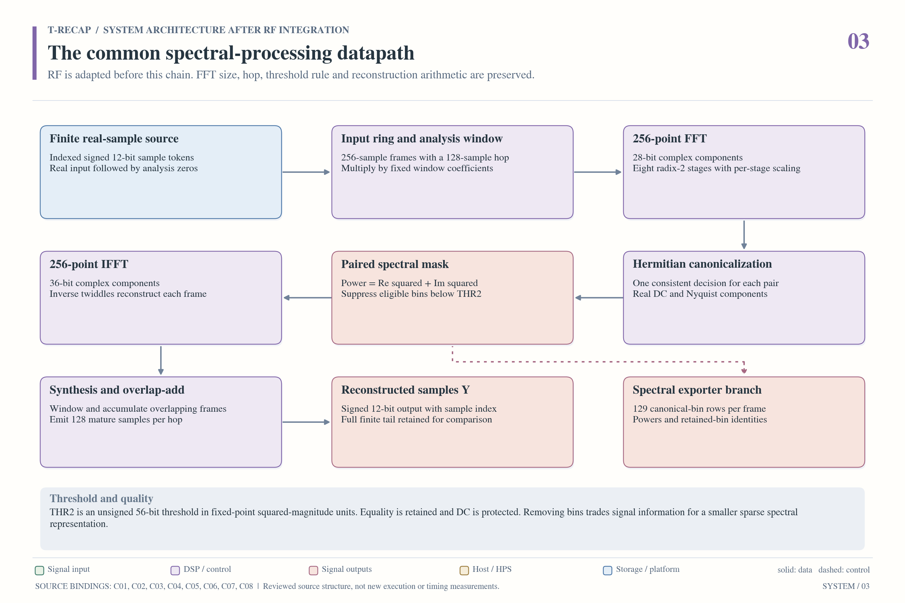

The core forms 256-sample windows at a 128-sample hop. Analysis produces signed 27-bit values. A normalized forward FFT yields 28-bit complex bins, then the canonicalizer enforces Hermitian symmetry using widened pair arithmetic and one defined rounding operation.

Power is an unsigned 56-bit squared magnitude. THR2 retains equality and protects DC. The paired complex mask feeds a separate inverse transform while a valid-only observation exposes nonnegative-frequency masked power to the exporter. Sparse encoding changes transport and consumer work rather than the fixed transform schedule.

The inverse engine produces signed 36-bit values. Synthesis applies the window, emits mature overlap-add samples and accumulates the current frame. The Y stream preserves reconstruction information. TSP1 preserves power and bin identity but omits phase. Detailed memories and arithmetic are shown in views 9 through 14.

| Block | Responsibility |
|---|---|
| Tagged samples and frames | sample: signed 12 bits, index:64 bits. 512-entry ring, 256 samples per frame. hop 128 and frame-owned configuration. |
| Analysis window | 256 x unsigned 16-bit coefficients. signed sample x signed-extended window. fit product to signed 27 bits. |
| Forward FFT | 256-point radix-2 iterative engine. 28-bit components, 15 fractional bits. divide by 2 at each of 8 stages. |
| Hermitian canonicalizer | Full 256-bin complex frame RAM. 29-bit pair sum and difference. round to 28 and mirror conjugates. |
| Power threshold and paired mask | Re squared + Im squared:56 bits. retain if power >= THR2. protect DC, apply mask to conjugate pair. |
| Inverse FFT | Separate 256-point engine and RAM. signed 36-bit components. inverse twiddle ROM, no stage division. |
| Synthesis and overlap-add | Window product 53 -> signed Z36. OLA ring 384 x 37 bits. emit 128 mature samples then add frame. |
| Reconstructed output Y | Round OLA by 15 fractional bits. saturate to signed 12 bits. value and index held until accepted. |
| TSP1 spectral export | Masked power bins 0 to128. dense 903-byte or sparse 8*K payload. frame id, threshold and checksum. |

**Interpretation:** Core coefficients use 15 fractional bits. RF FIR coefficients use 16. Threshold units are squared fixed-point FFT magnitude.

Source bindings: C01, C02, C03, C04, C05, C06, C12, C13, C16.

[Editable SVG](03-shared-dsp.svg) | [Vector PDF](03-shared-dsp.pdf)

## 4. I/Q frontend and real-IF source formation

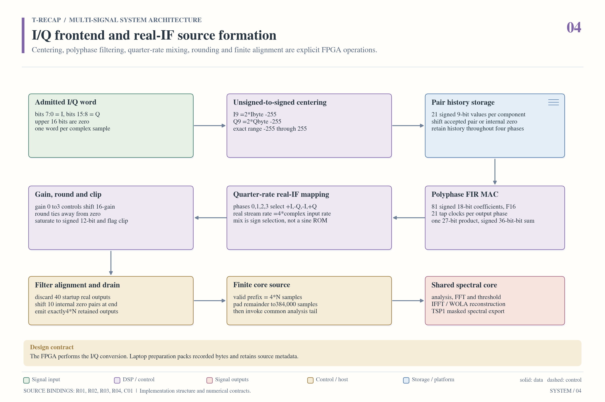

The I/Q frontend accepts one packed unsigned pair per input transfer. It converts each byte to a signed 9-bit centered value and retains 21 samples per component. Four interpolation phases share one multiplier and accumulator. The coefficient address is four times the tap index plus the phase.

The phase sequence selects +I, -Q, -I and +Q to form a real IF stream. FIR coefficients have 16 fractional bits. Gain changes the quantizer shift from 16 down to 13 without changing the core interface. A signed 12-bit sample and its clipping flag are registered and held together.

Alignment discards 40 startup outputs and flushes 10 centered-zero pairs, giving exactly four retained real samples per original pair. The finite wrapper records this valid prefix and pads to the admitted core geometry. Views15 and 16 expand the actual arithmetic resource and controller schedule.

| Block | Responsibility |
|---|---|
| Admitted I/Q word | Bits 7:0 = I, bits 15:8 = Q. upper 16 bits are zero. one word per complex sample. |
| Unsigned-to-signed centering | I9 =2*Ibyte -255. Q9 =2*Qbyte -255. exact range -255 through 255. |
| Pair history storage | 21 signed 9-bit values per component. shift accepted pair or internal zero. retain history throughout four phases. |
| Polyphase FIR MAC | 81 signed 18-bit coefficients, F16. 21 tap clocks per output phase. one 27-bit product, signed 36-bit-bit sum. |
| Quarter-rate real-IF mapping | Phases 0,1,2,3 select +I,-Q,-I,+Q. real stream rate =4*complex input rate. mix is sign selection, not a sine ROM. |
| Gain, round and clip | Gain 0 to3 controls shift 16-gain. round ties away from zero. saturate to signed 12-bit and flag clip. |
| Filter alignment and drain | Discard 40 startup real outputs. shift 10 internal zero pairs at end. emit exactly4*N retained outputs. |
| Finite core source | Valid prefix = 4*N samples. pad remainder to384,000 samples. then invoke common analysis tail. |
| Shared spectral core | analysis, FFT and threshold. IFFT / WOLA reconstruction. TSP1 masked spectral export. |

**Interpretation:** The FPGA performs the I/Q conversion. Laptop preparation packs recorded bytes and retains source metadata.

Source bindings: R01, R02, R03, R04, C01.

[Editable SVG](04-rf-input-adapter.svg) | [Vector PDF](04-rf-input-adapter.pdf)

## 5. Output representations and laptop applications

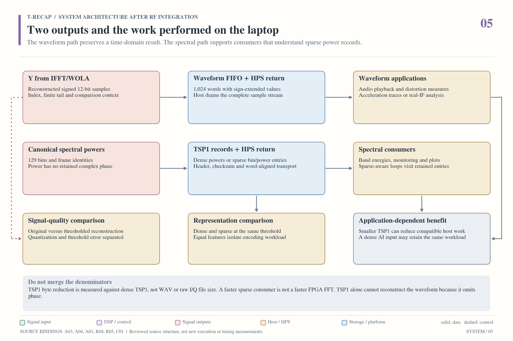

Y is the reconstructed real signal produced by the IFFT and WOLA path. It supports listening, waveform comparison, motion detection and conversion to downstream file formats. TSP1 contains masked power rather than complex coefficients. It supports spectrum consumers that can use retained-bin indices directly.

Each TSP1 frame has a 48-byte header. Dense encoding includes 129 seven-byte powers and one padding byte for 952 bytes total. Sparse encoding includes K eight-byte index/power entries for 48+8*K bytes. These spectral transport sizes are separate from WAV, FLAC or reconstructed sample storage.

The laptop first validates identities, framing and checksums. Application-specific consumers then compare quality and workload. Dense and sparse representations at the same threshold carry the same masked powers. Comparing them isolates the representation benefit. Comparing with threshold0 measures the information removed by thresholding.

| Block | Responsibility |
|---|---|
| Masked core results | Paired complex spectrum for reconstruction. nonnegative masked power for export. frame and sample identities travel with data. |
| Y reconstruction stream | Signed 12-bit sample plus index. sign extension to32-bit transport word. full fixed output count per epoch. |
| TSP1 spectral stream | 48-byte header per frame. dense:952 bytes total. sparse:48+8*K bytes total. |
| Host validation | Epoch and frame ids, lengths and counts. FNV-1a64 record checksum. source profile, threshold and scale. |
| Audio analysis | Aligned waveform and listening files. spectrogram and relative error. FLAC size and encode-time comparison. |
| Motion analysis | Reconstructed axis in physical units. step detection before and after. retained true steps and false counts. |
| RF analysis | real-IF spectrum mapped to RF context. occupied bins and event intervals. compare retained and missed activity. |
| Sparse consumer workload | Walk retained entries directly. compare to dense same-threshold values. time decode and arithmetic separately. |
| Application quality | Compare with source and threshold0. keep quantization error separate. report threshold tradeoffs per input. |

**Interpretation:** Power-only TSP1 cannot reconstruct phase-bearing waveforms. Y is the waveform reconstruction output.

Source bindings: C06, C16, A02, A03, A04, R05, R08.

[Editable SVG](05-outputs-and-consumers.svg) | [Vector PDF](05-outputs-and-consumers.pdf)

## 6. Host transport and finite transaction ownership

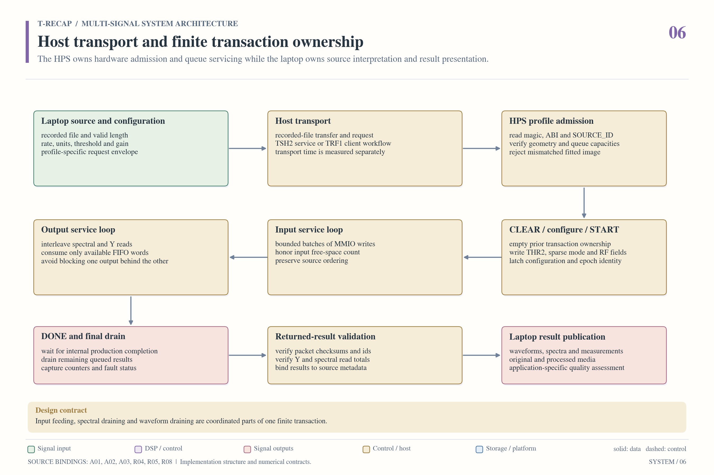

The laptop supplies a recorded source and explicit configuration. The HPS software validates the application magic, ABI, source digest and geometry before touching the transaction data path. This binds each capture to the fitted application and its register contract.

CLEAR removes stale queue and packet ownership. Configuration writes establish threshold and sparse mode, with pair count and gain for TRF1. START begins an epoch. The service interleaves bounded input writes with reads from both output queues so downstream backpressure can clear.

Hardware DONE is a production boundary. The host also drains remaining data and validates final counts, record identities and checksums. Reports distinguish hardware compute counters, transfer duration, laptop decode work and application work. Detailed register fields and FIFO ownership are shown in views17 through 19.

| Block | Responsibility |
|---|---|
| Laptop source and configuration | Recorded file and valid length. rate, units, threshold and gain. profile-specific request envelope. |
| Host transport | recorded-file transfer and request. TSH2 service or TRF1 client workflow. transport time is measured separately. |
| HPS profile admission | Read magic, ABI and SOURCE_ID. verify geometry and queue capacities. reject mismatched fitted image. |
| CLEAR / configure / START | Empty prior transaction ownership. write THR2, sparse mode and RF fields. latch configuration and epoch identity. |
| Input service loop | Bounded batches of MMIO writes. honor input free-space count. preserve source ordering. |
| Output service loop | Interleave spectral and Y reads. consume only available FIFO words. avoid blocking one output behind the other. |
| DONE and final drain | Wait for internal production completion. drain remaining queued results. capture counters and fault status. |
| Returned-result validation | Verify packet checksums and ids. verify Y and spectral read totals. bind results to source metadata. |
| Laptop result publication | waveforms, spectra and measurements. original and processed media. application-specific quality assessment. |

**Interpretation:** Input feeding, spectral draining and waveform draining are coordinated parts of one finite transaction.

Source bindings: A01, A02, A03, R04, R05, R08.

[Editable SVG](06-host-and-transactions.svg) | [Vector PDF](06-host-and-transactions.pdf)

## 7. Control ownership and backpressure

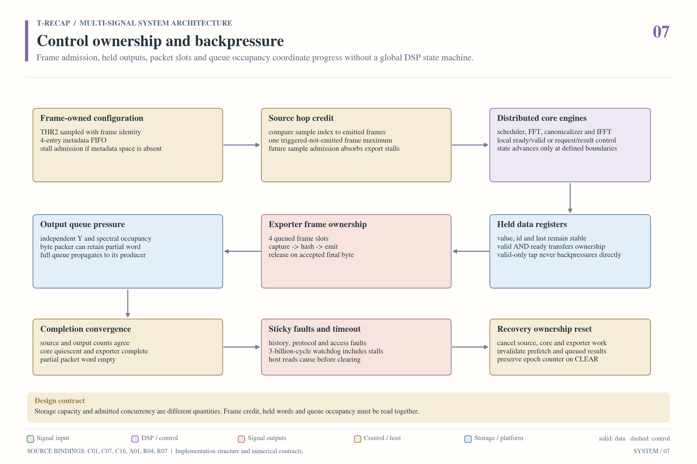

Control is distributed across modules. The input scheduler owns sample history and frame admission, the transform engines own their work RAMs, and the exporter owns packet slots. Metadata queues keep threshold and frame id aligned across variable transform and transport latency.

The finite wrapper gates future source samples using exported-frame credit. Therefore only one triggered frame may remain un-emitted even though the exporter physically has four slots. The spectral observation tap remains valid-only. Backpressure is applied upstream at a safe future admission boundary.

A ready/valid stream transfers only on simultaneous valid and ready. Held registers preserve values and identities across stalls. Sticky faults and watchdog expiry terminate a malformed epoch. CLEAR abandons all related ownership together so data from different epochs cannot silently combine.

| Block | Responsibility |
|---|---|
| Frame-owned configuration | THR2 sampled with frame identity. 4-entry metadata FIFO. stall admission if metadata space is absent. |
| Source hop credit | Compare sample index to emitted frames. one triggered-not-emitted frame maximum. future sample admission absorbs export stalls. |
| Distributed core engines | scheduler, FFT, canonicalizer and IFFT. local ready/valid or request/result control. state advances only at defined boundaries. |
| Held data registers | value, id and last remain stable. valid AND ready transfers ownership. valid-only tap never backpressures directly. |
| Exporter frame ownership | 4 queued frame slots. capture -> hash -> emit. release on accepted final byte. |
| Output queue pressure | Independent Y and spectral occupancy. byte packer can retain partial word. full queue propagates to its producer. |
| Completion convergence | Source and output counts agree. core quiescent and exporter complete. partial packet word empty. |
| Sticky faults and timeout | history, protocol and access faults. 3-billion-cycle watchdog includes stalls. host reads cause before clearing. |
| Recovery ownership reset | Cancel source, core and exporter work. invalidate prefetch and queued results. preserve epoch counter on CLEAR. |

**Interpretation:** Storage capacity and admitted concurrency are different quantities. Frame credit, held words and queue occupancy must be read together.

Source bindings: C01, C07, C16, A01, R04, R07.

[Editable SVG](07-control-and-backpressure.svg) | [Vector PDF](07-control-and-backpressure.pdf)

## 8. Platform, implementation and verification evidence

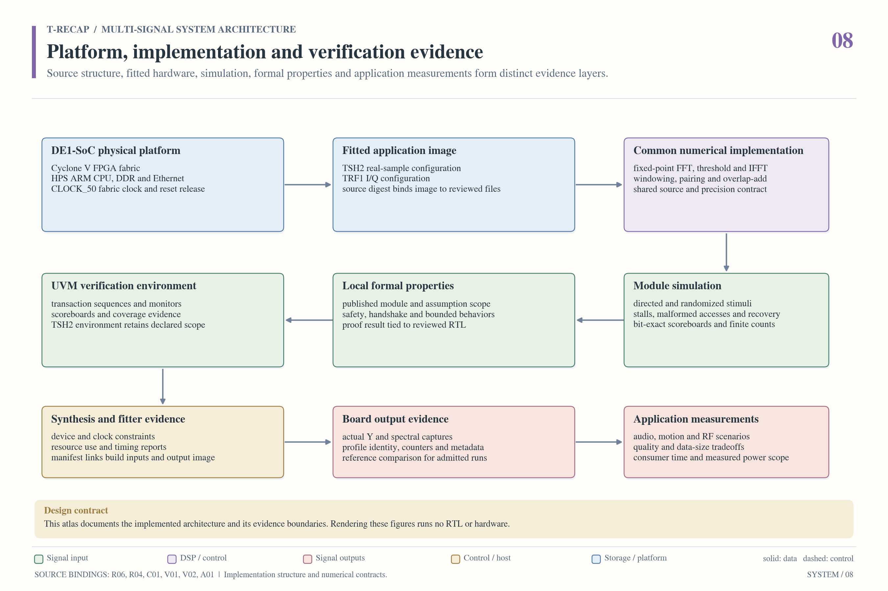

The FPGA application sits behind the HPS bridge on the DE1-SoC platform. CLOCK_50 drives the application fabric. Separate fitted images implement the configured source frontends while sharing the same numerical core implementation and output conventions.

Verification evidence is scoped to the design under test. Module and system simulations check arithmetic, handshakes, framing, malformed access and recovery. Published UVM and formal results retain their own source sets, assumptions and coverage. Their existence does not turn every application result into a formal proof.

Fitter reports establish physical implementation properties for a particular image. Board captures establish output behavior for admitted runs. Application measurements establish quality and workload under their stated inputs and timing boundaries. The atlas connects these layers through exact source bindings and module observation points.

| Block | Responsibility |
|---|---|
| DE1-SoC physical platform | Cyclone V FPGA fabric. HPS ARM CPU, DDR and Ethernet. CLOCK_50 fabric clock and reset release. |
| Fitted application image | TSH2 real-sample configuration. TRF1 I/Q configuration. source digest binds image to reviewed files. |
| Common numerical implementation | fixed-point FFT, threshold and IFFT. windowing, pairing and overlap-add. shared source and precision contract. |
| Module simulation | Directed and randomized stimuli. stalls, malformed accesses and recovery. bit-exact scoreboards and finite counts. |
| Local formal properties | Published module and assumption scope. safety, handshake and bounded behaviors. proof result tied to reviewed RTL. |
| UVM verification environment | Transaction sequences and monitors. scoreboards and coverage evidence. TSH2 environment retains declared scope. |
| Synthesis and fitter evidence | Device and clock constraints. resource use and timing reports. manifest links build inputs and output image. |
| Board output evidence | Actual Y and spectral captures. profile identity, counters and metadata. reference comparison for admitted runs. |
| Application measurements | audio, motion and RF scenarios. quality and data-size tradeoffs. consumer time and measured power scope. |

**Interpretation:** This atlas documents the implemented architecture and its evidence boundaries. Rendering these figures runs no RTL or hardware.

Source bindings: R06, R04, C01, V01, V02, A01.

[Editable SVG](08-platform-and-verification.svg) | [Vector PDF](08-platform-and-verification.pdf)

## 9. Frame storage and analysis-window hardware

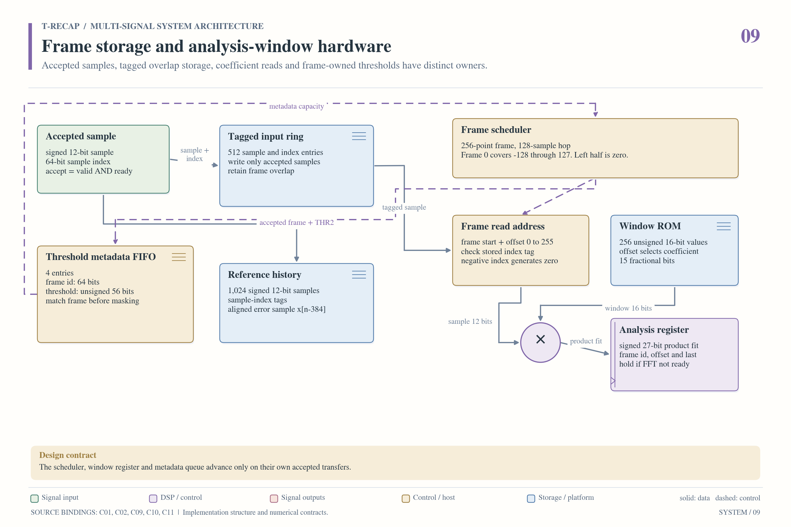

Only accepted input tokens advance the sample index and write the ring. One 256-sample frame is scheduled per 128 accepted samples. Negative conceptual indices in the first frame generate exact zero. Tags detect overwritten or mismatched sample history.

The analysis multiplier extends the unsigned 16-bit window coefficient with a leading zero before signed multiplication. It fits the product to signed 27 bits without a fractional right shift. The held result includes frame id, offset and last so backpressure does not separate sample data from its identity.

A four-entry metadata FIFO associates THR2 with each admitted frame across FFT latency. Reference history is a separate 1,024-entry store used for the 384-sample error alignment. Ring storage depth and metadata capacity do not imply that all entries can be simultaneously in flight as independent frames.

| Block | Responsibility |
|---|---|
| Accepted sample | Signed 12-bit sample. 64-bit sample index. accept = valid AND ready. |
| Tagged input ring | 512 sample and index entries. write only accepted samples. retain frame overlap. |
| Frame scheduler | 256-point frame, 128-sample hop. Frame 0 covers -128 through 127. Left half is zero. |
| Frame read address | Frame start + offset 0 to 255. check stored index tag. negative index generates zero. |
| Window ROM | 256 unsigned 16-bit values. offset selects coefficient. 15 fractional bits. |
| × | Arithmetic primitive connected by the labeled operand and result wires. |
| Analysis register | Signed 27-bit product fit. frame id, offset and last. hold if FFT not ready. |
| Threshold metadata FIFO | 4 entries. frame id: 64 bits. threshold: unsigned 56 bits. match frame before masking. |
| Reference history | 1,024 signed 12-bit samples. sample-index tags. aligned error sample x[n-384]. |

**Interpretation:** The scheduler, window register and metadata queue advance only on their own accepted transfers.

Source bindings: C01, C02, C09, C10, C11.

[Editable SVG](09-frame-window-hardware.svg) | [Vector PDF](09-frame-window-hardware.pdf)

## 10. FFT and IFFT memory engines

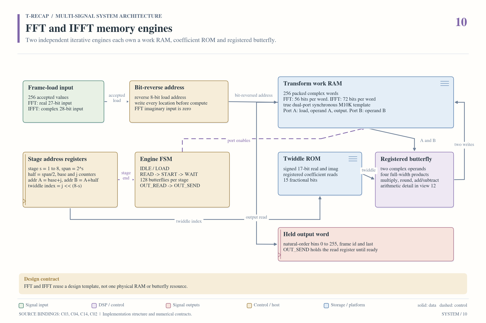

The FFT and IFFT are separate engine instances with separate work RAMs. Each holds 256 complex words. FFT components are signed 28 bits and IFFT components are signed 36 bits. Bit-reversed load addresses permit natural-order output.

Eight radix-2 stages contain 128 butterflies each. READ captures operands and twiddles, START launches arithmetic, and WAIT writes the two results. The paired write addresses differ by the current half-span and remain distinct.

The FSM separates memory read phases from write phases. RAM is loaded before compute rather than asynchronously cleared. OUT_SEND holds a captured word across backpressure. Clock count depends on accepted outputs and is distinct from the sample-domain FFT size.

| Block | Responsibility |
|---|---|
| Frame-load input | 256 accepted values. FFT: real 27-bit input. IFFT: complex 28-bit input. |
| Bit-reverse address | Reverse 8-bit load address. write every location before compute. FFT imaginary input is zero. |
| Transform work RAM | 256 packed complex words. FFT: 56 bits per word. IFFT: 72 bits per word. true dual-port synchronous M10K template. Port A: load, operand A, output. Port B: operand B. |
| Stage address registers | Stage s = 1 to 8, span = 2^s. half = span/2, base and j counters. addr A = base+j, addr B = A+half. twiddle index = j << (8-s). |
| Engine FSM | IDLE / LOAD. READ -> START -> WAIT. 128 butterflies per stage. OUT_READ -> OUT_SEND. |
| Twiddle ROM | Signed 17-bit real and imag. registered coefficient reads. 15 fractional bits. |
| Registered butterfly | Two complex operands. four full-width products. multiply, round, add/subtract. arithmetic detail in view 12. |
| Held output word | natural-order bins 0 to 255, frame id and last. OUT_SEND holds the read register until ready. |

**Interpretation:** FFT and IFFT reuse a design template, not one physical RAM or butterfly resource.

Source bindings: C03, C04, C14, C02.

[Editable SVG](10-transform-memory-engines.svg) | [Vector PDF](10-transform-memory-engines.pdf)

## 11. Canonical spectrum and threshold logic

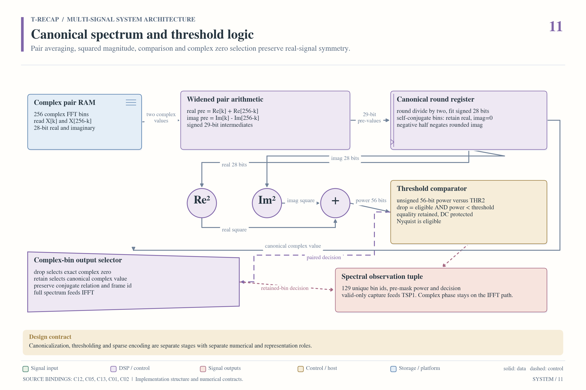

The canonicalizer stores a full FFT frame and reads conjugate-related pairs. It forms signed 29-bit real sums and imaginary differences before dividing by two with the defined rounding rule. DC and Nyquist retain their real values with imaginary zero.

The negative half negates the already-rounded positive imaginary component. The magnitude path squares the canonical real and imaginary components and adds them in the unsigned 56-bit power domain. The comparator uses frame-owned THR2. Strict less-than drops eligible bins, equality survives and DC is protected.

The spectrum builder selects canonical complex values or exact zero while preserving conjugate symmetry. A separate valid-only observation carries each unique bin, power and decision into spectral capture. TSP1 omits phase and cannot replace the IFFT input.

| Block | Responsibility |
|---|---|
| Complex pair RAM | 256 complex FFT bins. read X[k] and X[256-k]. 28-bit real and imaginary. |
| Widened pair arithmetic | Real pre = Re[k] + Re[256-k]. imag pre = Im[k] - Im[256-k]. signed 29-bit intermediates. |
| Canonical round register | Round divide by two, fit signed 28 bits. self-conjugate bins: retain real, imag=0. negative half negates rounded imag. |
| Re² | Arithmetic primitive connected by the labeled operand and result wires. |
| Im² | Arithmetic primitive connected by the labeled operand and result wires. |
| + | Arithmetic primitive connected by the labeled operand and result wires. |
| Threshold comparator | Unsigned 56-bit power versus THR2. drop = eligible AND power < threshold. equality retained, DC protected. Nyquist is eligible. |
| Complex-bin output selector | Drop selects exact complex zero. retain selects canonical complex value. preserve conjugate relation and frame id. full spectrum feeds IFFT. |
| Spectral observation tuple | 129 unique bin ids, pre-mask power and decision. valid-only capture feeds TSP1. Complex phase stays on the IFFT path. |

**Interpretation:** Canonicalization, thresholding and sparse encoding are separate stages with separate numerical and representation roles.

Source bindings: C12, C05, C13, C01, C02.

[Editable SVG](11-canonical-mask-hardware.svg) | [Vector PDF](11-canonical-mask-hardware.pdf)

## 12. Registered radix-2 butterfly arithmetic

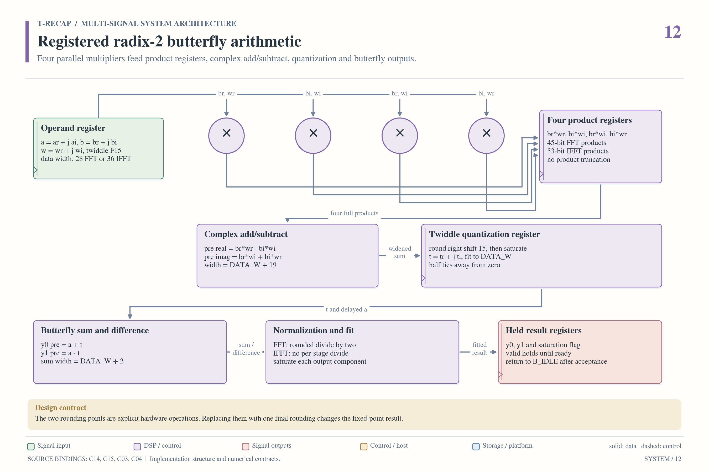

The four multiplier symbols represent parallel real products from the same operand registers. They are not a cascade. Each product has DATA_W+17 bits. A widened subtraction and addition form the complex twiddle product before the first rounding point.

Twiddle quantization shifts right by 15 with ties away from zero and saturation. The delayed a operand is added to and subtracted from the quantized t. FFT then rounds a divide-by-two at each stage. IFFT disables that second normalization shift and uses inverse twiddles.

The controller states are B_IDLE, B_PRODUCT_SUM, B_QUANTIZE, B_ADD, B_ROUND and B_OUTPUT. Arithmetic registers use clock enables. B_OUTPUT holds both complex results and saturation status until the engine accepts them.

| Block | Responsibility |
|---|---|
| Operand register | a = ar + j ai, b = br + j bi. w = wr + j wi, twiddle F15. data width: 28 FFT or 36 IFFT. |
| × | Arithmetic primitive connected by the labeled operand and result wires. |
| × | Arithmetic primitive connected by the labeled operand and result wires. |
| × | Arithmetic primitive connected by the labeled operand and result wires. |
| × | Arithmetic primitive connected by the labeled operand and result wires. |
| Four product registers | br*wr, bi*wi, br*wi, bi*wr. 45-bit FFT products. 53-bit IFFT products. no product truncation. |
| Complex add/subtract | Pre real = br*wr - bi*wi. pre imag = br*wi + bi*wr. width = DATA_W + 19. |
| Twiddle quantization register | Round right shift 15, then saturate. t = tr + j ti, fit to DATA_W. half ties away from zero. |
| Butterfly sum and difference | y0 pre = a + t. y1 pre = a - t. sum width = DATA_W + 2. |
| Normalization and fit | FFT: rounded divide by two. IFFT: no per-stage divide. saturate each output component. |
| Held result registers | y0, y1 and saturation flag. valid holds until ready. return to B_IDLE after acceptance. |

**Interpretation:** The two rounding points are explicit hardware operations. Replacing them with one final rounding changes the fixed-point result.

Source bindings: C14, C15, C03, C04.

[Editable SVG](12-butterfly-arithmetic.svg) | [Vector PDF](12-butterfly-arithmetic.pdf)

## 13. Synthesis window and overlap-add storage

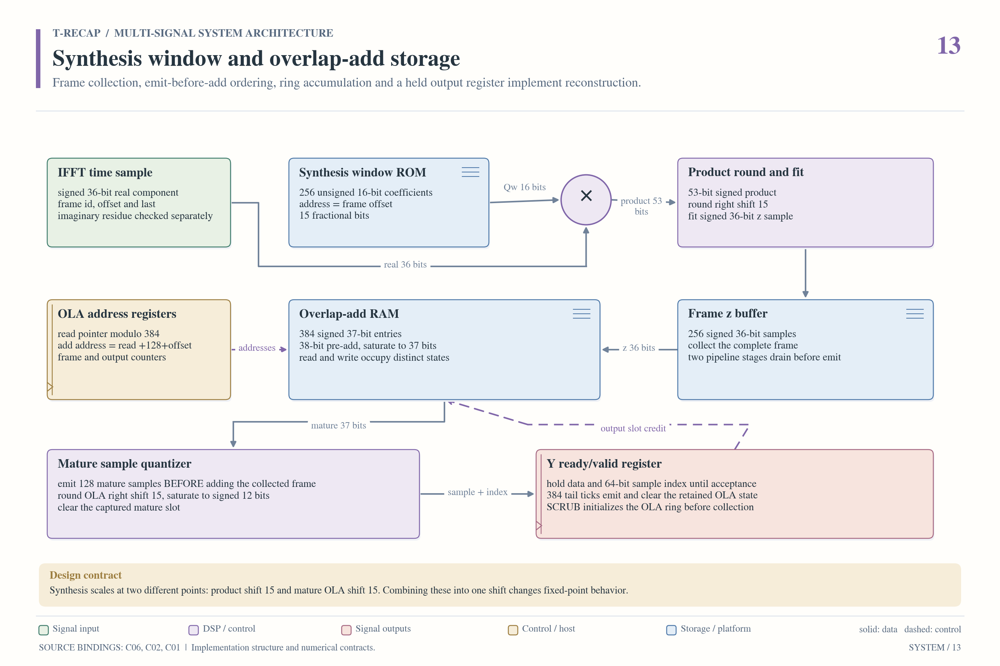

The synthesis multiplier uses a signed 36-bit IFFT component and a nonnegative 16-bit coefficient extended to signed 17 bits. It produces a 53-bit product. A rounded right shift of 15 fits the result into the signed 36-bit z buffer. This is the first synthesis scaling point.

After a complete frame and its pipeline tail are collected, WOLA emits 128 mature ring entries before adding the frame contributions. Each mature 37-bit value is rounded right by 15 and saturated to 12 bits. The captured slot is cleared. Frame contributions then use address (read pointer +128+offset) modulo384 with a widened 38-bit add and 37-bit saturation.

The z buffer has 256 entries and the OLA ring has 384 entries. Explicit SCRUB initializes OLA storage. Read/capture and add/read/write states respect synchronous RAM latency. The Y register holds data and index under backpressure. Final tail ticks emit and clear retained state without dummy transforms.

| Block | Responsibility |
|---|---|
| IFFT time sample | Signed 36-bit real component. frame id, offset and last. imaginary residue checked separately. |
| Synthesis window ROM | 256 unsigned 16-bit coefficients. address = frame offset. 15 fractional bits. |
| × | Arithmetic primitive connected by the labeled operand and result wires. |
| Product round and fit | 53-bit signed product. round right shift 15. fit signed 36-bit z sample. |
| Frame z buffer | 256 signed 36-bit samples. collect the complete frame. two pipeline stages drain before emit. |
| OLA address registers | Read pointer modulo 384. add address = read +128+offset. frame and output counters. |
| Overlap-add RAM | 384 signed 37-bit entries. 38-bit pre-add, saturate to 37 bits. read and write occupy distinct states. |
| Mature sample quantizer | Emit 128 mature samples BEFORE adding the collected frame. round OLA right shift 15, saturate to signed 12 bits. clear the captured mature slot. |
| Y ready/valid register | Hold data and 64-bit sample index until acceptance. 384 tail ticks emit and clear the retained OLA state. SCRUB initializes the OLA ring before collection. |

**Interpretation:** Synthesis scales at two different points: product shift 15 and mature OLA shift 15. Combining these into one shift changes fixed-point behavior.

Source bindings: C06, C02, C01.

[Editable SVG](13-wola-storage.svg) | [Vector PDF](13-wola-storage.pdf)

## 14. TSP1 capture, checksum and packetization

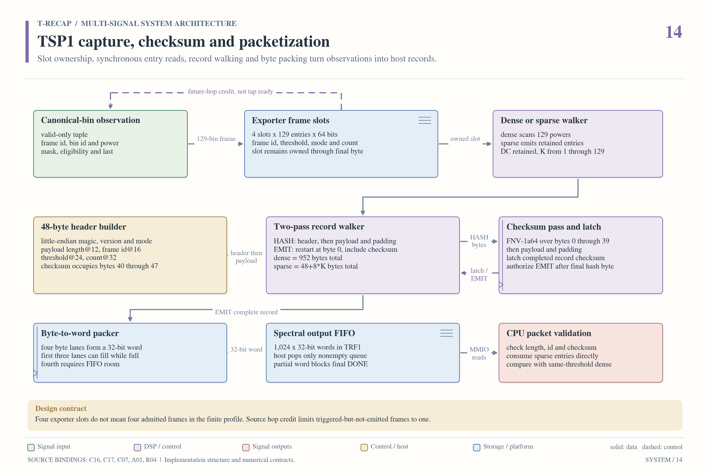

The exporter captures unique-bin powers and retain decisions into four frame slots. A 64-bit entry can hold bin: 8 bits plus power: 56 bits. Per-slot metadata contains frame identity, threshold, mode and count. Invalid order or inconsistent frame information triggers the documented discard/recovery behavior.

Dense mode has 903 payload bytes, one padding byte and the 48-byte header, totaling 952 bytes. Sparse mode carries 8K payload bytes and totals 48+8K. At K=129 it is 1,080 bytes and therefore exceeds dense. The checksum includes header bytes 0 through 39 and payload/padding, excluding only bytes 40 through 47.

HASH_FETCH and HASH scan header bytes 0 through 39 followed by payload and padding, skipping checksum bytes 40 through 47. The final hash is latched before EMIT_FETCH and EMIT restart at byte 0 with that checksum included. Synchronous entry reads supply seven dense or eight sparse byte lanes. Final-byte acceptance releases frame ownership. The word packer requires FIFO room on its fourth byte.

| Block | Responsibility |
|---|---|
| Canonical-bin observation | valid-only tuple. frame id, bin id and power. mask, eligibility and last. |
| Exporter frame slots | 4 slots x 129 entries x 64 bits. frame id, threshold, mode and count. slot remains owned through final byte. |
| Dense or sparse walker | Dense scans 129 powers. sparse emits retained entries. DC retained, K from 1 through 129. |
| 48-byte header builder | little-endian magic, version and mode. payload length@12, frame id@16. threshold@24, count@32. checksum occupies bytes 40 through 47. |
| Two-pass record walker | HASH: header, then payload and padding. EMIT: restart at byte 0, include checksum. dense = 952 bytes total. sparse = 48+8*K bytes total. |
| Checksum pass and latch | FNV-1a64 over bytes 0 through 39. then payload and padding. latch completed record checksum. authorize EMIT after final hash byte. |
| Byte-to-word packer | Four byte lanes form a 32-bit word. first three lanes can fill while full. fourth requires FIFO room. |
| Spectral output FIFO | 1,024 x 32-bit words in TRF1. host pops only nonempty queue. partial word blocks final DONE. |
| CPU packet validation | Check length, id and checksum. consume sparse entries directly. compare with same-threshold dense. |

**Interpretation:** Four exporter slots do not mean four admitted frames in the finite profile. Source hop credit limits triggered-but-not-emitted frames to one.

Source bindings: C16, C17, C07, A01, R04.

[Editable SVG](14-spectral-packet-hardware.svg) | [Vector PDF](14-spectral-packet-hardware.pdf)

## 15. I/Q polyphase multiply-accumulate datapath

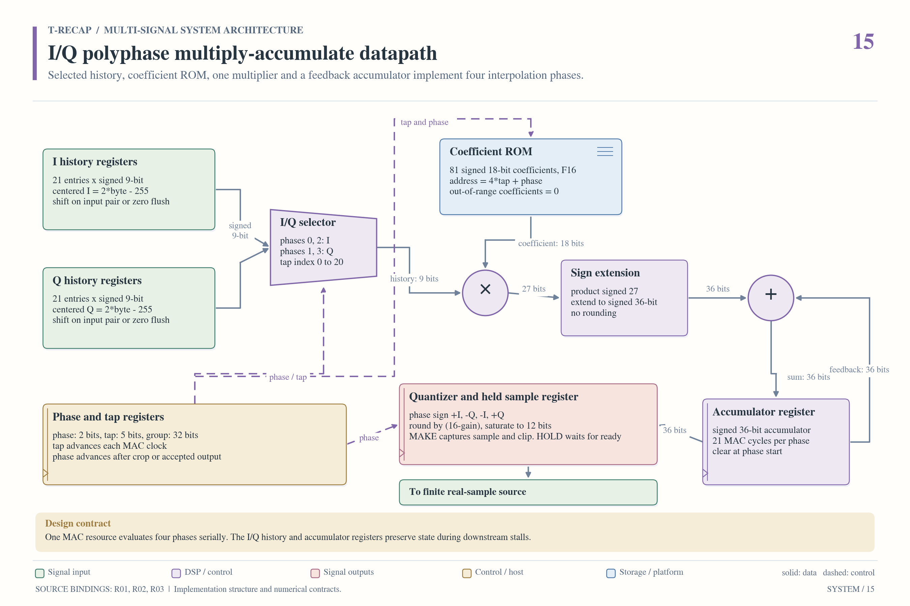

The adapter stores 21 centered signed 9-bit samples for I and 21 for Q. The 2-bit phase chooses the history bank. A 5-bit tap index selects one sample and forms coefficient address 4*tap+phase. The ROM contains 81 signed 18-bit values with 16 fractional bits.

One 9 by 18 signed multiplier produces a 27-bit product each MAC clock. Sign extension feeds a 36-bit accumulator. Twenty-one positions are evaluated per phase, including zero coefficients beyond address 80. No per-tap rounding occurs.

The accumulated value uses the phase sign sequence +I, -Q, -I, +Q. Gain selects a final shift from 16 to 13. Half ties round away from zero before signed 12-bit saturation. Output acceptance releases the held result and advances phase. The multiplier is shared across phases, not across FFT butterflies.

| Block | Responsibility |
|---|---|
| I history registers | 21 entries x signed 9-bit. centered I = 2*byte - 255. shift on input pair or zero flush. |
| Q history registers | 21 entries x signed 9-bit. centered Q = 2*byte - 255. shift on input pair or zero flush. |
| I/Q selector | Phases 0, 2: I. phases 1, 3: Q. tap index 0 to 20. |
| Coefficient ROM | 81 signed 18-bit coefficients, F16. address = 4*tap + phase. out-of-range coefficients = 0. |
| × | Arithmetic primitive connected by the labeled operand and result wires. |
| Sign extension | Product signed 27. extend to signed 36-bit. no rounding. |
| + | Arithmetic primitive connected by the labeled operand and result wires. |
| Accumulator register | Signed 36-bit accumulator. 21 MAC cycles per phase. clear at phase start. |
| Phase and tap registers | phase: 2 bits, tap: 5 bits, group: 32 bits. tap advances each MAC clock. phase advances after crop or accepted output. |
| Quantizer and held sample register | Phase sign +I, -Q, -I, +Q. round by (16-gain), saturate to 12 bits. MAKE captures sample and clip. HOLD waits for ready. |
| To finite real-sample source | Transfers accepted samples to the finite real-sample source. |

**Interpretation:** One MAC resource evaluates four phases serially. The I/Q history and accumulator registers preserve state during downstream stalls.

Source bindings: R01, R02, R03.

[Editable SVG](15-rf-mac-datapath.svg) | [Vector PDF](15-rf-mac-datapath.pdf)

## 16. I/Q adapter controller and finite alignment

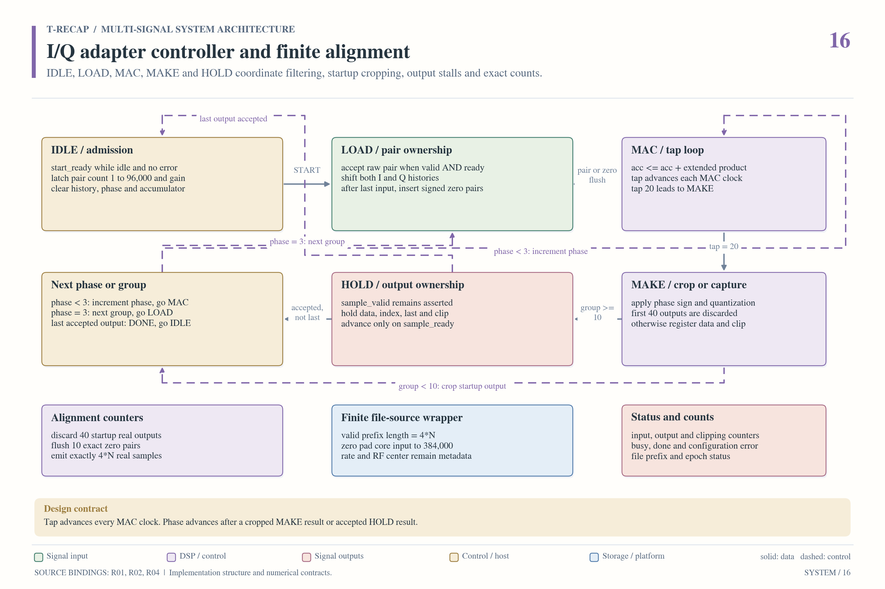

START admits a finite pair count and gain in IDLE. LOAD shifts I and Q history once for each accepted input pair. After input_count reaches pair_count, LOAD shifts exact centered zeros internally. The flush is not encoded as a fabricated unsigned byte.

MAC evaluates 21 tap positions. MAKE applies the oscillator sign before rounding and saturation. During the first ten groups, phase advance discards startup results. Subsequent results are captured into output registers and owned by HOLD until acceptance.

Four phases per group and ten flush pairs yield exactly 4*N aligned real samples. The file-source wrapper then zero pads the common input transaction. CLEAR aborts even a stalled output, and the enclosing application also clears its consumer so abandoned samples cannot enter another epoch.

| Block | Responsibility |
|---|---|
| IDLE / admission | start_ready while idle and no error. latch pair count 1 to 96,000 and gain. clear history, phase and accumulator. |
| LOAD / pair ownership | Accept raw pair when valid AND ready. shift both I and Q histories. after last input, insert signed zero pairs. |
| MAC / tap loop | Acc <= acc + extended product. tap advances each MAC clock. tap 20 leads to MAKE. |
| MAKE / crop or capture | Apply phase sign and quantization. first 40 outputs are discarded. otherwise register data and clip. |
| HOLD / output ownership | sample_valid remains asserted. hold data, index, last and clip. advance only on sample_ready. |
| Next phase or group | Phase < 3: increment phase, go MAC. phase = 3: next group, go LOAD. last accepted output: DONE, go IDLE. |
| Alignment counters | Discard 40 startup real outputs. flush 10 exact zero pairs. emit exactly 4*N real samples. |
| Finite file-source wrapper | Valid prefix length = 4*N. zero pad core input to 384,000. rate and RF center remain metadata. |
| Status and counts | input, output and clipping counters. busy, done and configuration error. file prefix and epoch status. |

**Interpretation:** Tap advances every MAC clock. Phase advances after a cropped MAKE result or accepted HOLD result.

Source bindings: R01, R02, R04.

[Editable SVG](16-rf-controller.svg) | [Vector PDF](16-rf-controller.pdf)

## 17. Host register interface and ownership

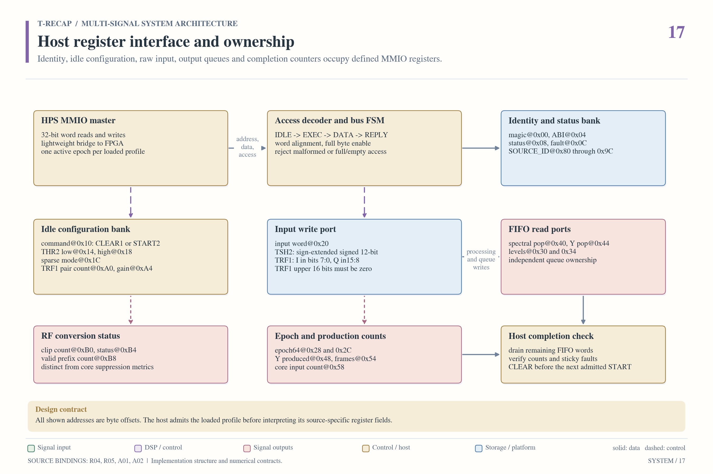

The HPS uses 32-bit aligned MMIO accesses through the lightweight bridge. The bus adapter requires full byte enables, a single burst and exactly one read or write request. FIFO read latency is captured by the DATA state before REPLY. The host verifies profile magic, ABI and source identity first.

THR2 is split across low 32 and high 24 bits. Idle-only configuration prevents an active epoch from changing its input interpretation. TSH2 words are signed 12-bit samples represented as int32. TRF1 words pack two unsigned bytes and reject a nonzero upper half-word.

Status, counters and FIFO pop ports are separate responsibilities. RF conversion exposes its own pair count, gain, clipping and valid-prefix registers. A DONE production bit does not certify that the host has received all results. HPS drains residual data, checks totals and clears the epoch ownership before another start.

| Block | Responsibility |
|---|---|
| HPS MMIO master | 32-bit word reads and writes. lightweight bridge to FPGA. one active epoch per loaded profile. |
| Access decoder and bus FSM | IDLE -> EXEC -> DATA -> REPLY. word alignment, full byte enable. reject malformed or full/empty access. |
| Identity and status bank | magic@0x00, ABI@0x04. status@0x08, fault@0x0C. SOURCE_ID@0x80 through 0x9C. |
| FIFO read ports | Spectral pop@0x40, Y pop@0x44. levels@0x30 and 0x34. independent queue ownership. |
| Input write port | Input word@0x20. TSH2: sign-extended signed 12-bit. TRF1: I in bits 7:0, Q in15:8. TRF1 upper 16 bits must be zero. |
| Idle configuration bank | command@0x10: CLEAR1 or START2. THR2 low@0x14, high@0x18. sparse mode@0x1C. TRF1 pair count@0xA0, gain@0xA4. |
| RF conversion status | Clip count@0xB0, status@0xB4. valid prefix count@0xB8. distinct from core suppression metrics. |
| Epoch and production counts | epoch64@0x28 and 0x2C. Y produced@0x48, frames@0x54. core input count@0x58. |
| Host completion check | Drain remaining FIFO words. verify counts and sticky faults. CLEAR before the next admitted START. |

**Interpretation:** All shown addresses are byte offsets. The host admits the loaded profile before interpreting its source-specific register fields.

Source bindings: R04, R05, A01, A02.

[Editable SVG](17-mmio-register-interface.svg) | [Vector PDF](17-mmio-register-interface.pdf)

## 18. FIFO storage, prefetch and backpressure

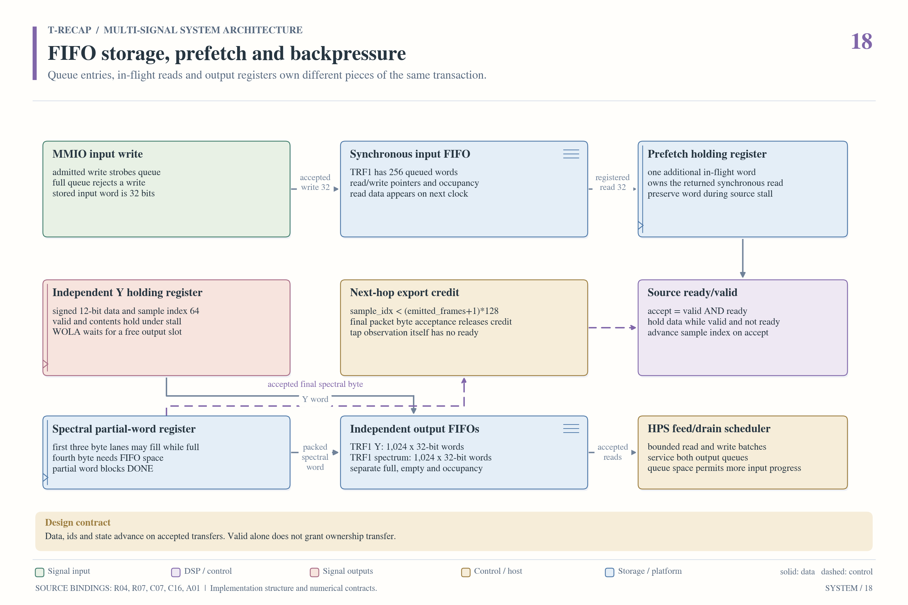

The TRF1 input queue has 256 words plus a registered prefetch stage. The prefetch owns a returned synchronous read while the source is not ready. Queue occupancy alone therefore does not describe all in-flight input ownership.

Finite source credit uses accepted source index and emitted-frame count to limit triggered-but-not-emitted frames to one. The valid-only tap is observed without a ready return. Its transport pressure acts on admission of future source hops. The independent Y path holds both value and index until accepted.

The packer owns a partial 32-bit spectral word independently of the output FIFO. Its fourth-byte transfer requires queue room. HPS interleaves bounded input writes and output reads so neither output FIFO is ignored. Host stalls extend epoch duration while accepted ordering and numerical state remain stable.

| Block | Responsibility |
|---|---|
| MMIO input write | Admitted write strobes queue. full queue rejects a write. stored input word is 32 bits. |
| Synchronous input FIFO | TRF1 has 256 queued words. read/write pointers and occupancy. read data appears on next clock. |
| Prefetch holding register | One additional in-flight word. owns the returned synchronous read. preserve word during source stall. |
| Source ready/valid | accept = valid AND ready. hold data while valid and not ready. advance sample index on accept. |
| Next-hop export credit | sample_idx < (emitted_frames+1)*128. final packet byte acceptance releases credit. tap observation itself has no ready. |
| Independent Y holding register | Signed 12-bit data and sample index 64. valid and contents hold under stall. WOLA waits for a free output slot. |
| Spectral partial-word register | First three byte lanes may fill while full. fourth byte needs FIFO space. partial word blocks DONE. |
| Independent output FIFOs | TRF1 Y: 1,024 x 32-bit words. TRF1 spectrum: 1,024 x 32-bit words. separate full, empty and occupancy. |
| HPS feed/drain scheduler | Bounded read and write batches. service both output queues. queue space permits more input progress. |

**Interpretation:** Data, ids and state advance on accepted transfers. Valid alone does not grant ownership transfer.

Source bindings: R04, R07, C07, C16, A01.

[Editable SVG](18-fifo-and-handshake.svg) | [Vector PDF](18-fifo-and-handshake.pdf)

## 19. Finite epoch state and exact tail geometry

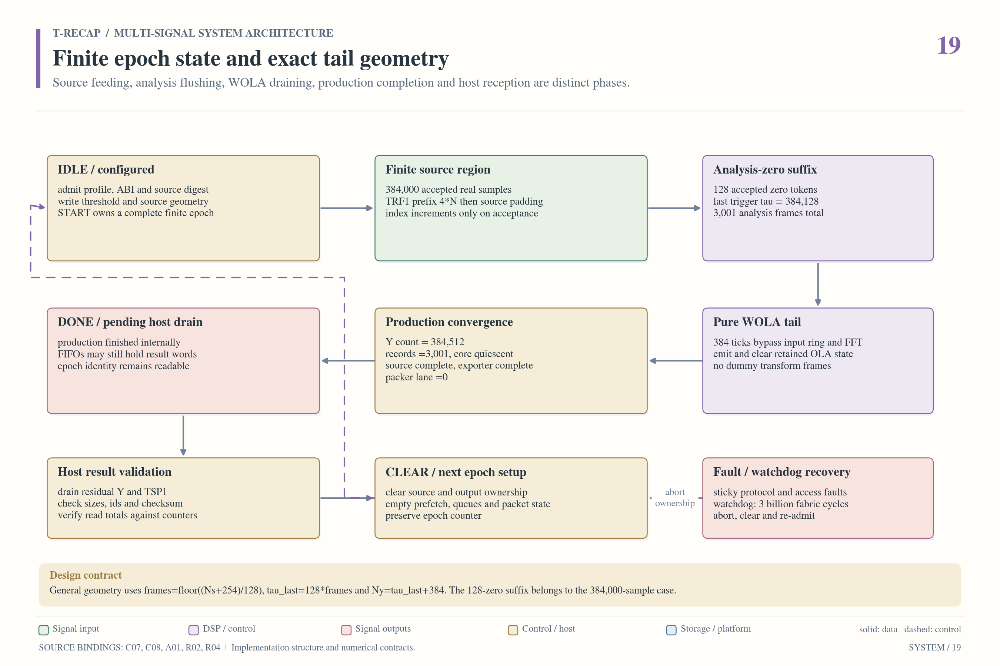

The admitted 384,000-sample geometry generates 384,128 analysis tokens, including 128 analysis zeros. At hop 128 this produces 3,001 frames. The first frame includes a conceptual zero left half. The source metadata records which input portion is valid data and which is padding.

After the final analysis frame, 384 WOLA-only ticks drain retained reconstruction history. They do not schedule FFT work. The exact reconstructed output count is 384,512. DONE also requires source completion, core quiescence, emitted spectral records and an empty partial-word packer.

The host may have drained earlier results before DONE, and may still need to drain remaining FIFO words afterward. It checks final totals before CLEAR. CLEAR preserves epoch numbering. Hardware reset restarts it. The 3-billion-cycle watchdog includes transport stalls and is nominally 60 seconds at 50 MHz.

| Block | Responsibility |
|---|---|
| IDLE / configured | Admit profile, ABI and source digest. write threshold and source geometry. START owns a complete finite epoch. |
| Finite source region | 384,000 accepted real samples. TRF1 prefix 4*N then source padding. index increments only on acceptance. |
| Analysis-zero suffix | 128 accepted zero tokens. last trigger tau = 384,128. 3,001 analysis frames total. |
| Pure WOLA tail | 384 ticks bypass input ring and FFT. emit and clear retained OLA state. no dummy transform frames. |
| Production convergence | Y count = 384,512. records =3,001, core quiescent. source complete, exporter complete. packer lane =0. |
| DONE / pending host drain | Production finished internally. FIFOs may still hold result words. epoch identity remains readable. |
| Host result validation | Drain residual Y and TSP1. check sizes, ids and checksum. verify read totals against counters. |
| CLEAR / next epoch setup | Clear source and output ownership. empty prefetch, queues and packet state. preserve epoch counter. |
| Fault / watchdog recovery | Sticky protocol and access faults. watchdog: 3 billion fabric cycles. abort, clear and re-admit. |

**Interpretation:** General geometry uses frames=floor((Ns+254)/128), tau_last=128*frames and Ny=tau_last+384. The 128-zero suffix belongs to the 384,000-sample case.

Source bindings: C07, C08, A01, R02, R04.

[Editable SVG](19-finite-epoch-lifecycle.svg) | [Vector PDF](19-finite-epoch-lifecycle.pdf)

## 20. Clock, reset and verification observability

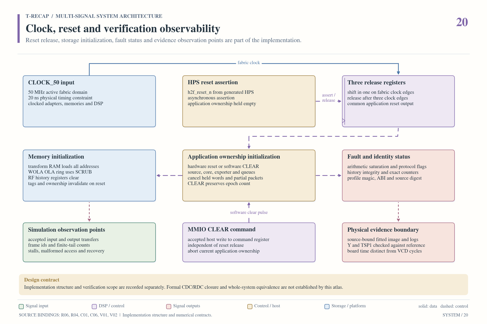

CLOCK_50 drives the active application fabric. HPS provides reset assertion and the retained wrapper uses a three-register release chain. Assertion is asynchronous and release shifts high on clock edges. Generated HPS CPU, DDR and Ethernet clocks belong to the platform boundary.

Transform RAM is loaded before compute instead of asynchronously cleared. WOLA storage is explicitly scrubbed. CLEAR cancels queue, prefetch, source, core, exporter and packer ownership together. RF history registers and finite-source counters follow the same abandoned-epoch boundary.

Checks observe accepted transfers, output identities, numerical values and exact counts. TSH2 UVM and formal results retain their module and assumption scope. TRF1 has its own simulation and source-bound board evidence. Source-derived diagrams connect implementation to evidence without claiming a new execution.

| Block | Responsibility |
|---|---|
| CLOCK_50 input | 50 MHz active fabric domain. 20 ns physical timing constraint. clocked adapters, memories and DSP. |
| HPS reset assertion | h2f_reset_n from generated HPS. asynchronous assertion. application ownership held empty. |
| Three release registers | Shift in one on fabric clock edges. release after three clock edges. common application reset output. |
| Fault and identity status | Arithmetic saturation and protocol flags. history integrity and exact counters. profile magic, ABI and source digest. |
| Application ownership initialization | Hardware reset or software CLEAR. source, core, exporter and queues. cancel held words and partial packets. CLEAR preserves epoch count. |
| Memory initialization | Transform RAM loads all addresses. WOLA OLA ring uses SCRUB. RF history registers clear. tags and ownership invalidate on reset. |
| Simulation observation points | Accepted input and output transfers. frame ids and finite-tail counts. stalls, malformed access and recovery. |
| MMIO CLEAR command | Accepted host write to command register. independent of reset release. abort current application ownership. |
| Physical evidence boundary | source-bound fitted image and logs. Y and TSP1 checked against reference. board time distinct from VCD cycles. |

**Interpretation:** Implementation structure and verification scope are recorded separately. Formal CDC/RDC closure and whole-system equivalence are not established by this atlas.

Source bindings: R06, R04, C01, C06, V01, V02.

[Editable SVG](20-clock-reset-observability.svg) | [Vector PDF](20-clock-reset-observability.pdf)

## Source review and reproduction

The source bindings below hash the public files used to review these views. The generator checks these identities and the artifact inventory. It does not execute RTL, access a board or rerun a hardware benchmark.

| ID | Published source |
|---|---|
| C01 | [rtl/core/trecap_core_top.sv](../../../rtl/core/trecap_core_top.sv) |
| C02 | [rtl/include/generated/trecap_core_pkg.sv](../../../rtl/include/generated/trecap_core_pkg.sv) |
| C03 | [rtl/fft/trecap_fft256.sv](../../../rtl/fft/trecap_fft256.sv) |
| C04 | [rtl/fft/trecap_ifft256.sv](../../../rtl/fft/trecap_ifft256.sv) |
| C05 | [rtl/core/trecap_mag2_mask.sv](../../../rtl/core/trecap_mag2_mask.sv) |
| C06 | [rtl/core/trecap_synthesis_wola.sv](../../../rtl/core/trecap_synthesis_wola.sv) |
| C07 | [verification/tsh2/rtl/trecap_pcm_stream_top.sv](../../../verification/tsh2/rtl/trecap_pcm_stream_top.sv) |
| C08 | [verification/tsh2/rtl/trecap_pcm_stream_source.sv](../../../verification/tsh2/rtl/trecap_pcm_stream_source.sv) |
| A01 | [profiles/tsh2/work/trecap_stream8_v01/rtl/trecap_stream_adapter.sv](../../../profiles/tsh2/work/trecap_stream8_v01/rtl/trecap_stream_adapter.sv) |
| A02 | [profiles/tsh2/work/trecap_laptop_fpga_v01/service/service.c](../../../profiles/tsh2/work/trecap_laptop_fpga_v01/service/service.c) |
| A03 | [profiles/tsh2/work/trecap_visualizer_v01/server.py](../../../profiles/tsh2/work/trecap_visualizer_v01/server.py) |
| A04 | [profiles/tsh2/work/trecap_visualizer_v01/data.py](../../../profiles/tsh2/work/trecap_visualizer_v01/data.py) |
| R01 | [profiles/trf1/adapter/rtl/trecap_rf_iq_adapter.sv](../../../profiles/trf1/adapter/rtl/trecap_rf_iq_adapter.sv) |
| R02 | [profiles/trf1/adapter/rtl/trecap_rf_file_source.sv](../../../profiles/trf1/adapter/rtl/trecap_rf_file_source.sv) |
| R03 | [profiles/trf1/adapter/coefficients/rf_coefficients.svh](../../../profiles/trf1/adapter/coefficients/rf_coefficients.svh) |
| R04 | [profiles/trf1/board/rtl/trecap_rf_board_adapter.sv](../../../profiles/trf1/board/rtl/trecap_rf_board_adapter.sv) |
| R05 | [profiles/trf1/board/host/trf1_client.c](../../../profiles/trf1/board/host/trf1_client.c) |
| R06 | [profiles/trf1/board/platform/trecap_hps_top.sv](../../../profiles/trf1/board/platform/trecap_hps_top.sv) |
| R07 | [profiles/trf1/board/rtl/stream_fifo.sv](../../../profiles/trf1/board/rtl/stream_fifo.sv) |
| R08 | [profiles/trf1/board/orchestration/capture.py](../../../profiles/trf1/board/orchestration/capture.py) |
| V01 | [verification/rf_iq/evidence/summary.json](../../../verification/rf_iq/evidence/summary.json) |
| V02 | [verification/tsh2/admission.json](../../../verification/tsh2/admission.json) |
| C09 | [rtl/core/trecap_input_ring.sv](../../../rtl/core/trecap_input_ring.sv) |
| C10 | [rtl/core/trecap_frame_scheduler.sv](../../../rtl/core/trecap_frame_scheduler.sv) |
| C11 | [rtl/core/trecap_analysis_window.sv](../../../rtl/core/trecap_analysis_window.sv) |
| C12 | [rtl/core/trecap_hermitian_canonicalizer.sv](../../../rtl/core/trecap_hermitian_canonicalizer.sv) |
| C13 | [rtl/core/trecap_spectrum_mask_builder.sv](../../../rtl/core/trecap_spectrum_mask_builder.sv) |
| C14 | [rtl/fft/trecap_fft_stage.sv](../../../rtl/fft/trecap_fft_stage.sv) |
| C15 | [rtl/common/round_sat.sv](../../../rtl/common/round_sat.sv) |
| C16 | [verification/tsh2/rtl/trecap_spectral_exporter.sv](../../../verification/tsh2/rtl/trecap_spectral_exporter.sv) |
| C17 | [verification/tsh2/rtl/trecap_core_export_observed.sv](../../../verification/tsh2/rtl/trecap_core_export_observed.sv) |

The accelerometer acquisition and axis-replay workflow was reviewed from local scripts. Their relative workspace identifiers and digests are preserved in `atlas_definitions.json`. These files are not bundled here, so the public checker does not claim to re-execute or revalidate that local acquisition workflow.

From the repository root:

```sh
python phase2/docs/architecture/system/build_atlas.py --check
```

To regenerate, install Matplotlib and Pillow, run the same script without `--check`, and compile `TRECAP_System_Architecture_Atlas.tex` twice with `pdflatex` from this directory. Review the rendered figures and pages, update `visual_review.json`, then run the generator with `--seal`. Rendering does not change source RTL or verification evidence.

The [audio atlas](../tsh2/README.md) and [RF specialist atlas](../rf_iq/README.md) retain their original detailed scopes. The [RF verification supplement](../../verification/rf_iq/README.md) contains the executed results behind the RF evidence summary.
