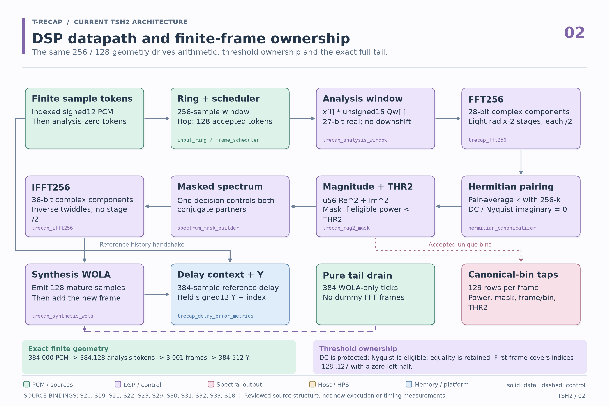
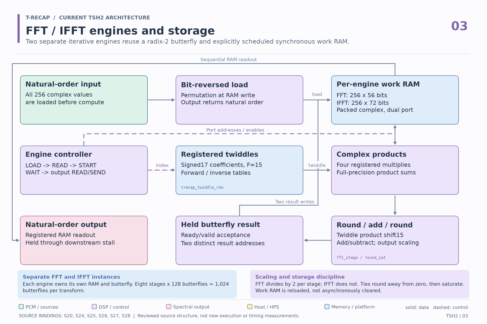
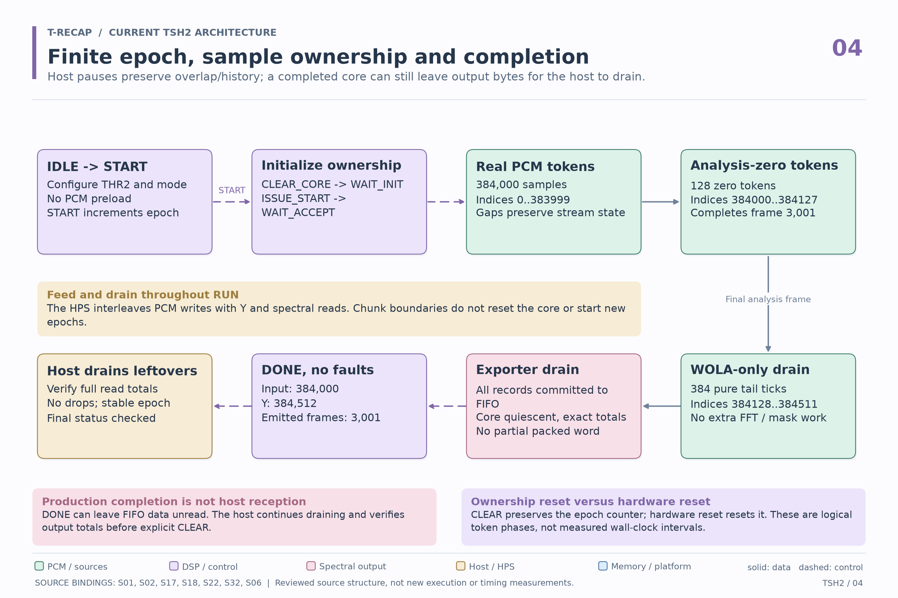
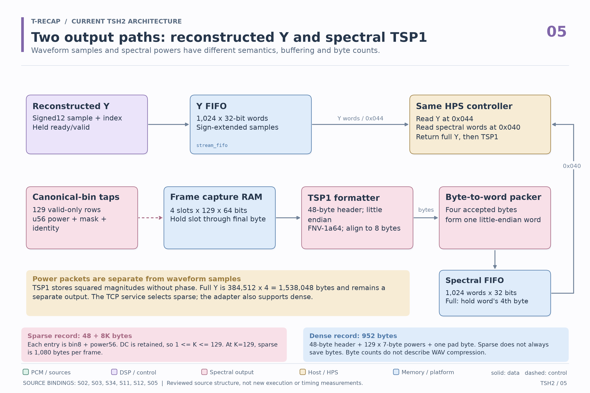
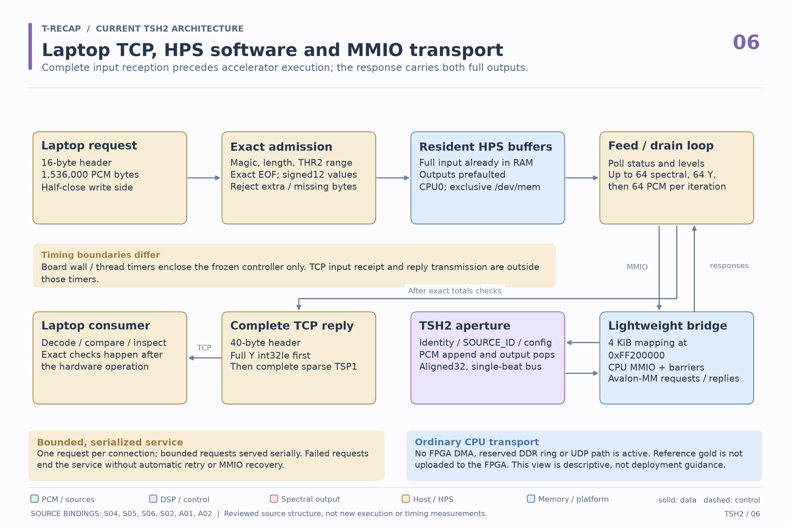
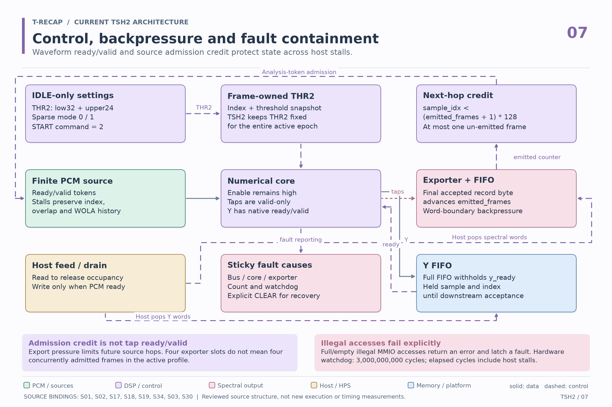
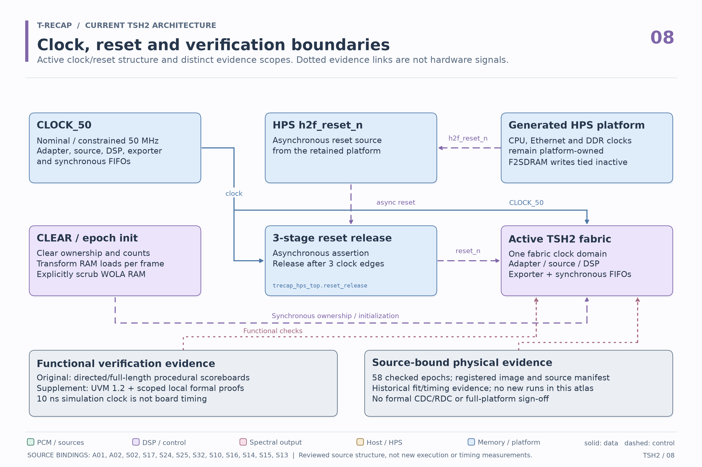

# Current TSH2 architecture atlas

These eight diagrams document the registered finite-file TSH2 application: laptop PCM over TCP, HPS software feeding and draining MMIO FIFOs, a fixed-point FPGA audio pipeline, and separate waveform and spectral outputs. They describe reviewed source structure. Creating this atlas performed no new synthesis, simulation, hardware execution or timing measurement.

The [historical architecture atlas](../diagrams/README.md) describes the broader 2026-09-14 design, including paths that are inactive here. The current profile does not activate its FPGA DDR ring, UDP telemetry or live codec/ADC input. Ordinary HPS Linux RAM remains part of the TCP service.

See the [TSH2 source snapshot](../../../profiles/tsh2/README.md), [portable verification package](../../../verification/tsh2/README.md), [accepted campaign evidence](../../results/verification_20261017/README.md), [UVM and formal supplement](../../verification/uvm_formal/README.md), and [project overview](../../../README.md) for their distinct scopes.

| View | PNG | Editable vector |
|---|---|---|
| 1. System architecture | [PNG](01-system.png) | [SVG](01-system.svg) |
| 2. DSP and finite frames | [PNG](02-dsp-finite-frames.png) | [SVG](02-dsp-finite-frames.svg) |
| 3. Transform memory | [PNG](03-transform-memory.png) | [SVG](03-transform-memory.svg) |
| 4. Finite epoch and feed/drain | [PNG](04-finite-epoch-feed-drain.png) | [SVG](04-finite-epoch-feed-drain.svg) |
| 5. TSP1 and Y outputs | [PNG](05-tsp1-y-outputs.png) | [SVG](05-tsp1-y-outputs.svg) |
| 6. TCP, HPS and MMIO | [PNG](06-tcp-hps-mmio.png) | [SVG](06-tcp-hps-mmio.svg) |
| 7. Configuration and backpressure | [PNG](07-configuration-backpressure.png) | [SVG](07-configuration-backpressure.svg) |
| 8. Clock, reset and verification | [PNG](08-clock-reset-verification.png) | [SVG](08-clock-reset-verification.svg) |

<a id="plate-01-system"></a>
## 1. System architecture


One START covers the complete 384,000-sample input and its finite tail. The HPS first receives the input in ordinary CPU RAM, then interleaves MMIO input writes with output reads. The diagram's HPS activities belong to one serialized service. Nominal 48 kHz sample interpretation and a 50 MHz fabric clock do not establish live or real-time throughput.

<a id="plate-02-dsp-finite-frames"></a>
## 2. DSP datapath and finite frames



The transform size is 256 with hop 128. The full run contains 384,128 analysis tokens, 3,001 frames and 384,512 Y samples. The first frame covers conceptual indices -128 through 127, with a zero left half. After the last analysis frame, 384 WOLA-only ticks drain the tail without dummy FFT frames.

The mask compares eligible squared magnitude with THR2 using strict less-than. Equality is retained, DC is protected and Nyquist is eligible. Canonical taps contain pre-mask power and the decision; the masked spectrum builder changes the complex bins. The separate solid reference-history branch provides sample context for the 384-sample error alignment. Current TSH2 does not export the broader historical METRICS/WAVE telemetry records.

<a id="plate-03-transform-memory"></a>
## 3. Transform engines and storage



The template is instantiated independently for FFT and IFFT. Each engine owns its own work RAM and butterfly; they do not share a single RAM. Eight radix-2 stages contain 128 butterflies each. Forward FFT divides by two at each stage. Inverse FFT uses inverse twiddles without that per-stage division. The arithmetic rounds ties away from zero and then saturates.

All work RAM locations load before compute. Scheduled reads and writes avoid read/write overlap, and each butterfly writes two distinct addresses. Work RAM contents are not asynchronously cleared. The structural schedule is not a measured transform, network or full-epoch latency.

<a id="plate-04-finite-epoch-feed-drain"></a>
## 4. Finite epoch and completion



For the registered 384,000-sample geometry, 128 analysis-zero tokens finish the analysis frames and 384 more ticks drain WOLA. For other admitted simulation lengths, use `frames = floor((Ns + 254) / 128)`, `tau_last = 128 * frames`, and `Ny = tau_last + 384`; do not assume the analysis flush is always 128 tokens.

DONE requires the exact production counts, core quiescence, completed exporter records and no partial packed word. It does not mean every output has reached the host or laptop. Earlier records may already have been drained, and the host checks final read totals before CLEAR. CLEAR preserves the epoch counter; hardware reset resets it.

<a id="plate-05-tsp1-y-outputs"></a>
## 5. Separate Y and TSP1 outputs



Y carries signed12 reconstructed samples in sign-extended 32-bit words. The full output is 1,538,048 bytes. TSP1 carries squared magnitudes without phase, so it cannot reconstruct audio by itself. Packet-size reductions describe this spectral representation, not the WAV size or the separate Y stream.

TSP1 uses a 48-byte little-endian header and FNV-1a64, not CRC. The checksum covers header bytes 0 through 39 plus payload/padding, excluding the checksum field itself. Sparse records use `48 + 8K` bytes, with bin8 plus power56 in each entry. DC remains present, so `1 <= K <= 129`. Dense records use 952 bytes. At threshold zero, sparse K=129 uses 1,080 bytes and is larger than dense. The finite TCP service selects sparse mode; lower-level adapter tests also support dense.

The packer can accept the first three bytes of a word while its FIFO is full; acceptance of the fourth byte requires space for the packed word. Exporter frame ownership lasts through acceptance of the final record byte.

<a id="plate-06-tcp-hps-mmio"></a>
## 6. TCP, HPS software and MMIO



One connection carries a 16-byte request header and 1,536,000 bytes of signed12 PCM represented as int32le. The client half-closes its write side so the service can reject extra or missing bytes before accelerator writes. The response contains a 40-byte header, full Y, then complete sparse TSP1. Reference gold is not sent to the FPGA.

The frozen host controller polls and interleaves batches of up to 64 spectral reads, 64 Y reads and 64 PCM writes. Its board wall/thread timers exclude TCP input reception and reply transmission. Laptop end-to-end timing has a different boundary. The service is bounded and serial; failed requests end it without automatic retry or MMIO recovery. These diagrams are not deployment instructions.

<a id="plate-07-configuration-backpressure"></a>
## 7. Configuration, backpressure and faults



THR2 and sparse mode are configured while idle and remain fixed through the active TSH2 epoch. The shared core also captures frame-owned threshold context. Source admission satisfies `sample_idx < (emitted_frames + 1) * 128`, bounding triggered-but-not-emitted frames to one. The counter advances on acceptance of the final record byte into the output path, not on laptop reception.

Taps remain valid-only. Export pressure limits future source hops instead of inventing a ready signal on those taps. Y has its own ready/valid backpressure and held data/index. Four exporter storage slots do not imply four concurrently admitted frames in this profile. Illegal full/empty or malformed MMIO accesses return an error and latch a sticky fault. The hardware watchdog is 3,000,000,000 fabric cycles, or nominally 60 seconds at 50 MHz. Elapsed fabric cycles include host stalls.

<a id="plate-08-clock-reset-verification"></a>
## 8. Clock, reset and evidence boundaries



The retained board top uses CLOCK_50 for the active fabric and a three-stage reset-release chain driven by HPS `h2f_reset_n`. Assertion is asynchronous; release shifts high over three clock edges. Software CLEAR and epoch initialization clear ownership, while WOLA storage is scrubbed explicitly. Transform work RAM is loaded per frame. Generated HPS CPU, Ethernet and DDR clocks remain platform-owned. The active F2SDRAM write input is tied inactive.

The public synthetic package checks the admitted stream/core/exporter closure at Ns=1,024. The broader accepted campaign contains two full 384,000-sample RTL simulations and 58 checked physical epochs. These scopes are distinct. Functional simulation uses a 10 ns clock, while the physical fabric constraint is 20 ns. VCD time is not board latency. No formal CDC/RDC, metastability proof, full code-coverage closure, PVT qualification or industrial certification is claimed.

The original RTL campaigns use procedural checks and exact scoreboards. The later [UVM and formal supplement](../../verification/uvm_formal/README.md) adds genuine UVM 1.2 execution and scoped local formal proofs against unchanged TSH2 RTL. Its 12 completed UVM epochs include three reset recoveries; three aborted prefixes are recorded separately. The preserved simulator startup failure and explicit bounded recovery remain part of that evidence. Local formal assumptions and exclusions apply; the supplement does not establish full-pipeline equivalence, concurrent-SVA coverage or formal CDC/RDC safety. Plate 8 distinguishes these evidence layers without changing the physical architecture.

## Editable sources and integrity

[atlas_definitions.json](atlas_definitions.json) holds the editable node rectangles, routed edges, captions, reviewed source notes and source hashes. [build_atlas.py](build_atlas.py) renders the same definitions as PNG and SVG. [atlas_manifest.json](atlas_manifest.json) binds the generator, definitions, 34 public source files and all 16 image artifacts.

Two board-wrapper sources are retained in the original build archive rather than supplied as public files. Their original hashes are matched against the [published fitted-source manifest](../../results/verification_20261017/source_bindings/fitted_source_manifest.json). This public check verifies those manifest entries; it cannot reopen the omitted original wrappers or rebuild the complete fitted image. The artifact identifiers are provenance references, not filesystem paths to open.

From the `phase2` directory, the integrity check needs only Python's standard library:

```sh
python docs/architecture/tsh2/build_atlas.py --repo-root . --output docs/architecture/tsh2 --check
```

To render into a new directory, use Python with Matplotlib and Pillow installed:

```sh
python docs/architecture/tsh2/build_atlas.py --repo-root . --output atlas-renders/attempt01
```

Existing nonempty output directories are rejected. Rendering checks text containment and orthogonal routes against unrelated nodes, then emits 2700 x 1800 PNGs and text-preserving SVGs. Visual review remains necessary after intentional layout edits. The checker requires the exact eight plate definitions and 16 associated images, validates their hashes and sizes, parses SVG XML, checks PNG dimensions, and rejects source or generator drift. Hashes establish identity, not functional correctness or a digital signature. A changed source snapshot requires a fresh content review and intentional regeneration.

## Source binding index

The IDs printed on each image resolve through the `sources` and `archived_source_bindings` arrays in the definitions and manifest. Public paths are relative to `phase2`. Original archive hashes are distinguished from hashes of the published derived evidence. Neither a source hash nor a diagram is a substitute for the [documented verification scope](../../../verification/README.md).
