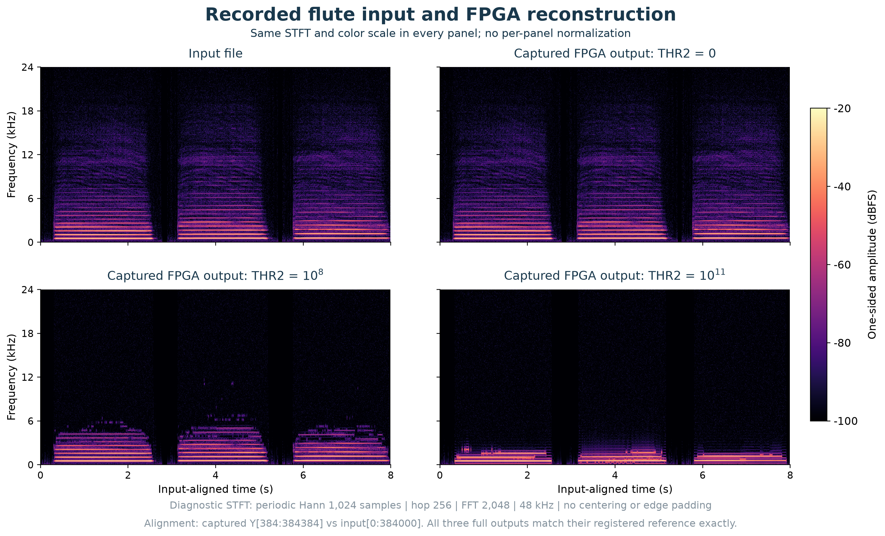
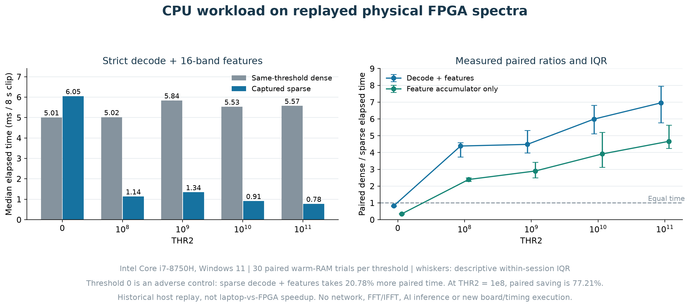
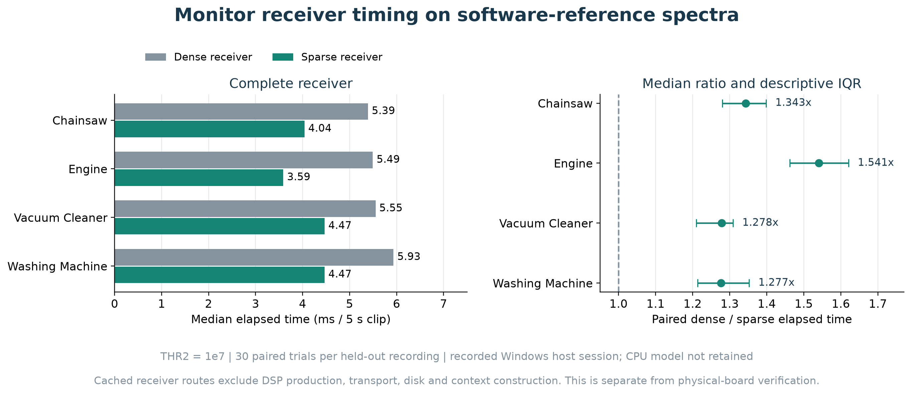

# Project overview figures and result provenance

This bundle supports the [main README](https://github.com/DatDinhh/T_RECAP#readme). It redraws selected measurements and supplies reviewable numerical tables. It performs **no new hardware run or timing experiment**. The reviewed repository baseline is commit `351ff6a8ef9f7ebd9893a531d71ac7626f95a0e2`.

## Evidence boundaries

| Result | Data origin | What it establishes |
|---|---|---|
| Flute waveform, spectrogram and packet sizes | Physical TSH2 release campaign, epochs 49 through 58 | Actual reconstructed outputs, spectral bytes and distortion across five thresholds |
| Flute laptop consumer timings | Earlier actual FPGA packets replayed on an Intel Core i7-8750H | Sparse versus same-threshold dense host-stage elapsed time |
| Monitor quality | Registered monitor pilot and later exact physical capture audit | Agreement with registered spectral/activity tolerances on the frozen held-out split |
| Complete monitor receiver timings | Windows host replay of software-reference spectra | Cached dense/sparse receiver cost including the same aggregation/event logic |
| RTL waveforms | Accepted simulator VCDs | Observed handshake, stall and recovery events within the displayed excerpts |
| Architecture drawing | Committed TSH2 service, adapter and stream-wrapper source | Current component responsibilities and data/control directions |

The archive identifiers in the provenance JSON files identify retained local source artifacts. They are not links to files promised in this repository. Raw recordings, runtime session identifiers and private captures are not included. Public physical evidence is a derived audit export with original hashes, not the entire raw hardware archive.

## Audio processing and spectra

The flute input has 384,000 signed 12-bit samples at nominal 48 kHz. For distortion plots, the captured output slice `Y[384:384384]` is compared with the input. Full numerical verification also checks the remaining leading/tail outputs, totaling 384,512 samples per epoch.

Spectrograms use a diagnostic 1,024-sample Hann window, a 256-sample hop, and a 2,048-point FFT, with a common frequency range and dBFS scale. These display parameters are different from the DUT's 256-point transform and 128-sample hop. The image is computed from captured reconstructed audio, not directly from TSP1 or substituted software output. Figure provenance records the exact input/capture hashes and display parameters.

The waveform-error denominator is the prepared input RMS. The dense spectral-size denominator is `3,001 × 952 = 2,856,952` bytes. Sparse encoding uses `48 + 8K` bytes per frame. Waveform transport and network framing are excluded from these spectral-size counts. At threshold zero, 129 retained bins make sparse encoding larger than dense encoding.

The [published physical flute metrics](../results/verification_20261017/metrics/flute_metrics.json) retain both repeats. They distinguish original-input distortion from exact agreement with the threshold-specific reference. Dataset credits are in [the campaign provenance](../results/verification_20261017/data_provenance/dataset_terms.json).

## Host work from actual FPGA packets

[Paired flute results](data/flute_downstream_paired.csv) are independently recomputed from the byte-identical [raw timing table](data/flute_downstream_raw_trials.csv). The host was an Intel Core i7-8750H running Windows 11. Each condition uses 30 measured matched trials; warmups are retained in the raw table and excluded from the reported statistics.

For each pair, percentage time saved is `100 × (dense_ms - sparse_ms) / dense_ms`. Reported percentages are medians of paired percentages, not a ratio of independently aggregated medians. Packet decoding/validation is included in the decode-plus-consumer stage; separate numerical equivalence checks are outside the timing boundary.

At `10^8`, dense and sparse decode-plus-feature medians are 5.01791 ms and 1.13780 ms per eight-second clip. Median paired time saved is 3.83659 ms, or 77.2067%. The consumer-only paired reduction is 58.2199%. At threshold zero, sparse is slower in both stages. No network, FPGA execution, file I/O or AI inference is timed.

This measures a 16-band integer consumer. Dense and sparse outputs match at a given threshold. It does not establish unchanged features relative to unthresholded audio, total CPU utilization, or a system-wide latency improvement.

## Spectral-activity monitor

The monitor computes band energies, peak frequency, centroid, and newly persistent band activity. It provides a concrete downstream use for retained spectra. It is an engineering monitor rather than a classifier for faults or sound identities.

The frozen natural held-out set contains four five-second recordings. At `THR2 = 10^7`, the results are:

| Recording category | Spectral bytes saved vs dense | Waveform NRMSE | Complete receiver paired dense/sparse ratio |
|---|---:|---:|---:|
| Chainsaw | 31.50% | 0.277% | 1.343x |
| Engine | 44.57% | 0.332% | 1.541x |
| Vacuum cleaner | 24.79% | 0.950% | 1.278x |
| Washing machine | 26.22% | 0.129% | 1.277x |

The byte/quality table uses the original five-second support. Physical verification padded inputs to an eight-second finite epoch and checked the entire returned output separately. The complete receiver ratios come from **software-reference spectral replay**, not new physical timing. Each recording has 30 paired measured trials, and the median across the four per-recording median ratios is 1.31073x. The campaign retained Windows 11 and Python 3.12.14 metadata but did not record the CPU model.

All four natural recordings passed the registered quality gate: at least 99% of valid dominant peaks remain within one 187.5 Hz bin, centroid error p95 is at most 187.5 Hz with no newly invalid groups, active-band error p95 is at most 10%, and worst-band error p95 is at most 20%. These were held-out software evaluation cases and later served as a physical replication set.

Only the chainsaw recording has positive baseline natural activity clusters: three, all retained. The other recordings have no baseline clusters. This is agreement with a threshold-zero baseline, not independently labeled detection accuracy. Eight separate synthetic controls require all five intended band-member events by onset plus 0.512 seconds and no extra clusters. Revision 02 followed calibration failures in revision 01; its held-out split remained frozen. Exact gates, source hashes and observed values are in the [review addendum](data/review_addendum.md).

All four sparse spectral streams are still larger than 480,000-byte PCM16 or 360,000-byte packed PCM12 for the same five-second input. A CPU task-summary-only alternative uses 6,552 bytes for 39 monitor groups, but discards fine-bin spectra. That format is not emitted by current FPGA RTL and its serialization was not timed. These controls prevent spectral sparsification from being presented as general audio compression.

See [quality and byte values](data/monitor_heldout_quality_and_bytes.csv), [paired receiver results](data/monitor_receiver_paired.csv), [all route summaries](data/monitor_routes_by_recording.csv), and [unchanged raw trials](data/monitor_raw_trials.csv).

## Verification visuals and source review

The topology, rounding, handshake, reset, waveform and packet-size PNGs are preserved from the accepted report figures. The spectrogram and host workload plots are newly drawn from archived observations. The generating script and figure provenance distinguish copied assets from derived figures.

The [public evidence ledger](../results/verification_20261017/README.md) and [LaTeX report](../verification/portfolio/README.md) define verification denominators, reused evidence, source identities, registered acceptance and remaining gaps. Original VCDs are linked from the main README. The historical source-bound fit is not relabeled as a new synthesis run.

The documentation audit inventoried **1,454 tracked files** at the baseline commit, classified their roles, checked current-profile and portable-package hashes, and focused source review on the claims used in the new README. It did not functionally retest every historical file. See the [review notes](data/readme_audit.md), [inventory summary](data/tracked_inventory_summary.json), [18-claim matrix](data/claims_matrix.csv), [claim source bindings](data/claim_source_bindings.json), and [independent timing audit](data/host_workload_audit.json).

The main README also records an unfavorable historical compute-only result. Six resident 1,024-sample jobs on the earlier TSH1 FPGA image each took 1.77048 ms, or 88,524 clocks at nominal 50 MHz. Laptop i7-8750H medians ranged from 0.28330 to 0.41865 ms, giving FPGA/laptop ratios of 4.23 to 6.25. These are ratios of separate medians; input/output transfers are excluded. The [source-bound addendum](data/review_addendum.json) independently reconciles 396 retained raw rows and identifies the original timing artifacts. This is not a current TSH2 or end-to-end benchmark.

## Files and integrity

- `data/PUBLICATION_FILES.json` binds the original 13 selected review/result files by SHA-256; the two review addenda are additionally bound by the bundle manifest.
- `figures/` contains the rendered README assets.
- The figure provenance and generating source document their source dependencies and reproduction limits.
- `manifest.json` binds this overview bundle for subsequent integrity checks.

Run `python phase2/docs/project_overview/check_bundle.py` from the repository root to verify the bundle's file inventory and SHA-256 hashes. See [figure notes](figures/FIGURE_NOTES.md) for plotting dependencies, source-data requirements and commands. The figure generator preserves archive dependencies explicitly; the public bundle does not contain the raw audio required to recreate captured-waveform plots.

This documentation update changes neither RTL nor the accepted numerical results. It adds a current architecture explanation and makes the existing evidence accessible without mixing incompatible profiles or timing boundaries.
