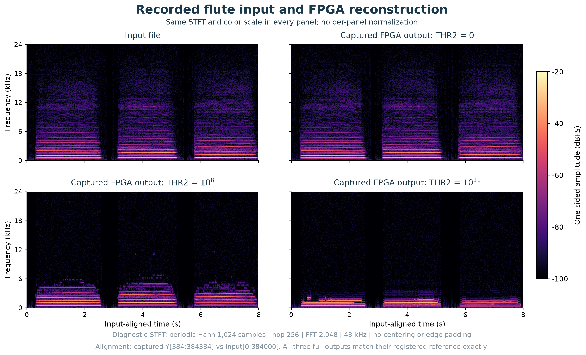
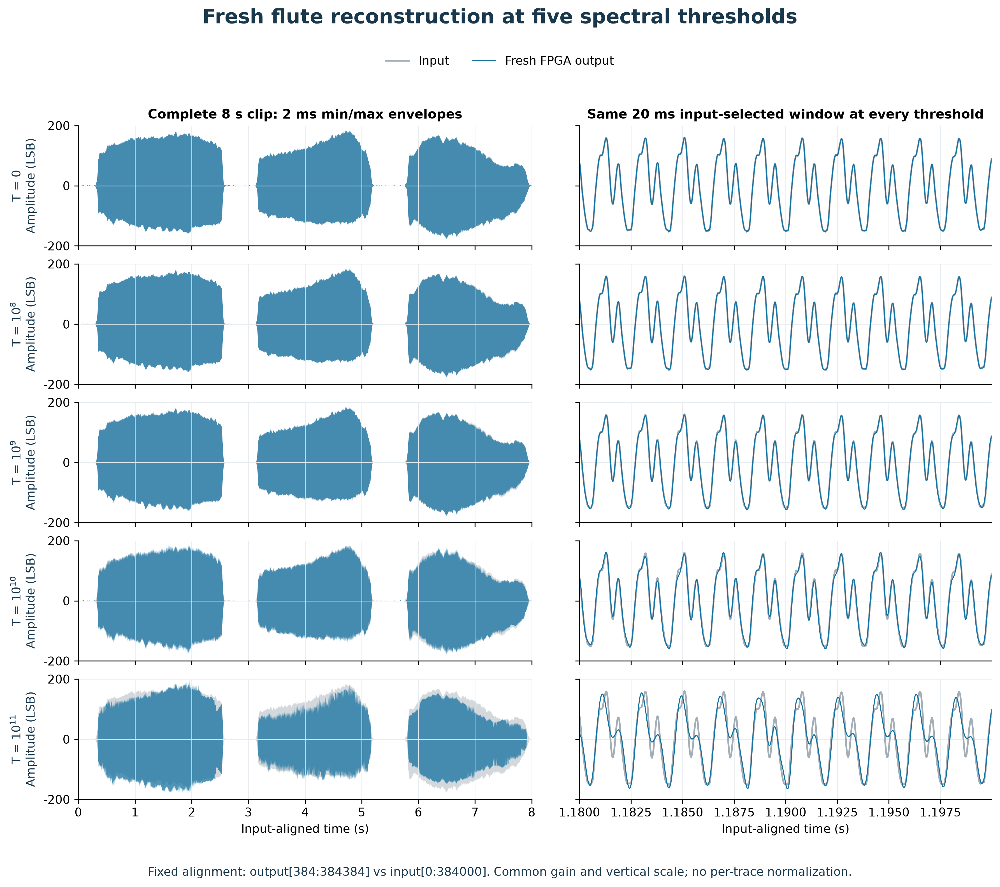
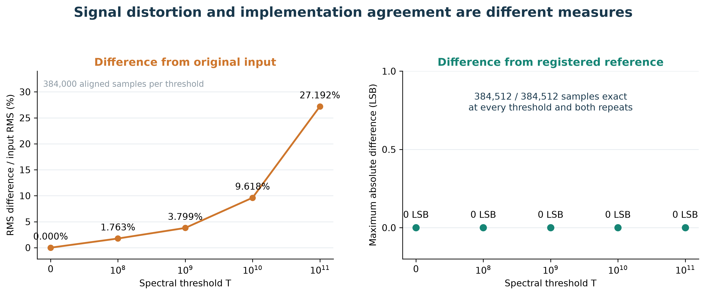
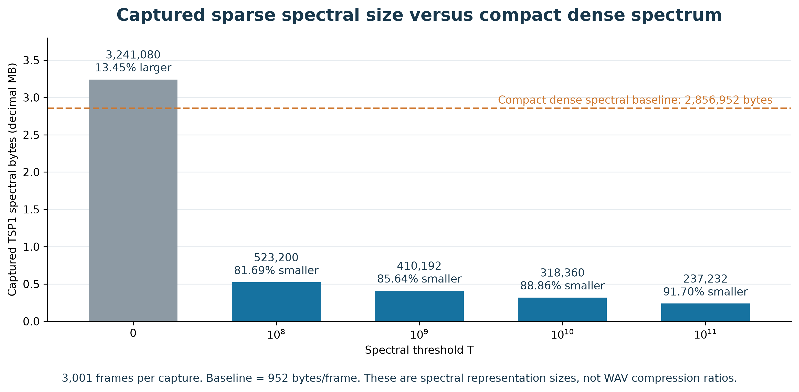
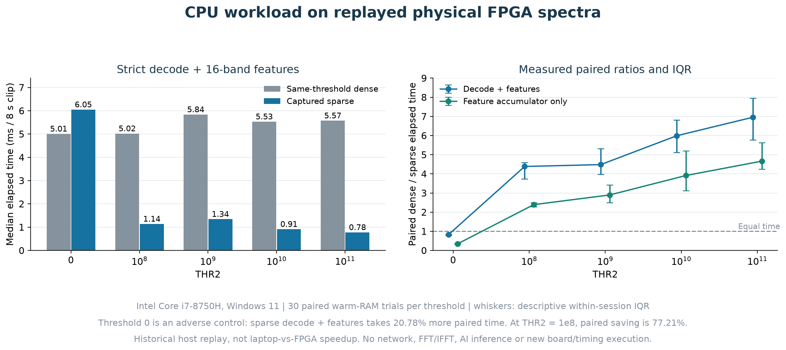
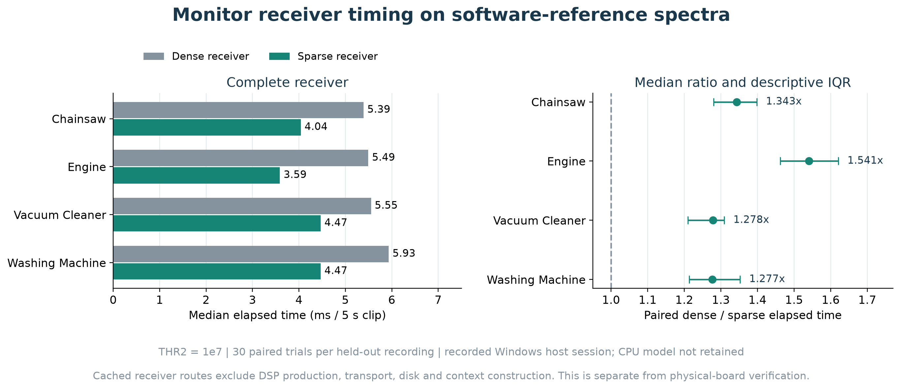
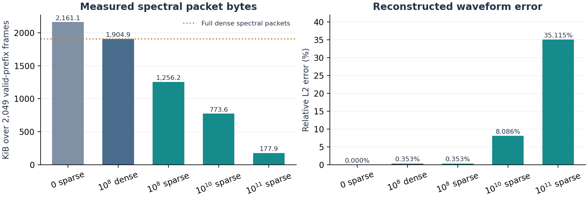

# Historical waveform and consumer benchmarks

[Three application studies](../applications/README.md) | [Benchmark provenance](README.md)

These supporting experiments characterize waveform distortion, spectral packet size and particular host consumers. They are retained for reproducibility. The project's application presentation uses audio preprocessing before FLAC, accelerometer step-event analysis and RF background suppression.

The flute excerpt is a benchmark input from Lawrence Fritts and the [University of Iowa Musical Instrument Samples collection](https://theremin.music.uiowa.edu/MIS.html). It is separate from the speech, piano and jazz clips in the audio application. Flute waveform error uses the already-quantized FPGA input as its reference. The FLAC application's reconstruction errors use the prepared original PCM16 reference.

## Flute waveform and packet benchmark

The following plots use the actual reconstructed waveform captured from the board. They show an eight-second flute excerpt credited to the University of Iowa Musical Instrument Samples collection. Output is aligned by the known 384-sample delay before comparison. The full output tail is still checked during verification.

The spectrograms use one shared scale. Threshold zero reproduces this prepared input exactly after alignment. Increasing the threshold removes weak spectral components. At high thresholds the audible waveform changes substantially. This is selective suppression, not a general-purpose denoising guarantee.

| `THR2` | Waveform NRMSE vs input | Sparse spectral bytes | Reduction vs dense spectral format |
|---:|---:|---:|---:|
| `0` | 0.00% | 3,241,080 | **13.45% larger** |
| `10^8` | 1.76% | 523,200 | 81.69% smaller |
| `10^9` | 3.80% | 410,192 | 85.64% smaller |
| `10^10` | 9.62% | 318,360 | 88.86% smaller |
| `10^11` | 27.19% | 237,232 | 91.70% smaller |

The dense baseline is **2,856,952 bytes** for the same 3,001 spectral frames. Sparse encoding adds an index to every retained bin, so it loses at threshold zero when all bins remain. These counts include TSP1 headers and padding but exclude the separately returned waveform and TCP/IP framing. They do not measure WAV compression or total network traffic reduction.

NRMSE is `100 × ||aligned_output - input||₂ / ||input||₂`. It measures total waveform error, not perceived quality. Every thresholded FPGA output matched its corresponding numerical reference exactly, even when it differed considerably from the input. A low aggregate error can also hide large relative losses in weak frequency bands.

The physical campaign also processed natural environmental recordings and synthetic signals. The [case ledger](../results/verification_20261017/hardware/cases.csv) identifies all 58 runs. The [benchmark provenance](README.md) explain the monitor quality gates and recording provenance. No new hardware execution was performed to redraw these overview figures.

## Historical 16-band consumer and monitor benchmarks

A dense consumer visits every spectral bin, including bins that the FPGA has already zeroed. A sparse consumer iterates over retained `(bin index, power)` entries. It can validate fewer bytes and skip arithmetic for omitted bins while producing the same thresholded features.

This experiment replays actual captured sparse FPGA packets from RAM on an **Intel Core i7-8750H**, with 3,001 frames per eight-second flute clip and 30 matched dense/sparse trials. The host re-encodes the same thresholded values into dense control packets. Those controls are not additional FPGA captures. Both paths produce identical integer 16-band features.

| Threshold | Feature computation: paired elapsed-time reduction | Packet validation + features: paired elapsed-time reduction |
|---:|---:|---:|
| `0` | 185.8% more time | 20.8% more time |
| `10^8` | 58.2% less time | 77.2% less time |
| `10^9` | 65.5% less time | 77.7% less time |
| `10^10` | 74.4% less time | 83.3% less time |
| `10^11` | 78.6% less time | 85.6% less time |

Percentages are medians of `100 × (dense_time - sparse_time) / dense_time` across 30 matched pairs. These are elapsed times for the measured consumer stages, with input already resident in RAM. FPGA execution, Ethernet, disk access, and AI inference are excluded. At `10^8`, the median paired saving for validation plus features is **3.84 ms per eight-second clip**. That is a small absolute saving for one stream. It establishes a benefit for this consumer, not a whole-laptop utilization reduction or an end-to-end system speedup. Raw trial extracts and calculation rules are linked in the [results guide](README.md).

A separate historical experiment evaluated a **causal spectral-activity monitor** with grouped band energy, peak frequency, centroid, and activity-change events. At `10^7`, all four held-out natural recordings passed its registered quality gates in the physical capture audit. A separate software-reference replay benchmark measured a dense/sparse receiver time ratio of **1.311x**, the median of four per-recording median paired ratios, with 30 pairs per recording. That receiver result has its own timing boundary and is not a fresh physical-board timing measurement.

### Findings that limit the claim

- In an earlier resident-compute comparison of six 1,024-sample jobs, the TSH1 FPGA implementation took **4.23 to 6.25 times** the i7-8750H laptop's median time. This is a historical compute-only result, not a new TSH2 timing measurement. Sparse host processing is a different benefit.
- The FFT/IFFT schedule still runs at every threshold. Fewer retained bins do not imply fewer FPGA transform cycles.
- Thresholding a waveform did not establish fewer YAMNet inference calls or an AI inference speedup. This benchmark evaluated a spectral monitor. The application studies have their own consumers and metrics.
- These benchmark measurements do not establish electrical energy savings, live-input acceptance, production reliability or recognition accuracy.

## Initial single-recording RF qualification

This qualification fixture is separate from the g001/g004 application study, in which g001 loses its decoded message at threshold 10^11. The initial physical RF campaign processed one public 0.262144-second OOK recording in five complete hardware epochs. All 1,922,560 returned Y samples and 8,518,600 TSP1 bytes matched their threshold-specific reference. The CPU decoder recovered the one expected payload at every tested setting.

| Threshold | Valid-interval spectral byte reduction against dense TSP1 | Relative L2 error against fixed-point adapter output |
|---|---:|---:|
| `10^8` | 34.06% | 0.353% |
| `10^10` | 59.39% | 8.086% |
| `10^11` | 90.66% | 35.115% |

Only the 2,049 frames touching valid input contribute to this table. Padding-only frames are excluded. The byte baseline is dense spectral packets, not raw CU8 file size. The error baseline excludes the adapter's own conversion error. Recovery of one payload demonstrates compatibility for that recording, not general protection of weak signals or arbitrary RF protocols. These results do not measure RF CPU workload or power savings.

The [RF verification report](../verification/rf_iq/README.md) preserves the original physical evidence separately from the fresh publication regression. These RF percentages belong to this fixture and campaign. The accelerometer application has separate physical captures and event-detection measurements.
