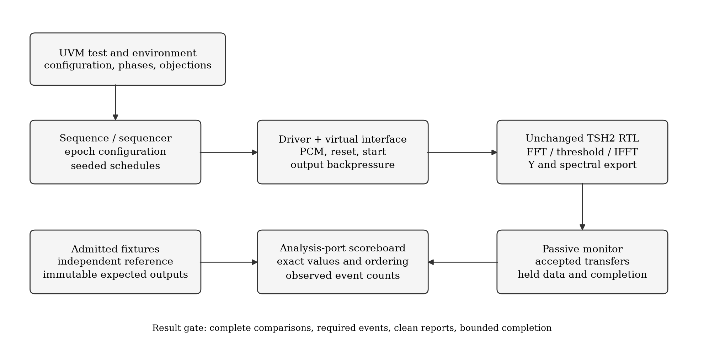
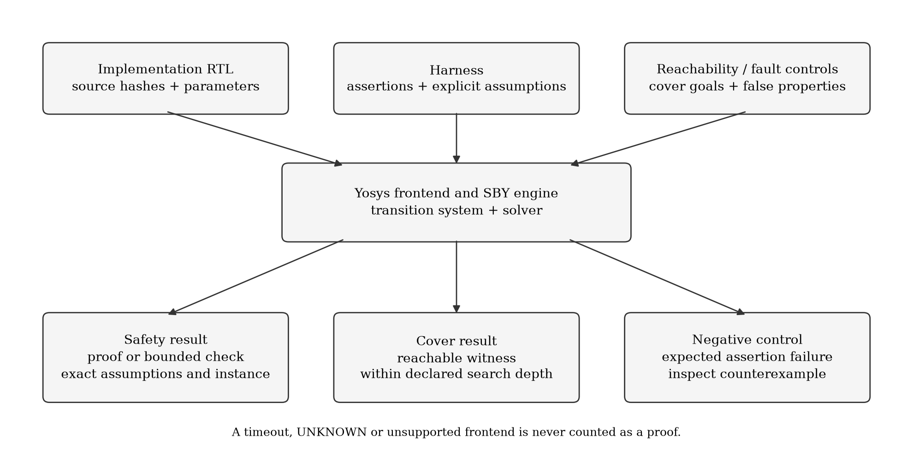
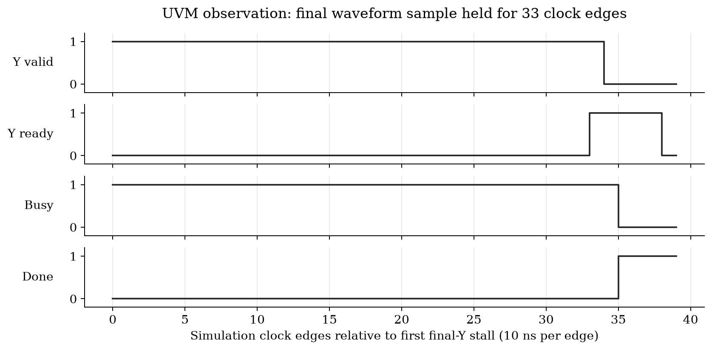
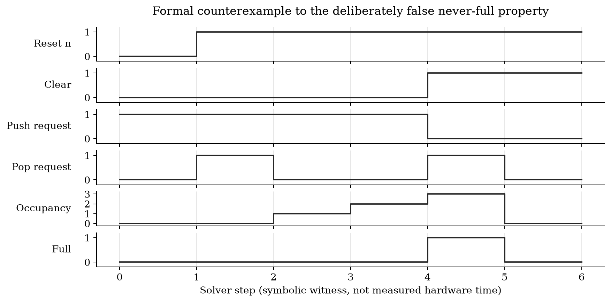

# UVM and formal verification supplement

Read [TRECAP_UVM_Formal_Report.pdf](TRECAP_UVM_Formal_Report.pdf), an academic article written in LaTeX with Latin Modern typography. This is an additive report for the unchanged finite-file TSH2 design. The [original portfolio](../portfolio/README.md) and its board results remain historical evidence.

The executed scope is 12 completed UVM epochs across three seeds, three interrupted prefixes, 16 formal safety/equivalence jobs, 14 bounded-cover jobs and three intentionally false formal properties. The UVM wrong-reference control also detects the intended mismatch. Reset recoveries are included in the 12 completed epochs. A simulator startup failure and its explicit bounded recovery are preserved in the UVM evidence.









## Files and traceability

- `main.tex` and the included `.tex` files are editable report source.
- `report_data.json` binds the accepted result counts and normalized independent review receipts.
- `waveform_data.json` records selected actual monitor samples, formal steps and input hashes.
- `review/` contains independent checker, source, proof and export audits. Some hashes identify raw local receipts; the package evidence indexes map original hashes to normalized public copies.
- `manifest.json` binds every report deliverable and all admitted UVM/formal publication files. `check_bundle.py` checks those byte identities without running simulation, proof or PDF compilation.

The UVM source, full run instructions and public receipts are in [verification/uvm](../../../verification/uvm/README.md). The formal property assumptions, runners and 68 native VCDs from the accepted matrix are in [verification/formal](../../../verification/formal/README.md). Four additional historical traces preserve superseded attempts.

## Rebuild

Use Python 3.12 and a local pdfLaTeX installation with the standard packages listed in `main.tex`:

```sh
python build.py --compiler /path/to/pdflatex
```

The builder runs two bounded passes with shell escape disabled and saves fresh attempt receipts. It does not download LaTeX packages. `build/` contains local compilation products and is not part of the committed report. The accepted PDF was rendered with Poppler and every page was visually reviewed.

Figure regeneration needs Matplotlib. From this report directory:

```sh
python plot_figures.py
python plot_waveforms.py \
  --uvm-timing ../../../verification/uvm/evidence/seed_1/timing.csv \
  --fifo-vcd ../../../verification/formal/evidence/fifo_negative_never_full/result/engine_0/trace.vcd
python check_bundle.py
```

Figure generation may change PDF metadata or renderer-dependent bytes; the integrity check intentionally detects any mismatch against the committed bundle. A new report release must be reviewed and its manifest deliberately regenerated. Plotted time is simulation/solver time, not measured hardware latency.

These results demonstrate scoped design-verification work. They do not establish whole-chip sign-off, full DSP equivalence, constrained-random or covergroup closure, production FIFO order, PCM FIFO proof, CDC/RDC safety or live microphone qualification.
